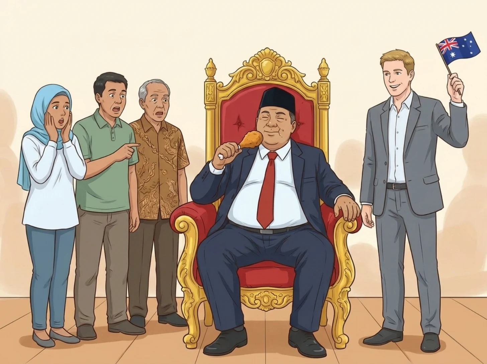
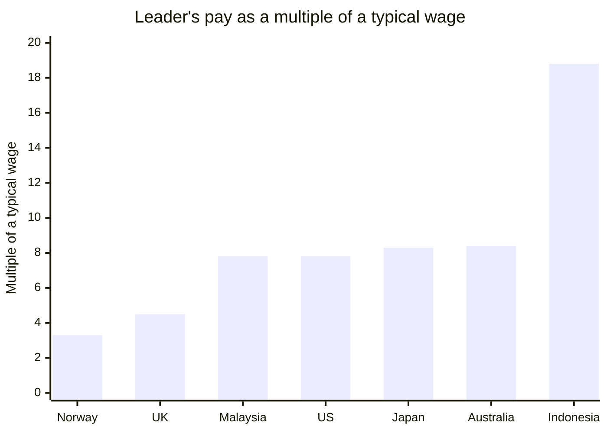

**In short:** Indonesian politicians' pay is far higher than Australia's once you measure it against what ordinary workers earn. Australia's Prime Minister earns 11.9 times the national minimum wage; Indonesia's president, 17.9 times the average provincial minimum wage. An Australian backbench MP's pay and allowances come to 6.0 times the minimum wage; a DPR member's to 21.1 times (18.7 after tax). With constituency funds, it is about 12 times against about 80. Then add Indonesia's lifetime perks for ex-presidents and its motorcades, against Australia's per-person expense reports, published every quarter.
{: .tldr}

* TOC
{:toc}

## What does power sound like in Jakarta?

In Jakarta, power has a soundtrack: a siren. You pull over, a convoy of black SUVs with strobe lights screams past, and somewhere inside is a minister, or just a member of parliament running late. You learn not to ask. I lived with that sound for more than 25 years. Then I moved to Perth, and in almost two years I have not seen a single motorcade. Not for a minister, not even for the Premier of Western Australia, the most powerful person in the state.

That silence made me curious, so I did what an engineer does with a feeling: I turned it into numbers. How much do the people who run each country take home, compared with the people at the bottom of the pay scale?

The answer, in one line: in Indonesia an official is treated like royalty, and in Australia an MP is treated like a manager. The pay is only part of it. The rest is the perks around the pay, the sirens, and whether the public can see where each dollar goes.

## Why is an Indonesian immigrant writing about Australian politicians?

Because Australia is the clearest mirror I have for Indonesia, not because Australians need me to explain their own country to them. A few disclaimers first, so nobody reads this as something it isn't.

- **This is not about salaries or the cost of living in Perth.** That is a different post.
- **This is not about how a developed country does everything better.** Maybe another post, one day.
- **This is not a love letter to the Australian government.** Plenty of Australians will disagree with how I describe their politicians, and they know them far better than I do. Labor, the Coalition, the Greens, One Nation: none of them are angels.

I grew up in Jakarta and lived in Indonesia for more than 25 years. I have lived in Perth for almost two. So please take this as an outsider's perspective: someone who knows the Indonesian side from the inside, and is still learning the Australian one.

## What is a "fair go", and why does it matter for what leaders earn?

A "fair go" is the Australian idea that everyone deserves an equal chance, whatever their background, and it matters because a culture built on it is suspicious of leaders who live above everyone else. Its partner is mateship: loyalty and solidarity between equals, and helping each other through hard times. Both are written into the Australian Values Statement that visa applicants sign.[^values]

Some history explains where that comes from. Australia began in 1788 as a British penal colony. The United States was founded partly by religious dissidents, and Canada kept close ties to Britain; Australia's first settlers were mostly convicts and the soldiers who guarded them. The convicts' resentment of the British class system is said to have left a culture that distrusts anyone who acts superior. Australians even have a name for cutting such people down to size: tall poppy syndrome.

Now the honest part. Australia is not the most equal country in the world. Its income Gini coefficient after tax was 0.307 in 2022-23,[^gini] and the Nordic countries are clearly more equal.[^oecd] Indonesia's Gini was 0.368 in March 2026, and that is measured on spending rather than income, which usually makes inequality look smaller than it is.[^gini]

The other honest part is money. Australia's GDP per person was about US$65,000 in 2025, Indonesia's about US$5,100: roughly 13 times less.[^imf] The average Australian punter is rich by world standards, which is why they walk around Bali like its de facto kings.

## How much does the Prime Minister earn compared with a minimum-wage worker?

Australia's Prime Minister earns about 11.9 times the national minimum wage, and Indonesia's president about 17.9 times the average provincial minimum wage.

In Australia, every federal MP gets a base salary of A$239,270 a year, and the Prime Minister gets a 160% loading on top: A$622,110 a year, or about A$51,843 a month. That rate has applied since 1 July 2025, and the Remuneration Tribunal decided on a 0% change from 1 July 2026, so it is still current.[^remtrib] The national minimum wage from 1 July 2026 is A$1,004.90 a week, the same in every state: A$52,255 a year, or about A$4,355 a month.[^fwo] A$622,110 / A$52,255 = 11.9 times.

In Indonesia, the president's pay is a base salary (*gaji pokok*) of Rp30,240,000 plus a position allowance of Rp32,500,000: Rp62,740,000 a month, unchanged since 2001.[^setkab] Indonesia has no single national minimum wage; each province sets its own UMP. The average across all 38 provinces in 2026 is Rp3,508,714 a month.[^ump] Rp62,740,000 / Rp3,508,714 = 17.9 times.

Fair's fair: a salary frozen for 25 years sounds almost modest. But the headline is not the full story, and the table below is where the two jobs really part ways.

| Item | Australia: Prime Minister | Indonesia: President |
| --- | --- | --- |
| Monthly salary | A$51,843 (A$622,110 a year) | Rp62,740,000 (base Rp30.24 million + allowance Rp32.5 million) |
| Multiple of the minimum wage | 11.9x the national minimum wage | 17.9x the average UMP |
| Extras in office | Official residence, full-time AFP protection | Palace; household, health and transport paid from the state's operational budget |
| Pension after office | No special PM pension: ordinary super, or the old MPs' scheme only if elected before 9 Oct 2004 | 100% of the last base salary (Rp30.24 million a month) |
| House after office | No | A house, furnished |
| Car and driver after office | No | A state car with a driver |
| Other after office | An office, 3 staff and capped domestic travel, for public duties | Water, electricity and phone bills; healthcare for the ex-president and family |

Australia closed its old defined-benefit parliamentary pension to new members on 9 October 2004; MPs elected after that, including every later Prime Minister, get ordinary accumulation super like any other worker.[^pcss] I'll concede the catch: former Prime Ministers who entered parliament before 2004 still draw the old scheme's pension. They get it because they were MPs before the cut-off, not because they were Prime Minister. There is no special "PM pension". What a former PM does get is an office, consistently three staff and a capped number of domestic trips, for public duties.[^formerpm]

An Indonesian ex-president, under Law 7 of 1978, keeps a pension of 100% of the last base salary, plus a house with furnishings, a state car with a driver, the household's water, electricity and phone bills, and healthcare for the whole family.[^uu7] The Australian package is a desk to keep doing public work. The Indonesian one is a household, paid for.

## How much does an MP take home in Jakarta versus Canberra?

A member of the DPR, Indonesia's 580-member House of Representatives, gets pay and allowances worth 21.1 times the average provincial minimum wage (18.7 times after tax), and about 80 times once recess funds are counted. An Australian backbench MP's pay and allowances come to 6.0 times the minimum wage, and about 12 times with everything included.

When you hear "DPR" in Indonesia, you picture immense power and a lot of money. In Australia, a backbench MP looks more like a manager or director at a mid-sized company: an executive, not royalty.

<figure>

<figcaption>Two ways to treat the people you elect. One gets a throne and a chicken leg, the other gets a small flag and a budget he has to report on.</figcaption>
</figure>

Here is an Australian backbench MP in the House of Representatives, per month:

- **Base salary:** A$239,270 a year, or A$19,939 a month.[^remtrib]
- **Electorate allowance:** paid to the MP and taxed, for the costs of serving the electorate. It is A$39,700, A$47,200 or A$57,100 a year depending on the electorate's size (May 2025).[^electorate] Taking the middle tier: A$3,933 a month.
- **Canberra travel allowance:** a fixed nightly rate, reported at about A$310 a night, for sitting days.[^travel] My estimate of about 80 nights a year gives about A$24,800 a year, or about A$2,067 a month.
- **Pay plus allowances:** about A$311,270 a year, or A$25,939 a month: 6.0 times the minimum wage of A$4,355 a month.
- **Office expenses budget**, money for constituency work rather than personal pay: A$170,631 plus A$1.272 per enrolled voter in 2025-26.[^office] For an electorate of about 121,000 voters, that is about A$324,000 a year, or about A$27,000 a month.
- **Everything together:** about A$636,000 a year, or about A$53,000 a month: roughly 12 times the minimum wage.

Electorate staff, paid separately, and Comcar, the government car service with a driver for parliamentary business, come on top, and I left them out of these totals.

Now a DPR member, after the allowances were cut at the end of August 2025.[^dpr]

- **Base salary:** Rp4,200,000 a month. Small, because almost all of the money comes as allowances.
- **Gross pay and allowances:** about Rp74.2 million a month. After about Rp8.6 million of income tax, the take-home is Rp65,595,730.
- **Before several allowances were cut**, the Rp50 million housing allowance among them, the total was reported at Rp104.1 million a month.
- **Recess funds (*dana reses*):** money for the recess, when members go back to their constituencies. About Rp500 million per recess since November 2025, cut from Rp702 million after a ruling by the DPR's ethics council (MKD), and about five recesses a year.[^reses] That is about Rp2.5 billion a year, or about Rp208 million a month.

Against the average UMP of Rp3.51 million, the take-home is 18.7 times; gross pay is 21.1 times; before the 2025 cut it was 29.7 times. Gross pay plus recess funds comes to about Rp282 million a month: about 80 times.

| Per month | Australian backbench MP (A$) | DPR member (Rp) |
| --- | --- | --- |
| Base pay | 19,939 | 4,200,000 |
| Allowances | 6,000 (electorate 3,933 + Canberra travel about 2,067, estimate) | about 70,000,000 |
| Gross pay | 25,939 | about 74,200,000 |
| Take-home | not computed (figures here are before tax) | 65,595,730 |
| Constituency funds | about 27,000 (office expenses budget) | about 208,000,000 (recess funds) |
| Total | about 53,000 | about 282,000,000 |
| Multiple of the minimum wage, pay only | 6.0x gross (4.6x base) | 21.1x gross (18.7x take-home) |
| Multiple of the minimum wage, everything | about 12x | about 80x |

In the table above, the like-for-like comparison is the gross row: 6.0 times in Australia, 21.1 times in Indonesia.

Now the DPR's side, because it deserves a hearing. Recess funds pay for constituency activities, not for the member's lifestyle, and the DPR will say so. Fair. But their use is reported in aggregate and is hard for the public to check, while Australia's comparable office budget is published per person, every quarter, by the Independent Parliamentary Expenses Authority (IPEA). Converted at about Rp12,500 to the Australian dollar (November 2026, rounded),[^fx] the DPR take-home is about A$5,250 a month, which sounds modest in Perth. That is exactly why the fair measure is local wages, not exchange rates.

What about size? Indonesia is about as wide as Australia: both span roughly 4,000 to 5,000 km, so travel distance doesn't explain the gap. Indonesia does have far more people per seat: about 284 million people for 580 DPR seats, or about 490,000 per member, against about 27.6 million for 150 House seats, or about 184,000 per member.[^pop] A DPR member represents about 2.7 times as many people. That is real. But measured against local wages, the pay gap is far bigger than 2.7 times.

## Why have I never seen a motorcade in Perth?

Because in Australia, almost nobody in politics gets one. In almost two years in Perth, I have not seen a single motorcade, not even for the WA Premier, who runs the state government.

The Australian Federal Police (AFP) protects "high office holders": the Governor-General, the Prime Minister, ministers, the Presiding Officers of parliament, and the Leader and Deputy Leader of the Opposition, as well as visiting dignitaries such as heads of state, the King included when he visits.[^afp] In practice, only the Prime Minister has full-time close personal protection; ministers get it when a risk assessment calls for it. A backbench MP has no escort and no permanent security. MPs can use Comcar for parliamentary business, but that is a car with a driver, not a convoy that clears the road.

In Jakarta, sirens and strobe lights for the president, ministers and even DPR members were a daily sight. In September 2025, ordinary road users had had enough: the "Stop tot tot wuk wuk" movement (named after the sound of the sirens) went viral, and the traffic police (Korlantas Polri) froze the use of sirens and strobes for escorts, though the escorts themselves continued. In late November 2025, they froze escort services altogether for evaluation.[^korlantas]

It took a viral meme to get a pause button. In Perth, nobody ever pressed play.

## What happens when an Australian politician misuses taxpayers' money?

It becomes national news, because every claim is published, per person, and anyone can read it.

Take Anika Wells, the Communications and Sport Minister. From late 2025 she faced scrutiny over taxpayer-funded travel, including a A$3,681 two-day trip to Adelaide in June 2025 that coincided with a Labor friend's birthday party. She said the trip was within the rules, and pointed out that the public only knew the details because she and her department had released them.[^wells-trip] The opposition still nicknamed her "Air-Miles Anika". She referred herself to IPEA; its 2026 audit cleared her New York trip but found four claims outside the rules. She repaid A$10,116 (A$8,093 plus a 25% penalty) and apologised for "honest mistakes".[^wells-repay]

Then there was family travel. Taxpayers spent more than A$4 million on travel for politicians' families since the 2022 election, as reported in December 2025. Four MPs charged more than A$100,000 each: Don Farrell, Fatima Payman, Patrick Gorman and Andrew Willcox, while others claimed less than A$1,000. Farrell's bill was A$116,306.[^family] After weeks of backlash, Prime Minister Albanese moved in December 2025 to restrict family reunion travel, including downgrading it from business class to economy.[^albanese]

I won't pretend this is nothing. Business-class flights for family members on the public's money is exactly the kind of thing a fair go should frown on, and Australians did frown. But look at the mechanism: the details were public because IPEA publishes every claim, per person, in quarterly reports. That's why a A$3,681 flight to Adelaide became a national story.

## And what about Indonesia's *perjalanan dinas*?

Official travel (*perjalanan dinas*) in Indonesia is where the comparison gets uncomfortable, because the public sees only audit totals, a year or more later. In my view, Australia's travel-expense scandals would look small next to it: the biggest bill any one Australian MP ran up, Don Farrell's A$116,306 in family travel since the 2022 election, is perhaps the size of a single trip for some Indonesian officials.

That is my opinion, but here is a number to anchor it. In its audit of 2023 spending, reported in June 2024, Indonesia's state auditor (BPK) found irregularities in official-travel spending worth Rp39.26 billion across 46 ministries and agencies, mostly trips that didn't match the rules and overpayments. BPK called official-travel findings recurring, and said they are often deliberate and fictitious.[^bpk]

Rp39.26 billion is the yearly minimum wage of about 930 workers at the 2026 average UMP. At about Rp12,500 to the dollar, it is about A$3.1 million.[^fx] That's for one year, and it is only the part that was irregular and that the auditors happened to catch. Australia's A$4 million family-travel bill covered more than three years and all of the spending, not just the irregular part, and it was still a scandal.

The deeper difference isn't the size of the sums. In Indonesia, the public sees an audit total a year or more later. In Australia, the public sees each person's bill every quarter.

## Is Indonesia an outlier, or is this normal?

Among the countries I compared, Indonesia is the outlier: its president earns 18.8 times a typical worker's wage, more than double the next country on the list.

To compare across countries, I divided the head of government's salary by a typical annual wage, using the median where one is published. The median works better than the minimum wage here, because some countries have no national minimum wage at all.

| Country | Leader's pay | Typical wage | Multiple |
| --- | --- | --- | --- |
| Norway | PM: NOK 2,234,978 a year (from 1 May 2026)[^norway] | Median NOK 55,800 a month x 12 = NOK 669,600 (2025) | 3.3x |
| United Kingdom | PM: £174,711 (MP £93,904 + ministerial £80,807, 2025-26)[^uk] | Median full-time £39,039 (April 2025) | 4.5x |
| Malaysia | PM: RM22,826.65 a month (declined by Anwar since November 2022)[^malaysia] | Median RM2,940 a month (2025) | 7.8x |
| United States | President: $400,000[^us] | BLS median annual wage $50,980 (2025) | 7.8x |
| Japan | PM: ¥40.49 million a year (statutory; Takaichi cut her own)[^japan] | National Tax Agency average private-sector salary ¥4.87 million (2025; no official median) | 8.3x |
| Australia | PM: A$622,110 (from 1 July 2025)[^remtrib] | Median A$1,425 a week x 52 = A$74,100 (August 2025)[^absmedian] | 8.4x |
| Indonesia | President: Rp62.74 million a month (since 2001)[^setkab] | BPS average wage of employees Rp3.33 million a month (August 2025)[^bpswage] | 18.8x |

The Indonesian number in the table above is, if anything, generous to Indonesia: BPS publishes an average wage, and a median would be lower, so the true multiple is likely higher.

I'll be honest about the selection, too. I left Singapore out, because it is a deliberate outlier: a city-state that pays its ministers like CEOs as an anti-corruption policy. Its Prime Minister earns S$3.6 million a year from 15 October 2026, against a median of S$5,775 a month: about 52 times.[^singapore] So Indonesia is not the highest in the world, and I'm not claiming it is.

The point is narrower and, I think, worse. Indonesia's president takes a bigger slice of his people's income than the leaders of richer, more equal democracies take of theirs. And this number doesn't even include the perks, the pension, or the DPR's allowances and recess funds.

## What would I rather argue about?

Policy. In Australia, I spend far less of my political energy on what officials do with taxpayers' money, and far more on the policies they make: what to do with the GST, how immigration should be handled, whether the capital gains tax discount is feeding the housing price crisis. Those are real arguments with two real sides, and I have opinions on all of them (just ask anyone who has sat next to me at a barbecue 😂).

That should be the bare minimum of political debate: arguing about what our leaders decide, not about what they help themselves to.

So is Indonesia's gap just what a big, crowded country looks like? No. Indonesia is about as wide as Australia, and Australia's MPs still live like managers. What Indonesia has is f\*cked-up incentives and opacity: generous pay and perks, sirens on demand, and spending the public can only see in aggregate, a year or more late. None of that is a law of nature. All of it is a choice, and choices can be changed.

**In Jakarta, you see the motorcade but never the bill; in Perth, you see the bill but never the motorcade.**

I'll admit it: what I feel in Perth, as an immigrant, is a quiet envy. Not of the salaries. Of the silence on the road, and of the boring, itemised reports that make the silence possible.

If you are Indonesian, here is one small thing to start with: ask for the receipts. Per person, published, every quarter, the way IPEA does it for every Australian MP. Then judge your representatives by what they publish, not by how loud their sirens are.

*[DPR]: Dewan Perwakilan Rakyat, Indonesia's House of Representatives
*[UMP]: Upah Minimum Provinsi, Indonesia's provincial minimum wage
*[IPEA]: Independent Parliamentary Expenses Authority
*[AFP]: Australian Federal Police
*[BPK]: Badan Pemeriksa Keuangan, Indonesia's state audit agency
*[BPS]: Badan Pusat Statistik, Statistics Indonesia
*[MKD]: Mahkamah Kehormatan Dewan, the DPR's ethics council
*[GST]: Goods and Services Tax
*[GDP]: Gross Domestic Product

## References

[^values]: Department of Home Affairs, [Australian values](https://immi.homeaffairs.gov.au/help-support/meeting-our-requirements/australian-values): the Australian Values Statement, including a "fair go" and mateship.
[^gini]: Australian Bureau of Statistics, [Income and wealth inequality](https://www.abs.gov.au/statistics/measuring-what-matters/measuring-what-matters-themes-and-indicators/prosperous/income-and-wealth-inequality): Gini coefficient of equivalised disposable household income, 0.307 in 2022-23. Bisnis.com, [Rasio gini Maret 2026 naik menjadi 0,368](https://ekonomi.bisnis.com/read/20260805/9/1993850/ketimpangan-makin-lebar-rasio-gini-maret-2026-naik-menjadi-0368), 5 August 2026, reporting BPS. BPS measures inequality in household spending, not income; because better-off households save more of what they earn, a spending-based Gini usually understates income inequality, so the two figures are not a perfect like-for-like comparison.
[^oecd]: OECD, Income Distribution Database: the Nordic countries (Iceland, Norway, Denmark, Sweden and others) have lower income Gini coefficients than Australia.
[^imf]: IMF, [World Economic Outlook, GDP per capita, current prices](https://www.imf.org/external/datamapper/NGDPDPC@WEO), October 2025: about US$65,000 for Australia and about US$5,100 for Indonesia in 2025.
[^remtrib]: Remuneration Tribunal, [2026 Remuneration Review Statement](https://www.remtribunal.gov.au/sites/default/files/2026-06/2026%20Remuneration%20Review%20Statement%20-%20FINAL.pdf) (0% change from 1 July 2026) and [Members of Parliament Determination 2026](https://www.remtribunal.gov.au/sites/default/files/2026-08/RT%20Members%20of%20Parliament%20determination%202026.PDF): base salary A$239,270 from 1 July 2025, Prime Minister's loading 160%, so A$622,110 a year.
[^fwo]: Fair Work Ombudsman, [Annual Wage Review 2026](https://www.fairwork.gov.au/about-us/workplace-laws/annual-wage-review/annual-wage-review-2026): national minimum wage A$1,004.90 a week (A$26.44 an hour) from 1 July 2026. A$1,004.90 x 52 = A$52,255 a year.
[^setkab]: Sekretariat Kabinet, [Gaji Presiden dan Wakil Presiden tidak berubah sejak 2001](https://setkab.go.id/bantah-kabar-kenaikan-istana-gaji-presiden-dan-wakil-presiden-tidak-berubah-sejak-2001/): base salary Rp30,240,000 plus position allowance Rp32,500,000 a month.
[^ump]: Bisnis.com, [Kenaikan rata-rata UMP 2026](https://ekonomi.bisnis.com/read/20260121/12/1946028/kenaikan-rata-rata-ump-2026-di-bawah-khl-menaker-bilang-begini), 21 January 2026, citing the Ministry of Manpower: average UMP 2026 across 38 provinces Rp3,508,714 a month, up 5.91%.
[^pcss]: Department of Finance, [Overview of the Parliamentary Superannuation Act 2004](https://finance.gov.au/government/superannuation/parliamentary-superannuation/overview-parliamentary-superannuation-act-2004): the Parliamentary Contributory Superannuation Scheme closed to new members on 9 October 2004. AAP FactCheck, [Hanson's $300,000 PM pension claim way off the money](https://www.aap.com.au/factcheck/hansons-300000-pm-pension-claim-way-off-the-money/), 2025: there is no special pension for being Prime Minister.
[^formerpm]: Parliamentary Library, [Former Prime Ministers' entitlements](https://www.aph.gov.au/About_Parliament/Parliamentary_departments/Parliamentary_Library/Research/FlagPost/2026/February/FormerPrimeMinistersEntitlements), FlagPost, February 2026: an office, three staff and a capped number of domestic trips, for public duties.
[^uu7]: Law No. 7 of 1978 on the financial and administrative rights of the President and Vice President and former Presidents and Vice Presidents, [BPK legal database](https://peraturan.bpk.go.id/Details/47167): pension of 100% of the last base salary, a furnished house, a state car with a driver, household water, electricity and phone bills, and healthcare for the former president and family.
[^electorate]: Department of Finance, Members of Parliament Staff and Resources, [Electorate allowance](https://maps.finance.gov.au/node/1032), May 2025: A$39,700, A$47,200 or A$57,100 a year, depending on the size of the electorate.
[^travel]: Independent Parliamentary Expenses Authority, [Travel allowance](https://www.ipea.gov.au/node/43085), rates set by the Remuneration Tribunal; about A$310 a night for Canberra, as reported in the press in 2025. The 80 nights a year is my own estimate for sitting days.
[^office]: Department of Finance, [Office expenses budget](https://maps.finance.gov.au/offices-resources-and-budgets/office-expenses-budget), 2025-26: A$170,631.24 plus A$1.272 per enrolled voter for House members. My calculation for 121,000 voters: A$170,631 + A$1.272 x 121,000 = about A$324,000.
[^dpr]: detik.com, [Take home pay DPR usai pangkas banyak tunjangan Rp 65,5 juta](https://news.detik.com/berita/d-8098119/take-home-pay-dpr-usai-pangkas-banyak-tunjangan-rp-65-5-juta), September 2025; Kontan, [Resmi, tunjangan perumahan dihapus](https://nasional.kontan.co.id/news/resmi-tunjangan-perumahan-dihapus-ini-sisa-gaji-tunjangan-anggota-dpr-terbaru), September 2025: base salary Rp4.2 million, gross about Rp74.2 million, income tax about Rp8.6 million, take-home Rp65,595,730; Rp104.1 million before several allowances were cut, including the Rp50 million housing allowance, dropped from 31 August 2025.
[^reses]: CNN Indonesia, [DPR recess funds cut to Rp500 million after the MKD ruling](https://www.cnnindonesia.com/nasional/20251106111135-32-1292542/dasco-sebut-dana-reses-anggota-dpr-jadi-rp500-juta-imbas-putusan-mkd), 6 November 2025: from Rp702 million to about Rp500 million per recess, about five recesses a year.
[^fx]: Market exchange rate, about Rp12,500 per Australian dollar, November 2026, rounded.
[^pop]: Population about 284 million (BPS, 2025) and about 27.6 million (ABS, 2025); 580 DPR seats (DPR) and 150 House of Representatives seats (Parliament of Australia).
[^afp]: Australian Federal Police, [Close personal protection](https://afp.gov.au/our-services/national-policing-services/personal-protection-close-personal-protection/MPprotection): protection for high office holders and visiting dignitaries.
[^korlantas]: The Jakarta Post, [Police halt use of sirens, strobe lights following public outcry](https://www.thejakartapost.com/indonesia/2025/09/22/police-halt-use-of-sirens-strobe-lights-following-public-outcry), 22 September 2025; Antara, [Police suspend sirens and strobes in escorts amid public backlash](https://en.antaranews.com/amp/news/381173/police-suspend-sirens-and-strobes-in-escorts-amid-public-backlash), September 2025; Kontan, [Layanan pengawalan tot tot wuk wuk dibekukan](https://nasional.kontan.co.id/news/layanan-pengawalan-tot-tot-wuk-wuk-dibekukan-aturan-sirene-dan-strobo-diperketat), November 2025.
[^wells-trip]: The Nightly, [Anika Wells forced to defend taxpayer-funded trips](https://thenightly.com.au/politics/anika-wells-forced-to-defend-taxpayer-funded-trips-as-new-details-emerge-about-other-costs-c-20918274), December 2025.
[^wells-repay]: AAP via The Leader, [Minister repays taxpayers after travel rule breaches](https://www.theleader.com.au/story/9242403/minister-repays-taxpayers-after-travel-rule-breaches/), 2026.
[^family]: AAP via newsbeep, [family travel costs](https://www.newsbeep.com/300998/), December 2025; ABC News, [Nationals MPs' high family travel bill highlights generous rules](https://www.abc.net.au/news/2025-12-11/nationals-mps-high-family-travel-bill-highlights-generous-rules/106126842), 11 December 2025.
[^albanese]: The New Daily, [MP expenses change](https://www.thenewdaily.com.au/news/politics/australian-politics/2025/12/23/mp-expenses-change), 23 December 2025.
[^bpk]: Bisnis.com, [Temuan BPK: masalah perjalanan dinas PNS bikin negara rugi Rp39,26 miliar](https://ekonomi.bisnis.com/read/20240609/9/1772443/temuan-bpk-masalah-perjalanan-dinas-pns-bikin-negara-rugi-rp3926-miliar), 9 June 2024, on BPK's audit of 2023 spending. Rp39.26 billion / (Rp3,508,714 x 12) = about 930 workers' yearly UMP.
[^norway]: Altinget, [Norges statsminister får lønstigning](https://www.altinget.dk/artikel/norges-statsminister-faar-loenstigning-men-er-stadig-langt-fra-mette-frederiksen), 2026: NOK 2,234,978 a year from 1 May 2026. Statistics Norway (SSB), [Hva er vanlig lønn i Norge?](https://www.ssb.no/arbeid-og-lonn/lonn-og-arbeidskraftkostnader/artikler/hva-er-vanlig-lonn-i-norge): median monthly earnings NOK 55,800, 2025.
[^uk]: GOV.UK, [Ministerial salary data](https://www.gov.uk/government/publications/ministerial-salary-data), 2025-26: MP salary £93,904 plus Prime Minister's ministerial salary £80,807. ONS, [Annual Survey of Hours and Earnings 2025](https://www.ons.gov.uk/employmentandlabourmarket/peopleinwork/earningsandworkinghours/bulletins/annualsurveyofhoursandearnings/2025): median gross annual earnings for full-time employees £39,039, April 2025.
[^us]: AFL-CIO, [Executive Paywatch](https://aflcio.org/paywatch), 2025, citing the Bureau of Labor Statistics median annual wage of $50,980. The US President's salary is $400,000 a year.
[^malaysia]: Malay Mail, [PM, ministers to take 20pc pay cut](https://www.malaymail.com/news/malaysia/2022/12/05/pm-ministers-to-take-20pc-pay-cut-until-countrys-economy-recovers/43593), 5 December 2022: Prime Minister's basic salary RM22,826.65 a month. DOSM, [Salaries and Wages Survey Report](https://www.dosm.gov.my/portal-main/release-content/salaries-and-wages-survey-report-2024): median monthly salary RM2,940 (2025).
[^japan]: [Prime Minister of Japan](https://en.wikipedia.org/wiki/Prime_Minister_of_Japan), Wikipedia: statutory annual pay ¥40.49 million. nippon.com, reporting the National Tax Agency's survey of private-sector salaries: average ¥4.87 million (2025).
[^absmedian]: Australian Bureau of Statistics, [Employee earnings, August 2025](https://www.abs.gov.au/statistics/labour/earnings-and-working-conditions/employee-earnings/aug-2025): median weekly earnings A$1,425. A$1,425 x 52 = A$74,100.
[^bpswage]: BPS, [Keadaan ketenagakerjaan Indonesia Agustus 2025](https://www.bps.go.id/id/pressrelease/2025/11/05/2479/keadaan-ketenagakerjaan-.html), 5 November 2025: average wage of employees Rp3.33 million a month.
[^singapore]: The Jakarta Post / Reuters, [Singapore PM's annual salary to rise](https://www.thejakartapost.com/world/2026/09/08/singapore-pms-annual-salary-to-rise-64-to-285-million-), 8 September 2026: S$3.6 million a year from 15 October 2026. Ministry of Manpower, [Gross monthly income tables 2025](https://stats.mom.gov.sg/Pages/Gross-Monthly-Income-Tables2025.aspx): median S$5,775 a month. S$3.6 million / (S$5,775 x 12) = about 52 times.
