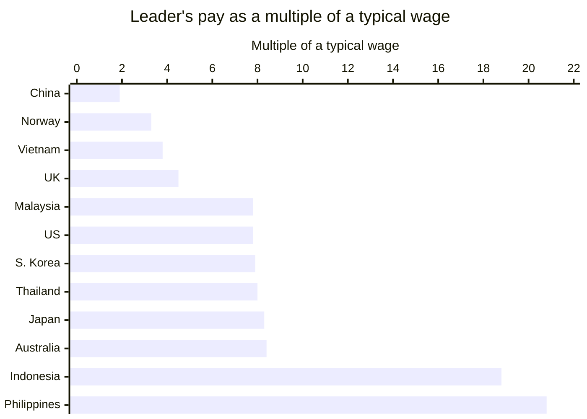
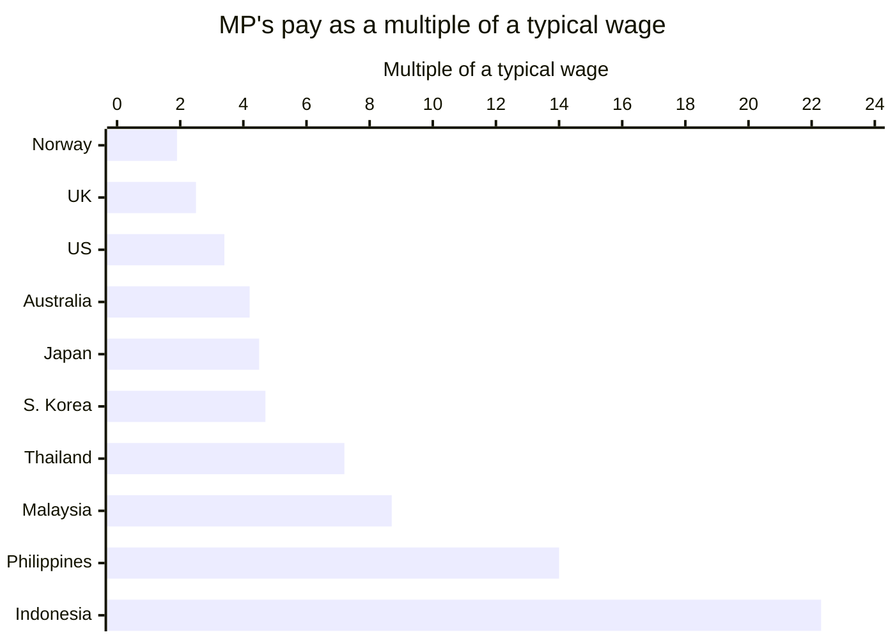

**In short:** Indonesian politicians' pay is far higher than Australia's once you measure it against what ordinary workers earn. Australia's Prime Minister earns 8.4 times the median Australian wage; Indonesia's president, 18.8 times the average Indonesian wage. In parliament the gap is wider still: an Australian backbench MP's pay and allowances come to 4.2 times the median wage, a DPR member's to 22.3 times (19.7 after tax). With constituency funds, it is about 8.6 times against about 85. Then add Indonesia's lifetime perks for ex-presidents, its motorcades and its billion-rupiah study tours, against Australia's per-person expense reports, published every quarter.
{: .tldr}

* TOC
{:toc}

## What does power sound like in Jakarta?

In Jakarta, sirens and convoys of black SUVs were a daily sight. I lived with them for more than 25 years. In almost two years in Perth, I have not seen a single motorcade, not even for the Premier of Western Australia.

That contrast made me curious: how much do the people who run each country take home, compared with ordinary workers?

The pay is only part of the comparison. There are also the perks, the escorts and whether the public can see where the money goes.

## Why is an Indonesian immigrant writing about Australian politicians?

Australia is the clearest comparison I have for Indonesia. This is an outsider's perspective, not an endorsement of the Australian government: I know the Indonesian side from the inside and am still learning the Australian one.

## What is a "fair go", and why does it matter for what leaders earn?

A "fair go" is the Australian idea that everyone deserves an equal chance, whatever their background, and it matters because a culture built on it is suspicious of leaders who live above everyone else. Its partner is mateship: loyalty and solidarity between equals, and helping each other through hard times. Both are written into the Australian Values Statement that visa applicants sign.[^values]

Australia is not the most equal country in the world. Its income Gini coefficient after tax was 0.307 in 2022-23,[^gini] and the Nordic countries are clearly more equal.[^oecd] Indonesia's Gini was 0.368 in March 2026, measured on spending rather than income, which usually makes inequality look smaller than it is.[^gini]

Australia's GDP per person was about US$65,000 in 2025, Indonesia's about US$5,100: roughly 13 times less.[^imf]

## How much does the Prime Minister earn compared with a typical worker?

Australia's Prime Minister earns about 8.4 times the median Australian wage, and Indonesia's president about 18.8 times the average Indonesian wage.

Why not the minimum wage? Because in Indonesia it says little about what most people earn. BPS puts the average employee wage at Rp3.33 million a month (August 2025), which is barely the average provincial minimum wage (UMP) of 2025, about Rp3.31 million, and already behind the 2026 average of Rp3.51 million.[^bpswage][^ump] The average worker earns roughly the legal minimum. BPS publishes only the average, and a few very high earners pull an average up, so the median is probably lower still. If anything, the Indonesian multiples in this post are conservative.

In Australia, every federal MP gets a base salary of A$239,270 a year, and the Prime Minister gets a 160% loading on top: A$622,110 a year, or about A$51,843 a month. That rate has applied since 1 July 2025, and the Remuneration Tribunal decided on a 0% change from 1 July 2026, so it is still current.[^remtrib] The median Australian employee earned A$1,425 a week in August 2025: about A$74,100 a year.[^absmedian] A$622,110 / A$74,100 = 8.4 times.

In Indonesia, the president's pay is a base salary (*gaji pokok*) of Rp30,240,000 plus a position allowance of Rp32,500,000: Rp62,740,000 a month, unchanged since 2001.[^setkab] Rp62,740,000 / Rp3,330,000 = 18.8 times.

A salary frozen for 25 years sounds modest, but it leaves out the benefits during and after office:

| Item | Australia: Prime Minister | Indonesia: President |
| --- | --- | --- |
| Monthly salary | A$51,843 (A$622,110 a year) | Rp62,740,000 (base Rp30.24 million + allowance Rp32.5 million) |
| Multiple of a typical wage | 8.4x the median wage | 18.8x the average wage |
| Extras in office | Official residence, full-time AFP protection | Palace; household, health and transport paid from the state's operational budget |
| Pension after office | No special PM pension: ordinary super, or the old MPs' scheme only if elected before 9 Oct 2004 | 100% of the last base salary (Rp30.24 million a month) |
| House after office | No | A house, furnished |
| Car and driver after office | No | A state car with a driver |
| Other after office | An office, 3 staff and capped domestic travel, for public duties | Water, electricity and phone bills; healthcare for the ex-president and family |

Australia closed its old defined-benefit parliamentary pension to new members on 9 October 2004; MPs elected after that get ordinary accumulation super like any other worker.[^pcss] Former Prime Ministers who entered parliament before the cut-off can still receive the old scheme's pension, but there is no special pension for being Prime Minister. Former Prime Ministers also get an office, three staff and a capped number of domestic trips, for public duties.[^formerpm]

An Indonesian ex-president, under Law 7 of 1978, keeps a pension of 100% of the last base salary, plus a house with furnishings, a state car with a driver, the household's water, electricity and phone bills, and healthcare for the whole family.[^uu7]

## How much does an MP take home in Jakarta versus Canberra?

A member of the DPR, Indonesia's 580-member House of Representatives, gets pay and allowances worth 22.3 times the average Indonesian wage (19.7 times after tax), and about 85 times once recess funds are counted. An Australian backbench MP's pay and allowances come to 4.2 times the median Australian wage, and about 8.6 times with everything included.

<figure>

<figcaption>Two ways to treat the people you elect. One gets a throne and a chicken leg, the other gets a small flag and a budget he has to report on.</figcaption>
</figure>

Here is an Australian backbench MP in the House of Representatives, per month:

- **Base salary:** A$239,270 a year, or A$19,939 a month.[^remtrib]
- **Electorate allowance:** paid to the MP and taxed, for the costs of serving the electorate. It is A$39,700, A$47,200 or A$57,100 a year depending on the electorate's size (May 2025).[^electorate] Taking the middle tier: A$3,933 a month.
- **Canberra travel allowance:** a fixed nightly rate, reported at about A$310 a night, for sitting days.[^travel] My estimate of about 80 nights a year gives about A$24,800 a year, or about A$2,067 a month.
- **Pay plus allowances:** about A$311,270 a year, or A$25,939 a month: 4.2 times the median wage of A$6,175 a month.[^absmedian]
- **Office expenses budget**, money for constituency work rather than personal pay: A$170,631 plus A$1.272 per enrolled voter in 2025-26.[^office] For an electorate of about 121,000 voters, that is about A$324,000 a year, or about A$27,000 a month.
- **Everything together:** about A$636,000 a year, or about A$53,000 a month: roughly 8.6 times the median wage.

Electorate staff, paid separately, and Comcar, the government car service with a driver for parliamentary business, come on top, and I left them out of these totals.

Now a DPR member, after the allowances were cut at the end of August 2025.[^dpr]

- **Base salary:** Rp4,200,000 a month. Small, because almost all of the money comes as allowances.
- **Gross pay and allowances:** about Rp74.2 million a month. After about Rp8.6 million of income tax, the take-home is Rp65,595,730.
- **Before several allowances were cut**, the Rp50 million housing allowance among them, the total was reported at Rp104.1 million a month.
- **Recess funds (*dana reses*):** money for the recess, when members go back to their constituencies. About Rp500 million per recess since November 2025, cut from Rp702 million after a ruling by the DPR's ethics council (MKD), and about five recesses a year.[^reses] That is about Rp2.5 billion a year, or about Rp208 million a month.

Against the average wage of Rp3.33 million, the take-home is 19.7 times; gross pay is 22.3 times; before the 2025 cut it was 31.3 times. Gross pay plus recess funds comes to about Rp282 million a month: about 85 times.

| Per month | Australian backbench MP | DPR member |
| --- | --- | --- |
| Base pay | A$19,939 | Rp4,200,000 |
| Allowances | A$6,000 (electorate A$3,933 + Canberra travel about A$2,067, estimate) | about Rp70 million |
| Gross pay | A$25,939 | about Rp74.2 million |
| Take-home | not computed (figures here are before tax) | Rp65,595,730 |
| Constituency funds | about A$27,000 (office expenses budget) | about Rp208 million (recess funds) |
| Total | about A$53,000 | about Rp282 million |
| Multiple of a typical wage, pay only | 4.2x the median (3.2x base) | 22.3x the average (19.7x take-home) |
| Multiple of a typical wage, everything | about 8.6x | about 85x |

In the table above, the like-for-like comparison is the gross row: 4.2 times in Australia, 22.3 times in Indonesia.

Recess funds pay for constituency activities, not for the member's lifestyle. Their use is reported in aggregate and is hard for the public to check, while Australia's comparable office budget is published per person, every quarter, by the Independent Parliamentary Expenses Authority (IPEA). Converted at about Rp12,500 to the Australian dollar (November 2026, rounded),[^fx] the DPR take-home is about A$5,250 a month. That sounds modest in Perth, which is why I compare pay against local wages rather than exchange rates.

What about size? Indonesia is about as wide as Australia: both span roughly 4,000 to 5,000 km, so travel distance doesn't explain a gap this big.

## Beyond the pay, why do Indonesian officials act as if they own the road?

In almost two years in Perth, I have not seen a political motorcade, not even for the WA Premier.

The Australian Federal Police (AFP) protects "high office holders": the Governor-General, the Prime Minister, ministers, the Presiding Officers of parliament, and the Leader and Deputy Leader of the Opposition, as well as visiting dignitaries such as heads of state, the King included when he visits.[^afp] In practice, only the Prime Minister has full-time close personal protection; ministers get it when a risk assessment calls for it. A backbench MP has no escort and no permanent security. MPs can use Comcar for parliamentary business, but that is a car with a driver, not a convoy that clears the road.

In Jakarta, sirens and strobe lights for the president, ministers and even DPR members were a daily sight. In September 2025, ordinary road users had had enough: the "Stop tot tot wuk wuk" movement (named after the sound of the sirens) went viral, and the traffic police (Korlantas Polri) froze the use of sirens and strobes for escorts, though the escorts themselves continued. In late November 2025, they froze escort services altogether for evaluation.[^korlantas]

## What happens when officials blow taxpayers' money on travel?

Australia's expense reporting lets the public scrutinise individual trips. Indonesia's study tours show how much harder that scrutiny can be.

Take Anika Wells, the Communications and Sport Minister. From late 2025 she faced scrutiny over a two-day trip to Adelaide in June 2025, costing A$3,681, that coincided with a Labor friend's birthday party.[^wells-trip] The opposition nicknamed her "Air-Miles Anika". She referred herself to IPEA, whose 2026 audit found four claims outside the rules; she repaid A$10,116 (A$8,093 plus a 25% penalty) and apologised.[^wells-repay] Taxpayer-funded family travel got the same treatment: more than A$4 million since the 2022 election,[^family] enough for Prime Minister Albanese to restrict it in December 2025 and move those families from business class to economy.[^albanese]

Now the Indonesian version. In October 2010, eight members of the DPR's ethics council (*Badan Kehormatan*, BK) and three expert staff flew to Greece for six days to study parliamentary ethics and Greece's smoke-free parliament. The budget was Rp2.2 billion, about Rp200 million per person.[^bk-greece] The council's own chair, Gayus Lumbuun, refused to go, saying the same material was available at the Greek embassy in Jakarta, and ten NGOs later complained to the ethics council itself that the eight had taken a sightseeing detour to Turkey.[^bk-turkey] At about Rp12,500 to the dollar,[^fx] Wells's Adelaide trip was about Rp46 million. Each ethics-council traveller cost more than four times that, in 2010 rupiah, before a cent of inflation. The irony: the BK's job is to police the DPR's ethics.

Nor are today's rules any tighter. Under the Finance Minister's regulation PMK 32/2025, a DPR member travelling abroad gets a daily allowance of US$347 to US$792 (about Rp5.7 million to Rp13 million) per person, per day, before flights and hotels. The top rate is for the UK, where one day's allowance is almost four times the average Indonesian monthly wage.[^per-diem] It took the mass protests of late August 2025 for the DPR to put a moratorium on overseas working visits from 1 September 2025, and even that exempts state invitations.[^moratorium]

In its audit of 2023 spending, reported in June 2024, about five months after that year closed, Indonesia's state auditor (BPK) found irregular official-travel spending worth Rp39.26 billion across 46 ministries and agencies, fictitious trips included.[^bpk] In Australia, IPEA publishes individual politicians' claims every quarter rather than just an aggregate total.

## Is Indonesia an outlier, or is this normal?

Among the countries I compared, Indonesia is near the very top: its president earns 18.8 times the average Indonesian wage, second only to the Philippines at 20.8 times. The other ten, neighbours such as Malaysia, Thailand, Vietnam and South Korea included, all sit below 9 times.

I used the same yardstick as for Australia and Indonesia: the leader's salary divided by the median wage, or by the average wage where no official median is published.

| Country | Leader's pay | Typical wage | Multiple |
| --- | --- | --- | --- |
| China | President: CN¥136,620 a year (base pay, set in 2015)[^china] | Average urban private-sector wage CN¥71,590 a year (2025) | 1.9x |
| Norway | PM: NOK 2,234,978 a year (from 1 May 2026)[^norway] | Median NOK 55,800 a month x 12 = NOK 669,600 (2025) | 3.3x |
| Vietnam | PM: ₫31,625,000 a month (from 1 July 2026)[^vietnam] | Average worker income ₫8,400,000 a month (2025) | 3.8x |
| United Kingdom | PM: £174,711 (MP £93,904 + ministerial £80,807, 2025-26)[^uk] | Median full-time £39,039 (April 2025) | 4.5x |
| Malaysia | PM: RM22,826.65 a month[^malaysia] | Median RM2,940 a month (2025) | 7.8x |
| United States | President: US$400,000[^us] | BLS median annual wage US$50,980 (2025) | 7.8x |
| South Korea | President: ₩271.77 million a year (2026)[^korea] | Median ₩2.88 million a month (December 2024) | 7.9x |
| Thailand | PM: ฿125,590 a month[^thailand] | Average employee wage ฿15,675 a month (Q1 2026) | 8.0x |
| Japan | PM: ¥40.49 million a year (statutory)[^japan] | National Tax Agency average private-sector salary ¥4.87 million (2025; no official median) | 8.3x |
| Australia | PM: A$622,110 (from 1 July 2025)[^remtrib] | Median A$1,425 a week x 52 = A$74,100 (August 2025)[^absmedian] | 8.4x |
| Indonesia | President: Rp62.74 million a month (since 2001)[^setkab] | BPS average wage of employees Rp3.33 million a month (August 2025)[^bpswage] | 18.8x |
| Philippines | President: ₱449,157 a month (from 1 January 2026)[^philippines] | Average full-time wage ₱21,544 a month (2024) | 20.8x |

The two highest multiples, Indonesia's 18.8 and the Philippines' 20.8, are if anything too low. Indonesia's is an average, and a median would most likely be lower. The Philippine wage comes from a survey of formal businesses with at least ten workers, which leaves out the informal sector, where pay is lower.

Ordinary MPs show the same pattern. For each country I added up the salary and the fixed allowances paid to a backbench MP personally, and divided by the same typical wage as in the leaders' table. Office budgets, staff and constituency funds, the DPR's recess money included, are left out. On that measure a DPR member earns 22.3 times the average Indonesian wage, the highest of the ten countries and well clear of the Philippines in second place at 14.0. MPs in Norway, the UK and the US get between 2 and 3.5 times what their people earn.

| Country | MP's pay and allowances | Typical wage | Multiple |
| --- | --- | --- | --- |
| Norway | NOK 1,272,209 a year (from 1 May 2026)[^mp-norway] | Median NOK 669,600 a year (2025) | 1.9x |
| United Kingdom | £98,599 a year (from 1 April 2026)[^mp-uk] | Median full-time £39,039 (April 2025) | 2.5x |
| United States | US$174,000 a year (unchanged since 2009)[^mp-us] | BLS median annual wage US$50,980 (2025) | 3.4x |
| Australia | About A$311,270 a year (base salary, electorate allowance, Canberra travel allowance)[^remtrib][^electorate][^travel] | Median A$74,100 a year (August 2025)[^absmedian] | 4.2x |
| Japan | About ¥21.7 million a year (salary and bonuses)[^mp-japan] | Average private-sector salary ¥4.87 million (2025) | 4.5x |
| South Korea | About ₩161 million a year (2026)[^mp-korea] | Median ₩2.88 million a month (December 2024) | 4.7x |
| Thailand | ฿113,560 a month[^mp-thailand] | Average employee wage ฿15,675 a month (Q1 2026) | 7.2x |
| Malaysia | RM25,700 a month (RM16,000 base plus fixed allowances)[^mp-malaysia] | Median RM2,940 a month (2025) | 8.7x |
| Philippines | ₱300,961 a month (base salary only, from 1 January 2026)[^mp-philippines] | Average full-time wage ₱21,544 a month (2024) | 14.0x |
| Indonesia | About Rp74.2 million a month (gross, September 2025)[^dpr] | BPS average wage of employees Rp3.33 million a month (August 2025)[^bpswage] | 22.3x |

China and Vietnam are missing from the MP table on purpose. Most of their legislators are part-time and keep their day jobs, so there is no MP salary to compare fairly. The Philippine figure is too low as well: it is the base salary of a member of the House of Representatives, and their allowances, which are large, aren't published in detail.

## What would I rather argue about?

In Australia, I spend less of my political energy on what officials do with taxpayers' money and more on their policies: what to do with the GST, how immigration should be handled, and whether the capital gains tax discount is feeding the housing price crisis.

That should be the bare minimum of political debate: arguing about what our leaders decide, not about what they help themselves to.

Indonesia's generous pay and perks, escorts and opaque spending are choices, not inevitable consequences of being a big country. They can be changed.

**In Jakarta, you see the motorcade but never the bill; in Perth, you see the bill but never the motorcade.**

What I envy in Perth is the silence on the road and the boring, itemised expense reports.

Ask for the receipts: per person, published every quarter, as IPEA does for Australian MPs. Judge your representatives by what they publish, not by how loud their sirens are.

*[DPR]: Dewan Perwakilan Rakyat, Indonesia's House of Representatives
*[UMP]: Upah Minimum Provinsi, Indonesia's provincial minimum wage
*[IPEA]: Independent Parliamentary Expenses Authority
*[AFP]: Australian Federal Police
*[BPK]: Badan Pemeriksa Keuangan, Indonesia's state audit agency
*[BPS]: Badan Pusat Statistik, Statistics Indonesia
*[MKD]: Mahkamah Kehormatan Dewan, the DPR's ethics council
*[GST]: Goods and Services Tax
*[Korlantas]: Korps Lalu Lintas, the national traffic police corps
*[Polri]: Kepolisian Negara Republik Indonesia, the Indonesian National Police
*[BK]: Badan Kehormatan, the DPR's ethics council
*[PMK]: Peraturan Menteri Keuangan, a Finance Minister's regulation
*[BLS]: Bureau of Labor Statistics (United States)
*[WA]: Western Australia
*[AAP]: Australian Associated Press
*[ABC]: Australian Broadcasting Corporation
*[AFL-CIO]: American Federation of Labor and Congress of Industrial Organizations
*[DBM]: Department of Budget and Management (Philippines)
*[DOSM]: Department of Statistics Malaysia
*[IMF]: International Monetary Fund
*[JPNN]: Jawa Pos National Network, an Indonesian news site
*[NESDC]: National Economic and Social Development Council (Thailand)
*[OECD]: Organisation for Economic Co-operation and Development
*[ONS]: Office for National Statistics (United Kingdom)
*[PNS]: Pegawai Negeri Sipil, an Indonesian civil servant
*[PSA]: Philippine Statistics Authority
*[Q1]: first quarter
*[SSB]: Statistisk sentralbyrå, Statistics Norway
*[IPSA]: Independent Parliamentary Standards Authority, which sets and pays UK MPs' salaries
*[PBS]: Public Broadcasting Service (Thai PBS, Thailand's public broadcaster)

## References

[^values]: Department of Home Affairs, [Australian values](https://immi.homeaffairs.gov.au/help-support/meeting-our-requirements/australian-values): the Australian Values Statement, including a "fair go" and mateship.
[^gini]: Australian Bureau of Statistics, [Income and wealth inequality](https://www.abs.gov.au/statistics/measuring-what-matters/measuring-what-matters-themes-and-indicators/prosperous/income-and-wealth-inequality): Gini coefficient of equivalised disposable household income, 0.307 in 2022-23. Bisnis.com, [Rasio gini Maret 2026 naik menjadi 0,368](https://ekonomi.bisnis.com/read/20260805/9/1993850/ketimpangan-makin-lebar-rasio-gini-maret-2026-naik-menjadi-0368), 5 August 2026, reporting BPS. BPS measures inequality in household spending, not income; because better-off households save more of what they earn, a spending-based Gini usually understates income inequality, so the two figures are not a perfect like-for-like comparison.
[^oecd]: OECD, Income Distribution Database: the Nordic countries (Iceland, Norway, Denmark, Sweden and others) have lower income Gini coefficients than Australia.
[^imf]: IMF, [World Economic Outlook, GDP per capita, current prices](https://www.imf.org/external/datamapper/NGDPDPC@WEO), October 2025: about US$65,000 for Australia and about US$5,100 for Indonesia in 2025.
[^remtrib]: Remuneration Tribunal, [2026 Remuneration Review Statement](https://www.remtribunal.gov.au/sites/default/files/2026-06/2026%20Remuneration%20Review%20Statement%20-%20FINAL.pdf) (0% change from 1 July 2026) and [Members of Parliament Determination 2026](https://www.remtribunal.gov.au/sites/default/files/2026-08/RT%20Members%20of%20Parliament%20determination%202026.PDF): base salary A$239,270 from 1 July 2025, Prime Minister's loading 160%, so A$622,110 a year.
[^setkab]: Sekretariat Kabinet, [Gaji Presiden dan Wakil Presiden tidak berubah sejak 2001](https://setkab.go.id/bantah-kabar-kenaikan-istana-gaji-presiden-dan-wakil-presiden-tidak-berubah-sejak-2001/): base salary Rp30,240,000 plus position allowance Rp32,500,000 a month.
[^ump]: Bisnis.com, [Kenaikan rata-rata UMP 2026](https://ekonomi.bisnis.com/read/20260121/12/1946028/kenaikan-rata-rata-ump-2026-di-bawah-khl-menaker-bilang-begini), 21 January 2026, citing the Ministry of Manpower: average UMP 2026 across 38 provinces Rp3,508,714 a month, up 5.91%, so the 2025 average was about Rp3,508,714 / 1.0591 = Rp3.31 million.
[^pcss]: Department of Finance, [Overview of the Parliamentary Superannuation Act 2004](https://finance.gov.au/government/superannuation/parliamentary-superannuation/overview-parliamentary-superannuation-act-2004): the Parliamentary Contributory Superannuation Scheme closed to new members on 9 October 2004. AAP FactCheck, [Hanson's $300,000 PM pension claim way off the money](https://www.aap.com.au/factcheck/hansons-300000-pm-pension-claim-way-off-the-money/), 2025: there is no special pension for being Prime Minister.
[^formerpm]: Parliamentary Library, [Former Prime Ministers' entitlements](https://www.aph.gov.au/About_Parliament/Parliamentary_departments/Parliamentary_Library/Research/FlagPost/2026/February/FormerPrimeMinistersEntitlements), FlagPost, February 2026: an office, three staff and a capped number of domestic trips, for public duties.
[^uu7]: Law No. 7 of 1978 on the financial and administrative rights of the President and Vice President and former Presidents and Vice Presidents, [BPK legal database](https://peraturan.bpk.go.id/Details/47167): pension of 100% of the last base salary, a furnished house, a state car with a driver, household water, electricity and phone bills, and healthcare for the former president and family.
[^electorate]: Department of Finance, Members of Parliament Staff and Resources, [Electorate allowance](https://maps.finance.gov.au/node/1032), May 2025: A$39,700, A$47,200 or A$57,100 a year, depending on the size of the electorate.
[^travel]: Independent Parliamentary Expenses Authority, [Travel allowance](https://www.ipea.gov.au/node/43085), rates set by the Remuneration Tribunal; about A$310 a night for Canberra, as reported in the press in 2025. The 80 nights a year is my own estimate for sitting days.
[^office]: Department of Finance, [Office expenses budget](https://maps.finance.gov.au/offices-resources-and-budgets/office-expenses-budget), 2025-26: A$170,631.24 plus A$1.272 per enrolled voter for House members. My calculation for 121,000 voters: A$170,631 + A$1.272 x 121,000 = about A$324,000.
[^dpr]: detik.com, [Take home pay DPR usai pangkas banyak tunjangan Rp 65,5 juta](https://news.detik.com/berita/d-8098119/take-home-pay-dpr-usai-pangkas-banyak-tunjangan-rp-65-5-juta), September 2025; Kontan, [Resmi, tunjangan perumahan dihapus](https://nasional.kontan.co.id/news/resmi-tunjangan-perumahan-dihapus-ini-sisa-gaji-tunjangan-anggota-dpr-terbaru), September 2025: base salary Rp4.2 million, gross about Rp74.2 million, income tax about Rp8.6 million, take-home Rp65,595,730; Rp104.1 million before several allowances were cut, including the Rp50 million housing allowance, dropped from 31 August 2025.
[^reses]: CNN Indonesia, [DPR recess funds cut to Rp500 million after the MKD ruling](https://www.cnnindonesia.com/nasional/20251106111135-32-1292542/dasco-sebut-dana-reses-anggota-dpr-jadi-rp500-juta-imbas-putusan-mkd), 6 November 2025: from Rp702 million to about Rp500 million per recess, about five recesses a year.
[^fx]: Market exchange rate, about Rp12,500 per Australian dollar, November 2026, rounded.
[^afp]: Australian Federal Police, [Close personal protection](https://afp.gov.au/our-services/national-policing-services/personal-protection-close-personal-protection/MPprotection): protection for high office holders and visiting dignitaries.
[^korlantas]: The Jakarta Post, [Police halt use of sirens, strobe lights following public outcry](https://www.thejakartapost.com/indonesia/2025/09/22/police-halt-use-of-sirens-strobe-lights-following-public-outcry), 22 September 2025; Antara, [Police suspend sirens and strobes in escorts amid public backlash](https://en.antaranews.com/amp/news/381173/police-suspend-sirens-and-strobes-in-escorts-amid-public-backlash), September 2025; Kontan, [Layanan pengawalan tot tot wuk wuk dibekukan](https://nasional.kontan.co.id/news/layanan-pengawalan-tot-tot-wuk-wuk-dibekukan-aturan-sirene-dan-strobo-diperketat), November 2025.
[^wells-trip]: The Nightly, [Anika Wells forced to defend taxpayer-funded trips](https://thenightly.com.au/politics/anika-wells-forced-to-defend-taxpayer-funded-trips-as-new-details-emerge-about-other-costs-c-20918274), December 2025.
[^wells-repay]: AAP via The Leader, [Minister repays taxpayers after travel rule breaches](https://www.theleader.com.au/story/9242403/minister-repays-taxpayers-after-travel-rule-breaches/), 2026.
[^family]: AAP via newsbeep, [family travel costs](https://www.newsbeep.com/300998/), December 2025; ABC News, [Nationals MPs' high family travel bill highlights generous rules](https://www.abc.net.au/news/2025-12-11/nationals-mps-high-family-travel-bill-highlights-generous-rules/106126842), 11 December 2025.
[^albanese]: The New Daily, [MP expenses change](https://www.thenewdaily.com.au/news/politics/australian-politics/2025/12/23/mp-expenses-change), 23 December 2025.
[^bpk]: Bisnis.com, [Temuan BPK: masalah perjalanan dinas PNS bikin negara rugi Rp39,26 miliar](https://ekonomi.bisnis.com/read/20240609/9/1772443/temuan-bpk-masalah-perjalanan-dinas-pns-bikin-negara-rugi-rp3926-miliar), 9 June 2024, on BPK's audit of 2023 spending: mostly trips that didn't match the rules and overpayments, often deliberate and sometimes fictitious.
[^norway]: Altinget, [Norges statsminister får lønstigning](https://www.altinget.dk/artikel/norges-statsminister-faar-loenstigning-men-er-stadig-langt-fra-mette-frederiksen), 2026: NOK 2,234,978 a year from 1 May 2026. Statistics Norway (SSB), [Hva er vanlig lønn i Norge?](https://www.ssb.no/arbeid-og-lonn/lonn-og-arbeidskraftkostnader/artikler/hva-er-vanlig-lonn-i-norge): median monthly earnings NOK 55,800, 2025.
[^uk]: GOV.UK, [Ministerial salary data](https://www.gov.uk/government/publications/ministerial-salary-data), 2025-26: MP salary £93,904 plus Prime Minister's ministerial salary £80,807. ONS, [Annual Survey of Hours and Earnings 2025](https://www.ons.gov.uk/employmentandlabourmarket/peopleinwork/earningsandworkinghours/bulletins/annualsurveyofhoursandearnings/2025): median gross annual earnings for full-time employees £39,039, April 2025.
[^us]: AFL-CIO, [Executive Paywatch](https://aflcio.org/paywatch), 2025, citing the Bureau of Labor Statistics median annual wage of $50,980. The US President's salary is $400,000 a year.
[^malaysia]: Malay Mail, [PM, ministers to take 20pc pay cut](https://www.malaymail.com/news/malaysia/2022/12/05/pm-ministers-to-take-20pc-pay-cut-until-countrys-economy-recovers/43593), 5 December 2022: Prime Minister's basic salary RM22,826.65 a month. DOSM, [Salaries and Wages Survey Report](https://www.dosm.gov.my/portal-main/release-content/salaries-and-wages-survey-report-2024): median monthly salary RM2,940 (2025).
[^japan]: [Prime Minister of Japan](https://en.wikipedia.org/wiki/Prime_Minister_of_Japan), Wikipedia: statutory annual pay ¥40.49 million. nippon.com, reporting the National Tax Agency's survey of private-sector salaries: average ¥4.87 million (2025).
[^absmedian]: Australian Bureau of Statistics, [Employee earnings, August 2025](https://www.abs.gov.au/statistics/labour/earnings-and-working-conditions/employee-earnings/aug-2025): median weekly earnings A$1,425. A$1,425 x 52 = A$74,100.
[^bpswage]: BPS, [Keadaan ketenagakerjaan Indonesia Agustus 2025](https://www.bps.go.id/id/pressrelease/2025/11/05/2479/keadaan-ketenagakerjaan-.html), 5 November 2025: average wage of employees Rp3.33 million a month.
[^china]: CNN Money, [China's president gets a 62% pay raise](https://money.cnn.com/2015/01/20/news/china-president-salary/index.html), 20 January 2015, citing China Daily: basic pay CN¥11,385 a month (CN¥136,620 a year), the latest official figure I could find. National Bureau of Statistics, [Average annual wages of employees in urban units in 2025](https://www.stats.gov.cn/english/PressRelease/202605/t20260518_1963740.html): urban private units CN¥71,590. CN¥136,620 / CN¥71,590 = 1.9.
[^vietnam]: LawNet, [Prime Minister's salary calculation based on salary coefficient](https://lawnet.vn/en/laws/current-prime-ministers-salary-calculation-based-on-salary-coefficient-and-statutory-pay-rate-166313.html): coefficient 12.5 times the base salary. VietnamPlus, [Basic salary to increase to 2.53 million VND per month from July](https://en.vietnamplus.vn/basic-salary-to-increase-to-253-million-vnd-per-month-from-july-post342937.vnp), 2026: 12.5 x ₫2.53 million = ₫31,625,000. LSVN, [Average worker income in 2025: 8.4 million dong a month](https://lsvn.vn/thu-nhap-binh-quan-cua-nguoi-lao-dong-nam-2025-dat-8-4-trieu-dong-thang-a167972.html), citing Vietnam's statistics office.
[^korea]: Newsis, [2026 civil service pay up 3.5%; President Lee's salary ₩271.77 million](https://www.newsis.com/view/NISX20251230_0003459678), 30 December 2025. Newsis, [2024 wage-job income results](https://www.newsis.com/view/NISX20260223_0003523081), 23 February 2026, reporting the National Data Office: median monthly income of wage jobs ₩2.88 million, December 2024. ₩271.77 million / (₩2.88 million x 12) = 7.9.
[^thailand]: Thairath, [interview](https://en.thairath.co.th/scoop/interview/2921078), 19 March 2026: Prime Minister's pay ฿125,590 a month (salary ฿75,590 plus ฿50,000 position allowance). The Nation, [Thai wages](https://www.nationthailand.com/business/economy/40066648), 26 May 2026, reporting NESDC: average employee wage ฿15,675 a month, Q1 2026.
[^philippines]: Manila Bulletin, [Higher pay for gov't workers starts this month](https://mb.com.ph/2026/01/26/higher-pay-for-govt-workers-starts-this-month), 26 January 2026, and DBM, [National Budget Circular No. 601](https://www.dbm.gov.ph/wp-content/uploads/Issuances/2026/National-Budget-Circular/NATIONAL-BUDGET-CIRCULAR-NO.-601_NEW.pdf): Salary Grade 33 (the President), step 1, ₱449,157 a month from 1 January 2026. PhilstarLife, [Top-paying jobs and average monthly wages, per PSA](https://philstarlife.com/self/479996-top-paying-jobs-average-monthly-wages-psa), 1 December 2025: 2024 Occupational Wages Survey, average monthly wage of full-time workers ₱21,544, covering formal businesses with at least ten workers.
[^bk-greece]: detik.com, [Tiba di bandara, massa Bendera sweeping anggota BK ke Yunani](https://news.detik.com/berita/d-1473073/tiba-di-bandara-massa-bendera-sweeping-anggota-bk-ke-yunani), 23 October 2010: a Rp2.2 billion budget for eight BK members and three expert staff. My calculation: Rp2.2 billion / 11 people = Rp200 million; Rp200 million / Rp46 million = about 4.3.
[^bk-turkey]: JPNN, [Tanpa ketuanya, BK DPR tetap ke Yunani](https://www.jpnn.com/news/tanpa-ketuanya-bk-dpr-tetap-ke-yunani), 19 October 2010 (Gayus Lumbuun's refusal, six-day trip); Kontan, [Pelesiran ke Turki, 8 anggota DPR diadukan ke Badan Kehormatan](https://nasional.kontan.co.id/news/pelesiran-ke-turki-8-anggota-dpr-diadukan-ke-badan-kehormatan-1) (the ten NGOs' complaint).
[^per-diem]: CNN Indonesia, [Intip uang saku DPR ke luar negeri yang akan dimoratorium buntut demo](https://www.cnnindonesia.com/ekonomi/20250902182852-532-1269374/intip-uang-saku-dpr-ke-luar-negeri-yang-akan-dimoratorium-buntut-demo), 3 September 2025: tier-A daily allowance under PMK 32/2025, US$347 to US$792 (UK) per person per day, at Rp16,412 to the US dollar (September 2025). US$792 x Rp16,412 = about Rp13 million; Rp13 million / Rp3.33 million = 3.9.
[^moratorium]: Suara.com, [DPR setop kunjungan kerja ke luar negeri](https://www.suara.com/news/2025/09/05/211435/dpr-setop-kunjungan-kerja-ke-luar-negeri-dasco-janji-buka-bukaan), 5 September 2025: moratorium from 1 September 2025, except for state invitations.
[^mp-norway]: Stortinget, [Godtgjøring](https://stortinget.no/no/Stortinget-og-demokratiet/Representantene/representantordninger/godtgjoring/): a Storting member's fixed allowance is NOK 1,272,209 a year from 1 May 2026. NOK 1,272,209 ÷ NOK 669,600 ≈ 1.9.
[^mp-uk]: IPSA, [IPSA confirms decision on MPs' pay for 2026-27](https://www.theipsa.org.uk/news/ipsa-confirms-decision-on-mps-pay-for-2026-27), March 2026: £98,599 from 1 April 2026. £98,599 ÷ £39,039 ≈ 2.5.
[^mp-us]: Clerk of the House of Representatives, [Salaries](https://clerk.house.gov/documents/Salary.pdf), as of 21 January 2026: US$174,000 for members of Congress, unchanged since 2009. US$174,000 ÷ US$50,980 ≈ 3.4.
[^mp-japan]: Zeiri4, [国会議員の年収](https://www.zeiri4.com/c_1076/n_1142/), 21 November 2023: salary (*saihi*) ¥1,294,000 a month (¥15,528,000 a year) plus bonuses (*kimatsu teate*) of about ¥6.2 million a year. I left out the ¥1 million a month research, communication and accommodation fund, which is tax-free and meant for members' activities. ¥21.7 million ÷ ¥4.87 million ≈ 4.5.
[^mp-korea]: The Fact (더팩트), via [Daum](https://v.daum.net/v/WdzvOHztov), 9 February 2026: about ₩161 million a year in 2026, including about ₩37.63 million in legislative activity expenses and ₩9.41 million in special activity expenses. ₩161 million ÷ (₩2.88 million × 12) ≈ 4.7.
[^mp-thailand]: Thai PBS, [เปิดรายได้ ส.ส. - ส.ว.](https://www.thaipbs.or.th/now/content/563196), 25 May 2023: salary ฿71,230 plus an additional allowance of ฿42,330, ฿113,560 a month in total. ฿113,560 ÷ ฿15,675 ≈ 7.2.
[^mp-malaysia]: Free Malaysia Today, [Doctors grouse over why MPs get so much more money](https://www.freemalaysiatoday.com/category/nation/2025/09/07/doctors-grouse-over-why-mps-get-so-much-more-money), 7 September 2025: base salary RM16,000 a month plus fixed allowances for entertainment (RM2,500), transport (RM1,500), a driver (RM1,500), ceremonial dress (RM1,500), fuel (RM1,500), phone (RM900) and tolls (RM300), RM25,700 in total. The RM400 daily sitting allowance is left out. RM25,700 ÷ RM2,940 ≈ 8.7.
[^mp-philippines]: Philstar, [How much will govt workers get in 3rd tranche salary increase](https://www.philstar.com/headlines/2026/01/03/2498499/how-much-will-govt-workers-get-3rd-tranche-salary-increase), 3 January 2026, under DBM's [National Budget Circular No. 601](https://www.dbm.gov.ph/wp-content/uploads/Issuances/2026/National-Budget-Circular/NATIONAL-BUDGET-CIRCULAR-NO.-601_NEW.pdf): Salary Grade 31 (members of the House of Representatives), step 1, ₱300,961 a month from 1 January 2026, excluding allowances. ₱300,961 ÷ ₱21,544 ≈ 14.0.

<!-- abbr-ok: LSVN -->
