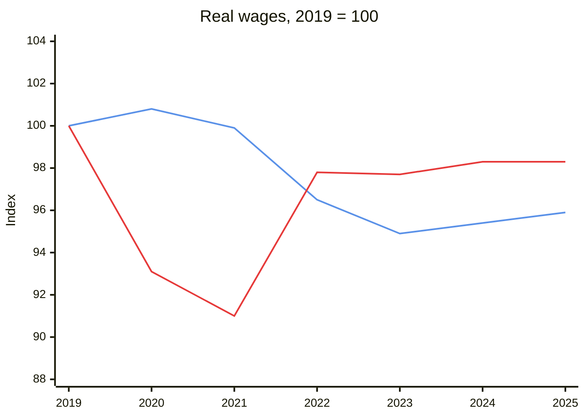
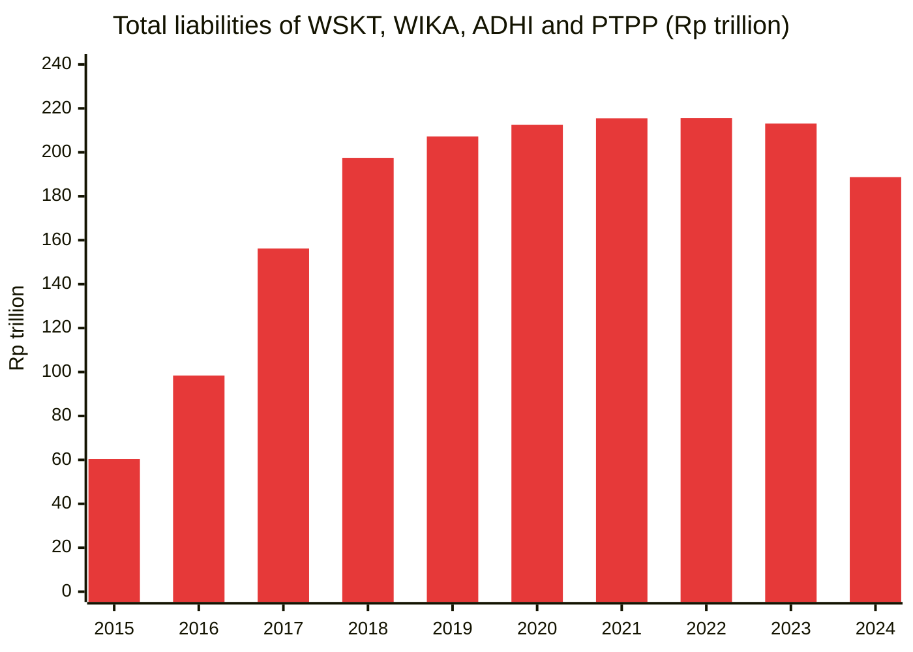

**In short:** Governments rarely need to fake a number. They choose which one to show, how to define it and what to leave out. Indonesia's headlines are true and flattering: unemployment is 4.85%, but 88% of jobs are informal; poverty is 8.47%, but 64.1% at the World Bank line for Indonesia's own income group; the typical Indonesian spends about 16% of GDP per capita, the lowest share in ASEAN; and debt is only 41% of GDP, yet interest eats 16% to 19% of revenue. Read the second number.
{: .tldr}

* TOC
{:toc}

## Why does "our economy is skyrocketing" sound true and feel false?

Picture the scene. An official in a light blue shirt grips the podium and shouts, "Our economy is skyrocketing!" The crowd cheers. Behind him, a screen shows growth going up, unemployment going down and poverty at a record low. Here is the uncomfortable part: every number on that screen may be true. A government rarely needs to invent a statistic. It only needs to pick which one to show, decide how to define it, and leave out the rest.

<figure>

<figcaption>Every number on his screen may be true. That is what makes the speech work.</figcaption>
</figure>

So let's take the seven numbers that turn up in every speech like that one: unemployment, GDP per capita, GDP growth, inflation, poverty, the Gini ratio, and the deficit and debt. For each one: what it measures, how it gets dressed up, and what to look at instead, with Indonesia set against its ASEAN neighbours and the OECD. Not so that you distrust every statistic, but so that the next time someone shouts "skyrocketing" from a podium, you know which questions to ask.

## Is unemployment really only 4.85%?

**What it is.** In August 2025, BPS, Indonesia's statistics agency, put the open unemployment rate (TPT, *tingkat pengangguran terbuka*) at 4.85%: 7.46 million people.[^sakernas] The number comes from Sakernas, the national labour force survey. To count as working, you need to have worked at least one hour for pay or profit in the past week. To count as unemployed, you need to have done no work at all, and to be looking for work or ready to start.

**How it gets dressed up.** One hour makes you employed. A street vendor who made one sale last week is employed. So is a ride-hailing driver who took one trip, and a teenager who helped in the family shop. A single rate says nothing about how many hours people work, or in what kind of job.

Fair's fair: Indonesia didn't invent this. The one-hour rule is the International Labour Organization's (ILO) global standard, and Australia uses it too. Australia's own headline also hides part-timers who want more hours. On the ILO's modelled estimates, time-related underemployment (working fewer hours than you want) is 5.3% in Indonesia and 6.6% in Australia.[^ilo-tru] The trick is not the definition. The trick is showing only this one number.

**How to see the real picture.** Start with BPS's own release, in the same table as the headline. In August 2025, 24.77% of employed Indonesians worked part-time, and 7.91%, or 11.6 million people, were underemployed: working under 35 hours a week and still wanting or looking for more work. Only 67.32% worked full-time.[^sakernas] The average employee earned Rp3.33 million a month.[^sakernas] (Set that against what the people at the podium take home in [Indonesian politicians' pay](/en/indonesian-politicians-pay/).)

Then compare countries. On the ILO's modelled estimate, Indonesia's unemployment rate in 2025 was 3.2%, below Australia's 4.1% and the OECD average of 5.7%.[^wb-unemp] The headline looks great:



Now look at what kind of jobs those are. On the ILO's harmonised definition, 88.3% of Indonesian workers were in informal jobs in 2024: no written contract, no social protection. Of all the countries in the chart, only Laos (90.5%) is higher. Vietnam is at 67.0%, Thailand at 63.2%, and the OECD average is 10.9%.[^ilo-informal] Australia does not report on this ILO measure at all.



The ILO counts an employee without a contract or social protection as informal, so its figure runs higher than BPS's own informal share: 57.80% of workers, or 84.58 million people, in August 2025.[^bps-informal] Either way, most Indonesian jobs come with no safety net.

Hours tell the same story from another angle. The average Indonesian worker put in 37.6 hours a week in 2025, the lowest in ASEAN, where the neighbours range from 39.8 to 46.2.[^ilo-hours]



Australia (31.3 hours) and the OECD average (33.6) sit even lower, but short hours in a rich country are often a choice, and well paid. In Indonesia they often are neither.[^ilo-hours] One caveat: hours show how fully people are used, not how good the work is. And there is one more layer: the graduate who drives a ride-hailing motorbike. In 2024, about 35% of young Indonesian workers were in jobs that didn't match their education, and 22.36% were overeducated for the job they had.[^mismatch] That measure needs care, because it flatters a country with fewer graduates.

**Verdict:** a low unemployment rate in a country where most jobs are informal doesn't say the jobs are good. It says people can't afford to be unemployed.

## Is Indonesia as rich as its GDP per capita says?

**What it is.** Gross domestic product (GDP) is everything produced inside a country's borders in a year:

$$
\text{GDP} = C + I + G + (X - M)
$$

That is household consumption ($$C$$), investment ($$I$$), government spending ($$G$$) and exports minus imports ($$X - M$$). Divide it by the population and you get GDP per capita: US$17,660 per Indonesian in 2025, in purchasing power parity (PPP) terms, a.k.a. adjusted for what money buys at home.[^wb-gdppc] Notice what it measures: production, not what lands in a household's pocket.

**How it gets dressed up.** Three ways.

1. **It is an average.** A few very rich people pull it up. The United States is the classic case, where the average sits far above the median.
2. **It is production, not income.** Profits paid to foreign owners stay in GDP. In Ireland and Luxembourg, gross national income (GNI, what residents actually earn) is only 69% and 68% of GDP, because of multinationals' profits and workers who cross the border every day. Singapore is at 83%, Switzerland at 99%.[^wb-gni]
3. **It includes things that never reach the dinner table:** investment and net exports.

**How to see the real picture.** The minimum is GNI. Indonesia's GNI is 97% of its GDP (2025), so about 3% of what is produced flows out to foreign owners and lenders.[^wb-gni] That is not much, so Indonesia's problem is not this one:



The gold standard is median household disposable income: median, because the rich can't pull it up, and disposable, because it is after tax and transfers. Indonesia doesn't publish it. BPS's household survey, Susenas, measures spending, not income.

The best proxy is the World Bank's Poverty and Inequality Platform (PIP), which gives the median income or spending per person, set against GDP per capita. On that measure the typical Indonesian's yearly spending is 16.4% of GDP per capita, about one sixth. That is the lowest in ASEAN: the Philippines is at 20.9%, Thailand and Laos at 26.2%, Myanmar at 33.8%, Vietnam at 37.5%. Of 47 countries, only Ireland (15.7%), the textbook case of a distorted GDP, is lower. Australia is at 38.1% (2020) and the OECD average about 32%.[^pip-median]



In money, the median Indonesian spent US$6.77 a day in 2025 (2021 PPP).[^pip-median]

An honest caveat. Spending surveys show lower numbers than income surveys, because people save part of what they earn, and they miss the rich, who refuse or never make it into the sample. That pushes Indonesia's share down. But the ASEAN neighbours also survey spending, and Indonesia is still the lowest. That gap is the point: the headline average sits far away from the typical person.

**Verdict:** a high average with a low median means the growth isn't reaching the middle.

## Does 5% growth mean we are better off?

**What it is.** GDP growth is the change in real GDP, a.k.a. GDP after inflation. Indonesia has grown at about 5% a year for a decade. In the second quarter (Q2) of 2025, BPS reported 5.12% year on year (yoy), after 4.87% in Q1.[^q2]

**How it gets dressed up.** Four ways.

**One: more people.** A growing population makes a bigger economy without anyone being better off. My own adopted country is the example: Australia's GDP grew, but its GDP per capita fell for seven quarters in a row, through 2023 and 2024.[^abs] In 2024, its GDP grew 1.4% while GDP per capita fell 0.6%.[^wb-growth] Indonesia's population grows about 0.78% a year, so its 5.1% GDP growth in 2025 is about 4.3% per person.[^wb-growth] Still good. Just not 5.1%.

**Two: spending that counts the same whatever it returns.** In GDP, a road nobody uses counts the same as a productive factory, at least in the year it is built. The Incremental Capital-Output Ratio (ICOR) measures how efficiently investment turns into growth:

$$
\text{ICOR} = \frac{\text{investment, \% of GDP}}{\text{real GDP growth, \%}}
$$

Lower is better. Indonesia's ICOR over 2015 to 2024 (without the COVID years 2020 and 2021) is 6.2, against 3.8 in the Philippines, 4.3 in Malaysia and Vietnam, and 4.4 in Cambodia.[^icor] Indonesia needs about 1.4 times as much investment as Malaysia or Vietnam for the same point of growth (6.2 / 4.3 = 1.44). Australia's is 9.0, but that is a fair exception: rich countries grow slowly from a high base, so they need more investment for each point.[^icor]



Concession: Indonesia's government is not a big spender. Government consumption was 7.5% of GDP in 2025, against an OECD average of 17.3% (2024).[^govcons] The issue is efficiency and the choice of projects, not size. A programme like free nutritious meals (Makan Bergizi Gratis, MBG) lifts GDP the moment the money is spent, whatever it returns in the long run.

**Three: forgetting what wears out and runs out.** GDP counts coal and nickel dug out of the ground as income, but not the loss of the resource. Worn-out machines are not subtracted either. The World Bank's adjusted net national income corrects for both.

**Four: the currency.** A weaker rupiah can lift exports in GDP while making imported food, fuel and medicine dearer for households.

**How to see the real picture.** Look at real GDP per capita growth and real household consumption growth. Then check the proxies that are hard to fake: electricity sales, freight, tax receipts, imports, cement and car sales. (Careful with electricity: smelters and data centres use a lot of it. Even so, a fall is an alarm.) And look at the lights. Luis Martinez compared satellite images of night lights with reported GDP, and found that autocracies overstate their yearly GDP growth by about 35%:[^martinez] a true 2% shows up as about 2.7%. Indonesia is a democracy, so this is not an accusation. The point is the method. Night lights don't answer to ministers.

Now a case for you to judge. In Q2 2025, BPS reported 5.12%, above most forecasts, in a quarter without the Lebaran (Eid) spending boost that lifted Q1. Economists at CELIOS, a Jakarta think tank, wrote to the United Nations Statistics Division on 8 August 2025 and asked for a review. The Coordinating Ministry for Economic Affairs and BPS answered that the methodology is public and sound.[^q2] I won't tell you who is right. The proxies above are public too: electricity, cement, car sales, tax receipts. Check them against the 5.12%.

**Verdict:** growth per person, per household, and matched by things you can see, beats a headline percentage.

## Is inflation low, or are prices still going up?

**What it is.** The Consumer Price Index (CPI) prices a basket of goods and services every month. BPS sets the weights from its Cost of Living Survey (SBH, *Survei Biaya Hidup*) of 2022, used since January 2024.[^sbh] "Inflation is down" means prices rise more slowly. It does not mean they fall.

**How it gets dressed up.** Five ways.

1. **The weights.** In SBH 2022, food (restaurant food included) is 38.04% of the basket, up from 33.68% in SBH 2018.[^sbh] Yet the average Indonesian household spends 50.10% of its monthly budget on food (Susenas, March 2024),[^food-share] and a poor household spends even more. The gap has a reason: SBH surveys urban households in 150 cities and regencies, and weights them by total spending, so richer households, who spend more rupiah, count for more.[^sbh]
2. **The weights lag behind life, and then forget.** They are updated roughly every four to five years (a 2018 base, then 2022).[^sbh] When beef gets dear, a family switches to eggs. At the next update, BPS sets the weights to what people now buy, so the cheaper basket becomes the new normal: the family that was pushed from beef to eggs counts as living "the same". The index never records the step down.
3. **Shrinkflation.** A smaller pack at the same price is a price rise that is hard to capture.
4. **Prices the government sets.** Fuel, electricity and LPG prices are administered. Holding them down holds the index down, and the bill moves to the budget, and to Pertamina and PLN, the state oil and electricity companies, until the government pays them back.
5. **The incentive.** Regions are paid for a low measured inflation, and they can reach some of what gets measured.

That last one needs its own paragraphs. Under PMK 43/2024, the Ministry of Finance pays fiscal incentives to regions, and the inflation ranking, from BPS data, makes up 47% of a province's score and 30% of a regency's or city's. The inflation incentive is Rp300 billion per period, for three periods, out of Rp4 trillion of fiscal incentives in that regulation.[^pmk]

Regional governments run Pasar Murah (cheap markets) and market operations, and call them inflation control openly. In October 2026, when Golkar party branches ran cheap markets on the President's instruction, the Minister of Micro, Small and Medium Enterprises called them help for the government's inflation-control programme.[^pasar] And BPS collects prices on a fixed schedule: according to BPS's published methodology (2013), staples are priced weekly on Monday and Tuesday, other food and tobacco monthly on the Tuesday to Thursday nearest the 15th, and services on days 1 to 10.[^bps-cpi] A fixed schedule is what makes timing possible.

Did anyone time it? The Home Affairs Minister, Tito Karnavian, said so himself in late September 2024: some regional heads study which markets BPS samples, then quickly hold a cheap market there "so the price goes down". In his words, "he knows where the random is, which sample it is." He asked BPS to keep several alternative sample markets. BPS's acting head, Amalia Adininggar Widyasanti, rejected the idea that its data were manipulated.[^tito] The Finance Minister, Sri Mulyani, said there were "very few" such cases, that they had been corrected, and that fiscal incentives must not distort inflation figures.[^smi]

So this is not a charge against BPS, and probably not a big dent in the national number. But the incentive is still there. A cheap market helps the families who reach it that day. It also lowers the measured price in a region that is rewarded for a low measured price. That is Goodhart's law in a regulation: when a measure becomes a target, it stops being a good measure.

**How to see the real picture.** Look at the cumulative change, not the monthly rate: prices in Indonesia rose about 31% from 2015 to 2024.[^cpi-cum] (Deflation is not the goal, by the way. Falling prices usually signal a stagnant economy.) Then ask whether wages keep up. Real wages, a.k.a. wages after inflation, are the number that tells you whether a family can buy more this year than last.

Divide BPS's average employee wage by the consumer price index and set 2019 at 100. In 2025, the average Indonesian employee's wage bought 1.7% less than in 2019, after six years in which the inflation headline was mostly called low.[^realwage] Fair's fair: Australia's real wages fell too, after the 2022 inflation spike, and further, to 95.9. Low inflation and wages that keep up are two different things, in any country. In the chart below, the blue line is Australia and the red line is Indonesia.

And look at the ratios that matter at home: a house price against a year's income, a year's school fees against the median wage.

**Verdict:** the question is not "how fast are prices rising?" but "are wages rising faster?"

## How many Indonesians are poor? It depends on the line

**What it is.** BPS draws its poverty line from the cost of a minimum of food plus a minimum of everything else: Rp609,160 per person per month in March 2025, or about Rp20,305 a day. By that line, 8.47% of Indonesians (23.85 million people) were poor, the lowest in two decades. By September 2025 it was 8.25% (23.36 million).[^bps-poverty] Rp20,305 a day is the line between poor and not poor, for food, transport, rent and everything else.

**How it gets dressed up.** Choose a low line. In its June 2025 update (2021 PPP), the World Bank uses US$3.00 a day for low-income countries, US$4.20 for lower-middle-income countries and US$8.30 for upper-middle-income countries. Indonesia has been an upper-middle-income country since the World Bank's July 2023 classification.[^wb-class] Here is Indonesia under each line (2025 survey): 3.7%, 15.5% and 64.1%.[^wb-lines]



Same country, same year, same people. Anywhere from 3.7% to 64.1% poor, depending on the line.

**How to see the real picture.** Use several lines and judge which one fits. Then compare countries at the line for Indonesia's own income group, US$8.30 a day. Indonesia is at 64.1%, with a GDP per capita of US$17,660. Vietnam, with about the same GDP per capita (US$18,088), is at 21.5%. Thailand (US$26,250) is at 11.7%, Malaysia at 2.9%. The Philippines, with US$12,577, is at 73.9%. Australia is at 1.5%.[^wb-830][^wb-gdppc]



With a GDP per capita like Vietnam's, Indonesia "should" sit near Vietnam and Thailand. It sits near the Philippines and Laos instead. That means the income is very unequally spread, and a huge share of Indonesians are an aspiring middle class: just above the BPS line, and far below a decent life. The median Indonesian spends US$6.77 a day,[^pip-median] under the US$8.30 line, which is why more than half the country falls below it. (The survey years and methods differ between countries, but a gap this big is not a rounding issue.)

Now the honest twist. Australia and the OECD measure poverty in relative terms: below 50% (or 60%) of the median. On that measure Indonesia scores only 6.7% (2025), lower than Australia's 11.3% (2020) and the United States' 18.9%.[^relpov] Why? Because Indonesia's median itself is so low, and the survey measures spending. A relative line flatters Indonesia too: it says people are close to the median, not that the median is enough. Use it together with the absolute lines, never alone.

**Verdict:** a poverty rate is only as honest as its line.

## Is Indonesia as equal as its Gini ratio says?

**What it is.** The Gini ratio measures inequality from 0 (everyone has the same) to 1, or 100 (one person has everything). BPS put Indonesia's at 0.375 in March 2025 and 0.363 in September 2025, from Susenas spending data.[^bps-gini]

**How it gets dressed up.** Measure spending, not income or wealth. The rich save and invest a big part of what they earn, and they are hard to survey: they refuse, or they are missing from the sample. So a spending Gini looks equal. On the World Bank's figures from household surveys, Indonesia's Gini is 34.4 (2025), lower than the United States' 41.8 and close to Australia's 33.8 and Germany's 33.7.[^pip-gini] Most OECD Ginis are based on income, most ASEAN ones on spending, so the chart compares plates with payslips:



**How to see the real picture.** Look at income or wealth, and at percentile shares: how much the top 10% take. In Indonesia's own spending survey, the top 10% account for 28.7% of all spending (2025).[^top10] In the World Inequality Database (WID), which adds tax and national-accounts data, the top 10% receive 46.9% of pre-tax national income (2018, the latest year). That is about the same as the United States (46.8%, 2024), and above Australia (35.2%) and the OECD average (37.8%).[^top10]



Tax data helps too: who pays income tax, and how much, tells you about the top incomes that surveys miss. With a caveat: high earners avoid tax, legally and otherwise, so even tax data is a floor.

**Verdict:** a spending Gini tells you how equal the plates are, not the bank accounts.

## Is 41% of GDP in government debt safe?

**What it is.** Indonesia's law caps the deficit at 3% of GDP and government debt at 60% of GDP (Law 17/2003 on State Finances).[^law17] The International Monetary Fund (IMF) puts general government gross debt at 40.9% of GDP in 2025, and the deficit at 2.9%.[^imf-debt]

Concession first: by the headline, Indonesia is genuinely prudent. Australia's debt is 51.9% of GDP, the OECD average 70.6%, Japan's 204.8%.[^imf-debt] (Whether debt is good or bad in the first place is a question I took on in [Is debt bad?](/en/is-debt-bad/).)



**How it gets dressed up.** Four ways.

**One: off the balance sheet, through state-owned enterprises (SOEs).** Toll roads and infrastructure are built by the state construction companies (BUMN Karya: WSKT, WIKA, ADHI and PTPP) with their own borrowing. That debt isn't "government debt", but the state owns the companies and rescues them when they struggle. The liabilities of the four listed state construction companies more than tripled in three years, from Rp60.4 trillion in 2015 to Rp197.5 trillion in 2018, during the toll-road push, and have stayed between about Rp190 trillion and Rp215 trillion since. Waskita Karya (WSKT) alone went from Rp20.6 trillion to Rp95.5 trillion over those three years. Waskita and Wijaya Karya (WIKA) both went through debt restructuring with their banks in 2023 and 2024.[^karya] None of it is counted as government debt. Here are their combined liabilities, year by year:

**Two: bills paid late.** The government owes Pertamina and PLN compensation for selling fuel and electricity below cost. In 2024, Rp53.8 trillion of the bills for Q1 2024 were still unpaid.[^energy] Paying late keeps this year's deficit lower and parks the cost on the SOEs' books until the money arrives.

**Three: future promises.** Civil servants pay 4.75% of their salary to Taspen, the state pension insurer, but the pensions themselves come out of each year's budget (pay-as-you-go): about Rp119 trillion was projected for 2022, according to the Director General of Budget.[^pension] There is no funded pot behind the promise, so the promise is a debt in all but name.

**Four: financial engineering.** The classic case is Greece, where currency swaps arranged in 2001 lowered the debt it reported against EU rules. Gerald Corrigan of Goldman Sachs, the bank that arranged them, later admitted they produced "a small, but not insignificant reduction in Greece's deficit and debt".[^greece] (No claim about Indonesia here; it is the textbook example of the trick.)

**How to see the real picture.** Three numbers.

**One: public-sector debt, SOEs included.** The debt the state stands behind, not only the debt in its own name.

**Two: interest as a share of revenue.** Indonesia's general government pays 16.3% of its revenue in net interest (IMF, 2025). That is the highest in ASEAN, and the third highest of 48 countries after Costa Rica (29.8%) and Mexico (24.4%). Australia pays 2.6%, Japan 0.5%.[^imf-interest] On the central budget (APBN) alone, interest paid in 2025 was Rp514.4 trillion against state revenue of Rp2,765.1 trillion: Rp514.4 / Rp2,765.1 = 18.6%.[^apbn] Almost a fifth of every rupiah collected goes to lenders before a single school is built. The cause is low revenue: general government revenue is only 13.3% of GDP, the lowest in the IMF sample,[^imf-interest] so a modest debt is heavy to carry.



**Three: who you owe, and in what currency.** Japan's debt of 205% of GDP is mostly in yen and mostly held at home: in December 2025 the Bank of Japan held 43.1% of its government bonds and foreigners only 6.8%.[^boj] A country can't run out of its own currency. Indonesia is different. At the end of 2025, its central government owed Rp1,636.9 trillion in foreign-currency bonds and about Rp1,192 trillion in foreign loans, out of Rp9,637.9 trillion in total: (Rp1,636.9 + Rp1,192) / Rp9,637.9 = 29% in foreign currency.[^fx-debt] The government's own debt strategy caps that share at 30%.[^kmk] So every 10% fall in the rupiah raises the rupiah value of nearly a third of the debt by 10%, overnight. The good news is at home: non-residents held only 13.37% of tradable rupiah government bonds at the end of 2025, the lowest since 2007.[^foreign-held]

**Verdict:** the size of the debt matters less than what it costs and who you owe it to.

## The cheat sheet: how is each headline dressed up, and what do you read instead?

Seven headline figures, seven tricks, and the second number for each.

| Headline figure | How it gets dressed up | What to look at instead | Where Indonesia sits |
| --- | --- | --- | --- |
| Unemployment: 4.85% | One hour of work a week counts as a job | Informal jobs, underemployment, hours worked | 88.3% of jobs informal, second highest after Laos;[^ilo-informal] 37.6 hours a week, lowest in ASEAN[^ilo-hours] |
| GDP per capita: US$17,660 | An average of production, pulled up by the top | GNI, and the median income or spending | The median is 16.4% of GDP per capita, lowest in ASEAN[^pip-median] |
| GDP growth: 5.12% (Q2 2025) | Population growth, low-return spending, no depreciation | Growth per person, household consumption, proxies like night lights | 4.3% per person in 2025;[^wb-growth] ICOR 6.2 against 3.8 to 4.4 for its fastest neighbours[^icor] |
| Inflation: "low" | Old weights, set prices, cheap markets in a region paid on its ranking | Cumulative prices, real wages | Prices up about 31% from 2015 to 2024;[^cpi-cum] the average wage buys 1.7% less than in 2019[^realwage] |
| Poverty: 8.47% | A low line | The World Bank line for your own income group | 64.1% below US$8.30 a day[^wb-lines] |
| Gini: 0.375 | Spending, not income or wealth | The top 10%'s share of income | Top 10% take 46.9% of pre-tax income, as in the US[^top10] |
| Debt: 40.9% of GDP | Off-budget SOE debt, late bills, unfunded pensions | Interest against revenue, currency of the debt | Interest takes 16.3% of revenue (IMF), 18.6% of the APBN's;[^imf-interest][^apbn] 29% of the debt is in foreign currency[^fx-debt] |

## So, is our economy skyrocketing?

Back to the podium. Some numbers did go up: output, growth, the share of people above BPS's poverty line. But the numbers that tell you how people live, the median, the jobs with a contract, the share above a decent poverty line, didn't rise with them. The speech wasn't false. It was chosen.

It is not the numbers that lie; it is the choice of numbers.

That doesn't make statistics useless. They are the best tool we have, and BPS follows international methods. It means reading them well, and the habit fits in three questions you can ask of any number from a podium:

1. **Per whom?** An average or a median? A total, or per person?
2. **Measured how?** Which definition, which line, which survey?
3. **Compared with what?** Other countries, other lines, last year?

So here is the small action. Next time a headline number is quoted, at you, on the news, in a speech, by me, look for its second number: the informal share next to the unemployment rate, the median next to the average, the interest bill next to the debt ratio. If nobody shows you the second number, ask for it. Usually it is already published, a few pages down in the same release.

*[ABS]: Australian Bureau of Statistics
*[ADHI]: Adhi Karya, a state-owned construction company (stock code)
*[APBN]: Anggaran Pendapatan dan Belanja Negara, Indonesia's central government budget
*[ASEAN]: Association of Southeast Asian Nations
*[BPK]: Badan Pemeriksa Keuangan, Indonesia's state audit agency
*[BPS]: Badan Pusat Statistik, Statistics Indonesia
*[BUMN]: Badan Usaha Milik Negara, a state-owned enterprise
*[CELIOS]: Center of Economic and Law Studies, a Jakarta think tank
*[CNBC]: Consumer News and Business Channel
*[COVID]: Coronavirus disease 2019
*[CPI]: Consumer Price Index
*[EU]: European Union
*[GDP]: Gross Domestic Product, the value of everything produced inside a country in a year
*[GNI]: Gross National Income, what a country's residents earn, at home and abroad
*[ICOR]: Incremental Capital-Output Ratio, investment needed for one point of growth
*[ILO]: International Labour Organization
*[ILOSTAT]: the ILO's statistics database
*[Kemenko]: Kementerian Koordinator, a coordinating ministry
*[IMF]: International Monetary Fund
*[LPG]: Liquefied petroleum gas, the bottled gas used for cooking
*[MBG]: Makan Bergizi Gratis, Indonesia's free nutritious meals programme
*[OECD]: Organisation for Economic Co-operation and Development, a club of 38 mostly rich countries
*[PBB]: Perserikatan Bangsa-Bangsa, the United Nations
*[PIP]: Poverty and Inequality Platform, the World Bank's poverty database
*[PLN]: Perusahaan Listrik Negara, Indonesia's state electricity company
*[PMK]: Peraturan Menteri Keuangan, a Finance Minister's regulation
*[PPP]: Purchasing power parity, money adjusted for what it buys in each country
*[PTPP]: Pembangunan Perumahan, a state-owned construction company (stock code)
*[Q1]: first quarter
*[Q2]: second quarter
*[RI]: Republik Indonesia
*[SBH]: Survei Biaya Hidup, BPS's Cost of Living Survey
*[SDG]: Sustainable Development Goal
*[SOEs]: State-owned enterprises
*[SOE]: State-owned enterprise
*[Sakernas]: Survei Angkatan Kerja Nasional, Indonesia's labour force survey
*[Susenas]: Survei Sosial Ekonomi Nasional, Indonesia's household socio-economic survey
*[TPT]: Tingkat Pengangguran Terbuka, the open unemployment rate
*[UN]: United Nations
*[WID]: World Inequality Database
*[WIKA]: Wijaya Karya, a state-owned construction company (stock code)
*[WSKT]: Waskita Karya, a state-owned construction company (stock code)
*[DDTC]: Danny Darussalam Tax Center, an Indonesian tax consultancy and news site
*[IHK]: Indeks Harga Konsumen, the consumer price index
*[KMK]: Keputusan Menteri Keuangan, a Finance Minister's decree
*[DJPPR]: Direktorat Jenderal Pengelolaan Pembiayaan dan Risiko, the Ministry of Finance's debt management office
*[SBN]: Surat Berharga Negara, Indonesian government securities
*[PNS]: Pegawai Negeri Sipil, an Indonesian civil servant
*[Menkeu]: Menteri Keuangan, the Finance Minister
*[Mendagri]: Menteri Dalam Negeri, the Home Affairs Minister
*[Taspen]: Tabungan dan Asuransi Pegawai Negeri, the state pension insurer for civil servants
*[Golkar]: Golongan Karya, a political party
*[pemda]: pemerintah daerah, a regional government
*[FY24]: fiscal year 2024
*[yoy]: year on year, compared with the same period a year earlier

## References

[^sakernas]: BPS, [Keadaan ketenagakerjaan Indonesia Agustus 2025](https://www.bps.go.id/en/pressrelease/2025/11/05/2479/), 5 November 2025, from Sakernas: open unemployment rate (TPT) 4.85%, 7.46 million people; part-time workers 24.77%, underemployed 7.91% (11.60 million), full-time 67.32% of the employed; average employee wage Rp3.33 million a month. Also reported by Bisnis.com, [TPT naik Agustus 2025, sentuh 4,85%](https://ekonomi.bisnis.com/read/20251105/12/1926326/tingkat-pengangguran-terbuka-tpt-naik-agustus-2025-sentuh-485), 5 November 2025.
[^bps-informal]: CNBC Indonesia, [Pekerja formal naik, tapi pekerja informal masih mendominasi di RI](https://www.cnbcindonesia.com/news/20251105121936-4-682481/pekerja-formal-naik-tapi-pekerja-informal-masih-mendominasi-di-ri), 5 November 2025, reporting BPS: informal workers 57.80% of the employed (84.58 million), August 2025.
[^mismatch]: CNBC Indonesia, [Pendidikan tinggi, upah rendah: 35% pekerja muda salah jurusan](https://www.cnbcindonesia.com/research/20251104154304-128-682220/pendidikan-tinggi-upah-rendah-35-pekerja-muda-salah-jurusan), 4 November 2025, from BPS's Sakernas 2024: about 35% of young workers in jobs that don't match their education, 22.36% overeducated for their job.
[^ilo-tru]: ILO modelled estimates, [ILOSTAT](https://ilostat.ilo.org/topics/working-time/), 2025: time-related underemployment 5.3% in Indonesia, 6.6% in Australia.
[^wb-unemp]: World Bank, [Unemployment, total (% of total labor force) (modeled ILO estimate)](https://data.worldbank.org/indicator/SL.UEM.TOTL.ZS), SL.UEM.TOTL.ZS, 2025: Indonesia 3.2%, Australia 4.1%; OECD average 5.7% (simple mean of the 38 members with data, my calculation).
[^ilo-informal]: ILOSTAT, [Informality](https://ilostat.ilo.org/topics/informality/), SDG indicator 8.3.1, ILO harmonised definition, latest year: Indonesia 88.3% (2024), Laos 90.5%, Vietnam 67.0%, Thailand 63.2%; OECD average 10.9% (simple mean of the 31 members with data, my calculation). Australia does not report this indicator.
[^ilo-hours]: ILO modelled estimates, [ILOSTAT, Working time](https://ilostat.ilo.org/topics/working-time/), 2025: mean weekly hours actually worked per employed person, Indonesia 37.6, the other ASEAN countries 39.8 (Philippines) to 46.2 (Cambodia), Australia 31.3; OECD average 33.6 (my calculation).
[^wb-gdppc]: World Bank, [GDP per capita, PPP (current international $)](https://data.worldbank.org/indicator/NY.GDP.PCAP.PP.CD), NY.GDP.PCAP.PP.CD, 2025: Indonesia US$17,660, Vietnam US$18,088, Thailand US$26,250, the Philippines US$12,577, Malaysia US$41,498.
[^wb-gni]: World Bank, [World Development Indicators](https://data.worldbank.org/), GNI and GDP per capita (PPP, current international dollars), 2025, my calculation: GNI as a share of GDP, Indonesia 97%, Ireland 69%, Luxembourg 68%, Singapore 83%, Switzerland 99%.
[^pip-median]: World Bank, [Poverty and Inequality Platform](https://pip.worldbank.org/), latest survey (Indonesia 2025, Australia 2020), and World Development Indicators, GDP per capita (2021 PPP), my calculation: median income or spending per person in a year as a share of GDP per capita, Indonesia 16.4%, the Philippines 20.9%, Thailand 26.2%, Laos 26.2%, Myanmar 33.8%, Vietnam 37.5%, Ireland 15.7%, Australia 38.1%, OECD average about 32% (simple mean of the 37 members with data). Indonesia's median spending US$6.77 a day per person (2021 PPP), 2025.
[^q2]: BPS, GDP growth releases: 5.12% year on year in Q2 2025, 4.87% in Q1 2025. Bisnis.com, [Komisi Statistik PBB beri respons anomali data pertumbuhan ekonomi RI 5,12%](https://ekonomi.bisnis.com/read/20250814/9/1902278/komisi-statistik-pbb-beri-respons-anomali-data-pertumbuhan-ekonomi-ri-512), 14 August 2025, on CELIOS's letter of 8 August 2025 to the UN Statistics Division. Investortrust, [CELIOS minta data pertumbuhan ekonomi diaudit PBB, Kemenko Perekonomian: metodologinya ada](https://investortrust.id/macro/75780/celios-minta-data-pertumbuhan-ekonomi-diaudit-pbb-kemenko-perekonomian-metodologinya-ada), August 2025.
[^abs]: ABS, [Australian economy grew 0.3 per cent in the September quarter](https://www.abs.gov.au/media-centre/media-releases/australian-economy-grew-03-cent-september-quarter), media release, December 2024: "GDP per capita fell by 0.3 per cent, falling for the seventh straight quarter."
[^wb-growth]: World Bank, [GDP growth (annual %)](https://data.worldbank.org/indicator/NY.GDP.MKTP.KD.ZG), NY.GDP.MKTP.KD.ZG, and [GDP per capita growth (annual %)](https://data.worldbank.org/indicator/NY.GDP.PCAP.KD.ZG), NY.GDP.PCAP.KD.ZG: Indonesia 5.1% in 2025, 4.3% per capita, population growth 0.78%; Australia in 2024, GDP 1.4%, GDP per capita -0.6%.
[^icor]: World Bank, [Gross fixed capital formation (% of GDP)](https://data.worldbank.org/indicator/NE.GDI.FTOT.ZS), NE.GDI.FTOT.ZS, and GDP growth, NY.GDP.MKTP.KD.ZG, my calculation: average of 2015 to 2024 without 2020 and 2021. Indonesia 6.2, the Philippines 3.8, Malaysia 4.3, Vietnam 4.3, Cambodia 4.4, Thailand 7.4, Australia 9.0. Indonesia against Malaysia or Vietnam: 6.2 / 4.3 = 1.44, about 1.4 times.
[^govcons]: World Bank, [General government final consumption expenditure (% of GDP)](https://data.worldbank.org/indicator/NE.CON.GOVT.ZS), NE.CON.GOVT.ZS: Indonesia 7.5% (2025); OECD average 17.3% (2024).
[^martinez]: Luis R. Martinez, [How Much Should We Trust the Dictator's GDP Growth Estimates?](https://doi.org/10.1086/720458), Journal of Political Economy 130(10), 2022: autocracies overstate yearly GDP growth by about 35%. My example: 2% x 1.35 = 2.7%.
[^sbh]: DDTC News, [Mutakhirkan penghitungan inflasi, BPS perbarui bobot komoditas IHK](https://news.ddtc.co.id/berita/nasional/1799147/mutakhirkan-penghitungan-inflasi-bps-perbarui-bobot-komoditas-ihk), citing BPS: the Cost of Living Survey 2022 (SBH 2022) is the CPI basket from January 2024; food, restaurant food included, is 38.04% of consumption, up from 33.68% in SBH 2018; SBH covers urban households in 150 cities and regencies, weighted by total spending.
[^pasar]: Antara Banten, [Pasar murah dinilai bantu pengendalian inflasi](https://banten.antaranews.com/berita/394167/pasar-murah-dinilai-bantu-pengendalian-inflasi), 26 October 2026: Golkar branches ran cheap markets on the President's instruction; the Minister of Micro, Small and Medium Enterprises, Maman Abdurrahman, called them help for the government's inflation-control programme.
[^pmk]: Ministry of Finance, [PMK 43/2024](https://jdih.kemenkeu.go.id/download/3d48755e-455f-4910-b52f-370cff7ded36/43%20Tahun%202024.pdf) (also on [pasal.id](https://pasal.id/peraturan/pmk/pmk-43-2024)): fiscal incentives for regions; the inflation ranking, from BPS data, is 47% of a province's score and 30% of a regency's or city's; Rp300 billion per period, for three periods; Rp4 trillion of fiscal incentives in total in the regulation.
[^bps-cpi]: BPS, [Consumer Price Index description](https://webapps.ilo.org/ilostat-files/SSM/SSM1_NEW/E/IDN_CPI_Descriptions%20-2013.pdf), 2013, hosted by the ILO: staples priced weekly on Monday and Tuesday; other food and tobacco monthly, on the Tuesday to Thursday nearest the 15th; services on days 1 to 10 of the month.
[^tito]: Liputan6, [Dituding pemda manipulasi data inflasi, BPS buka suara](https://www.liputan6.com/bisnis/read/5716591/dituding-pemda-manipulasi-data-inflasi-bps-buka-suara), 1 October 2024: Home Affairs Minister Tito Karnavian, "supaya harganya turun" and "Dia tahu random-nya di mana, sampelnya yang mana" (my translation); BPS's acting head Amalia Adininggar Widyasanti rejected that the data were manipulated.
[^smi]: CNBC Indonesia, [Data inflasi BPS dimanipulasi pemda? Sri Mulyani temui Mendagri](https://www.cnbcindonesia.com/news/20241004121003-4-576969/data-inflasi-bps-dimanipulasi-pemda-sri-mulyani-temui-mendagri), 4 October 2024: "sangat sedikit" (very few) cases, already corrected; fiscal incentives must not distort inflation figures.
[^food-share]: CNBC Indonesia, [Bukan Jakarta, warga RI makan beras paling banyak ternyata ada di sini](https://www.cnbcindonesia.com/news/20241023155215-4-582442/bukan-jakarta-warga-ri-makan-beras-paling-banyak-ternyata-ada-di-sini), 23 October 2024, reporting BPS's Susenas of March 2024: 50.10% of monthly spending goes on food; average spending Rp1,500,556 per person a month.
[^realwage]: My calculation. Indonesia: BPS average wage of employees in August (Sakernas), Rp2.91 million in 2019, 2.76 (2020), 2.74 (2021), 3.07 (2022), 3.18 (2023), 3.27 (2024) and 3.33 (2025), via [Databoks](https://databoks.katadata.co.id/en/education/statistics/ee7ad197c76ab3e/average-indonesian-employee-salary-increases-by-rp12-million-in-9-years) and BPS's release of 5 November 2025, divided by the World Bank's [consumer price index](https://data.worldbank.org/indicator/FP.CPI.TOTL) (FP.CPI.TOTL): 100, 93.1, 91.0, 97.8, 97.7, 98.3, 98.3. Australia: ABS Wage Price Index (total hourly rates excluding bonuses) divided by ABS CPI, annual averages, 2025 = first three quarters: 100, 100.8, 99.9, 96.5, 94.9, 95.4, 95.9.
[^cpi-cum]: World Bank, [Consumer price index (2010 = 100)](https://data.worldbank.org/indicator/FP.CPI.TOTL), FP.CPI.TOTL, Indonesia, my calculation: about +31% from 2015 to 2024.
[^bps-poverty]: BPS, [Poverty rate continues to decline](https://www.bps.go.id/id/news/2025/07/25/731/poverty-rate-continues-to-decline.html), 25 July 2025: poverty line Rp609,160 per person per month, 8.47% poor (23.85 million), March 2025. My calculation: Rp609,160 / 30 = Rp20,305 a day. Fortune IDN, [BPS: jumlah penduduk miskin turun jadi 23,36 juta per September 2025](https://www.fortuneidn.com/news/bps-jumlah-penduduk-miskin-turun-jadi-23-36-juta-per-september-2025-00-6cmtl-m46nms): 8.25% (23.36 million), September 2025.
[^wb-class]: World Bank, [New World Bank group country classifications by income level: FY24](https://blogs.worldbank.org/en/opendata/new-world-bank-group-country-classifications-income-level-fy24), 1 July 2023: Indonesia moved to upper-middle income. World Bank, [June 2025 update to the global poverty lines](https://www.worldbank.org/en/news/factsheet/2025/06/05/june-2025-update-to-global-poverty-lines) (2021 PPP): US$3.00, US$4.20 and US$8.30 a day.
[^wb-lines]: World Bank, [Poverty and Inequality Platform](https://pip.worldbank.org/), Indonesia, 2025 survey, 2021 PPP: 3.7% below US$3.00 a day, 15.5% below US$4.20, 64.1% below US$8.30.
[^wb-830]: World Bank, [Poverty and Inequality Platform](https://pip.worldbank.org/), share below US$8.30 a day (2021 PPP), latest survey: the Philippines 73.9% (2023), Laos 70.3%, Myanmar 79.8% (2017), Vietnam 21.5% (2022), Thailand 11.7% (2024), Malaysia 2.9% (2021), Australia 1.5% (2020).
[^relpov]: World Bank, [Proportion of people living below 50 percent of median income](https://data.worldbank.org/indicator/SI.DST.50MD), SI.DST.50MD: Indonesia 6.7% (2025), Australia 11.3% (2020), United States 18.9%.
[^bps-gini]: BPS, Gini ratio releases for March and September 2025, as reported by Infobanknews and Fortune IDN: 0.375 (March 2025), 0.363 (September 2025), from Susenas spending data.
[^pip-gini]: World Bank, [Poverty and Inequality Platform](https://pip.worldbank.org/), Gini index, latest survey: Indonesia 34.4 (2025, spending), United States 41.8, Australia 33.8, Germany 33.7.
[^top10]: World Bank, [Poverty and Inequality Platform](https://pip.worldbank.org/): top 10% share of spending in Indonesia 28.7% (2025). World Inequality Database, via Our World in Data, [Income share of the richest 10% (before tax)](https://ourworldindata.org/grapher/income-share-top-10-before-tax-wid): Indonesia 46.9% (2018, latest), United States 46.8% (2024), Australia 35.2%; OECD average 37.8% (simple mean of the 38 members with data, my calculation).
[^law17]: Law No. 17 of 2003 on State Finances, elucidation of Article 12: the deficit is capped at 3% of GDP and debt at 60% of GDP.
[^imf-debt]: IMF, [World Economic Outlook, general government gross debt (% of GDP)](https://www.imf.org/external/datamapper/GGXWDG_NGDP), 2025: Indonesia 40.9%, Australia 51.9%, Japan 204.8%; OECD average 70.6% (simple mean of the 38 members with data, my calculation). Indonesia's deficit 2.9% of GDP.
[^karya]: Total liabilities at year-end, compiled by the author from the companies' annual reports and financial statements, via Indonesia-Investments (2015-2016), detikFinance, [Mengintip utang BUMN konstruksi yang meningkat sejak 2014](https://finance.detik.com/read/2018/05/11/115051/4015513/4/mengintip-utang-bumn-konstruksi-yang-meningkat-sejak-2014), 11 May 2018, press reports of annual results (Waskita, including CNBC Indonesia, [Waskita Karya pangkas utang Rp14,7 triliun di 2024](https://www.cnbcindonesia.com/market/20250430093330-17-629851/top-waskita-karya--wskt--pangkas-utang-rp147-triliun-di-2024), 30 April 2025) and stockanalysis.com balance sheets (WIKA, ADHI, PTPP, 2021-2024); 2019-2020 WIKA and 2020 WSKT derived as assets minus equity. Rp trillion, 2015 to 2024: WSKT 20.6, 44.7, 75.1, 95.5, 93.5, 89.0, 88.1, 84.0, 84.0, 69.3; WIKA 14.2, 18.6, 31.1, 42.0, 42.9, 51.5, 52.0, 57.6, 56.4, 51.6; ADHI 11.6, 14.7, 22.5, 23.8, 29.7, 32.5, 34.2, 31.2, 31.3, 25.7; PTPP 14.0, 20.4, 27.5, 36.2, 41.1, 39.5, 41.2, 42.8, 41.4, 42.1; total 60.4, 98.4, 156.2, 197.5, 207.2, 212.5, 215.5, 215.6, 213.1, 188.7.
[^pension]: Bisnis.com, [Blak-blakan anak buah Menkeu Sri Mulyani soal beban pensiun PNS dalam APBN](https://finansial.bisnis.com/read/20220829/215/1571936/blak-blakan-anak-buah-menkeu-sri-mulyani-soal-beban-pensiun-pns-dalam-apbn), 29 August 2022: Director General of Budget Isa Rachmatarwata on the pay-as-you-go system; civil servants pay 4.75% of salary to Taspen; about Rp119 trillion of pensions projected for 2022.
[^greece]: MercoPress, [Goldman Sachs defends 2001 swap deal to mask debts of Greece](https://en.mercopress.com/2010/02/22/goldman-sachs-defends-2001-swap-deal-to-mask-debts-of-greece), 22 February 2010, quoting Gerald Corrigan.
[^boj]: Bank of Japan, Flow of Funds, via Japan's Ministry of Finance, December 2025: the Bank of Japan held 43.1% of Japanese government bonds (excluding treasury bills), foreigners 6.8%.
[^fx-debt]: Ministry of Finance, central government debt data, end of 2025, my calculation: foreign-currency government bonds Rp1,636.9 trillion plus foreign loans about Rp1,192 trillion, of total debt Rp9,637.9 trillion; (1,636.9 + 1,192) / 9,637.9 = 29%.
[^kmk]: Ministry of Finance, [KMK 441/2024](https://api-djppr.kemenkeu.go.id/web/api/v1/media/A09585E6-0E5E-4955-A41B-15B4030AB4E8), the medium-term debt management strategy: foreign-currency debt capped at 30% of the total.
[^foreign-held]: CNBC Indonesia, [Era asing berakhir? Porsi investor global di SBN terendah 18 tahun](https://www.cnbcindonesia.com/research/20251215150332-128-694311/era-asing-berakhir-porsi-investor-global-di-sbn-terendah-18-tahun), 15 December 2025, with data from DJPPR: non-residents held 13.37% of tradable rupiah government bonds at the end of 2025, the lowest since 2007.
[^energy]: detik.com, [Pemerintah belum bayar kompensasi energi ke Pertamina-PLN Rp53,8 triliun](https://finance.detik.com/energi/d-7411777/pemerintah-belum-bayar-kompensasi-energi-ke-pertamina-pln-rp-53-8-triliun), 2024: Rp53.8 trillion of compensation for Q1 2024 not yet paid, per the Ministry of Finance.
[^imf-interest]: IMF, Fiscal Monitor, 2025, my calculation: net interest of general government (primary balance minus overall balance) as a share of revenue, Indonesia 16.3%, Costa Rica 29.8%, Mexico 24.4%, Australia 2.6%, Japan 0.5%; Indonesia is the highest in ASEAN and third of 48 countries. General government revenue, Indonesia 13.3% of GDP, the lowest of the 48.
[^apbn]: Bisnis.com, [Pemerintah bayar bunga utang Rp514 triliun pada 2025, nyaris 20% total belanja pusat](https://ekonomi.bisnis.com/read/20260716/10/1988669/pemerintah-bayar-bunga-utang-rp514-triliun-pada-2025-nyaris-20-total-belanja-pusat), 16 July 2026, on BPK's audit of the 2025 central government accounts: interest paid Rp514.4 trillion (93.04% of the Rp552.85 trillion budgeted), state revenue Rp2,765.1 trillion. My calculation: Rp514.4 / Rp2,765.1 = 18.6%.

<!-- abbr-ok: IDN -->
