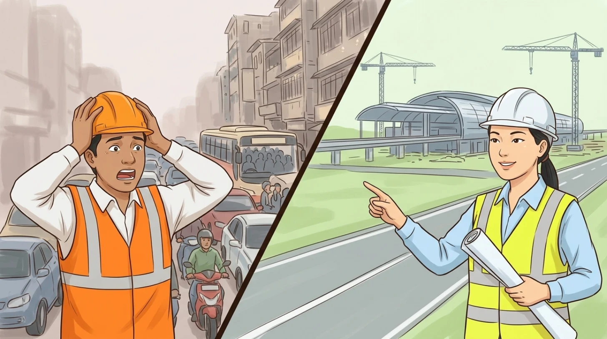
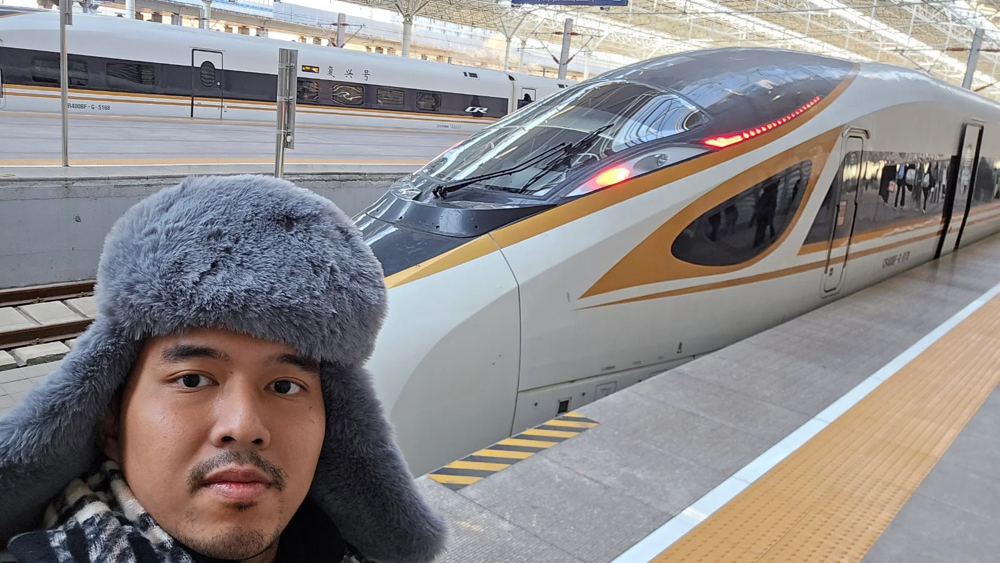
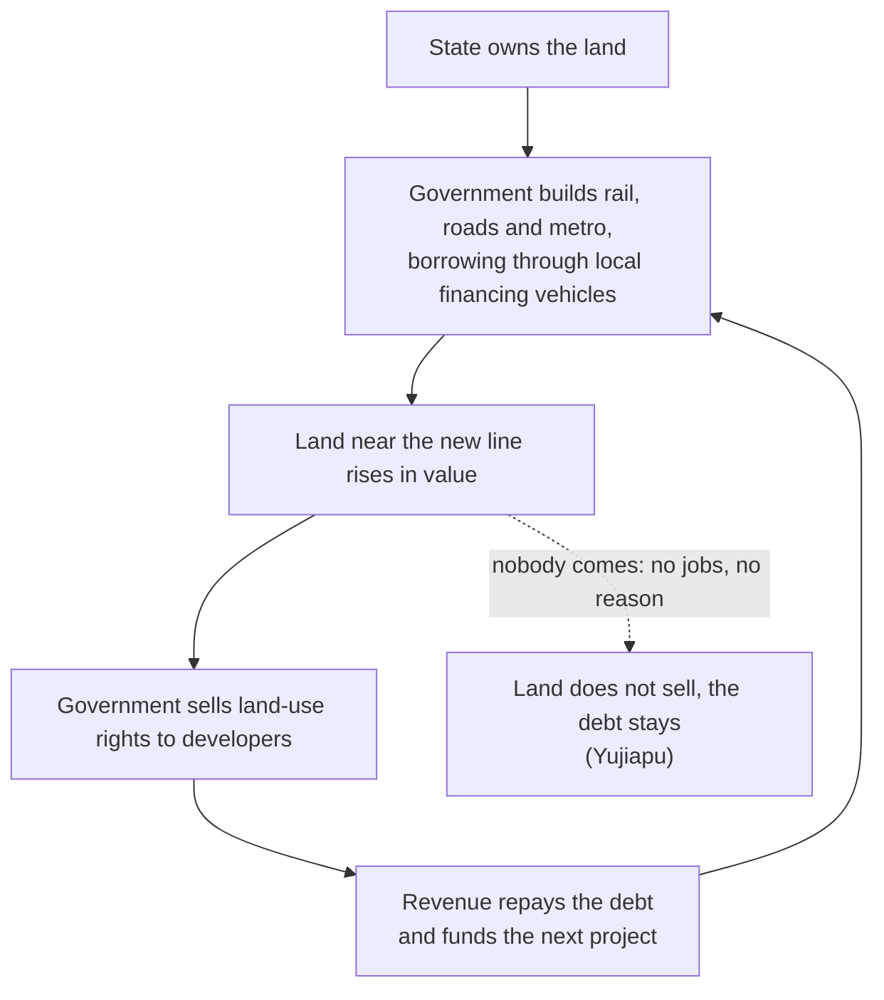
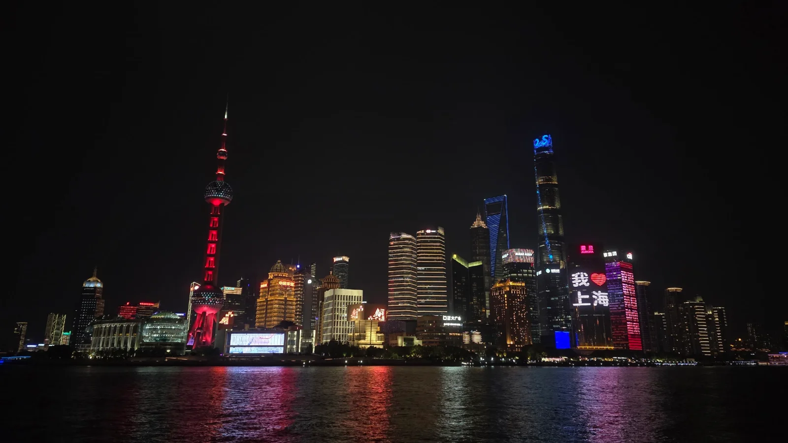
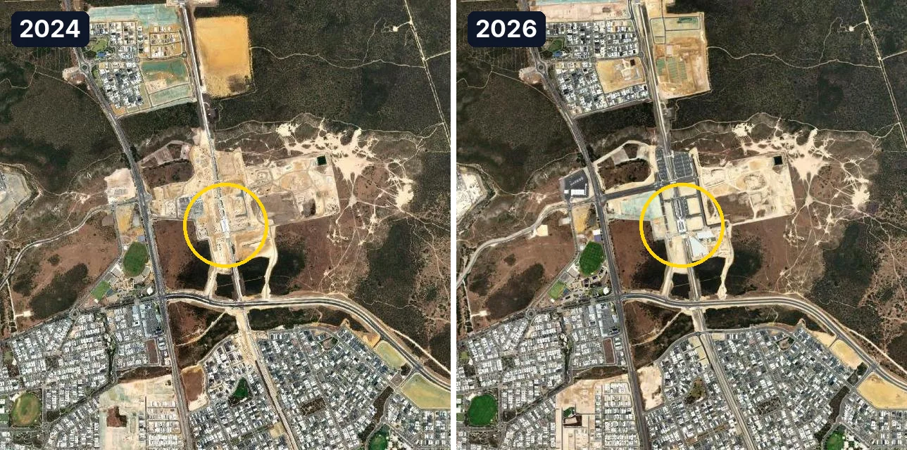
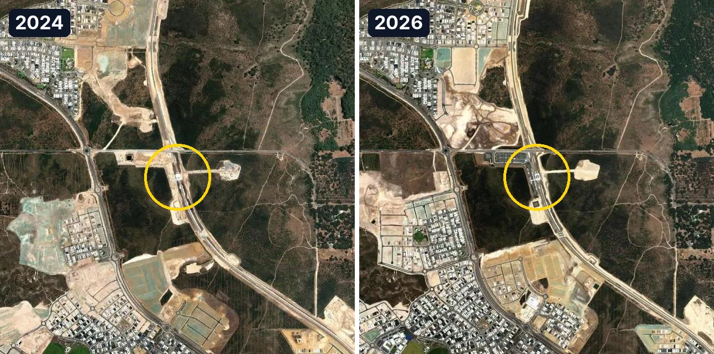
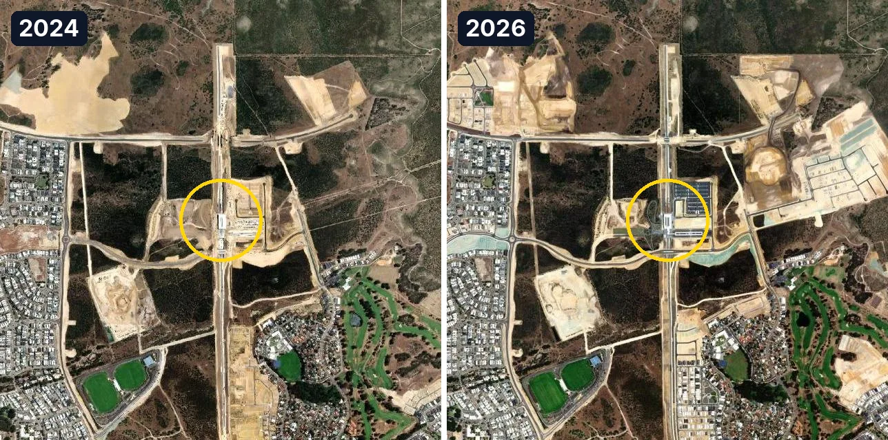
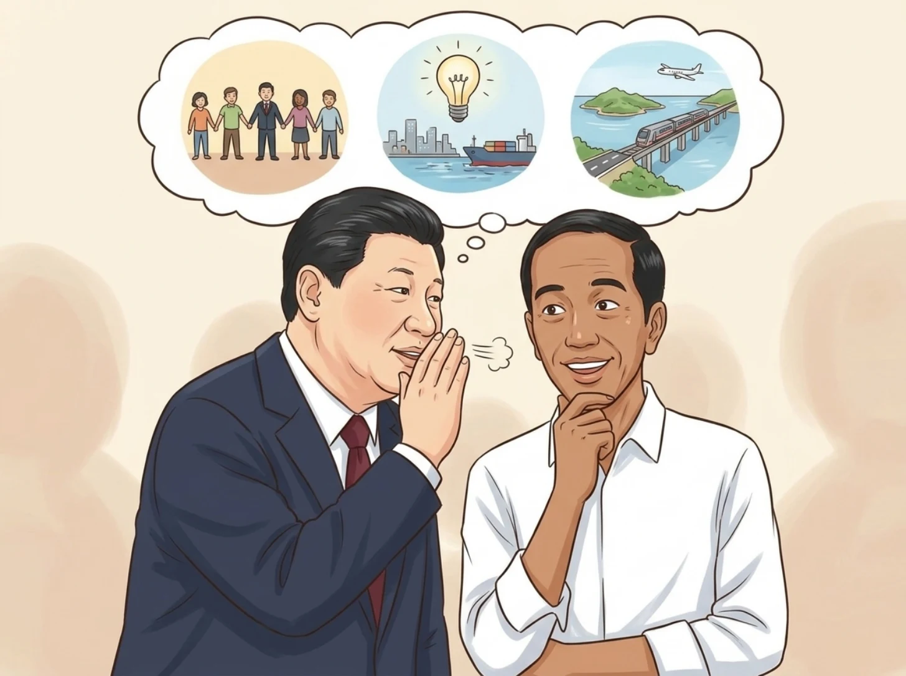

**In short:** China builds so fast because it builds supply-push: the state lays rail, stations and metros first, on land it owns, pays for them with the land value they create, and keeps the plan going for decades. That gave it 50,000 km of high-speed rail by 2025 and urban rail in 58 cities. It works where a place has a reason to exist, is connected from day one and outlives its leaders. Indonesia copied the building, not the connecting or the continuing.
{: .tldr}

* TOC
{:toc}

## What did I see in China that made me ask this?

How do you build 2,862 km of high-speed rail in a single year? That is what China opened in 2025: about twenty times the whole length of Whoosh, Indonesia's only high-speed line (142.3 km).[^nra][^whoosh] I have been asking myself versions of that question on every trip to China, and I have made at least one a year since 2023.

<figure>

<figcaption>Two ways to build a city: wait for the jam and then dig through it, or build first and wait for the city.</figcaption>
</figure>

So far I have been to 14 Chinese jurisdictions: the four municipalities of Beijing, Tianjin, Shanghai and Chongqing; Jiangsu, Heilongjiang, Hunan, Shaanxi, Sichuan, Guangdong, Fujian and Taiwan; and the two special administrative regions (SARs), Hong Kong and Macau.

<figure>

<figcaption>The 14 places I have been to so far, shaded. Map: boundaries from DataV (Alibaba Cloud).</figcaption>
</figure>

The impression repeats wherever I go. A high-speed rail network that reaches cities I had never heard of. Train stations the size of airports (the first few times, I caught myself looking for the check-in counter 😅). Metro maps as tangled as Singapore's, in city after city. And skyscraper skylines not only in Shanghai and Beijing, but in second- and third-tier cities whose names I had to practise before I could say them to a taxi driver.

The numbers back the impression up. At the end of 2025, China had 165,000 km of railway, 50,000 km of it high-speed rail (HSR).[^nra] Fifty-eight mainland cities had urban rail, 13,068 km of it in total.[^camet] For scale, Singapore, the city most of Southeast Asia treats as the gold standard for public transport, has 271.3 km of MRT and LRT.[^lta] Shanghai's metro alone runs 906 km.[^sh906] Chengdu, a city many people outside China couldn't place on a map, has 870 km of urban rail.[^camet] That is more than three Singapores in a single city.

<figure>

<figcaption>Me and a Fuxing (复兴号) CR400BF in winter. The fur hat was for the cold, not for the photo. Photo: Adjie.</figcaption>
</figure>

My stake: I spent my first 25-plus years in Indonesia, and I have lived in Australia for almost two. Both countries build. Both argue about it endlessly. Neither builds like this.

So this post asks two things. How does China build so fast? And why can't Indonesia, which has tried hard to copy it, simply do the same?

## Demand-pull or supply-push: what are the two ways to build a city?

Most countries build **demand-pull**: they build in response to proof. They wait for real, measured signals (a jammed road, a full train, a lost opportunity) and then build to fix that bottleneck. China, in its big projects, builds **supply-push**: planners build ahead of demand, from a long-term forecast, a master plan or a vision, and expect the people and the businesses to follow. Build it, and they will come.

Demand-pull has real strengths. Little capital sits idle, because every rupiah goes where the need is already proven. The commercial risk is lower too, because the users already exist: you know the train will be full, since the road beside it is full today.

Its weakness is the price of waiting. By the time demand is undeniable, the city has grown around the problem, so you build inside the congestion: you tunnel under it, you buy land in a built-up city, and you disrupt everyone while you work. Jakarta is the example I know best. Its first MRT line, Phase 1 from Lebak Bulus to Bundaran HI, opened on 24 March 2019: 15.7 km and 13 stations, six of them underground, for about Rp16 trn.[^mrt] That is about Rp1 trn per kilometre (my own calculation). Jakarta built it when the traffic had become unbearable, which is exactly the point at which building is hardest.

Supply-push has the opposite profile. Its strength is scale: coordinated, multi-decade projects that shape where a region grows, which industries settle and how much capacity it will have. Building in bulk, on a long plan, also lowers the cost per unit and prevents the chronic under-capacity that demand-pull cities live with. Its weakness is the bet. If the plan is wrong, you have built idle capacity: stations and towers that cost money to run and maintain every year, plus interest if you borrowed to build them.

The table below puts the two side by side.

| | Demand-pull | Supply-push |
| --- | --- | --- |
| **Trigger** | A proven need: congestion, full trains, lost business | A forecast, a master plan or a vision |
| **Who decides, and how** | Reacts to real-time signals and actual bottlenecks, one project at a time | Planners and the state decide ahead, for decades, often many projects together |
| **Strengths** | Little idle capital; low commercial risk, because users already exist | Scale and long-term capacity; lower cost per unit; no chronic under-capacity |
| **Risks** | Builds late and expensively, inside congestion; the city outgrows its network | Idle capacity, running losses and debt if nobody comes |
| **Examples** | Jakarta MRT, Sydney Metro, most of the world | Shenzhen, Shanghai Pudong, Perth's Yanchep line |

Neither is "the right way". Demand-pull is careful and late. Supply-push is early and risky. The question is what makes the risk pay off.

## How does "build it and they will come" work in China?

China's version of supply-push runs on land. In Chinese cities the land belongs to the state, so a local government can do something an Indonesian or Australian city cannot: build a railway, a road or a metro line to empty land it already owns, and keep the value the new line creates.

The loop goes like this. A local government borrows, usually through a local government financing vehicle (LGFV), a company it owns that can raise money off its books. It builds the infrastructure. The land near the new line becomes valuable. The government sells the right to use that land (land-use rights) to developers, and the revenue repays the debt and pays for the next project. At its peak in 2021, land-use-right sales brought China's governments RMB 8,705.1 bn in a single year.[^land]

The flowchart below draws that loop, including the branch where it breaks.

Two more things keep the loop turning. The first is the plan: China works in Five-Year Plans, and its cities draw master plans that run for decades, so a line drawn on a map in one decade is usually still being built in the next. The second is the incentive: local officials have long been judged on the growth their area produces, and nothing produces growth on paper faster than a construction site.

Does it work? Sometimes spectacularly. Sometimes not at all.

### Where did "they" actually come?

**Shenzhen** is the most famous case. In 1979, when Bao'an county became Shenzhen city, it had 314,100 residents.[^sz1979] The special economic zone (SEZ) was approved on 26 August 1980.[^sez] By the end of 2025, Shenzhen had 18,248,500 residents and a GDP of RMB 3,873.18 bn.[^sz2025] That is 58 times the population of 1979. A fair concession: Shenzhen wasn't built by roads alone. It got market reforms that the rest of China didn't have yet, and it sits right next to Hong Kong, which supplied capital, know-how and a door to the world. The infrastructure made the growth possible; the reforms and the neighbour gave it a reason.

**Shanghai's Pudong** is the case I have seen with my own eyes. The opening up of Pudong was announced on 18 April 1990, when the east bank of the Huangpu was mostly farmland and warehouses.[^pudong1990] In 2025 Pudong's GDP was RMB 1,876.91 bn: about a third of Shanghai's, which was RMB 5,670.87 bn (33.1%, my own calculation).[^pudong]

<figure>

<figcaption>Pudong from the Bund. In 1990, most of this side of the river was farmland and warehouses. Photo: Adjie.</figcaption>
</figure>

**Shanghai Hongqiao** is the hub done right. On the city's western edge, Shanghai put an airport, a high-speed rail station and the metro in one place. The rail station opened on 1 July 2010, with 16 platforms and 30 tracks.[^hongqiao] The airport sits about 13 km from the city centre in a straight line, and Metro Line 2 links it to the centre.[^hongqiao][^line2] A business district then grew around the hub: the offices came to where the trains and planes already were.

**Beijing's Chaoyang CBD** was planned and launched in 1993, in that year's Beijing master plan: a core of 7.04 km² inside a functional zone of 84 km².[^bjcbd] In 2025 Chaoyang counted more than 140 buildings that each paid over RMB 100m in tax, and 125 regional headquarters of multinationals.[^bjcbd]

What the four have in common: each had an economic reason to exist (a border with Hong Kong, a port and a financial centre, a national transport hub, a capital's business district), each was connected from day one, and each plan kept going across several sets of leaders.

### Where didn't they come, and who pays?

**Yujiapu**, in Tianjin, is the cautionary tale. It was built by a local government financing vehicle (LGFV) and billed as the world's largest financial district, "China's Manhattan", with at least RMB 200 bn (US$32 bn) invested.[^yjp2019] In 2014 the South China Morning Post (SCMP) was already calling its towers "ghost buildings".[^yjp2014] Businesses trickled in by 2016,[^yjp2016] but around 2019 about 80% of its office space was still empty and several towers had stalled.[^yjp2019]

Yujiapu had the towers, the roads and even the financing. What it didn't have was a reason for a bank to leave Beijing or Shanghai and move there. A ghost town is a master plan that forgot to give anyone a reason.

The bill for the whole land-finance loop is now arriving. Land-use-right sales fell from RMB 8,705.1 bn in 2021 to RMB 4,151.8 bn in 2025, the fourth fall in a row: roughly half gone (−52.3%, my own calculation).[^land] Meanwhile the International Monetary Fund (IMF) estimates LGFV debt at RMB 71.4 trn in 2025, 50.9% of China's GDP. Counting that debt, China's "augmented" government debt reaches 126.6% of GDP, and the IMF projects 153.7% by 2030.[^imf]

This is the concession that matters. Supply-push is borrowing against the future, and borrowing is only as good as what it builds. I wrote about that difference in [Is debt bad?](/en/is-debt-bad/): debt that builds a productive asset can pay for itself, debt that builds an empty tower cannot. China's loop worked brilliantly while land prices kept rising, and it is now paying for every project where they didn't.

## Is Australia turning towards the Chinese model?

Partly, yes, and it is a sign that supply-push isn't only for one-party states. Australia's tradition is firmly demand-pull, though. Sydney Metro North West opened on 26 May 2019, 36 km and 13 stations from Tallawong to Chatswood, into a city that had been congested for years.[^sydmetro] Sydney's suburban trains are double-deckers, which tells you how long the city has been squeezing more people into the network it has.

Melbourne's airport line shows the cost of waiting. In 2018 the Melbourne Airport Rail link was estimated at A$8 to 13 bn, with A$5 bn each promised by the federal and Victorian governments. The 2024 Victorian budget delayed it by at least four years, to 2033 at the earliest. Stage 1 alone, from West Footscray to Albion, costs more than A$4 bn.[^mar]

Housing is the most visible demand-pull failure. The national Housing Accord aims for 1.2 million new homes in the five years from mid-2024 to June 2029. In April 2026 the National Housing Supply and Affordability Council (NHSAC) estimated that only 980,000 would be built in that period, about 220,000 short (my own subtraction), and that the target would be reached only in the September quarter of 2030.[^nhsac]

Now the change. Perth's METRONET extended the northern line 14.5 km from Butler to Yanchep, with stations at Alkimos, Eglinton and Yanchep. It opened on 14 July 2024.[^yanchep] The original estimate was about A$531.7m; the reported final cost is about A$1 bn.[^yanchep-cost] And crucially, those stations were built before the suburbs around them. The satellite images below compare each station in 2024 and 2026.

<figure>

<figcaption>Alkimos, Eglinton and Yanchep stations (yellow circles), each about 2.6 km across, in 2024 and 2026. The stations came first; the streets are catching up. Satellite imagery: Esri World Imagery, Esri releases of August 2024 and October 2026; Esri, Maxar, Earthstar Geographics.</figcaption>
</figure>

They came. In two years, new street grids and house lots have grown around Eglinton and Yanchep, and new estates are rising near Alkimos. The next station on the line, Karnup, is still a promise: final planning starts with A$10m over 2026-27 and 2027-28, works begin in 2028, and half of its total of about A$156m is meant to come from land sales.[^karnup] Paying for a station with the land it makes valuable is a very Chinese idea.

Sydney's new airport is the bigger bet, and it comes with a warning. Western Sydney International Airport opened to passengers on 25 October 2026; the first flight was Jetstar to the Gold Coast.[^wsi] Around it, the plan is a whole new city, Bradfield. But its metro line, 23 km from St Marys to Bradfield, opens only in 2027, so for now passengers ride a free interim bus to the train network.[^wsi] An airport that opens before its rail link is the classic way a supply-push project starts life looking empty. Australia's saving grace is that the line is already being built and is due next year, not merely promised.

## Why hasn't it worked as well in Indonesia (yet)?

Because Indonesia copied the "build" and skipped the rest. For most of its history it built in an extreme form of demand-pull, and when it switched to supply-push under Jokowi, it built the big things without the connections, without a way to capture the land value, and without a guarantee that the next government would keep going.

### Why does Indonesia wait for the jam, and then still not build?

Indonesia's demand-pull is extreme: even where the demand is undeniable, the proper infrastructure often still doesn't arrive. Proper rapid transit exists in only two Indonesian cities. Jakarta has its MRT (Phase 1 opened on 24 March 2019, 15.7 km),[^mrt] its LRT and its KRL commuter trains. Palembang has an LRT, about 23 km and 13 stations from the airport to Jakabaring, which opened to the public on 1 August 2018, built for the Asian Games.[^lrt] It carried about 4.63 million passengers in 2025 (my own sum of the monthly figures).[^lrt]

Then look at Indonesia's next three big cities. Surabaya, Bandung and Medan have no metro and no LRT, and until recently not even a proper bus rapid transit (BRT) system. Under MASTRAN, a mass-transit programme funded by the World Bank and the French development agency AFD (about US$224 to 264m), construction of the Bandung Basin BRT finally started in July 2026: about Rp1.3 trn for 18 routes. Medan's Mebidang BRT is due to start service in 2027, and Surabaya is still at the detailed-design stage.[^brt]

Three of Indonesia's biggest cities, millions of people each, and the first proper mass transit for any of them is a bus, starting this year. That is not demand-pull. That is demand, ignored.

### What did Xi tell Jokowi?

On 18 November 2014, President Jokowi told participants of Lemhannas, the national resilience institute, that China's President Xi Jinping had given him three keys to building a developed country.[^lemhannas][^detik] In the official transcript, they were:

1. **Political unity:** "partai yang harus bersatu", a party that must be united.
2. **A big plan:** "punya gagasan besar, punya visi besar, punya mimpi besar", big ideas, a big vision and big dreams, which in Jokowi's words meant a long-term plan for "fifty years ahead, a hundred years ahead".
3. **Connectivity now:** "Kejar infrastrukturnya", chase the infrastructure: connectivity between cities and between islands, and "jangan ditunda-tunda", don't keep putting it off.[^lemhannas]

<figure>

<figcaption>Three keys, as Jokowi retold them: a united party, a big long-term plan, and connectivity built now. Indonesia took the third one most to heart.</figcaption>
</figure>

I'd call the three keys "planned and strategic development", and in my view it was the right lesson. Jokowi then did build: toll roads, airports, ports, dams and a high-speed railway. The question is what happened to the other two keys, the united plan and the long horizon, in a democracy where each president gets at most ten years.

### Did "they" come to the Trans-Java Toll Road?

Mostly yes, slowly and unevenly, and it is the best Indonesian example of supply-push I know. The Trans-Java Toll Road runs about 1,167 km from Merak to Banyuwangi. Merak to Surabaya, about 930 km, was connected in December 2018, and Surabaya to Probolinggo a year later.[^tj]

The evidence of "they came" is real but mixed. A panel study from IPB, the Bogor agricultural university, finds a positive effect on growth in the Central Java districts the road passes.[^ipb] A study from Universitas Indonesia (UI) finds no stable effect yet on gross regional domestic product (GRDP) per capita, unemployment or poverty in the medium term.[^ui] And there are losers: in towns along the old north-coast road, Pantura, a Pekalongan study reports that batik sellers lost the passing trade that used to stop on their street.[^pekalongan]

So yes, they came, mostly to the interchanges and the new industrial estates. The road had what most supply-push projects need: an economic reason (Java's cities already trade with each other) and a connection at both ends.

### Why are Kertajati, Whoosh and IKN struggling?

Because each took the "build" from China and left something else behind. Five things, in my view.

**1. No continuity between administrations.** Each ministry and agency guards its own turf (*ego sektoral*, a.k.a. "my budget, my project, my ribbon"), and a five-year term rarely lines up with a fifty-year plan. China can plan long and actually enforce the plan, a benefit it gets from its one-party system. Indonesia can plan long, but a plan that the next government doesn't own tends to stall.

**2. The main infrastructure was built without its connections.** Kertajati, West Java's international airport (BIJB, Bandara Internasional Jawa Barat), was inaugurated on 24 May 2018 with a phase-1 capacity of about 5.6 million passengers a year.[^kertajati] Since the Cisumdawu toll road opened in 2023, it is about 60 km and about an hour by road from Bandung.[^cisumdawu] Distance is not the real problem. The connection is: there is no rail link at all. When Bandung's in-city Husein Sastranegara airport moved its jet flights to Kertajati from 29 October 2023, passengers didn't follow. In 2024 Kertajati handled 413,240 passengers,[^kjt-pax] about 7% of its capacity (my own calculation). And from 14 August 2026, the government let jets fly from Husein again: a quiet admission.[^husein]

Shanghai shows that distance alone was never the problem. The table below sets Kertajati beside Shanghai's two airports.

| Airport | Distance from the city | Rail link | Fastest way in |
| --- | --- | --- | --- |
| Shanghai Hongqiao | About 13 km from the centre[^hongqiao] | Metro Line 2, and a high-speed rail station next door[^line2] | Metro Line 2 into the centre |
| Shanghai Pudong (opened 1999) | About 30 km from the centre[^pvg] | Metro Line 2, and the 30 km Maglev since 2004[^maglev] | Maglev: about 7 minutes 20 seconds to Longyang Road, then the metro |
| Kertajati (opened 2018) | About 60 km from Bandung[^cisumdawu] | None | About 1 hour by road on the Cisumdawu toll road |

Pudong airport is more than twice as far from the centre as Hongqiao, and it still took over most of Shanghai's international flights, because the rail was there.[^pvg]

Whoosh has the same problem at its ends. The Jakarta-Bandung high-speed railway was inaugurated on 2 October 2023, with stations at Halim, Karawang, Padalarang and Tegalluar.[^whoosh] Tegalluar, the station built for Bandung, is more than 10 km from central Bandung. Halim is in East Jakarta, not the centre. So most Bandung riders get off at Padalarang and take a 15-to-22-minute feeder train to Bandung station.[^tegalluar] In 2025 Whoosh carried 6.2 million passengers: 3.1 million at Halim, 2.2 million at Padalarang and only 750,000 at Tegalluar.[^whoosh-riders] The station built for Bandung is the least used.

**3. No land-value capture.** China pays for a line by selling the land the line made valuable. Whoosh carries its cost without that land. It cost about US$7.2 to 7.27 bn, including a US$1.2 bn overrun, 75% of it borrowed from the China Development Bank (CDB), and the debt is about Rp116 trn (US$7.3 bn).[^whoosh] PSBI, the consortium that holds the Indonesian stake and is 58.53% owned by KAI, the state railway, lost Rp4.99 trn in 2025 and Rp5.13 trn in the first half of 2026 alone.[^whoosh-loss] The restructuring of that debt was still being finalised in August 2026, and its final terms are not public.[^danantara]

**4. Slow, expensive land acquisition, and projects that start before they are settled.** Land acquisition (*pembebasan lahan*) in Indonesia is a negotiation with every owner along the route, and projects often break ground before the feasibility study, the financing and the connections are agreed. Each of those, settled late, comes back as a delay, an overrun or a missing link.

**5. Building where there isn't yet a reason to come.** IKN, the new capital in East Kalimantan, is the purest supply-push project Indonesia has. Under Perpres 79/2025, promulgated on 30 June 2025, IKN is to become the "political capital" in 2028, with Rp48.8 trn budgeted for 2025 to 2028 (2025 to 2029 in parliament's own research brief).[^ikn] For 2026, the IKN Authority (OIKN) got Rp6.3 trn in the draft budget, and the DPR rejected a Rp14.92 trn top-up.[^ikn] The open question is the one that left Tianjin's Yujiapu, billed as China's Manhattan, about 80% empty around 2019,[^yjp2019] beyond the civil servants who are told to move, who comes, and when?

## Do you need a one-party state to build like this?

No, but it would be dishonest to pretend the system doesn't help. Let me concede that first. A one-party state can keep one plan for thirty years, can acquire land without years of court cases, and can enforce what the plan says. Shenzhen and Pudong needed all three. Indonesia's ministries guarding their own turf, and Australia's airport line slipping to 2033, are what happens without them.

The costs are just as real. The same system built Yujiapu, with at least RMB 200 bn invested and about 80% of its offices empty around 2019.[^yjp2019] It left local financing vehicles with debt the IMF estimates at RMB 71.4 trn, 50.9% of GDP, in 2025.[^imf] It moves people out of their homes with weak ways to say no, and nobody in the system has much reason to tell the planners they are wrong until the towers are already standing empty.

Democracies can keep long plans too; they just have to write them into law and institutions instead of a party. Perth's METRONET has run as a state programme across more than one term of government, and its Yanchep extension opened in 2024. Australia has an independent body, Infrastructure Australia, to vet the big projects. And Indonesia already has the legal tool: Law No. 59 of 2024 on the long-term development plan (RPJPN, *Rencana Pembangunan Jangka Panjang Nasional*) for 2025 to 2045, enacted on 13 September 2024.[^rpjpn] A twenty-year plan in law is exactly the "fifty years ahead" that Jokowi was told about. The hard part is making each new government build on it, not around it.

So the lesson worth copying isn't the political system. It is the discipline: plan long, connect everything on day one, pay for it with the value it creates, and keep going after the ribbon is cut.

## So, how does China build so fast?

It builds first, on land it owns, pays with the value the building creates, and doesn't stop when the leaders change. That is the whole trick, and it explains both Pudong and Yujiapu.

My own principle, after more trips to China than my passport strictly needed: building ahead of demand is a bet, and building without a connection is a bet you have already lost. Build ahead, by all means. But connect it, give people a reason to come, and keep going.

So here is the small action. Next time you see a ribbon-cutting, on the news, on your feed or in your own city, ask two questions. **What connects to it on day one?** And **who pays for, and keeps building, the next phase after this government is gone?** If nobody can answer either one, you are not looking at the next Pudong. You might be looking at the next Yujiapu.

And an honest question back to you: which project in your city would you build first, before anyone asks for it?

*[CR400BF]: China Railway 400, a Fuxing high-speed train model designed for 400 km/h; BF is the version built by CRRC Changchun
*[AAP]: Australian Associated Press, a news agency
*[AFD]: Agence Française de Développement, the French development agency
*[BIJB]: Bandara Internasional Jawa Barat, West Java International Airport (Kertajati)
*[BPS]: Badan Pusat Statistik, Statistics Indonesia
*[BRT]: Bus Rapid Transit, buses on their own dedicated lanes with stations, run like a train line
*[CAMET]: China Association of Metros
*[CBD]: Central Business District
*[CDB]: China Development Bank
*[Cisumdawu]: Cileunyi-Sumedang-Dawuan, the toll road east of Bandung towards Kertajati
*[DPR]: Dewan Perwakilan Rakyat, Indonesia's House of Representatives
*[GDP]: Gross Domestic Product, the value of everything produced in a place in a year
*[GRDP]: Gross Regional Domestic Product, GDP for a province, city or district
*[HSR]: High-speed rail
*[IKN]: Ibu Kota Nusantara, Indonesia's planned new capital in East Kalimantan
*[IMF]: International Monetary Fund
*[IPB]: Institut Pertanian Bogor, IPB University, Bogor's agricultural university
*[KAI]: Kereta Api Indonesia, the state railway company
*[KCIC]: Kereta Cepat Indonesia China, the company that runs Whoosh
*[KRL]: Kereta Rel Listrik, Jakarta's electric commuter trains
*[Lemhannas]: Lembaga Ketahanan Nasional, Indonesia's National Resilience Institute, which trains senior officials
*[LGFV]: Local Government Financing Vehicle, a company a Chinese local government owns to borrow and build off its books
*[LRT]: Light Rail Transit
*[LTA]: Land Transport Authority, Singapore's transport agency
*[MASTRAN]: Mass Transit Program, Indonesia's World Bank-backed bus rapid transit programme
*[Mebidang]: Medan-Binjai-Deli Serdang, the Medan metropolitan area
*[MOF]: Ministry of Finance of China
*[MOT]: Ministry of Transport of China
*[MRT]: Mass Rapid Transit
*[NHSAC]: National Housing Supply and Affordability Council, Australia's housing advisory body
*[NRA]: National Railway Administration of China
*[NSW]: New South Wales
*[NYT]: The New York Times
*[OIKN]: Otorita Ibu Kota Nusantara, the authority that builds and runs IKN
*[Pantura]: Pantai Utara, Java's old north-coast highway
*[Perpres]: Peraturan Presiden, a presidential regulation
*[PSBI]: PT Pilar Sinergi BUMN Indonesia, the consortium of Indonesian state companies that holds Indonesia's stake in KCIC
*[PT]: Perseroan Terbatas, a limited company
*[RMB]: Renminbi, China's currency
*[RPJPN]: Rencana Pembangunan Jangka Panjang Nasional, Indonesia's 20-year national development plan
*[SARs]: Special Administrative Regions, Hong Kong and Macau
*[SCMP]: South China Morning Post
*[SEZ]: Special Economic Zone
*[Setkab]: Sekretariat Kabinet, the Cabinet Secretariat of Indonesia
*[UI]: Universitas Indonesia
*[UU]: Undang-Undang, a law passed by parliament
*[WA]: Western Australia
*[Whoosh]: Waktu Hemat, Operasi Optimal, Sistem Hebat (time saved, optimal operation, great system), the brand of the Jakarta-Bandung high-speed railway
*[BPK]: Badan Pemeriksa Keuangan, Indonesia's state audit agency
*[JICA]: Japan International Cooperation Agency
*[Menhub]: Menteri Perhubungan, Indonesia's Minister of Transportation
*[RAPBN]: Rancangan Anggaran Pendapatan dan Belanja Negara, the draft state budget
*[IDN]: Indonesia
*[CNBC]: Consumer News and Business Channel
*[Sumsel]: Sumatera Selatan, South Sumatra province
*[HI]: Hotel Indonesia, the roundabout in central Jakarta
*[RRI]: Radio Republik Indonesia, the public radio broadcaster
*[RI]: Republik Indonesia, the Republic of Indonesia

<!-- abbr-ok: METRONET -->

## References

[^nra]: National Railway Administration (NRA), [2025 铁道统计公报](https://www.nra.gov.cn/xwzx/zlzx/hytj/202605/P020260529633504739062.pdf) (railway statistical bulletin 2025), 29 May 2026: railway network 165,000 km, of which HSR 50,000 km at the end of 2025; 3,109 km of new line opened in 2025, 2,862 km of it HSR. Same figures in the Ministry of Transport (MOT), [2025 交通运输行业发展统计公报](https://xxgk.mot.gov.cn/jigou/zhghs/202606/t20260618_4207752.html), 18 June 2026.
[^camet]: China Association of Metros (CAMET), [2025 年度统计和分析报告](https://infosharingp2-oss.camet.org.cn/resources/manual/2026/03/31/789660015317061.pdf) (urban rail transit statistics 2025), 31 March 2026: 58 mainland cities, 382 lines, 13,067.89 km of urban rail at the end of 2025 (all modes); Chengdu 869.73 km (metro 680.25 km), Beijing 982.29 km, Shanghai 1,041.97 km (all modes, Table 3).
[^sh906]: Shanghai Observer (Jiefang Daily), [Shanghai Metro network](https://www.shobserver.cn/sgh/detail?id=4040602), end of 2025: 906 km, 21 lines, 523 stations.
[^lta]: Land Transport Authority (LTA), [Rail Length 2025](https://www.lta.gov.sg/content/dam/ltagov/who_we_are/statistics_and_publications/statistics/pdf/Rail_Length_2025.pdf), end of 2025: 271.3 km (MRT 242.5 km, LRT 28.8 km).
[^whoosh]: Figures on Whoosh from several reports: Fortune IDN, [Berapa utang kereta cepat Whoosh?](https://www.fortuneidn.com/news/berapa-utang-kereta-cepat-whoosh-d7w03-00-26sy1-441hjc/amp), quoting the Ministry of Finance: debt about Rp116 trn (US$7.3 bn); Bisnis.com, [KAI sepakati utang kereta cepat Rp8,41 triliun dari China](https://ekonomi.bisnis.com/read/20240109/98/1730819/kai-sepakati-utang-kereta-cepat-rp841-triliun-dari-china), 9 January 2024: cost about US$7.2 to 7.27 bn including a US$1.2 bn overrun, 75% financed by CDB, which lent US$542.7m (Rp8.41 trn) for the overrun. Setkab, [President Jokowi officiates operation of Whoosh high speed train](https://setkab.go.id/en/president-jokowi-officiates-operation-of-whoosh-high-speed-train/), 2 October 2023: inaugurated on 2 October 2023 at Halim, 142.3 km; paid commercial service from 17 October 2023; stations Halim, Karawang (opened 24 December 2024), Padalarang and Tegalluar.
[^mrt]: Setkab, [President Jokowi inaugurates Indonesia's first MRT](https://setkab.go.id/en/president-jokowi-inaugurates-indonesias-first-mrt/), 24 March 2019: Phase 1, Lebak Bulus to Bundaran HI, 15.7 km, 13 stations (7 elevated, 6 underground). Cost about Rp16 trn, funded by JICA: Eastspring, [Wajah baru ibu kota Jakarta](https://www.eastspring.com/docs/librariesprovider6/Our-Perspectives/spring-of-life/2019/spring-of-life---maret-2019---wajah-baru-ibukota-jakarta.pdf), March 2019, citing PT MRT Jakarta.
[^land]: Ministry of Finance of China (MOF), [2021年财政收支情况](http://gks.mof.gov.cn/tongjishuju/202201/t20220128_3785692.htm) (fiscal revenue and spending 2021), 28 January 2022: land-use-right sale revenue RMB 8,705.1 bn (+3.5%); [2025年财政收支情况](https://m.mof.gov.cn/czxw/202601/t20260130_3982923.htm), 30 January 2026: RMB 4,151.8 bn (−14.7%). The −52.3% from 2021 to 2025 is my own calculation.
[^sz1979]: Jiemian, [Shenzhen's population since 1979](https://www.jiemian.com/article/9372282.html), quoting the Shenzhen Statistics Bureau series: 314,100 residents in 1979.
[^sez]: China Daily, [Shenzhen SEZ at 40](https://cn.chinadaily.com.cn/a/202008/26/WS5f4617aaa31008497842131b.html), 26 August 2020: the SEZ was approved on 26 August 1980.
[^sz2025]: Shenzhen Statistics Bureau, [2025 统计公报](https://www.sz.gov.cn/cn/xxgk/zfxxgj/tjsj/tjgb/content/post_12805133.html) (statistical bulletin 2025), 25 May 2026: resident population 18,248,500; GDP RMB 3,873.18 bn (+5.5%).
[^pudong1990]: The Paper, [Pudong's opening up, 18 April 1990](https://www.thepaper.cn/newsDetail_forward_7027024): announced by Premier Li Peng.
[^pudong]: Pudong Statistics Bureau, [2025 统计公报](https://www.pudong.gov.cn/zwgk/tjj_gkml_ywl_tjsj_gb/2026/135/355149.html): Pudong GDP RMB 1,876.91 bn in 2025 (+5.7%); Shanghai Statistics Bureau, [2025 统计公报](https://tjj.sh.gov.cn/tjgb/20260330/e0772941e8e041eaaad2df850b44ef98.html), 30 March 2026: Shanghai GDP RMB 5,670.87 bn. The 33.1% share is my own calculation.
[^hongqiao]: Wikipedia, [Shanghai Hongqiao railway station](https://en.wikipedia.org/wiki/Shanghai_Hongqiao_railway_station): opened 1 July 2010, 16 platforms and 30 tracks; The Paper, [Hongqiao airport](https://m.thepaper.cn/baijiahao_8119589): about 13 km from the city centre in a straight line.
[^line2]: Wikipedia, [Shanghai Pudong International Airport](https://en.wikipedia.org/wiki/Shanghai_Pudong_International_Airport): Metro Line 2 serves both Hongqiao and Pudong airports, about 80 to 90 minutes end to end.
[^pvg]: Wikipedia, [Shanghai Pudong International Airport](https://en.wikipedia.org/wiki/Shanghai_Pudong_International_Airport): opened 1 October 1999, about 30 km from the centre; it took over most international flights from Hongqiao.
[^maglev]: Wikipedia, [Shanghai maglev train](https://en.wikipedia.org/wiki/Shanghai_maglev_train): Longyang Road to Pudong airport, 30 km, about 7 minutes 20 seconds, top speed 431 km/h, commercial service from 2004.
[^bjcbd]: Beijing Municipal Government, [Beijing CBD](https://english.beijing.gov.cn/investinginbeijing/InvestmentSpecial/INV_BJ_CBD/inv_idbz/202509/t20250922_4207756.html), September 2025: planned and launched in 1993; core area 7.04 km², functional zone 84 km²; in Chaoyang, more than 140 buildings each paying over RMB 100m in tax, and 125 regional headquarters of multinationals (2025).
[^yjp2014]: SCMP, [Ghost buildings haunt Tianjin's Manhattan project](https://www.scmp.com/property/hong-kong-china/article/1544384/ghost-buildings-haunt-tianjins-manhattan-project), 2014.
[^yjp2016]: SCMP, [Despite 10.4pc growth, China's Manhattan remains a cautionary tale](https://www.scmp.com/news/china/economy/article/1990611/despite-104pc-growth-chinas-manhattan-remains-cautionary-tale), 2016.
[^yjp2019]: The Real Deal, [Empty buildings in China's "Manhattan" could mean trouble](https://therealdeal.com/2019/04/14/empty-buildings-in-chinas-manhattan-could-mean-trouble-for-growth-in-the-country), 14 April 2019, citing NYT: at least RMB 200 bn (US$32 bn) invested through an LGFV; about 80% of office space empty, several towers stalled.
[^imf]: IMF, [People's Republic of China: 2025 Article IV Consultation](https://www.imf.org/-/media/files/publications/cr/2026/english/1chnea2026001-source-pdf.pdf), Country Report No. 26/44, Table 2, and [press release](https://www.imf.org/en/news/articles/2026/02/18/pr-26053-china-imf-executive-board-concludes-2025-article-iv-consultation), 18 February 2026: LGFV debt RMB 71.4 trn, 50.9% of GDP (2025 estimate); augmented government debt 126.6% of GDP in 2025, projected 153.7% in 2030.
[^sydmetro]: NSW Government, [Sydney Metro to open three weeks early](https://www.nsw.gov.au/media-releases/sydney-metro-to-open-three-weeks), and Sydney Metro, [North West opening date announced](https://www.sydneymetro.info/article/north-west-opening-date-announced), 2019: opening on Sunday 26 May 2019, Tallawong to Chatswood, 13 stations, 36 km.
[^mar]: AAP, [Questions remain over Melbourne Airport Rail link](https://aapnews.aap.com.au/news/questions-remain-over-melbourne-airport-rail-link), 2024: 2018 estimate A$8 to 13 bn, A$5 bn each from the federal and Victorian governments; delayed at least four years, to 2033 at the earliest. Victoria's Big Build, [First stage of Melbourne Airport Rail gets underway](https://bigbuild.vic.gov.au/library/melbourne-airport-rail/fact-sheets/first-stage-of-melbourne-airport-rail-gets-underway): Stage 1, West Footscray to Albion, more than A$4 bn. Federal project register: [Melbourne Airport Rail](https://investment.infrastructure.gov.au/projects/097140-17vic).
[^nhsac]: NHSAC, [State of the Housing System 2026](https://nhsac.gov.au/sites/nhsac.gov.au/files/2026-04/ar-state-housing-system-2026.pdf), 30 April 2026: 980,000 homes expected in the Accord period against a 1.2 million target, reached in the September quarter of 2030. The 220,000 shortfall is my own subtraction.
[^yanchep]: WA Government, [METRONET Yanchep Rail Extension officially open](https://www.wa.gov.au/government/media-statements/Cook-Labor-Government/Joint-media-statement---METRONET-Yanchep-Rail-Extension-officially-open-20240714), 14 July 2024: 14.5 km north of Butler, stations at Alkimos, Eglinton and Yanchep.
[^yanchep-cost]: International Railway Journal, [Perth opens commuter rail extension](https://www.railjournal.com/passenger/commuter-rail/perth-opens-commuter-rail-extension/), July 2024: original estimate about A$531.7m, final cost about A$1 bn.
[^karnup]: WA Government, [Cook Government commits to building METRONET Karnup Station](https://www.wa.gov.au/government/media-statements/Cook%20Labor%20Government/Cook-Government-commits-to-building-METRONET-Karnup-Station-20260802), 2 August 2026: A$10m over 2026-27 and 2027-28 for planning, design and approvals; works start in 2028; total about A$156m, half from land sales.
[^wsi]: Prime Minister of Australia, [It's official: Western Sydney open for passengers 25 October](https://www.pm.gov.au/media/its-official-western-sydney-open-passengers-25-october-and-freight-26-july-2026); The Star, [First international flight lands at new Western Sydney airport](https://www.thestar.com.my/aseanplus/aseanplus-news/2026/10/26/first-international-flight-lands-at-new-western-sydney-airport), 26 October 2026: first passenger flight Jetstar to the Gold Coast on 25 October 2026. NSW Government, [Airport will take off with free bus connection to train network](https://www.nsw.gov.au/ministerial-releases/airport-will-take-off-free-bus-connection-to-train-network): the St Marys to Bradfield metro line (23 km) opens in 2027, with a free interim bus until then.
[^lrt]: Republika, [Jajal LRT Palembang, Jokowi: lebih dari Eropa](https://news.republika.co.id/berita/pbt7ss349/jajal-lrt-palembang-jokowi-lebih-dari-eropa), July 2018: public service from 1 August 2018, about 23 km, 13 stations. Ridership: Koran Jakarta, [Jumlah penumpang LRT Sumsel tembus 3,3 juta](https://koran-jakarta.com/2025-10-09/jumlah-penumpang-lrt-sumsel-tembus-33-juta), 9 October 2025: 3,386,357 in January to September 2025; BPS South Sumatra, [monthly release](https://satudata.sumselprov.go.id/storage/brs/69835a1acf503.pdf): 403,889, 392,086 and 444,155 in October, November and December 2025. The 4.63 million total is my own sum.
[^brt]: Bisnis.com, [Proyek BRT Cekungan Bandung dimulai, telan anggaran Rp1,3 triliun](https://ekonomi.bisnis.com/read/20260723/98/1990366/proyek-brt-cekungan-bandung-dimulai-telan-anggaran-rp13-triliun), 23 July 2026; RRI, [Indonesia develops BRT systems in Medan and Bandung with French support](https://rri.co.id/en/archipelago/2606092/indonesia-develops-brt-systems-in-medan-and-bandung-with-french-support), 2026: MASTRAN, World Bank and AFD, about US$224 to 264m; Mebidang service target 2027. Investortrust, [BRT MASTRAN diperluas ke Semarang dan Surabaya](https://investortrust.id/business/111925/brt-mastran-diperluas-ke-semarang-dan-surabaya-ini-progresnya), 2026: Surabaya at the detailed design stage.
[^lemhannas]: Setkab, [Arahan Presiden RI Joko Widodo pada penerimaan peserta Lemhanas](https://setkab.go.id/arahan-presiden-ri-joko-widodo-pada-penerimaan-peserta-program-pendidikan-reguler-lemhanas-di-istana-negara-jakarta-18-november-2014/), 18 November 2014, transcript.
[^detik]: detikNews, [Di depan peserta Lemhannas, Jokowi sampaikan 3 resep jitu bikin negara maju](https://news.detik.com/berita/d-2751470/di-depan-peserta-lemhannas-jokowi-sampaikan-3-resep-jitu-bikin-negara-maju), 18 November 2014.
[^tj]: Setkab, [Merak-Surabaya to be linked by toll roads in 2018](https://setkab.go.id/en/merak-surabaya-to-be-linked-by-toll-roads-in-2018/); Wikipedia, [Trans-Java Toll Road](https://en.wikipedia.org/wiki/Trans-Java_Toll_Road): about 1,167 km from Merak to Banyuwangi; Merak to Surabaya (about 930 km) connected in December 2018, Surabaya to Probolinggo a year later.
[^ipb]: Jurnal Ekonomi dan Kebijakan Pembangunan (IPB), [panel study of the Trans-Java Toll Road in Central Java](https://journal.ipb.ac.id/index.php/jekp/article/download/39971/23792): a positive effect on growth in the districts the road passes.
[^ui]: Jurnal Kebijakan Ekonomi (UI), [study of the Trans-Java Toll Road](https://scholarhub.ui.ac.id/jke/vol15/iss2/8): no stable medium-term effect yet on GRDP per capita, unemployment or poverty.
[^pekalongan]: Litbang Kota Pekalongan, [study of Pekalongan's batik trade after the toll road](https://jurnal.pekalongankota.go.id/index.php/litbang/article/view/110): lower income for batik businesses on the old Pantura road (qualitative).
[^kertajati]: Setkab, [Kertajati International Airport to be operated on 8 June](https://setkab.go.id/en/kerjatati-international-airport-to-be-operated-on-8-june/), 2018: inaugurated on 24 May 2018, commercial flights from 8 June 2018. Setkab, [Check Kertajati Airport for next month trial preparedness: President Jokowi](https://setkab.go.id/en/check-kertajati-airport-for-next-month-trial-preparedness-president-jokowi/), 17 April 2018: phase-1 capacity about 5.6 million passengers a year.
[^cisumdawu]: Bisnis.com, [Tol Cisumdawu diresmikan, Menhub: Bandung-Bandara Kertajati cuma 1 jam](https://ekonomi.bisnis.com/read/20230712/98/1674038/tol-cisumdawu-diresmikan-menhub-bandung-bandara-kertajati-cuma-1-jam), 12 July 2023: about 60 km, about one hour, per the Ministry of Transportation.
[^kjt-pax]: Liputan6, [Strategi Menhub optimalkan Bandara Kertajati Majalengka](https://www.liputan6.com/bisnis/read/5875034/strategi-menhub-optimalkan-bandara-kertajati-majalengka), 2025: 413,240 passengers and 3,411 flights in 2024. The 7% of capacity is my own calculation.
[^husein]: Katadata, [Bandara Husein layani pesawat jet mulai 14 Agustus, perdana Bandung-Denpasar](https://katadata.co.id/berita/industri/6a78189b18d76/bandara-husein-layani-pesawat-jet-mulai-14-agustus-perdana-bandung-denpasar), August 2026: jets moved from Husein to Kertajati on 29 October 2023; Husein certified for Boeing 737-800 jets again from 14 August 2026.
[^tegalluar]: Bisnis.com, [Ini akses transportasi ke Kota Bandung dari stasiun kereta cepat](https://ekonomi.bisnis.com/read/20231209/98/1722450/ini-akses-transportasi-ke-kota-bandung-dari-stasiun-kereta-cepat), 9 December 2023: Tegalluar is more than 10 km from central Bandung; the Padalarang feeder train to Bandung station takes 15 to 22 minutes.
[^whoosh-riders]: Republika, [KCIC: Whoosh angkut 6,2 juta penumpang pada 2025](https://ekonomi.republika.co.id/berita/t8qjcx423/kcic-whoosh-angkut-62-juta-penumpang-pada-2025-naik-200-ribu-dari-2024), quoting KCIC: 6.2 million passengers in 2025; Halim 3.1 million, Padalarang 2.2 million, Tegalluar 750,000.
[^whoosh-loss]: CNBC Indonesia, [Makin bengkak, rugi pemegang saham Whoosh tembus Rp5,13 T](https://www.cnbcindonesia.com/market/20260731101421-17-755343/makin-bengkak-rugi-pemegang-saham-whoosh-tembus-rp-513-t), 31 July 2026, from KAI filings: PSBI (KAI 58.53%) lost Rp4.99 trn in 2025 and Rp5.13 trn in the first half of 2026.
[^danantara]: Antara, [Danantara sebut skema restrukturisasi Whoosh dalam tahap penyempurnaan](https://jogja.antaranews.com/berita/823324/danantara-sebut-skema-restrukturisasi-whoosh-dalam-tahap-penyempurnaan), August 2026: restructuring still being finalised; final terms not public.
[^ikn]: Kontan, [Presiden Prabowo teken Perpres 79/2025, IKN akan jadi ibu kota politik pada 2028](https://nasional.kontan.co.id/news/presiden-prabowo-teken-perpres-792025-ikn-akan-jadi-ibu-kota-politik-pada-2028), 2025; Antara, [Anggaran pembangunan IKN hingga 2028 disetujui Rp48,8 triliun](https://www.antaranews.com/berita/4964169/otorita-anggaran-pembangunan-ikn-hingga-2028-disetujui-rp488-triliun), 2025; DPR research centre, [Info Singkat, November 2025](https://berkas.dpr.go.id/pusaka/files/info_singkat/Info%20Singkat-XVII-22-II-P3DI-November-2025-172.pdf): Rp48.8 trn for 2025 to 2029, and the rejected Rp14.92 trn top-up; Bisnis.com, [Sri Mulyani ungkap OIKN dapat pagu Rp6,3 triliun di RAPBN 2026](https://ekonomi.bisnis.com/read/20250815/45/1902838/sri-mulyani-ungkap-oikn-dapat-pagu-rp63-triliun-di-rapbn-2026), 15 August 2025.
[^rpjpn]: Audit Board (BPK) legal database, [UU No. 59 Tahun 2024](https://peraturan.bpk.go.id/Details/299728/uu-no-59-tahun-2024): the RPJPN 2025-2045, enacted on 13 September 2024.
