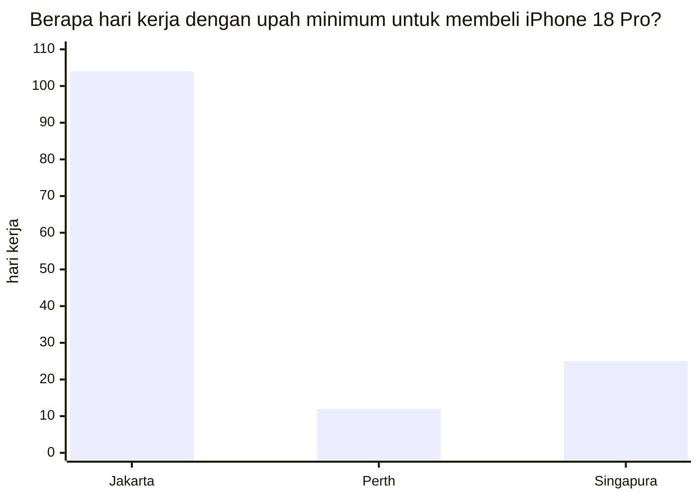

**Singkatnya:** nasi goreng memang jauh lebih murah di Indonesia, tetapi tabungan di akhir bulan bisa jauh lebih tebal di Australia dan Singapura. Sebabnya, selisih gaji antarnegara jauh lebih lebar daripada selisih harga, apalagi banyak barang seperti ponsel, baju, dan bensin harganya kurang lebih sama di mana pun. Menurut hitungan saya, pekerja profesional di Perth bisa menyisihkan sekitar Rp32 juta sebulan dan di Singapura sekitar Rp40 juta, sedangkan di Jakarta hanya Rp1,3 juta. Ada catatannya: yang paling megap-megap justru pekerja bergaji rendah di Singapura.
{: .tldr}

* TOC
{:toc}

## Apa itu #KaburAjaDulu, dan kenapa ada dua kubu?

Tagar ini sebenarnya sudah muncul sejak 2023, lalu meledak di awal 2025 sebagai luapan kekecewaan, terutama dari anak muda, terhadap kondisi di dalam negeri.[^kad] Tak lama kemudian muncul kubu tandingan yang berpendapat bahwa hidup di Indonesia justru lebih enak karena harga-harganya murah. Kekecewaan itu sendiri bukan tanpa dasar. Salah satu contohnya adalah ketimpangan yang kembali melebar: rasio Gini naik dari 0,363 (September 2025) menjadi 0,368 (Maret 2026).[^gini] Cukup sampai di situ soal kondisi dalam negeri, karena tulisan ini membahas uang, bukan politik.

Sekarang, mari jujur-jujuran dulu. Saya punya banyak teman yang bekerja di luar negeri, sebagian besar di Singapura, Inggris, Amerika Serikat, Jepang, dan Australia, negara tempat saya tinggal sekarang. Tentu saja sampel ini tidak sepenuhnya mewakili populasi secara luas (ada bias): mereka seumuran dengan saya, sedang berada di usia paling produktif, dan teman yang tidak betah sudah lama pulang sehingga tidak ikut terhitung. Meski begitu, ketika saya tanya apakah mereka mau kembali ke Indonesia, hampir semuanya menjawab sama: enggak mau. Karena sampelnya bias, saya tetap tidak mau bersandar pada testimoni seperti itu dan lebih memilih bicara dengan angka.

## Benarkah hidup di Indonesia lebih enak karena murah?

Mari mulai dari argumen terkuat kubu "murah". Anggap saja gajimu Rp10 juta sebulan di Indonesia dan sepiring nasi goreng harganya Rp20.000. Gaji sebesar itu cukup untuk membeli 500 porsi sebulan. Di Australia, anggap gajimu A$5.000 dan nasi goreng A$20, jadi sebulan kamu cuma kebagian 250 porsi. Kelihatannya seperti turun kelas, kan? 😅 (Angka bulat ini hanya ilustrasi.)

Soal rasa, saya pun mengakui nasi goreng Rp20 ribuan di Indonesia memang lebih nendang.

<figure>

</figure>

Pertanyaannya, berapa persen gajimu yang benar-benar habis untuk nasi goreng? Makan di luar hanya menyumbang sekitar 15 persen dari total belanja bulanan. Sisanya habis untuk sewa, bahan makanan, listrik dan air, ongkos transportasi, tagihan ponsel, dan barang-barang lain yang kamu beli. Bagian untuk nasi goreng hanya secuil, dan tidak ada orang yang menghabiskan seluruh gajinya untuk nasi goreng.

Ada satu hal lagi yang perlu diingat supaya perbandingannya tidak berat sebelah. Per Agustus 2025, rata-rata upah buruh di Indonesia hanya Rp3,33 juta sebulan,[^bpsupah] sehingga gaji Rp10 juta tadi sudah tiga kali lipat rata-rata. Artinya, tulisan ini lebih relevan bagi kamu yang memang punya pilihan untuk pindah, bukan untuk semua orang.

## Kenapa nasi goreng mahal di negara maju?

Jawabannya ada pada dua jenis barang dan jasa yang biasa dibedakan para ekonom: yang ***non-tradable*** (tidak bisa diperdagangkan antarnegara) dan yang ***tradable*** (bisa diperdagangkan).

| | *Non-tradable* | *Tradable* |
| --- | --- | --- |
| Artinya | Tidak bisa diimpor, harus dibuat di tempat | Bisa dibeli dari mana saja |
| Contoh | Nasi goreng di restoran, sewa, potong rambut, jasa tukang | Baju, ponsel, laptop, mobil, bensin |
| Harganya mengikuti | Upah dan sewa setempat | Harga pasar dunia (kurang lebih) |

Nasi goreng di restoran termasuk barang *non-tradable*. Coba pikirkan bagian mana dari sepiring nasi goreng restoran yang tidak bisa diimpor: kokinya, pelayannya, dan bangunan restorannya, yang semuanya harus ada di tempat. Di negara maju, upah koki dan sewa ruko memang tinggi, dan biaya itu diteruskan ke pembeli, termasuk kita. Itulah sebabnya nasi goreng restoran di Perth mahal: bukan karena restorannya serakah, melainkan karena upahnya tinggi.

Lain ceritanya dengan barang *tradable*. Baju, kendaraan, elektronik, dan bensin harganya relatif sama di seluruh dunia (bensin pun mengikuti harga minyak dunia, kecuali yang harganya diatur pemerintah seperti di Indonesia). iPhone tidak mendadak jadi murah hanya karena dijual di Jakarta.

Bahan makanan berada di antara keduanya. Beras dan daging memang bisa diperdagangkan, tetapi sebagian mudah rusak dan sebagian diproduksi di dalam negeri, sehingga harganya separuh mengikuti pasar dunia dan separuh mengikuti kondisi setempat.

## Berapa yang tersisa di akhir bulan? Skenario A: pekerja bergaji rendah

Agar adil, saya menguji dua kelompok pekerja. Untuk kedua skenario, saya memakai [*tool* Cost of Living Comparator](https://tool.adjiebrotots.com/costofliving-comparator/) dalam mode **Detailed** dan daftar pengeluaran yang sama untuk ketiga kota, yaitu milik seorang lajang yang menyewa tempat tinggal dengan tipe yang sama, kadang masak sendiri dan kadang jajan di luar, serta bepergian dengan motor atau transportasi umum. Perbandingannya pun benar-benar *apple to apple*. Jakarta saya jadikan titik awal, lalu *tool* ini memperkirakan setiap baris pengeluaran (sewa, makanan, listrik dan air, bensin, kesehatan, dan seterusnya) untuk Perth dan Singapura berdasarkan indeks harga masing-masing kota. Dengan begitu, kamu bisa melihat selisihnya baris demi baris.

Skenario pertama memakai gaji pekerja bergaji rendah di ketiga kota.

- **Jakarta:** UMP DKI 2026 sebesar Rp5.729.876 per bulan, yang saya anggap sebagai gaji bersih (*take-home pay*).[^ump]
- **Perth:** upah minimum nasional Australia A$26,44 per jam. Untuk kerja penuh waktu 38 jam seminggu, upah mingguannya A$1.004,90 (berlaku sejak 1 Juli 2026).[^fwc] Setelah dipotong pajak penghasilan untuk penduduk pajak Australia (*resident tax*) dan *Medicare levy* (iuran 2% untuk layanan kesehatan publik), gaji bersihnya sekitar A$3.769 per bulan.[^ato]
- **Singapura:** negara ini tidak punya upah minimum nasional. Yang ada adalah Progressive Wage Model (PWM), skema upah minimum per sektor yang naik mengikuti jenjang keterampilan. Untuk jenjang terbawah pekerja kebersihan, upahnya S$2.080 per bulan (1 Juli 2026 sampai 30 Juni 2027).[^pwm] Setelah dipotong iuran CPF (Central Provident Fund, tabungan pensiun wajib) sebesar 20%, gaji bersihnya S$1.664.[^cpf]

| Per bulan | Jakarta (Rp) | Perth (A$) | Singapura (S$) |
| --- | --- | --- | --- |
| Gaji bersih | 5.729.876 | 3.769 | 1.664 |
| Sewa | 1.800.000 | 852 | 852 |
| Belanja bahan makanan | 1.400.000 | 223 | 202 |
| Makan di luar | 800.000 | 242 | 166 |
| Listrik, air, gas | 400.000 | 167 | 95 |
| Transportasi (bensin) | 400.000 | 60 | 112 |
| Kesehatan (dokter, obat) | 150.000 | 50 | 42 |
| Lain-lain (ponsel, pakaian, dll.) | 450.000 | 83 | 80 |
| **Total pengeluaran** | **5.400.000** | **1.677** | **1.549** |
| **Tabungan** | **329.876** | **2.092** | **115** |
| Rasio tabungan | 5,8% | 55,5% | 6,9% |
| Tabungan dalam rupiah | Rp330 ribu | Rp26,6 juta | Rp1,6 juta |

*Angka dibulatkan. Kurs mengikuti bawaan Cost of Living Comparator: A$1 = Rp12.710 dan S$1 = Rp14.152.*

Pekerja di Perth jelas paling untung: dalam rupiah, tabungannya sekitar 80 kali lipat tabungan pekerja di Jakarta. Di atas kertas, pekerja di Singapura juga lebih untung (6,9% versus 5,8%), tetapi selisihnya tipis sekali, dan di sinilah saya harus jujur. PWM hanya wajib diterapkan untuk warga negara dan penduduk tetap (PR), tidak untuk pemegang Work Permit (izin kerja Singapura untuk pekerja asing berketerampilan rendah).[^pwm] Artinya, skenario ini hanya menunjukkan bagaimana harga terbentuk, bukan jalur yang biasa ditempuh orang Indonesia yang pindah ke sana. Perlu dicatat juga bahwa potongan CPF tadi sebenarnya tabungan wajibmu sendiri, sehingga jumlah yang kamu tabung lebih besar daripada angka di tabel.

Bagaimana kalau perkiraan *tool* ini meleset? Saya mengujinya dengan *stress test* (uji ketahanan): semua pengeluaran selain sewa saya naikkan 50 persen, karena *tool* ini memakai indeks harga, bukan struk belanja sungguhan. Hasilnya, tabungan di Perth masih tersisa sekitar A$1.680 per bulan (sekitar Rp21,4 juta), sedangkan di Singapura tabungannya langsung tekor.

## Bagaimana dengan pekerja profesional? Skenario B

Skenario kedua lebih mirip jalur yang biasa ditempuh orang Indonesia, yaitu pindah karena mendapat pekerjaan dan visanya disponsori perusahaan.

- **Jakarta:** gaji bersih Rp10 juta.
- **Perth:** untuk visa kerja terampil, Australia menetapkan gaji minimum yang disebut Core Skills Income Threshold (CSIT), dulu dikenal sebagai TSMIT. Besarnya A$79.423 per tahun (sumber sekunder sedikit berbeda, lihat catatan kaki). Setelah dipotong pajak dan *Medicare levy*, gaji bersihnya sekitar A$5.291 per bulan.[^csit]
- **Singapura:** pekerja profesional asing butuh Employment Pass (EP), izin kerja yang mensyaratkan gaji minimum S$5.600 per bulan. Setelah dipotong pajak penghasilan untuk penduduk pajak Singapura (*tax resident*), gaji bersihnya sekitar S$5.396, karena pemegang izin kerja asing tidak membayar CPF.[^ep]

Untuk skenario ini, pos-pos pengeluaran saya naikkan karena gaya hidup pekerja profesional biasanya ikut naik: tempat tinggal dengan satu kamar tidur, lebih sering makan di luar, dan biaya kesehatan yang lebih besar.

| Per bulan | Jakarta (Rp) | Perth (A$) | Singapura (S$) |
| --- | --- | --- | --- |
| Gaji bersih | 10.000.000 | 5.291 | 5.396 |
| Sewa | 3.000.000 | 1.420 | 1.420 |
| Belanja bahan makanan | 1.800.000 | 287 | 260 |
| Makan di luar | 1.500.000 | 454 | 312 |
| Listrik, air, gas | 600.000 | 250 | 142 |
| Transportasi (bensin) | 600.000 | 90 | 167 |
| Kesehatan (dokter, obat) | 300.000 | 100 | 85 |
| Lain-lain (ponsel, pakaian, dll.) | 900.000 | 166 | 160 |
| **Total pengeluaran** | **8.700.000** | **2.766** | **2.545** |
| **Tabungan** | **1.300.000** | **2.525** | **2.851** |
| Rasio tabungan | 13,0% | 47,7% | 52,8% |
| Tabungan dalam rupiah | Rp1,3 juta | Rp32,1 juta | Rp40,3 juta |

*Angka dibulatkan.*

Kali ini pekerja di Perth dan Singapura sama-sama unggul telak: rasio tabungan mereka sekitar empat kali lipat rasio tabungan di Jakarta, sementara nominalnya 25 sampai 31 kali lipat. Dengan *stress test* yang sama (semua pengeluaran selain sewa naik 50 persen), tabungan yang tersisa masih sekitar Rp24 juta di Perth dan Rp32 juta di Singapura, sehingga kesimpulannya tidak berubah.

Kamu bisa menyusun skenariomu sendiri di [Cost of Living Comparator](https://tool.adjiebrotots.com/costofliving-comparator/): isi kota asal, kota tujuan, gaji, dan pengeluaranmu, lalu lihat berapa yang tersisa.

## Apa yang bisa kamu beli dengan tabungan itu?

Ada satu hal yang sering terlupakan dalam perdebatan ini: kalau harga barang *tradable* sama di mana-mana, gaji yang lebih besar otomatis berarti daya beli yang lebih besar pula.

Ambil contoh iPhone 18 Pro 256GB yang baru dirilis bulan ini. Harga resminya sekitar Rp27,5 juta di Indonesia, A$2.099 di Australia, dan S$1.899 di Singapura.[^iphone] Kalau dikonversi dengan kurs A$1 = Rp12.710 dan S$1 = Rp14.152, harga di Australia dan Singapura setara dengan Rp26,7 juta dan Rp26,9 juta, hampir sama dan malah sedikit lebih murah. Sekarang bandingkan harga itu dengan gaji bersih pekerja berupah minimum di ketiga kota:

*Dihitung dari gaji bersih pekerja berupah minimum (Rp5,73 juta, A$3.769, dan S$1.664 sebulan), dengan 21,7 hari kerja per bulan.*

Di Jakarta, pekerja bergaji UMP harus bekerja sekitar 4,8 bulan untuk membeli satu iPhone, sementara di Perth cukup sekitar 12 hari kerja dan di Singapura sekitar 25 hari. Untuk pekerja profesional, selisihnya mengecil, tetapi masih jauh: 2,8 bulan di Jakarta, dibandingkan dengan sekitar 9 hari kerja di Perth dan 8 hari di Singapura.

Logika yang sama berlaku untuk liburan ke luar negeri, karena harga tiket pesawat dan hotel di tempat tujuan sama untuk semua orang. Bagi orang Indonesia, Jepang mungkin terasa mahal, sementara bagi orang Singapura atau Australia, liburan ke Jepang rasanya seperti belanja saat diskon besar-besaran.

## Apa saja keuntungan lain di luar gaji?

Gaji bukan satu-satunya alasan untuk pindah. Berikut beberapa hal yang saya rasakan sendiri sejak pindah dari Jakarta ke Perth:

- **Infrastruktur yang lebih baik**, termasuk taman dan transportasi umum.
- **Gejolak sosial yang lebih jarang, karena kesenjangannya relatif lebih kecil.** Rasio Gini Australia untuk pendapatan setelah pajak dan tunjangan (*disposable income*) sebesar 0,307 pada 2022-23, sementara rasio Gini pengeluaran Indonesia sebesar 0,368 pada Maret 2026.[^gini] Karena ukurannya berbeda, anggap saja perbandingan ini gambaran kasar, bukan angka yang persis. Untuk Singapura, saya tidak dalam posisi untuk menarik kesimpulan.
- **Layanan publik yang benar-benar melayani.** Dari pengamatan pribadi saya, bukan dari hitungan, ini terjadi karena setiap petugas publik relatif melayani lebih sedikit penduduk.
- **_Capital freedom_ (kebebasan menaruh modal).** Secara hukum, penduduk Indonesia bebas memiliki dan menggunakan devisa.[^uu] Dalam praktiknya, berinvestasi di instrumen luar negeri dari Indonesia terasa sulit, padahal investasi semacam itu berguna sebagai pegangan kalau-kalau negara tempat kita tinggal sedang tidak baik-baik saja. Di negara yang tergolong pasar maju (*developed market*), kamu biasanya bebas memarkir uang di negara lain. Hambatan di Indonesia lebih banyak berupa akses yang terbatas dan urusan praktis yang merepotkan, bukan larangan. Bagian tentang hambatan ini berdasarkan pengalaman saya sendiri, bukan tafsir atas bunyi pasal.

<figure>

</figure>

## Apakah semua orang cocok untuk kabur?

Tentu tidak. Keberatan bahwa tidak semua orang cocok untuk kabur memang yang paling kuat, dan sebagian isinya benar:

- **Tidak semua orang bisa pergi.** Visa kerja terampil mensyaratkan tawaran kerja, sponsor dari perusahaan, dan gaji yang memenuhi batas minimum. Karena syarat itu, skenario upah minimum lebih tepat dibaca sebagai ilustrasi tentang bagaimana harga terbentuk, bukan sebagai jalur pindah yang realistis.
- **Ada biaya yang tidak masuk hitungan**, seperti harus hidup jauh dari keluarga, ongkos pindah dan visa, serta masa-masa awal yang sepi.
- **Bias sampel.** Teman-teman saya adalah mereka yang bertahan, dan saya tidak punya data berapa persen yang menyerah lalu pulang.
- **Kalau penghasilanmu di Indonesia sudah tinggi, atau usahamu ada di sini**, hitungannya bisa berbeda. *Tool* ini hanya menghitung gaji dan biaya hidup, tidak termasuk peluang yang cuma ada di Indonesia.
- **Perkiraan ini berbasis indeks harga.** *Tool* ini memperkirakan biaya dari indeks tiap kota, bukan dari struk belanjamu. Itulah alasan saya menguji hitungannya dengan *stress test*, yaitu menaikkan semua pengeluaran selain sewa sebesar 50 persen.

## Jadi, kabur atau bertahan?

Nasi goreng di Jakarta memang lebih murah dan lebih enak, tetapi harganya hanya menentukan menu makan siangmu hari ini. Selisih antara penghasilan dan pengeluaranlah yang pada akhirnya membentuk masa depanmu.

Kalau kamu sedang menimbang untuk pindah, mulailah dari selisih itu, bukan dari perasaan atau dari harga sepiring nasi goreng: berapa yang tersisa di akhir bulan, dan apa yang bisa kamu beli dengan sisa tersebut. Masukkan angkamu sendiri di [Cost of Living Comparator](https://tool.adjiebrotots.com/costofliving-comparator/), baru setelah itu ambil keputusan.

## Referensi

[^kad]: Bisnis.com, [Awal mula kemunculan #KaburAjaDulu yang digaungkan masyarakat](https://kabar24.bisnis.com/read/20250215/15/1839813/awal-mula-kemunculan-kaburajadulu-yang-digaungkan-masyarakat), 15 Februari 2025. Tagar ini sudah dipakai sejak 2023 dan melonjak pada Januari 2025.
[^gini]: BPS, rasio Gini (pengeluaran) 0,368 per Maret 2026 dan 0,363 per September 2025, dikutip dari [Bisnis.com](https://ekonomi.bisnis.com/read/20260805/9/1993850/ketimpangan-makin-lebar-rasio-gini-maret-2026-naik-menjadi-0368), 5 Agustus 2026. Australia: ABS, [Income and wealth inequality](https://www.abs.gov.au/statistics/measuring-what-matters/measuring-what-matters-themes-and-indicators/prosperous/income-and-wealth-inequality), rasio Gini pendapatan rumah tangga setelah pajak dan tunjangan (*equivalised disposable income*) 0,307 pada 2022-23.
[^bpsupah]: BPS, [Keadaan Ketenagakerjaan Agustus 2025](https://www.bps.go.id/id/pressrelease/2025/11/05/2479/keadaan-ketenagakerjaan-.html), 5 November 2025: rata-rata upah buruh Rp3,33 juta per bulan.
[^ump]: [Katadata](https://katadata.co.id/amp/berita/industri/694bb57d97fa5/ump-jakarta-2026-resmi-naik-jadi-rp-5-72-juta/), UMP DKI Jakarta 2026 Rp5.729.876, berlaku 1 Januari 2026. Saya menganggapnya sebagai gaji bersih karena iuran BPJS dan pajak di tingkat upah ini kecil, sehingga tidak saya masukkan ke dalam model.
[^fwc]: Fair Work Ombudsman, [Minimum wages increase from 1 July 2026](https://www.fairwork.gov.au/about-us/workplace-laws/annual-wage-review/annual-wage-review-2026): A$26,44 per jam atau A$1.004,90 per minggu.
[^ato]: Tarif pajak penghasilan *resident* 2026-27: 0% sampai A$18.200, 15% sampai A$45.000, 30% sampai A$135.000, ditambah *Medicare levy* 2% dan Low Income Tax Offset (potongan pajak untuk penghasilan rendah). Lihat [ATO](https://www.ato.gov.au/tax-rates-and-codes/tax-rates-australian-residents) dan tabel 2026-27 di [taxbne.com.au](https://www.taxbne.com.au/blog-posts/new-tax-rates-2026-27). *Superannuation* (iuran pensiun) yang dibayar pemberi kerja di luar gaji tidak ikut dihitung.
[^pwm]: MOM, [Progressive Wage Model, sektor kebersihan](https://www.mom.gov.sg/maintenance/employment-practices/progressive-wage-model/cleaning-sector/): upah dasar pembersih umum S$2.080 per bulan yang berlaku 1 Juli 2026 sampai 30 Juni 2027 (sebelumnya S$1.910). Cakupan: [apa itu PWM](https://www.mom.gov.sg/maintenance/employment-practices/progressive-wage-model/what-is-pwm/), wajib untuk warga negara dan PR. Bonus PWM minimal dua minggu gaji per tahun tidak saya masukkan, sehingga angka ini sedikit konservatif.
[^cpf]: CPF Board, tarif iuran 2026 untuk karyawan 55 tahun ke bawah: karyawan 20%, pemberi kerja 17%, menurut [CPF](https://www.cpf.gov.sg/service/article/what-are-the-changes-to-the-cpf-contribution-rates-for-senior-workers-from-1-january-2026). Pemegang izin kerja (*work pass*) asing tidak membayar CPF.
[^csit]: Batas gaji minimum visa Skills in Demand (subclass 482) jalur Core Skills per 1 Juli 2026, dikutip dari [Ethos Migration Lawyers](https://ethosmigration.com.au/annual-indexation-of-the-core-skills-income-threshold-csit-and-specialist-skills-income-threshold-ssit-as-of-1-july-2026/) dan sumber lain. Sumber sekunder berbeda tipis (A$79.423 versus A$79.499, naik dari A$76.515); saya memakai A$79.423, dan selisih A$76 per tahun tidak mengubah kesimpulan. Angka resminya bisa dicek di [Home Affairs](https://immi.homeaffairs.gov.au/visas/employing-and-sponsoring-someone/sponsoring-workers/nominating-a-position/income-thresholds).
[^ep]: MOM, [Employment Pass eligibility](https://www.mom.gov.sg/passes-and-permits/employment-pass/eligibility): gaji minimum S$5.600 per bulan untuk pelamar baru sebelum 1 Januari 2027 (S$6.000 setelahnya), naik sesuai usia sampai S$10.700. Saya memakai batas bawahnya. Pajak: tarif *resident* tahun pajak 2026 (YA2026) dari [IRAS](https://www.iras.gov.sg/taxes/individual-income-tax/basics-of-individual-income-tax/tax-residency-and-tax-rates/individual-income-tax-rates), tanpa potongan pajak (*relief*).
[^iphone]: Indonesia: [Selular.ID](https://selular.id/2026/10/daftar-harga-resmi-iphone-18-series-di-indonesia-iphone-18-pro-tembus-rp58-juta/), 7 Oktober 2026, Rp27.499.000. Australia: [Finder](https://www.finder.com.au/news/iphone-18-pro-and-pro-max-price-specs-availability-australia), A$2.099. Singapura: [TechRepublic](https://www.techrepublic.com/article/news-iphone-18-pro-sea-prices-apac-southeast-asia/), S$1.899. Ketiganya bersumber dari laporan media tentang harga resmi Apple, bukan langsung dari situs Apple.
[^uu]: [UU No. 24 Tahun 1999](https://peraturan.go.id/files/uu24-1999.pdf) tentang Lalu Lintas Devisa dan Sistem Nilai Tukar, Pasal 2 ayat (1): penduduk dapat secara bebas memiliki dan menggunakan devisa.
