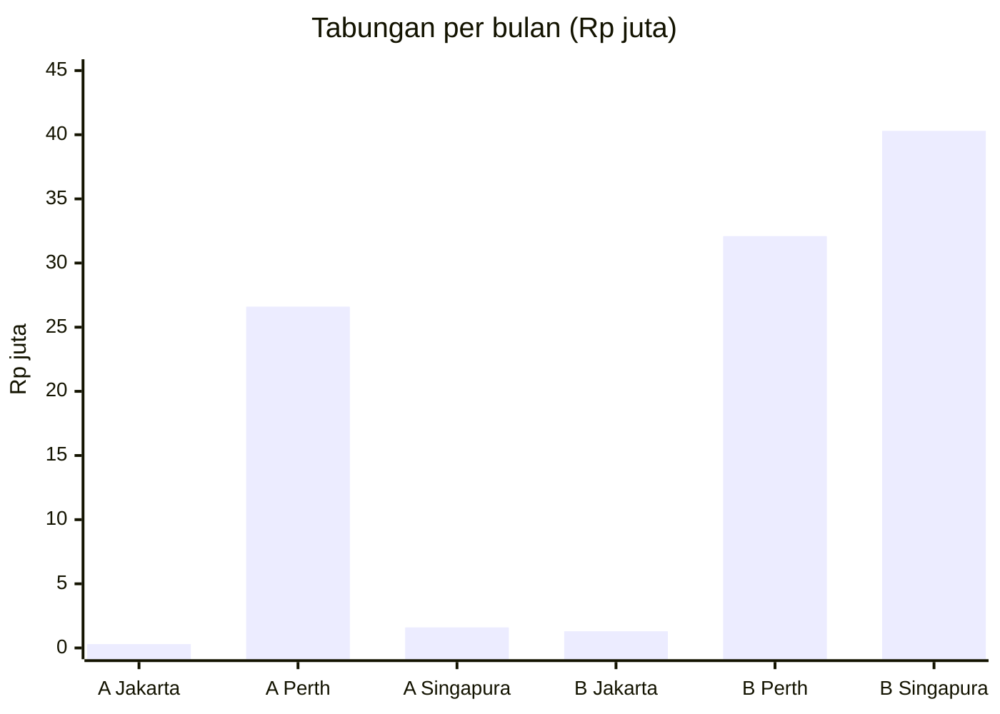
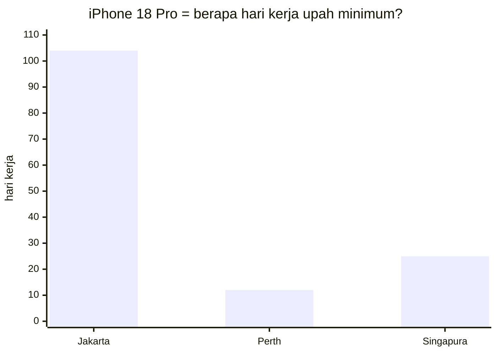

**Singkatnya:** nasi goreng memang jauh lebih murah di Indonesia, tapi tabungan akhir bulan bisa jauh lebih besar di Australia dan Singapura. Alasannya, sebagian besar belanja kita adalah barang yang harganya hampir sama di seluruh dunia, sementara gajinya gak sama. Di hitungan saya, pekerja profesional di Perth menabung sekitar Rp32 juta sebulan, di Singapura sekitar Rp40 juta, sedangkan di Jakarta Rp1,3 juta. Dengan catatan: yang paling tipis justru pekerja upah rendah di Singapura.
{: .tldr}

* TOC
{:toc}

## Apa itu #KaburAjaDulu, dan kenapa ada dua kubu?

Tagar ini sebenarnya sudah muncul sejak 2023, lalu meledak di awal 2025 sebagai ungkapan kecewa, terutama dari anak muda, terhadap kondisi di dalam negeri.[^kad] Sejak itu muncul kubu tandingannya: justru hidup di Indonesia lebih enak, karena harga-harganya murah. Bukan tanpa alasan. Ketimpangan misalnya melebar lagi, rasio Gini naik dari 0,363 (September 2025) menjadi 0,368 (Maret 2026).[^gini] Itu saja yang akan saya bahas soal kondisi dalam negeri. Tulisan ini soal uang, bukan politik.

Sekarang pengakuan dulu. Saya punya banyak teman yang bekerja di luar negeri: paling banyak di Singapura, Inggris, Amerika Serikat, Jepang, dan tentu saja Australia. Sampel ini bias. Mereka seusia saya, di usia paling produktif, dan mereka yang gak betah sudah pulang, jadi gak masuk hitungan. Tapi hampir semua yang saya tanya apakah mau balik ke Indonesia menjawab sama: gak mau. Karena itu saya gak mau mengandalkan testimoni. Mari kita pakai angka.

## Benarkah hidup di Indonesia lebih enak karena murah?

Mari mulai dari argumen terbaik kubu "murah". Anggap gajimu Rp10 juta di Indonesia, dan nasi goreng Rp20.000. Sebulan kamu bisa membeli 500 porsi. Di Australia, anggap gajimu A$5.000 dan nasi goreng A$20. Sebulan cuma 250 porsi. Kelihatan downgrade, kan 😅 (angka bulat ini hanya ilustrasi, angka sungguhannya di tabel nanti).

Dan saya akui: nasi goreng Rp20 ribuan itu rasanya memang lebih enak.

<figure>

</figure>

Tapi coba jujur: berapa persen gajimu yang habis untuk nasi goreng? Di daftar pengeluaran yang saya pakai di bawah, makan di luar cuma sekitar 15 sampai 17 persen dari seluruh belanja bulanan. Sisanya sewa, belanja bahan makanan, listrik dan air, ongkos, ponsel, dan barang-barang yang kamu beli. Nasi goreng itu secuil. Kamu gak mungkin menghabiskan seluruh gajimu cuma untuk nasi goreng.

Satu konsesi lagi, supaya adil. Rata-rata upah buruh di Indonesia Rp3,33 juta per Agustus 2025.[^bpsupah] Rp10 juta itu tiga kali lipatnya. Jadi apa yang saya bahas di sini berlaku untuk kamu yang punya pilihan untuk pindah, bukan untuk semua orang.

## Kenapa nasi goreng mahal di negara maju?

Jawabannya ada di dua jenis barang: **non-tradable** dan **tradable** goods.

| | Non-tradable | Tradable |
| --- | --- | --- |
| Artinya | Gak bisa diimpor, harus ada di tempat | Bisa dibeli dari mana saja |
| Contoh | Nasi goreng di restoran, sewa, potong rambut, tukang | Baju, ponsel, laptop, mobil, bensin |
| Harga mengikuti | Upah dan sewa setempat | Harga pasar dunia (kurang lebih) |

Nasi goreng di restoran termasuk non-tradable. Apa yang gak bisa diimpor? Koki dan pelayannya, dan bangunan restorannya. Semua harus ada di situ. Di negara maju, upah koki dan sewa ruko memang tinggi, dan harganya dilempar ke pembeli seperti kita. Makanya nasi goreng restoran di Perth mahal. Ini bukan restorannya serakah. Ini upahnya.

Barang tradable lain ceritanya. Baju, kendaraan, elektronik, bensin: harganya relatif sama di seluruh dunia (bensin pun ikut harga minyak dunia, kecuali yang harganya diatur pemerintah, seperti di Indonesia). iPhone gak jadi murah hanya karena dijual di Jakarta.

Makanan ada di antara keduanya. Beras dan daging bisa diperdagangkan, tapi punya tanggal kedaluwarsa dan sebagian diproduksi lokal, jadi harganya separuh ikut dunia, separuh ikut setempat.

Jadi pertanyaannya bergeser: kalau barang tradable harganya sama di mana-mana, siapa yang punya gaji lebih besar untuk membelinya?

## Berapa tabungan akhir bulannya? Skenario A: upah rendah

Supaya adil, kita uji dua kelompok. Hitungan di bawah dibuat dengan [tool Cost of Living Comparator](https://tool.adjiebrotots.com/costofliving-comparator/) buatan saya, dalam mode Detailed, dengan satu daftar pengeluaran yang sama di tiga kota: seorang single, menyewa tempat tinggal dengan tipe yang sama, makan campur masak dan di luar, bepergian dengan motor atau transportasi umum. Itu yang saya maksud dengan apple to apple. Jakarta jadi titik awal. Tiap baris (sewa, makanan, listrik dan air, bensin, kesehatan, dan seterusnya) lalu diperkirakan tool untuk Perth dan Singapura dari indeks harga masing-masing kota, jadi kamu bisa melihat selisihnya per baris.

Skenario pertama: pekerja upah rendah.

- **Jakarta:** UMP DKI 2026, Rp5.729.876 per bulan, dianggap take-home.[^ump]
- **Perth:** upah minimum nasional A$26,44 per jam, kerja penuh waktu 38 jam, A$1.004,90 per minggu (berlaku 1 Juli 2026).[^fwc] Setelah pajak resident dan Medicare levy, take-home sekitar A$3.769 per bulan.[^ato]
- **Singapura:** Progressive Wage Model (PWM), jenjang paling bawah pekerja kebersihan, S$2.080 per bulan (1 Juli 2026 sampai 30 Juni 2027).[^pwm] Setelah iuran CPF 20% yang dipotong dari gaji, take-home S$1.664.[^cpf]

| Per bulan | Jakarta (Rp) | Perth (A$) | Singapura (S$) |
| --- | --- | --- | --- |
| Gaji take-home | 5.729.876 | 3.769 | 1.664 |
| Sewa | 1.800.000 | 852 | 852 |
| Belanja bahan makanan | 1.400.000 | 223 | 202 |
| Makan di luar | 800.000 | 242 | 166 |
| Listrik, air, gas | 400.000 | 167 | 95 |
| Transportasi (bensin) | 400.000 | 60 | 112 |
| Kesehatan (dokter, obat) | 150.000 | 50 | 42 |
| Lain-lain (ponsel, pakaian, dll.) | 450.000 | 83 | 80 |
| **Total pengeluaran** | **5.400.000** | **1.677** | **1.549** |
| **Tabungan** | **329.876** | **2.092** | **115** |
| Rasio tabungan | 5,8% | 55,5% | 6,9% |
| Tabungan dalam rupiah | Rp330 ribu | Rp26,6 juta | Rp1,6 juta |

*Angka dibulatkan. Kurs bawaan tool: A$1 = Rp12.710 dan S$1 = Rp14.152.*

Perth jelas menang: sekitar 80 kali lipat tabungan Jakarta, dalam rupiah. Singapura juga menang di atas kertas (6,9% versus 5,8%), tapi tipis, dan ini bagian yang harus saya jujurkan. PWM hanya mewajibkan upah itu untuk warga negara dan PR, bukan pemegang work permit.[^pwm] Jadi skenario ini menunjukkan mekanisme harga, bukan jalur yang biasa dilewati orang Indonesia yang pindah. Dan CPF yang dipotong itu sebenarnya tabungan wajibmu sendiri, jadi tabungan sebenarnya lebih besar daripada baris di atas.

Uji stres: kalau semua pengeluaran selain sewa ternyata 50 persen lebih mahal daripada perkiraan tool (tool memakai indeks, bukan struk belanja), tabungan di Perth masih sekitar A$1.680 per bulan (sekitar Rp21,4 juta), sedangkan di Singapura jatuh negatif.

## Bagaimana dengan pekerja profesional? Skenario B

Skenario kedua lebih mirip jalur yang biasa ditempuh orang Indonesia: pindah dengan pekerjaan dan sponsor visa dari perusahaan.

- **Jakarta:** Rp10 juta take-home.
- **Perth:** batas gaji minimum visa kerja terampil (dulu populer disebut TSMIT, sekarang Core Skills Income Threshold) sekitar A$79.423 per tahun. Setelah pajak dan Medicare levy, take-home sekitar A$5.291 per bulan.[^csit]
- **Singapura:** gaji minimum untuk Employment Pass (E-Pass), S$5.600 per bulan. Setelah pajak resident (tanpa CPF untuk pemegang pass asing), take-home sekitar S$5.396.[^ep]

Daftar pengeluarannya lebih tinggi karena gaya hidupnya juga: tempat tinggal satu kamar tidur, lebih sering makan di luar, dan biaya kesehatan yang lebih besar.

| Per bulan | Jakarta (Rp) | Perth (A$) | Singapura (S$) |
| --- | --- | --- | --- |
| Gaji take-home | 10.000.000 | 5.291 | 5.396 |
| Sewa | 3.000.000 | 1.420 | 1.420 |
| Belanja bahan makanan | 1.800.000 | 287 | 260 |
| Makan di luar | 1.500.000 | 454 | 312 |
| Listrik, air, gas | 600.000 | 250 | 142 |
| Transportasi (bensin) | 600.000 | 90 | 167 |
| Kesehatan (dokter, obat) | 300.000 | 100 | 85 |
| Lain-lain (ponsel, pakaian, dll.) | 900.000 | 166 | 160 |
| **Total pengeluaran** | **8.700.000** | **2.766** | **2.545** |
| **Tabungan** | **1.300.000** | **2.525** | **2.851** |
| Rasio tabungan | 13,0% | 47,7% | 52,8% |
| Tabungan dalam rupiah | Rp1,3 juta | Rp32,1 juta | Rp40,3 juta |

Kali ini dua-duanya menang telak. Rasionya sekitar 4 kali lipat, dan nominalnya 25 sampai 31 kali lipat. Uji stres yang sama (semua selain sewa 50 persen lebih mahal) menyisakan tabungan sekitar Rp24 juta di Perth dan Rp32 juta di Singapura. Kesimpulannya gak berubah.

*A = upah rendah, B = profesional di batas gaji minimum visa.*

Kamu bisa membuat skenariomu sendiri di [Cost of Living Comparator](https://tool.adjiebrotots.com/costofliving-comparator/): isi kota asal, kota tujuan, gaji, dan pengeluaranmu, lalu lihat berapa yang tersisa.

## Apa yang bisa kamu beli dengan tabungan itu?

Ini bagian yang sering terlupa. Kalau barang tradable harganya sama, gaji yang lebih besar langsung berarti daya beli lebih besar.

Ambil iPhone 18 Pro 256GB, yang baru rilis bulan ini. Harga resminya sekitar Rp27,5 juta di Indonesia, A$2.099 di Australia, dan S$1.899 di Singapura.[^iphone] Kalau dikonversi dengan kurs tool, di Australia dan Singapura harganya sekitar Rp26,7 juta dan Rp26,9 juta. Hampir sama, bahkan sedikit lebih murah. Sekarang bandingkan dengan take-home skenario A (upah minimum):

*Dihitung dari take-home di tabel A, 21,7 hari kerja per bulan.*

Di Jakarta, kamu harus bekerja sekitar 4,8 bulan di UMP untuk satu iPhone. Di Perth sekitar 12 hari kerja, di Singapura sekitar 25 hari. Untuk profesional di skenario B, selisihnya mengecil tapi tetap besar: 2,8 bulan di Jakarta versus sekitar 9 hari kerja di Perth dan 8 hari di Singapura.

Hal yang sama berlaku untuk jalan-jalan ke luar negeri. Harga tiket pesawat dan hotel di tujuan sama untuk semua orang. Bagi orang Indonesia, Jepang mungkin terasa mahal. Tapi kalau kamu orang Singapura atau Australia, Jepang itu diskon besar.

## Apa lagi bonus di luar gaji?

Gaji bukan satu-satunya alasan. Ini yang saya rasakan sendiri sejak pindah dari Jakarta ke Perth:

- **Infrastruktur lebih baik**, termasuk taman dan transportasi umum.
- **Minim gejolak sosial karena kesenjangan relatif lebih rendah.** Rasio Gini pendapatan disposable Australia 0,307 pada 2022-23, sementara rasio Gini pengeluaran Indonesia 0,368 pada Maret 2026.[^gini] Ukurannya berbeda, jadi anggap ini arah, bukan angka persis. Untuk Singapura, saya gak mengklaim apa-apa.
- **Public service yang lebih melayani.** Menurut saya, ini karena rasio penduduk per petugas publik yang relatif lebih kecil. Ini pengamatan, bukan hasil hitungan.
- **Capital freedom.** Secara hukum, penduduk Indonesia bebas memiliki dan menggunakan devisa.[^uu] Tapi di Indonesia rasanya sulit untuk berinvestasi ke instrumen luar negeri, kalau-kalau negara yang kita tinggali kenapa-kenapa. Di negara yang termasuk kategori Developed Market, biasanya kamu bebas memarkirkan uangmu di negara lain. Hambatannya lebih ke akses dan keribetan praktis, bukan larangan. Itu pengalaman saya, bukan pasal hukum.

<figure>

</figure>

## Tapi apakah semua orang cocok kabur?

Gak. Ini keberatan terkuat, dan sebagian benar.

- **Gak semua orang bisa.** Visa kerja terampil butuh pekerjaan dan sponsor, dan gaji yang memenuhi batas minimum. Skenario A, seperti saya jelaskan, sebagian besar mekanisme harga saja.
- **Ada biaya yang gak masuk tabel.** Jauh dari keluarga, biaya pindah dan visa, dan masa awal yang sepi.
- **Bias sampel.** Teman-teman saya adalah yang bertahan. Saya gak punya angka berapa persen yang menyerah dan pulang.
- **Kalau penghasilanmu di Indonesia sudah tinggi, atau usahamu ada di sini**, hitungannya bisa lain. Tool ini hanya memperkirakan gaji dan biaya, bukan kesempatan yang cuma ada di Indonesia.
- **Estimasi ini dari indeks harga.** Tool memperkirakan biaya dari indeks tiap kota, bukan dari struk belanjamu. Makanya saya tampilkan uji stres di atas.

## Jadi, kabur atau bertahan?

Nasi goreng di Jakarta memang lebih murah dan lebih enak. Tapi nasi goreng gak menentukan masa depanmu. Harga nasi goreng menentukan makan siangmu. Selisih antara gaji dan pengeluaran menentukan masa depanmu.

Kalau kamu sedang menimbang-nimbang, jangan mulai dari perasaan, dan jangan mulai dari harga nasi goreng. Mulai dari selisih: berapa yang tersisa di akhir bulan, dan apa yang bisa dibeli dengan sisa itu. Hitung versimu sendiri di [Cost of Living Comparator](https://tool.adjiebrotots.com/costofliving-comparator/), lalu putuskan.

Dan kalau hitungan itu membuatmu ingin bertanya soal rumah juga, saya pernah membahas [sewa atau beli rumah di Perth dan Jakarta](https://blog.adjiebrotots.com/id/sewa-atau-beli-rumah/).

## Referensi

[^kad]: Bisnis.com, [Awal mula kemunculan #KaburAjaDulu yang digaungkan masyarakat](https://kabar24.bisnis.com/read/20250215/15/1839813/awal-mula-kemunculan-kaburajadulu-yang-digaungkan-masyarakat), 15 Februari 2025. Tagar ini sudah dipakai sejak 2023 dan melonjak pada Januari 2025.
[^gini]: BPS, rasio Gini (pengeluaran) 0,368 per Maret 2026 dan 0,363 per September 2025, lewat [Bisnis.com](https://ekonomi.bisnis.com/read/20260805/9/1993850/ketimpangan-makin-lebar-rasio-gini-maret-2026-naik-menjadi-0368), 5 Agustus 2026. Australia: ABS, [Income and wealth inequality](https://www.abs.gov.au/statistics/measuring-what-matters/measuring-what-matters-themes-and-indicators/prosperous/income-and-wealth-inequality), Gini pendapatan disposable ekuivalen rumah tangga 0,307 pada 2022-23.
[^bpsupah]: BPS, [Keadaan Ketenagakerjaan Agustus 2025](https://www.bps.go.id/id/pressrelease/2025/11/05/2479/keadaan-ketenagakerjaan-.html), 5 November 2025: rata-rata upah buruh Rp3,33 juta per bulan.
[^ump]: [Katadata](https://katadata.co.id/amp/berita/industri/694bb57d97fa5/ump-jakarta-2026-resmi-naik-jadi-rp-5-72-juta/), UMP DKI Jakarta 2026 Rp5.729.876, berlaku 1 Januari 2026. Saya menganggapnya take-home; iuran BPJS dan pajak di level ini kecil, dan saya gak memodelkannya.
[^fwc]: Fair Work Ombudsman, [Minimum wages increase from 1 July 2026](https://www.fairwork.gov.au/about-us/workplace-laws/annual-wage-review/annual-wage-review-2026): A$26,44 per jam atau A$1.004,90 per minggu.
[^ato]: Tarif pajak resident 2026-27: 0% sampai A$18.200, 15% sampai A$45.000, 30% sampai A$135.000, ditambah Medicare levy 2% dan Low Income Tax Offset. Lihat [ATO](https://www.ato.gov.au/tax-rates-and-codes/tax-rates-australian-residents) dan tabel 2026-27 di [taxbne.com.au](https://www.taxbne.com.au/blog-posts/new-tax-rates-2026-27). Superannuation yang dibayar pemberi kerja di luar gaji gak dihitung.
[^pwm]: MOM, [Progressive Wage Model, sektor kebersihan](https://www.mom.gov.sg/maintenance/employment-practices/progressive-wage-model/cleaning-sector/): upah dasar pembersih umum S$2.080 per bulan untuk 1 Juli 2026 sampai 30 Juni 2027 (S$1.910 sebelumnya). Cakupan: [apa itu PWM](https://www.mom.gov.sg/maintenance/employment-practices/progressive-wage-model/what-is-pwm/), wajib untuk warga negara dan PR. Bonus PWM minimal dua minggu gaji per tahun gak saya masukkan, jadi angka ini sedikit konservatif.
[^cpf]: CPF Board, tarif iuran 2026 untuk karyawan 55 tahun ke bawah: karyawan 20%, pemberi kerja 17%, lewat [CPF](https://www.cpf.gov.sg/service/article/what-are-the-changes-to-the-cpf-contribution-rates-for-senior-workers-from-1-january-2026). Pemegang work pass asing gak membayar CPF.
[^csit]: Batas gaji minimum visa Skills in Demand (subclass 482) jalur Core Skills per 1 Juli 2026, lewat [Ethos Migration Lawyers](https://ethosmigration.com.au/annual-indexation-of-the-core-skills-income-threshold-csit-and-specialist-skills-income-threshold-ssit-as-of-1-july-2026/) dan sumber lain. Sumber sekunder berbeda tipis (A$79.423 versus A$79.499, dari A$76.515); saya memakai A$79.423, dan selisih A$76 per tahun gak mengubah kesimpulan. Cek angka resminya di [Home Affairs](https://immi.homeaffairs.gov.au/visas/employing-and-sponsoring-someone/sponsoring-workers/nominating-a-position/income-thresholds).
[^ep]: MOM, [Employment Pass eligibility](https://www.mom.gov.sg/passes-and-permits/employment-pass/eligibility): gaji minimum S$5.600 per bulan untuk pelamar baru sebelum 1 Januari 2027 (S$6.000 setelahnya), naik sesuai usia sampai S$10.700. Saya memakai batas bawahnya. Pajak: tarif resident YA2026 lewat [IRAS](https://www.iras.gov.sg/taxes/individual-income-tax/basics-of-individual-income-tax/tax-residency-and-tax-rates/individual-income-tax-rates), tanpa relief.
[^iphone]: Indonesia: [Selular.ID](https://selular.id/2026/10/daftar-harga-resmi-iphone-18-series-di-indonesia-iphone-18-pro-tembus-rp58-juta/), 7 Oktober 2026, Rp27.499.000. Australia: [Finder](https://www.finder.com.au/news/iphone-18-pro-and-pro-max-price-specs-availability-australia), A$2.099. Singapura: [TechRepublic](https://www.techrepublic.com/article/news-iphone-18-pro-sea-prices-apac-southeast-asia/), S$1.899. Ketiganya laporan media atas harga Apple, bukan halaman Apple sendiri.
[^uu]: [UU No. 24 Tahun 1999](https://peraturan.go.id/files/uu24-1999.pdf) tentang Lalu Lintas Devisa dan Sistem Nilai Tukar, Pasal 2 ayat (1): penduduk dapat secara bebas memiliki dan menggunakan devisa.
