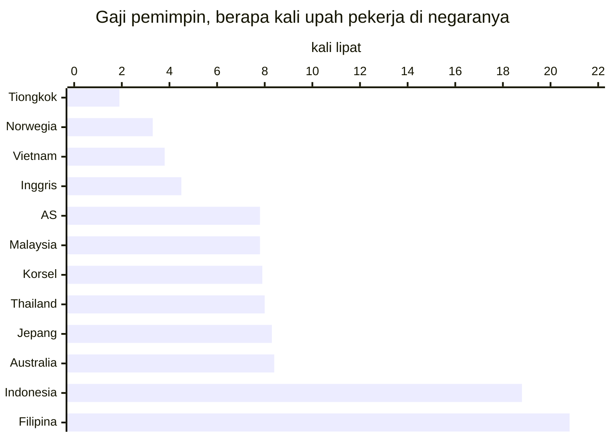
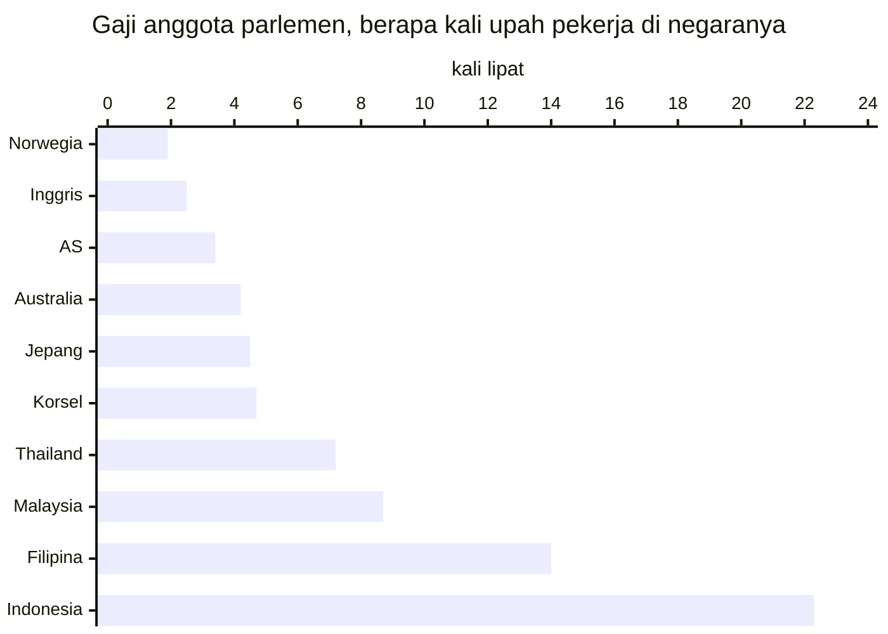

**Singkatnya:** kalau diukur dengan upah rakyatnya sendiri, gaji pejabat Indonesia jauh lebih tinggi daripada gaji politisi Australia. Gaji presiden setara 18,8 kali rata-rata upah buruh Indonesia, sedangkan gaji Perdana Menteri Australia hanya 8,4 kali median upah pekerja Australia. Jurangnya makin lebar di parlemen: gaji dan tunjangan anggota DPR setara 22,3 kali rata-rata upah buruh (19,7 kali setelah pajak), sementara gaji dan tunjangan anggota parlemen Australia hanya 4,2 kali median upah, dan kalau dana reses serta anggaran kantor ikut dihitung, perbandingannya menjadi sekitar 85 kali berbanding 8,6 kali. Itu pun belum termasuk fasilitas seumur hidup setelah lengser, iring-iringan bersirene, dan studi banding yang menelan miliaran rupiah, belum lagi laporan pengeluaran yang nyaris mustahil diperiksa publik.
{: .tldr}

* TOC
{:toc}

Selama lebih dari 25 tahun saya tinggal di Jakarta, iring-iringan pejabat dengan sirene dan lampu strobo sudah jadi pemandangan sehari-hari. Yang lewat bisa siapa saja, mulai dari presiden, menteri, sampai anggota DPR. Bunyinya begitu akrab di telinga sampai-sampai "tot tot wuk wuk" sempat viral pada 2025, ketika warga ramai-ramai memprotes pejabat yang memakai sirene di jalan.

Lain ceritanya dengan Perth. Sudah hampir dua tahun saya tinggal di sini, dan belum sekali pun saya melihat iring-iringan pejabat, bahkan untuk *Premier* Australia Barat pun tidak, meski dialah orang paling berkuasa di negara bagian ini (jabatannya kira-kira setara gubernur). Pertanyaannya, kenapa pejabat di Indonesia diperlakukan bak raja, sementara di Australia anggota parlemen diperlakukan tidak jauh berbeda dari manajer perusahaan biasa, padahal gaji dan fasilitas pejabat di kedua negara sama-sama dibayar dari pajak rakyat?

## Kenapa perantau Indonesia menulis soal politisi Australia?

Saya menulis ini karena dari kejauhan, perbedaan cara kedua negara memperlakukan pejabatnya justru terlihat makin jelas. Sebelum masuk ke angka, ada beberapa hal yang perlu saya luruskan terlebih dahulu supaya tulisan ini tidak dibaca dengan harapan yang keliru.

- **Ini bukan soal gaji atau biaya hidup di Perth.** Topik itu sudah saya bahas di tulisan [#KaburAjaDulu](/id/kabur-aja-dulu/), lengkap dengan hitungan tabungan di akhir bulan.
- **Ini juga bukan soal negara maju yang lebih unggul dalam segala hal.** Soal itu mungkin layak dibahas dalam tulisan tersendiri.
- **Saya tidak sedang memuja pemerintah Australia.** Banyak orang Australia pasti tidak setuju dengan sebagian isi tulisan ini, lagi pula tidak ada satu partai pun yang suci, baik Labor, Coalition, Greens, maupun One Nation.

Karena lebih dari 25 tahun saya tumbuh di Jakarta dan baru hampir dua tahun di Perth, kritik dalam tulisan ini lebih banyak saya arahkan ke Indonesia, negara yang paling saya kenal dan yang paling saya harapkan bisa lebih baik.

## Apa itu *fair go*, dan apa hubungannya dengan gaji pemimpin?

*Fair go* adalah keyakinan bahwa setiap orang berhak mendapat kesempatan yang sama, apa pun latar belakangnya, dan nilai inilah yang membuat orang Australia risih melihat siapa pun, termasuk pemimpinnya, berlagak seolah-olah lebih tinggi daripada orang lain. Nilai yang menjadi pasangannya adalah *mateship*, yaitu kesetiaan, solidaritas, dan kesetaraan di antara kawan, termasuk saling membantu di masa sulit. Kedua nilai itu tercantum dalam Australian Values Statement, pernyataan nilai-nilai Australia yang wajib ditandatangani para pemohon visa.[^values] Anggap saja ini Pancasila-nya Australia.

Akar nilai ini bisa dilacak dari sejarah Australia. Australia modern bermula pada 1788 sebagai koloni pembuangan narapidana Inggris. Berbeda dengan Amerika Serikat yang sebagian didirikan oleh kaum pelarian yang menghindari penindasan agama, atau Kanada yang tetap erat dengan Inggris, penduduk awal Australia adalah narapidana beserta para penjaganya, dan kebencian para narapidana terhadap sistem kelas Inggris ikut membentuk budaya yang curiga pada siapa pun yang merasa dirinya lebih tinggi. Orang Australia bahkan punya istilah untuk kebiasaan menjatuhkan orang yang terlalu menonjol: *tall poppy syndrome*.

Meski begitu, Australia bukan negara paling setara di dunia. Rasio Gini Australia, yang dihitung dari pendapatan setelah dipotong pajak dan ditambah bantuan sosial, sebesar 0,307 pada 2022-23, sementara negara-negara Nordik seperti Islandia, Norwegia, Denmark, dan Swedia jelas lebih setara.[^gini] Rasio Gini Indonesia sebesar 0,368 pada Maret 2026, lebih tinggi daripada rasio Gini Australia, padahal angka itu dihitung dari pengeluaran, bukan pendapatan, yang biasanya membuat ketimpangan terlihat lebih kecil daripada aslinya.[^gini]

Yang jauh lebih timpang justru tingkat kemakmuran kedua negara. Produk domestik bruto (PDB) per kapita Australia sekitar US$65.000 pada 2025, sedangkan Indonesia sekitar US$5.100, sehingga PDB per kapita Australia kira-kira 13 kali lipat Indonesia.[^imf] Artinya, warga Australia biasa sudah tergolong kaya menurut ukuran dunia, dan tidak heran kalau di Bali justru merekalah yang diperlakukan bak raja.

## Berapa gaji presiden dan perdana menteri dibandingkan upah pekerja biasa?

Gaji Presiden Indonesia setara 18,8 kali rata-rata upah buruh, sedangkan gaji Perdana Menteri Australia setara 8,4 kali median upah pekerja di negaranya. Membandingkan rupiah dengan dolar secara mentah tidak banyak artinya, sehingga ukuran yang lebih adil adalah melihat berapa kali lipat gaji pemimpin dibandingkan upah yang diterima kebanyakan rakyatnya sendiri.

Saya sengaja tidak memakai upah minimum, karena di Indonesia upah minimum belum tentu menggambarkan upah kebanyakan orang. Rata-rata upah buruh menurut BPS, yaitu Rp3,33 juta sebulan pada Agustus 2025, hanya setara rata-rata UMP 2025 (sekitar Rp3,31 juta) dan sudah tertinggal dari rata-rata UMP 2026 di 38 provinsi yang besarnya Rp3,51 juta.[^bpsupah][^ump] BPS hanya menerbitkan angka rata-rata, padahal segelintir orang bergaji sangat besar menarik rata-rata itu ke atas, sehingga median upah buruh kemungkinan lebih rendah lagi. Artinya, kelipatan untuk Indonesia dalam tulisan ini masih tergolong konservatif.

Di Australia, gaji Perdana Menteri A$622.110 setahun, yaitu gaji pokok anggota parlemen sebesar A$239.270 ditambah tunjangan jabatan sebesar 160%. Angka ini berlaku sejak 1 Juli 2025, dan karena Remuneration Tribunal (lembaga independen yang menetapkan gaji pejabat federal) memutuskan tidak ada kenaikan per 1 Juli 2026, angka itu masih berlaku sampai sekarang.[^rt] Sementara itu, median penghasilan pekerja Australia A$1.425 per minggu pada Agustus 2025, atau sekitar A$74.100 setahun.[^absmed]

Di Indonesia, gaji presiden terdiri atas gaji pokok Rp30.240.000 dan tunjangan jabatan Rp32.500.000, sehingga totalnya Rp62.740.000 sebulan, dan angka ini tidak berubah sejak 2001.[^setkab]

Mungkin kamu akan menyanggah: dalam rupiah, gaji Perdana Menteri Australia sekitar Rp648 juta sebulan (dengan kurs A$1 ≈ Rp12.500),[^kurs] atau sepuluh kali gaji presiden kita. Sanggahan itu ada benarnya, tetapi median upah pekerja di Australia juga sekitar 23 kali rata-rata upah buruh Indonesia, sehingga ukuran yang adil tetap kelipatan terhadap upah rakyatnya sendiri.

Lagi pula, gaji hanyalah sebagian dari hak keuangan yang diterima presiden. Selama menjabat, kebutuhan rumah tangga, kesehatan, dan transportasi presiden ditanggung negara lewat anggaran istana. UU No. 7 Tahun 1978 menjamin bahwa setelah lengser, mantan presiden mendapat uang pensiun sebesar 100% gaji pokok terakhir (Rp30,24 juta sebulan, bukan total gajinya), sebuah rumah lengkap dengan perabotnya, mobil negara beserta sopirnya, biaya air, listrik, dan telepon yang ditanggung negara, serta layanan kesehatan untuk dirinya dan keluarganya.[^uu7] Bandingkan dengan pekerja biasa yang harus [menyiapkan pensiunnya sendiri tanpa jadi PNS](/id/pensiun-tanpa-jadi-pns/).

Australia tidak punya pensiun khusus untuk perdana menteri. Skema pensiun lama bagi anggota parlemen (Parliamentary Contributory Superannuation Scheme), yang memberi pensiun bulanan pasti, ditutup untuk anggota baru sejak 9 Oktober 2004, sehingga anggota parlemen yang terpilih setelah itu, termasuk perdana menteri berikutnya, hanya mendapat *superannuation* (dana pensiun) biasa seperti pekerja lain.[^pcss] Supaya adil, perlu saya akui bahwa sebagian mantan perdana menteri masih menikmati skema lama itu, tetapi hak itu mereka dapat karena sudah menjadi anggota parlemen sebelum 2004, bukan karena pernah menjadi perdana menteri. Mantan perdana menteri juga mendapat kantor, tiga orang staf, dan jatah perjalanan dalam negeri yang dibatasi, semuanya untuk tugas publik.[^flagpost]

| | Perdana Menteri Australia | Presiden Indonesia |
| --- | --- | --- |
| Gaji per bulan | A$51.843 (A$622.110 setahun) | Rp62.740.000 |
| Kelipatan upah pekerja | 8,4 kali median upah | 18,8 kali rata-rata upah buruh |
| Fasilitas selama menjabat | Pengawalan penuh waktu dari polisi federal (AFP) | Kebutuhan rumah tangga, kesehatan, dan transportasi ditanggung negara |
| Pensiun setelah menjabat | Tidak ada pensiun khusus, hanya *superannuation* biasa (kecuali yang sudah menjadi anggota parlemen sebelum 2004) | 100% gaji pokok terakhir, Rp30,24 juta sebulan |
| Rumah setelah lengser | Tidak ada | Rumah beserta perabotnya |
| Mobil dan sopir setelah lengser | Tidak ada | Mobil negara beserta sopir |
| Fasilitas lain setelah lengser | Kantor, tiga staf, jatah perjalanan dalam negeri yang dibatasi | Biaya air, listrik, dan telepon ditanggung negara, serta layanan kesehatan untuk diri dan keluarga |

*Gaji per bulan Perdana Menteri Australia adalah gaji setahun dibagi 12. Sumber: Remuneration Tribunal, ABS, Setkab, BPS, UU No. 7 Tahun 1978, Departemen Keuangan Australia, dan Parliamentary Library.*

## Berapa penghasilan anggota DPR dibandingkan anggota parlemen Australia?

Gaji dan tunjangan kotor anggota DPR setara 22,3 kali rata-rata upah buruh (19,7 kali setelah pajak), sedangkan gaji dan tunjangan anggota parlemen Australia hanya setara 4,2 kali median upah pekerja. Kalau dana reses dan anggaran kantor ikut dihitung, perbandingannya menjadi sekitar 85 kali berbanding 8,6 kali. Begitu mendengar kata "DPR", yang terbayang di kepala kita adalah kekuasaan dan uang yang luar biasa besar. Di Australia, anggota parlemen lebih mirip manajer atau direktur di sebuah perusahaan: mereka bekerja sebagai eksekutif, bukan duduk di singgasana sebagai raja.

<figure>

</figure>

Mari mulai dari anggota parlemen biasa di House of Representatives (majelis rendah parlemen federal, padanan DPR), yang disebut *backbencher* karena tidak menjabat menteri. Gaji pokoknya A$239.270 setahun atau A$19.939 sebulan.[^rt] Di luar gaji, ada *electorate allowance* (tunjangan untuk biaya di daerah pemilihan) yang dibayarkan langsung kepada anggota dan dikenai pajak, dengan besaran A$39.700 sampai A$57.100 setahun, tergantung luas daerah pemilihannya.[^ea] Saya memakai angka tengahnya, A$47.200 setahun atau A$3.933 sebulan. Ada pula uang perjalanan ke Canberra, ibu kota Australia, berupa tarif per malam selama masa sidang yang menurut pemberitaan sekitar A$310 per malam.[^ta] Kalau saya perkirakan sekitar 80 malam setahun, jumlahnya kira-kira A$24.800 setahun atau A$2.067 sebulan. Totalnya sekitar A$311.270 setahun atau A$25.939 sebulan, setara 4,2 kali median upah bulanan pekerja Australia (A$6.175).[^absmed]

Setiap anggota parlemen Australia juga mendapat anggaran kantor untuk kegiatan di daerah pemilihan, yang fungsinya mirip dana reses di Indonesia: uang untuk melayani konstituen, bukan untuk dibawa pulang. Untuk tahun anggaran 2025-26, besarnya A$170.631 ditambah A$1,272 untuk setiap pemilih terdaftar.[^oeb] Untuk daerah pemilihan dengan sekitar 121.000 pemilih, anggarannya kira-kira A$324.000 setahun atau A$27.000 sebulan. Kalau semuanya dijumlahkan, totalnya sekitar A$636.000 setahun atau A$53.000 sebulan, setara kira-kira 8,6 kali median upah. Gaji staf di daerah pemilihan dan layanan mobil pemerintah dengan sopir (Comcar) untuk urusan parlemen dibayar terpisah dan tidak saya masukkan.

Sekarang, mari kita lihat DPR. Gaji pokok anggota DPR hanya Rp4.200.000 sebulan, sedangkan sebagian besar penghasilannya berupa tunjangan. Per September 2025, gaji dan tunjangan kotornya sekitar Rp74,2 juta sebulan, dan setelah dipotong PPh 21 sekitar Rp8,6 juta, gaji bersihnya (*take-home pay*) Rp65.595.730 sebulan.[^dpr] Sebelum sejumlah tunjangan dipangkas (termasuk tunjangan perumahan Rp50 juta yang dihapus mulai 31 Agustus 2025), totalnya dilaporkan Rp104,1 juta sebulan, setara 31,3 kali rata-rata upah buruh. Belum lagi dana reses, yaitu dana kegiatan ketika anggota DPR pulang ke daerah pemilihannya. Setelah putusan Mahkamah Kehormatan Dewan (MKD) pada November 2025, dana ini turun dari Rp702 juta menjadi sekitar Rp500 juta per masa reses, dengan sekitar lima kali reses setahun.[^reses] Dengan begitu, setiap anggota DPR memegang sekitar Rp2,5 miliar setahun, atau Rp208 juta sebulan, di luar gaji dan tunjangan.

| Per bulan | Anggota parlemen Australia | Anggota DPR |
| --- | --- | --- |
| Gaji pokok | A$19.939 | Rp4.200.000 |
| Tunjangan | A$6.000 (daerah pemilihan dan perjalanan ke Canberra, perkiraan) | sekitar Rp70 juta |
| Gaji dan tunjangan kotor | A$25.939 | sekitar Rp74,2 juta |
| Gaji bersih | tidak dihitung, semua angka Australia sebelum pajak | Rp65.595.730 |
| Dana kegiatan daerah pemilihan | sekitar A$27.000 (anggaran kantor) | sekitar Rp208 juta (dana reses) |
| **Total** | **sekitar A$53.000** | **sekitar Rp282 juta** |
| Kelipatan upah pekerja (gaji dan tunjangan saja) | 4,2 kali median upah | 22,3 kali rata-rata upah buruh (kotor), 19,7 kali (bersih) |
| Kelipatan upah pekerja (semuanya) | sekitar 8,6 kali | sekitar 85 kali |

*Angka dibulatkan. Median upah pekerja Australia A$6.175 sebulan, rata-rata upah buruh Indonesia Rp3,33 juta sebulan. Uang perjalanan ke Canberra adalah perkiraan saya (80 malam setahun).*

Tentu DPR akan berdalih bahwa dana reses dipakai untuk kegiatan bersama konstituen, bukan masuk ke kantong pribadi, dan dalih itu ada benarnya. Masalahnya, pemakaian dana reses hanya dilaporkan secara gelondongan dan sulit diperiksa publik, sementara anggaran kantor anggota parlemen Australia diumumkan per orang oleh IPEA (Independent Parliamentary Expenses Authority), lembaga independen yang mengawasi pengeluaran anggota parlemen. Selama pertanggungjawabannya segelap itu, saya rasa wajar kalau dana reses ikut dihitung.

Ada pula yang berargumen bahwa Indonesia negara yang luas, sehingga wajar kalau ongkos wakil rakyatnya besar. Kenyataannya, kalau peta Indonesia ditaruh di atas peta Australia, bentang keduanya dari barat ke timur kurang lebih sama, sehingga jarak tidak bisa menjelaskan selisih penghasilan sebesar ini.

## Selain soal gaji, kenapa pejabat kita merasa berhak menguasai jalan umum?

Selama hampir dua tahun di Perth, saya belum pernah melihat iring-iringan pejabat, bahkan untuk *Premier* Australia Barat (kepala pemerintahan negara bagian yang jabatannya kira-kira setara gubernur), karena di Australia pengawalan hanya diberikan kepada segelintir pemegang jabatan, dan itu pun untuk keamanan, bukan untuk membelah jalanan.

Polisi federal Australia (Australian Federal Police, AFP) memberikan perlindungan kepada para pemegang jabatan tinggi (*high office holders*): Gubernur Jenderal, Perdana Menteri, para menteri, pimpinan kedua kamar parlemen (*Presiding Officers*), serta Pemimpin dan Wakil Pemimpin Oposisi. Tamu negara seperti kepala negara asing juga dilindungi, begitu pula Raja Charles III ketika berkunjung ke Australia.[^afp] Dalam praktiknya, hanya Perdana Menteri yang dikawal secara penuh waktu, sedangkan para menteri baru diberi pengawal pribadi jika penilaian risiko mengharuskannya. Anggota parlemen biasa tidak punya pengawal dan tidak dijaga terus-menerus. Untuk urusan parlemen, mereka boleh memakai Comcar, layanan mobil pemerintah dengan sopir, tetapi layanan itu sekadar angkutan, bukan iring-iringan pembuka jalan.

Di Jakarta, iring-iringan bersirene untuk presiden, menteri, bahkan anggota DPR dulu lewat hampir setiap hari, seolah-olah jalan umum adalah karpet merah pribadi mereka. Pada September 2025, gerakan "Stop tot tot wuk wuk" viral, dan Korlantas Polri akhirnya membekukan penggunaan sirene dan lampu strobo untuk pengawalan, meski pengawalannya sendiri tetap berjalan. Baru pada akhir November 2025 layanan pengawalan itu dibekukan untuk dievaluasi.[^korlantas] Perlu protes seantero negeri yang viral di media sosial supaya sirene dimatikan, dan itu pun hanya dibekukan, bukan dihapus.

## Apa yang terjadi kalau pejabat menghamburkan uang pajak untuk perjalanan?

Di Australia, perjalanan dinas seharga puluhan juta rupiah saja bisa menjadi skandal nasional dan berujung pada pengembalian uang, sementara di Indonesia, rombongan studi banding dengan ongkos miliaran rupiah tetap berangkat meski diprotes.

Contoh terbaru di Australia adalah Anika Wells, Menteri Komunikasi dan Olahraga, yang sejak akhir 2025 disorot karena perjalanan dua hari ke Adelaide yang kebetulan bertepatan dengan pesta ulang tahun seorang kawannya dari Partai Labor. Ongkos perjalanan itu A$3.681, atau sekitar Rp46 juta dengan kurs A$1 ≈ Rp12.500.[^kurs][^wells1] Oposisi menjulukinya "Air-Miles Anika", dan setelah dia melaporkan dirinya sendiri ke IPEA, audit pada 2026 menemukan empat klaim yang melanggar aturan, sehingga dia harus mengembalikan A$10.116 (A$8.093 ditambah denda 25%) dan meminta maaf.[^wells2] Perjalanan keluarga politisi yang dibiayai negara juga ikut disorot: sejak pemilu 2022, ongkosnya sudah lebih dari A$4 juta,[^family] sampai-sampai Perdana Menteri Anthony Albanese pada Desember 2025 membatasi perjalanan itu dan menurunkan kelas penerbangan keluarga politisi dari kelas bisnis ke kelas ekonomi.[^albo]

Lain ceritanya dengan studi banding Badan Kehormatan (BK) DPR ke Yunani pada Oktober 2010. Delapan anggota BK dan tiga staf ahli melawat ke sana selama enam hari untuk mempelajari kode etik parlemen dan aturan larangan merokok di gedung parlemen, dengan anggaran Rp2,2 miliar, atau sekitar Rp200 juta per orang.[^bkyunani] Ketua BK sendiri, Gayus Lumbuun, menolak ikut karena menurutnya bahan yang dicari bisa didapat di Kedutaan Besar Yunani di Jakarta, dan belakangan sepuluh LSM justru mengadukan kedelapan anggota itu ke BK, lembaga mereka sendiri, karena diduga mampir berwisata ke Turki.[^bkturki] Ongkos Rp200 juta per orang itu lebih dari empat kali ongkos perjalanan Wells ke Adelaide, dan angka itu belum memperhitungkan inflasi sejak 2010. Ironisnya, BK adalah lembaga yang seharusnya menjaga etika anggota DPR.

Ongkos sebesar itu tidak mengherankan, karena sampai sekarang pun aturan uang harian perjalanan dinas ke luar negeri memang royal. Menurut PMK No. 32 Tahun 2025, uang harian anggota DPR berkisar US$347 sampai US$792 (sekitar Rp5,7 juta sampai Rp13 juta) per orang per hari, belum termasuk tiket pesawat dan hotel. Angka tertinggi, US$792, berlaku untuk Inggris: jatah satu hari di sana saja hampir empat kali rata-rata upah buruh sebulan.[^uangharian] Kunjungan kerja DPR ke luar negeri baru dimoratorium mulai 1 September 2025, setelah gelombang demonstrasi pada akhir Agustus 2025, dengan pengecualian untuk undangan kenegaraan.[^moratorium]

Yang terungkap ke publik pun hanya angka gelondongan dari hasil audit. Badan Pemeriksa Keuangan (BPK) menemukan ketidakberesan belanja perjalanan dinas senilai Rp39,26 miliar di 46 kementerian dan lembaga untuk tahun anggaran 2023, termasuk perjalanan fiktif, dan temuan itu baru diberitakan pada Juni 2024, sekitar lima bulan setelah tahun anggaran ditutup.[^bpk] Di Australia, pengeluaran politisi diumumkan satu per satu lewat laporan triwulanan IPEA, sehingga perjalanan seharga A$3.681 pun bisa menjadi berita nasional, sedangkan di Indonesia publik baru tahu totalnya berbulan-bulan kemudian, itu pun hanya dalam bentuk angka gabungan.

## Apakah Indonesia pengecualian, atau memang begini di mana-mana?

Jarak antara gaji presiden dan upah pekerja di Indonesia termasuk yang paling lebar di antara negara-negara yang saya bandingkan: gaji presidennya setara 18,8 kali rata-rata upah buruh, hanya dilampaui Filipina yang mencapai 20,8 kali, sementara sepuluh negara lain dalam tabel di bawah, termasuk tetangga di Asia seperti Malaysia, Thailand, Vietnam, dan Korea Selatan, berada di bawah 9 kali. Sama seperti perbandingan Indonesia dengan Australia, saya membagi gaji pemimpin setiap negara dengan median upah pekerjanya, atau dengan upah rata-rata kalau median resminya tidak tersedia.

| Negara | Gaji pemimpin | Upah pekerja | Kelipatan |
| --- | --- | --- | --- |
| Tiongkok | CN¥136.620 setahun (gaji pokok, angka 2015)[^cn] | CN¥71.590 setahun (rata-rata sektor swasta perkotaan)[^cn] | 1,9 kali |
| Norwegia | NOK 2.234.978 setahun[^nor] | NOK 669.600 setahun (median)[^nor] | 3,3 kali |
| Vietnam | ₫31.625.000 sebulan[^vn] | ₫8.400.000 sebulan (rata-rata)[^vn] | 3,8 kali |
| Inggris | £174.711 setahun[^uk] | £39.039 setahun (median penuh waktu)[^uk] | 4,5 kali |
| Amerika Serikat | US$400.000 setahun[^us] | US$50.980 setahun (median)[^us] | 7,8 kali |
| Malaysia | RM22.826,65 sebulan[^my] | RM2.940 sebulan (median)[^my] | 7,8 kali |
| Korea Selatan | ₩271,77 juta setahun[^kr] | ₩2,88 juta sebulan (median)[^kr] | 7,9 kali |
| Thailand | ฿125.590 sebulan[^th] | ฿15.675 sebulan (rata-rata pegawai)[^th] | 8,0 kali |
| Jepang | ¥40,49 juta setahun[^jp] | ¥4,87 juta setahun (rata-rata)[^jp] | 8,3 kali |
| Australia | A$622.110 setahun[^rt] | A$74.100 setahun (median)[^absmed] | 8,4 kali |
| Indonesia | Rp62,74 juta sebulan[^setkab] | Rp3,33 juta sebulan (rata-rata)[^bpsupah] | 18,8 kali |
| Filipina | ₱449.157 sebulan[^ph] | ₱21.544 sebulan (rata-rata pekerja penuh waktu)[^ph] | 20,8 kali |

Untuk Indonesia dan Filipina, kelipatan di tabel ini bisa jadi masih terlalu rendah. Upah rata-rata Indonesia kemungkinan besar lebih tinggi daripada mediannya, karena segelintir orang bergaji sangat besar menarik rata-rata ke atas, sedangkan angka upah Filipina berasal dari survei perusahaan formal dengan sedikitnya 10 pekerja, sehingga pekerja sektor informal yang upahnya lebih rendah tidak ikut terhitung.

Catatan itu justru mempertegas pesan tabel di atas: sebagian besar negara yang saya bandingkan, baik negara kaya seperti Norwegia dan Australia maupun negara Asia seperti Thailand, Vietnam, dan Korea Selatan, menggaji pemimpinnya kurang dari 9 kali upah rakyatnya, sementara Indonesia duduk di kelompok paling atas bersama Filipina. Angka 18,8 kali itu pun belum memasukkan fasilitas seumur hidup yang diterima presiden setelah lengser, sementara penghasilan anggota DPR, kalau dana reses ikut dihitung, setara sekitar 85 kali rata-rata upah buruh.

Pola yang sama muncul ketika yang dibandingkan adalah anggota parlemen biasa. Untuk setiap negara, saya menjumlahkan gaji dan tunjangan tetap yang dibayarkan langsung kepada anggota parlemen, lalu membaginya dengan upah pekerja yang sama seperti pada perbandingan gaji pemimpin. Anggaran kantor, gaji staf, dan dana kegiatan di daerah pemilihan, termasuk dana reses, tidak saya hitung. Hasilnya, gaji dan tunjangan anggota DPR setara 22,3 kali rata-rata upah buruh, tertinggi di antara sepuluh negara dalam tabel berikut dan jauh melampaui Filipina yang berada di urutan kedua dengan 14,0 kali, sementara anggota parlemen di Norwegia, Inggris, dan Amerika Serikat hanya menerima 2 sampai 3,5 kali upah rakyatnya.

| Negara | Gaji dan tunjangan anggota parlemen | Upah pekerja | Kelipatan |
| --- | --- | --- | --- |
| Norwegia | NOK 1.272.209 setahun[^mpnor] | NOK 669.600 setahun (median)[^nor] | 1,9 kali |
| Inggris | £98.599 setahun[^mpuk] | £39.039 setahun (median penuh waktu)[^uk] | 2,5 kali |
| Amerika Serikat | US$174.000 setahun[^mpus] | US$50.980 setahun (median)[^us] | 3,4 kali |
| Australia | sekitar A$311.270 setahun (gaji pokok, tunjangan daerah pemilihan, dan uang perjalanan ke Canberra)[^rt][^ea][^ta] | A$74.100 setahun (median)[^absmed] | 4,2 kali |
| Jepang | sekitar ¥21,7 juta setahun (gaji dan bonus)[^mpjp] | ¥4,87 juta setahun (rata-rata)[^jp] | 4,5 kali |
| Korea Selatan | sekitar ₩161 juta setahun[^mpkr] | ₩2,88 juta sebulan (median)[^kr] | 4,7 kali |
| Thailand | ฿113.560 sebulan[^mpth] | ฿15.675 sebulan (rata-rata pegawai)[^th] | 7,2 kali |
| Malaysia | RM25.700 sebulan (gaji pokok RM16.000 ditambah tunjangan tetap)[^mpmy] | RM2.940 sebulan (median)[^my] | 8,7 kali |
| Filipina | ₱300.961 sebulan (gaji pokok saja)[^mpph] | ₱21.544 sebulan (rata-rata pekerja penuh waktu)[^ph] | 14,0 kali |
| Indonesia | sekitar Rp74,2 juta sebulan[^dpr] | Rp3,33 juta sebulan (rata-rata)[^bpsupah] | 22,3 kali |

Tiongkok dan Vietnam sengaja tidak saya masukkan ke tabel anggota parlemen, karena sebagian besar wakil rakyat di kedua negara itu bekerja paruh waktu dan tetap menjalani pekerjaan utamanya, sehingga tidak ada gaji anggota parlemen yang bisa dibandingkan secara adil. Kelipatan Filipina pun masih terlalu rendah, karena saya hanya memakai gaji pokok anggota House of Representatives (majelis rendah Filipina), padahal mereka juga menerima berbagai tunjangan yang besarnya tidak diumumkan secara rinci.

## Jadi, apa yang seharusnya kita perdebatkan?

Yang seharusnya kita perdebatkan adalah kebijakan, bukan ulah pejabat dalam membelanjakan uang rakyat. Selama tinggal di Australia, saya justru jarang menghabiskan energi untuk mengomentari perilaku pejabat. Saya lebih sering memikirkan kebijakan yang mereka buat: mau diapakan GST (pajak pertambahan nilai di Australia), bagaimana imigrasi sebaiknya diatur, dan apakah diskon pajak keuntungan modal (*CGT discount*) ikut memperparah krisis harga rumah. Menurut saya, perdebatan seperti itulah standar minimum diskusi politik, bukan pertengkaran soal ke mana presiden, menteri, atau anggota DPR menghabiskan uang pajak kita.

Masalah Indonesia bukan takdir. Luas wilayah juga bukan alasan, karena bentang Indonesia dan Australia dari barat ke timur kurang lebih sama, sementara anggota parlemen di Australia tetap hidup seperti manajer, bukan raja. Yang membedakan adalah insentif yang bobrok dan pengeluaran yang gelap: gaji yang tinggi dibanding upah rakyat, fasilitas yang menempel seumur hidup, dan uang rakyat yang hanya bisa diintip lewat temuan audit berbulan-bulan kemudian. Di Indonesia, rakyat diminta percaya begitu saja kepada pejabatnya, sedangkan di Australia, pejabatlah yang harus mempertanggungjawabkan setiap dolar yang mereka pakai kepada rakyat.

Kita tentu tidak bisa mengubah semua itu dalam semalam, tetapi kita bisa mulai dari tuntutan yang sederhana, yaitu meminta DPR dan setiap kementerian menerbitkan laporan pengeluaran per orang, dirinci per pos, seperti laporan triwulanan IPEA, lembaga pengawas pengeluaran anggota parlemen Australia. Setelah itu, nilailah wakil rakyatmu dari apa yang berani mereka umumkan, bukan dari seberapa keras sirene mereka berbunyi. Tahun lalu, warga harus ramai-ramai bersuara supaya "tot tot wuk wuk" berhenti, dan saya berharap suara yang sama suatu hari nanti juga cukup untuk membuat setiap rupiah yang dipakai pejabat kita bisa dilihat oleh rakyat yang membayarnya.

*[UMP]: Upah Minimum Provinsi
*[BPK]: Badan Pemeriksa Keuangan
*[BK]: Badan Kehormatan DPR
*[MKD]: Mahkamah Kehormatan Dewan
*[PPh]: Pajak Penghasilan
*[PMK]: Peraturan Menteri Keuangan
*[IPEA]: Independent Parliamentary Expenses Authority, lembaga pengawas pengeluaran anggota parlemen Australia
*[AFP]: Australian Federal Police, polisi federal Australia
*[ABS]: Australian Bureau of Statistics, badan statistik Australia
*[GST]: Goods and Services Tax, pajak pertambahan nilai di Australia
*[CGT]: Capital Gains Tax, pajak keuntungan modal
*[Korlantas]: Korps Lalu Lintas
*[AAP]: Australian Associated Press
*[ABC]: Australian Broadcasting Corporation
*[AFL-CIO]: American Federation of Labor and Congress of Industrial Organizations
*[BLS]: Bureau of Labor Statistics, badan statistik tenaga kerja Amerika Serikat
*[DBM]: Department of Budget and Management, kementerian anggaran Filipina
*[DOSM]: Department of Statistics Malaysia, badan statistik Malaysia
*[GDP]: Gross Domestic Product
*[IMF]: International Monetary Fund, Dana Moneter Internasional
*[JPNN]: Jawa Pos National Network, situs berita Indonesia
*[MP]: Member of Parliament, anggota parlemen
*[MaPS]: Ministerial and Parliamentary Services, layanan administrasi menteri dan anggota parlemen Australia
*[NESDC]: National Economic and Social Development Council, dewan pembangunan ekonomi dan sosial Thailand
*[OECD]: Organisation for Economic Co-operation and Development
*[ONS]: Office for National Statistics, badan statistik Inggris
*[PSA]: Philippine Statistics Authority, badan statistik Filipina
*[SSB]: Statistisk sentralbyrå, badan statistik Norwegia
*[IPSA]: Independent Parliamentary Standards Authority, lembaga yang menetapkan gaji anggota parlemen Inggris
*[PBS]: Public Broadcasting Service (Thai PBS, lembaga penyiaran publik Thailand)

## Referensi

[^values]: Department of Home Affairs, [Australian values](https://immi.homeaffairs.gov.au/help-support/meeting-our-requirements/australian-values): Australian Values Statement yang ditandatangani pemohon visa, termasuk *fair go* dan *mateship*.
[^gini]: Australia: ABS, [Income and wealth inequality](https://www.abs.gov.au/statistics/measuring-what-matters/measuring-what-matters-themes-and-indicators/prosperous/income-and-wealth-inequality), rasio Gini pendapatan rumah tangga setelah pajak dan tunjangan (*equivalised disposable income*) 0,307 pada 2022-23. Negara-negara Nordik lebih setara menurut data OECD. Indonesia: BPS, rasio Gini 0,368 per Maret 2026, dikutip dari [Bisnis.com](https://ekonomi.bisnis.com/read/20260805/9/1993850/ketimpangan-makin-lebar-rasio-gini-maret-2026-naik-menjadi-0368), 5 Agustus 2026. BPS menghitungnya dari pengeluaran, bukan pendapatan, sehingga kedua angka ini tidak sepenuhnya sebanding dan ketimpangan Indonesia yang sebenarnya kemungkinan lebih lebar.
[^imf]: IMF, [World Economic Outlook, GDP per capita](https://www.imf.org/external/datamapper/NGDPDPC@WEO), Oktober 2025: Australia sekitar US$65.000 dan Indonesia sekitar US$5.100 pada 2025.
[^rt]: Remuneration Tribunal, [2026 Remuneration Review Statement](https://www.remtribunal.gov.au/sites/default/files/2026-06/2026%20Remuneration%20Review%20Statement%20-%20FINAL.pdf) dan [Members of Parliament Determination 2026](https://www.remtribunal.gov.au/sites/default/files/2026-08/RT%20Members%20of%20Parliament%20determination%202026.PDF): gaji pokok anggota parlemen A$239.270 setahun sejak 1 Juli 2025, tunjangan jabatan Perdana Menteri 160% sehingga gajinya A$622.110, dan tidak ada kenaikan per 1 Juli 2026.
[^setkab]: Sekretariat Kabinet, [Gaji Presiden dan Wakil Presiden tidak berubah sejak 2001](https://setkab.go.id/bantah-kabar-kenaikan-istana-gaji-presiden-dan-wakil-presiden-tidak-berubah-sejak-2001/): gaji pokok Rp30.240.000 dan tunjangan jabatan Rp32.500.000 per bulan.
[^ump]: Kemnaker, rata-rata UMP 2026 di 38 provinsi Rp3.508.714 per bulan, naik 5,91%, dikutip dari [Bisnis.com](https://ekonomi.bisnis.com/read/20260121/12/1946028/kenaikan-rata-rata-ump-2026-di-bawah-khl-menaker-bilang-begini), 21 Januari 2026. Hitungan saya untuk rata-rata UMP 2025: Rp3.508.714 ÷ 1,0591 ≈ Rp3,31 juta.
[^kurs]: Kurs pasar A$1 ≈ Rp12.500 per November 2026, dibulatkan.
[^uu7]: [UU No. 7 Tahun 1978](https://peraturan.bpk.go.id/Details/47167) tentang Hak Keuangan/Administratif Presiden dan Wakil Presiden serta Bekas Presiden dan Wakil Presiden: pensiun sebesar 100% gaji pokok terakhir, rumah beserta perlengkapannya, kendaraan milik negara beserta pengemudinya, biaya air, listrik, dan telepon, serta biaya perawatan kesehatan untuk bekas presiden dan keluarganya.
[^pcss]: Department of Finance, [Overview of the Parliamentary Superannuation Act 2004](https://finance.gov.au/government/superannuation/parliamentary-superannuation/overview-parliamentary-superannuation-act-2004): Parliamentary Contributory Superannuation Scheme ditutup untuk anggota baru sejak 9 Oktober 2004. Tidak ada pensiun khusus untuk perdana menteri, menurut [AAP FactCheck](https://www.aap.com.au/factcheck/hansons-300000-pm-pension-claim-way-off-the-money/), 2025.
[^flagpost]: Parliamentary Library, [Former Prime Ministers' entitlements](https://www.aph.gov.au/About_Parliament/Parliamentary_departments/Parliamentary_Library/Research/FlagPost/2026/February/FormerPrimeMinistersEntitlements), Februari 2026: kantor, tiga staf, dan jatah perjalanan dalam negeri yang dibatasi untuk tugas publik.
[^ea]: Department of Finance, [Parliamentary Expenses (MaPS), electorate allowance](https://maps.finance.gov.au/node/1032), Mei 2025: A$39.700, A$47.200, atau A$57.100 setahun tergantung luas daerah pemilihan.
[^ta]: IPEA, [Travel allowance](https://www.ipea.gov.au/node/43085): tarif per malam ditetapkan oleh Remuneration Tribunal; sekitar A$310 per malam selama masa sidang menurut pemberitaan 2025. Jumlah 80 malam setahun adalah perkiraan saya sendiri.
[^oeb]: Department of Finance, [Office expenses budget](https://maps.finance.gov.au/offices-resources-and-budgets/office-expenses-budget), tahun anggaran 2025-26: A$170.631,24 ditambah A$1,272 per pemilih terdaftar untuk anggota House of Representatives. Daerah pemilihan dengan 121.000 pemilih adalah contoh saya.
[^dpr]: detikNews, [Take home pay DPR usai pangkas banyak tunjangan Rp65,5 juta](https://news.detik.com/berita/d-8098119/take-home-pay-dpr-usai-pangkas-banyak-tunjangan-rp-65-5-juta), September 2025, dan Kontan, [Resmi, tunjangan perumahan dihapus, ini sisa gaji dan tunjangan anggota DPR terbaru](https://nasional.kontan.co.id/news/resmi-tunjangan-perumahan-dihapus-ini-sisa-gaji-tunjangan-anggota-dpr-terbaru), September 2025: gaji pokok Rp4,2 juta, gaji dan tunjangan kotor sekitar Rp74,2 juta, gaji bersih Rp65.595.730, dan Rp104,1 juta sebelum sejumlah tunjangan dipangkas, termasuk tunjangan perumahan Rp50 juta yang dihapus mulai 31 Agustus 2025. PPh 21 sekitar Rp8,6 juta adalah hitungan saya dari selisih antara gaji kotor dan gaji bersih.
[^reses]: CNN Indonesia, [Dana reses anggota DPR jadi Rp500 juta imbas putusan MKD](https://www.cnnindonesia.com/nasional/20251106111135-32-1292542/dasco-sebut-dana-reses-anggota-dpr-jadi-rp500-juta-imbas-putusan-mkd), 6 November 2025: turun dari Rp702 juta menjadi sekitar Rp500 juta per masa reses, dengan sekitar lima masa reses setahun.
[^afp]: Australian Federal Police, [Close personal protection](https://afp.gov.au/our-services/national-policing-services/personal-protection-close-personal-protection/MPprotection): perlindungan untuk *high office holders* dan tamu negara.
[^korlantas]: The Jakarta Post, [Police halt use of sirens, strobe lights following public outcry](https://www.thejakartapost.com/indonesia/2025/09/22/police-halt-use-of-sirens-strobe-lights-following-public-outcry), 22 September 2025; Antara, [Police suspend sirens and strobes in escorts amid public backlash](https://en.antaranews.com/amp/news/381173/police-suspend-sirens-and-strobes-in-escorts-amid-public-backlash), September 2025; Kontan, [Layanan pengawalan tot tot wuk wuk dibekukan](https://nasional.kontan.co.id/news/layanan-pengawalan-tot-tot-wuk-wuk-dibekukan-aturan-sirene-dan-strobo-diperketat), November 2025.
[^wells1]: The Nightly, [Anika Wells forced to defend taxpayer-funded trips as new details emerge](https://thenightly.com.au/politics/anika-wells-forced-to-defend-taxpayer-funded-trips-as-new-details-emerge-about-other-costs-c-20918274), Desember 2025: perjalanan ke Adelaide seharga A$3.681 pada Juni 2025.
[^wells2]: AAP, dikutip dari [The Leader](https://www.theleader.com.au/story/9242403/minister-repays-taxpayers-after-travel-rule-breaches/), 2026: audit IPEA, pengembalian A$10.116 (A$8.093 ditambah denda 25%).
[^family]: AAP, dikutip dari [newsbeep](https://www.newsbeep.com/300998/), dan [ABC](https://www.abc.net.au/news/2025-12-11/nationals-mps-high-family-travel-bill-highlights-generous-rules/106126842), 11 Desember 2025: lebih dari A$4 juta untuk perjalanan keluarga sejak pemilu 2022, empat anggota parlemen di atas A$100.000, Farrell A$116.306.
[^albo]: The New Daily, [MP expenses change](https://www.thenewdaily.com.au/news/politics/australian-politics/2025/12/23/mp-expenses-change), 23 Desember 2025.
[^bpk]: Bisnis.com, [Temuan BPK: masalah perjalanan dinas PNS bikin negara rugi Rp39,26 miliar](https://ekonomi.bisnis.com/read/20240609/9/1772443/temuan-bpk-masalah-perjalanan-dinas-pns-bikin-negara-rugi-rp3926-miliar), 9 Juni 2024, tentang audit tahun anggaran 2023 di 46 kementerian dan lembaga: temuannya sebagian besar berupa perjalanan yang tidak sesuai ketentuan dan kelebihan bayar, dan menurut BPK sering kali disengaja, bahkan fiktif.
[^nor]: Gaji Perdana Menteri Norwegia NOK 2.234.978 setahun mulai 1 Mei 2026, menurut [Altinget](https://www.altinget.dk/artikel/norges-statsminister-faar-loenstigning-men-er-stadig-langt-fra-mette-frederiksen). Median gaji bulanan NOK 55.800 (2025), menurut [SSB](https://www.ssb.no/arbeid-og-lonn/lonn-og-arbeidskraftkostnader/artikler/hva-er-vanlig-lonn-i-norge), dikalikan 12.
[^uk]: Gaji Perdana Menteri Inggris £93.904 sebagai anggota parlemen ditambah £80.807 sebagai menteri (2025-26), menurut [gov.uk](https://www.gov.uk/government/publications/ministerial-salary-data). Median gaji pekerja penuh waktu £39.039 (April 2025), menurut [ONS](https://www.ons.gov.uk/employmentandlabourmarket/peopleinwork/earningsandworkinghours/bulletins/annualsurveyofhoursandearnings/2025).
[^us]: Gaji Presiden Amerika Serikat US$400.000 setahun dan median upah tahunan US$50.980 (2025) dari BLS, dikutip dari [AFL-CIO Paywatch](https://aflcio.org/paywatch).
[^my]: Gaji pokok Perdana Menteri Malaysia RM22.826,65 sebulan, menurut [Malay Mail](https://www.malaymail.com/news/malaysia/2022/12/05/pm-ministers-to-take-20pc-pay-cut-until-countrys-economy-recovers/43593), 5 Desember 2022. Median gaji bulanan RM2.940 (2025), menurut [DOSM](https://www.dosm.gov.my/portal-main/release-content/salaries-and-wages-survey-report-2024).
[^jp]: Gaji Perdana Menteri Jepang menurut aturan ¥40,49 juta setahun, menurut [Wikipedia, Prime Minister of Japan](https://en.wikipedia.org/wiki/Prime_Minister_of_Japan). Rata-rata gaji pekerja swasta ¥4,87 juta (2025) dari National Tax Agency, dikutip dari nippon.com. Jepang tidak menerbitkan median resmi.
[^absmed]: ABS, [Employee earnings, August 2025](https://www.abs.gov.au/statistics/labour/earnings-and-working-conditions/employee-earnings/aug-2025): median penghasilan mingguan A$1.425, dikalikan 52 menjadi A$74.100 setahun.
[^bpsupah]: BPS, [Keadaan Ketenagakerjaan Agustus 2025](https://www.bps.go.id/id/pressrelease/2025/11/05/2479/keadaan-ketenagakerjaan-.html), 5 November 2025: rata-rata upah buruh Rp3,33 juta per bulan.
[^kr]: Gaji Presiden Korea Selatan ₩271,77 juta setahun pada 2026, menurut [Newsis](https://www.newsis.com/view/NISX20251230_0003459678), 30 Desember 2025. Median penghasilan bulanan pekerja ₩2,88 juta (Desember 2024), menurut National Data Office (국가데이터처), dikutip dari [Newsis](https://www.newsis.com/view/NISX20260223_0003523081), 23 Februari 2026. Hitungan saya: ₩271,77 juta ÷ (₩2,88 juta × 12) ≈ 7,9.
[^th]: Gaji Perdana Menteri Thailand ฿125.590 sebulan (gaji pokok ฿75.590 ditambah tunjangan jabatan ฿50.000), menurut [Thairath](https://en.thairath.co.th/scoop/interview/2921078), 19 Maret 2026. Rata-rata upah pegawai ฿15.675 sebulan pada triwulan I 2026, menurut NESDC, dikutip dari [The Nation](https://www.nationthailand.com/business/economy/40066648), 26 Mei 2026.
[^vn]: Gaji Perdana Menteri Vietnam adalah koefisien 12,5 dikalikan gaji dasar, menurut [LawNet](https://lawnet.vn/en/laws/current-prime-ministers-salary-calculation-based-on-salary-coefficient-and-statutory-pay-rate-166313.html). Gaji dasar ₫2,53 juta sebulan mulai 1 Juli 2026, menurut [VietnamPlus](https://en.vietnamplus.vn/basic-salary-to-increase-to-253-million-vnd-per-month-from-july-post342937.vnp), sehingga 12,5 × ₫2,53 juta = ₫31.625.000. Rata-rata penghasilan pekerja ₫8,4 juta sebulan pada 2025, menurut kantor statistik Vietnam, dikutip dari [LSVN](https://lsvn.vn/thu-nhap-binh-quan-cua-nguoi-lao-dong-nam-2025-dat-8-4-trieu-dong-thang-a167972.html).
[^cn]: Gaji pokok Presiden Tiongkok CN¥11.385 sebulan, atau CN¥136.620 setahun, sejak dinaikkan pada 2015, menurut China Daily, dikutip dari [CNN Money](https://money.cnn.com/2015/01/20/news/china-president-salary/index.html), 20 Januari 2015. Sejak itu, saya belum menemukan angka resmi yang lebih baru. Rata-rata upah tahunan pekerja sektor swasta perkotaan CN¥71.590 pada 2025, menurut [National Bureau of Statistics](https://www.stats.gov.cn/english/PressRelease/202605/t20260518_1963740.html).
[^ph]: Gaji Presiden Filipina (Salary Grade 33, tahap pertama) ₱449.157 sebulan mulai 1 Januari 2026, menurut [Manila Bulletin](https://mb.com.ph/2026/01/26/higher-pay-for-govt-workers-starts-this-month), 26 Januari 2026, berdasarkan [National Budget Circular No. 601](https://www.dbm.gov.ph/wp-content/uploads/Issuances/2026/National-Budget-Circular/NATIONAL-BUDGET-CIRCULAR-NO.-601_NEW.pdf) dari DBM. Rata-rata upah bulanan pekerja penuh waktu ₱21.544 pada 2024 menurut Occupational Wages Survey dari PSA, yang mencakup perusahaan formal dengan sedikitnya 10 pekerja, dikutip dari [PhilstarLife](https://philstarlife.com/self/479996-top-paying-jobs-average-monthly-wages-psa), 1 Desember 2025.
[^bkyunani]: detikNews, [Tiba di bandara, massa Bendera sweeping anggota BK ke Yunani](https://news.detik.com/berita/d-1473073/tiba-di-bandara-massa-bendera-sweeping-anggota-bk-ke-yunani), 23 Oktober 2010: anggaran Rp2,2 miliar untuk delapan anggota BK dan tiga staf ahli. Hitungan saya: Rp2,2 miliar ÷ 11 orang = Rp200 juta, dan Rp200 juta ÷ Rp46 juta ≈ 4,3.
[^bkturki]: JPNN, [Tanpa ketuanya, BK DPR tetap ke Yunani](https://www.jpnn.com/news/tanpa-ketuanya-bk-dpr-tetap-ke-yunani), 19 Oktober 2010, sumber pernyataan Gayus Lumbuun dan lama perjalanan enam hari; Kontan, [Pelesiran ke Turki, 8 anggota DPR diadukan ke Badan Kehormatan](https://nasional.kontan.co.id/news/pelesiran-ke-turki-8-anggota-dpr-diadukan-ke-badan-kehormatan-1), sumber pengaduan sepuluh LSM.
[^uangharian]: CNN Indonesia, [Intip uang saku DPR ke luar negeri yang akan dimoratorium buntut demo](https://www.cnnindonesia.com/ekonomi/20250902182852-532-1269374/intip-uang-saku-dpr-ke-luar-negeri-yang-akan-dimoratorium-buntut-demo), 3 September 2025: uang harian tingkat A menurut PMK No. 32 Tahun 2025, US$347 sampai US$792 (Inggris) per orang per hari, dengan kurs Rp16.412 per dolar AS (September 2025). Hitungan saya: US$792 × Rp16.412 ≈ Rp13 juta, dan Rp13 juta ÷ Rp3,33 juta ≈ 3,9.
[^moratorium]: Suara.com, [DPR setop kunjungan kerja ke luar negeri, Dasco janji buka-bukaan](https://www.suara.com/news/2025/09/05/211435/dpr-setop-kunjungan-kerja-ke-luar-negeri-dasco-janji-buka-bukaan), 5 September 2025: moratorium sejak 1 September 2025, kecuali untuk menghadiri undangan kenegaraan.
[^mpnor]: Uang jasa tetap (*fast godtgjøring*) anggota Storting, parlemen Norwegia, NOK 1.272.209 setahun mulai 1 Mei 2026, menurut [Stortinget](https://stortinget.no/no/Stortinget-og-demokratiet/Representantene/representantordninger/godtgjoring/). Hitungan saya: NOK 1.272.209 ÷ NOK 669.600 ≈ 1,9.
[^mpuk]: Gaji pokok anggota parlemen Inggris £98.599 setahun mulai 1 April 2026, menurut [IPSA](https://www.theipsa.org.uk/news/ipsa-confirms-decision-on-mps-pay-for-2026-27), Maret 2026. Hitungan saya: £98.599 ÷ £39.039 ≈ 2,5.
[^mpus]: Gaji anggota Kongres Amerika Serikat US$174.000 setahun, tidak berubah sejak 2009, menurut [Clerk of the House of Representatives](https://clerk.house.gov/documents/Salary.pdf), per 21 Januari 2026. Hitungan saya: US$174.000 ÷ US$50.980 ≈ 3,4.
[^mpjp]: Gaji (*saihi*) anggota Diet, parlemen Jepang, ¥1.294.000 sebulan atau ¥15.528.000 setahun, ditambah bonus (*kimatsu teate*) sekitar ¥6,2 juta setahun, menurut [Zeiri4](https://www.zeiri4.com/c_1076/n_1142/), 21 November 2023. Dana riset, komunikasi, dan akomodasi ¥1 juta sebulan tidak saya hitung karena dana itu bebas pajak dan dimaksudkan untuk kegiatan anggota. Hitungan saya: ¥21,7 juta ÷ ¥4,87 juta ≈ 4,5.
[^mpkr]: Gaji dan tunjangan anggota Majelis Nasional Korea Selatan sekitar ₩161 juta setahun pada 2026, termasuk biaya kegiatan legislatif sekitar ₩37,63 juta dan biaya kegiatan khusus sekitar ₩9,41 juta, menurut [The Fact (더팩트)](https://v.daum.net/v/WdzvOHztov), 9 Februari 2026. Hitungan saya: ₩161 juta ÷ (₩2,88 juta × 12) ≈ 4,7.
[^mpth]: Gaji anggota majelis rendah Thailand ฿71.230 sebulan ditambah tunjangan ฿42.330, sehingga totalnya ฿113.560 sebulan, menurut [Thai PBS](https://www.thaipbs.or.th/now/content/563196), 25 Mei 2023. Hitungan saya: ฿113.560 ÷ ฿15.675 ≈ 7,2.
[^mpmy]: Gaji pokok anggota Dewan Rakyat Malaysia RM16.000 sebulan, ditambah tunjangan tetap untuk jamuan (RM2.500), transportasi (RM1.500), sopir (RM1.500), pakaian resmi (RM1.500), bahan bakar (RM1.500), telepon (RM900), dan tol (RM300), sehingga totalnya RM25.700 sebulan, menurut [Free Malaysia Today](https://www.freemalaysiatoday.com/category/nation/2025/09/07/doctors-grouse-over-why-mps-get-so-much-more-money), 7 September 2025. Tunjangan sidang harian RM400 tidak saya hitung. Hitungan saya: RM25.700 ÷ RM2.940 ≈ 8,7.
[^mpph]: Gaji pokok anggota House of Representatives Filipina (Salary Grade 31, tahap pertama) ₱300.961 sebulan mulai 1 Januari 2026, berdasarkan [National Budget Circular No. 601](https://www.dbm.gov.ph/wp-content/uploads/Issuances/2026/National-Budget-Circular/NATIONAL-BUDGET-CIRCULAR-NO.-601_NEW.pdf) dari DBM, dikutip dari [Philstar](https://www.philstar.com/headlines/2026/01/03/2498499/how-much-will-govt-workers-get-3rd-tranche-salary-increase), 3 Januari 2026. Tunjangan tidak termasuk. Hitungan saya: ₱300.961 ÷ ₱21.544 ≈ 14,0.

<!-- abbr-ok: LSVN -->
