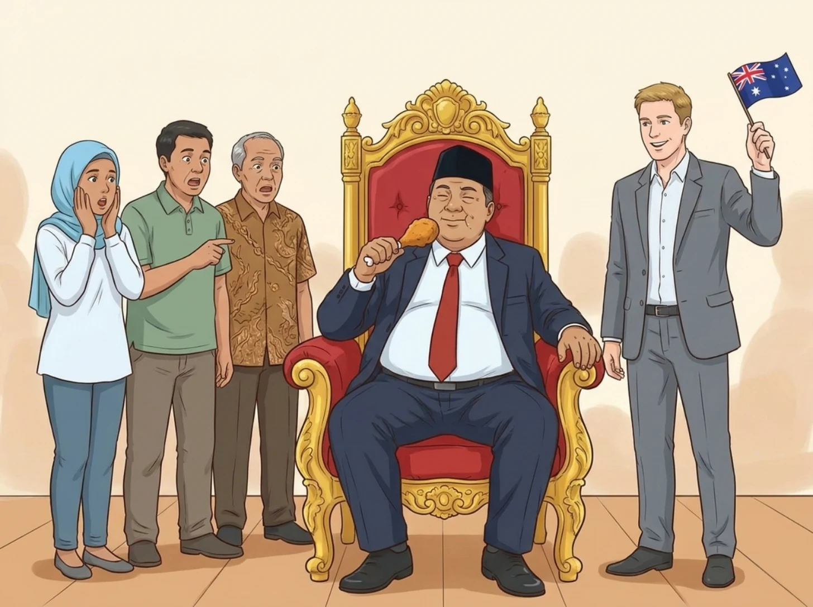
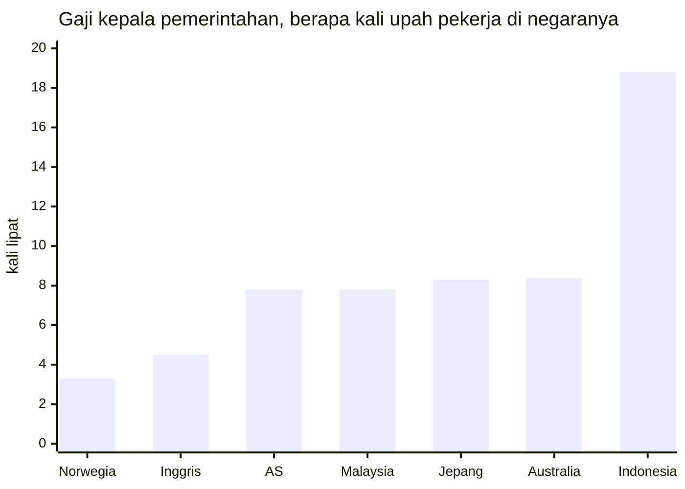

**Singkatnya:** kalau diukur dengan upah rakyatnya sendiri, gaji pejabat Indonesia jauh lebih tinggi daripada gaji politisi Australia. Gaji presiden setara 17,9 kali rata-rata UMP, sedangkan gaji Perdana Menteri Australia 11,9 kali upah minimum. Gaji dan tunjangan anggota DPR setara 21,1 kali rata-rata UMP (18,7 kali setelah pajak), sementara gaji dan tunjangan anggota parlemen Australia 6,0 kali upah minimum, dan kalau dana reses serta anggaran kantor ikut dihitung, perbandingannya menjadi sekitar 80 kali berbanding 12 kali. Belum lagi fasilitas seumur hidup setelah lengser, iring-iringan bersirene, dan laporan pengeluaran yang nyaris mustahil diperiksa publik.
{: .tldr}

* TOC
{:toc}

Selama lebih dari 25 tahun saya tinggal di Jakarta, iring-iringan pejabat dengan sirene dan lampu strobo sudah jadi pemandangan sehari-hari. Yang lewat bisa siapa saja, mulai dari presiden, menteri, sampai anggota DPR. Bunyinya begitu akrab di telinga sampai-sampai "tot tot wuk wuk" sempat viral pada 2025, ketika warga ramai-ramai memprotes pejabat yang memakai sirene di jalan.

Lain ceritanya dengan Perth. Sudah hampir dua tahun saya tinggal di sini, dan belum sekali pun saya melihat iring-iringan pejabat, bahkan untuk *Premier* Australia Barat pun tidak, meski dialah orang paling berkuasa di negara bagian ini (jabatannya kira-kira setara gubernur). Pertanyaannya, kenapa pejabat di Indonesia diperlakukan bak raja, sementara di Australia anggota parlemen diperlakukan tidak jauh berbeda dari manajer perusahaan biasa, padahal gaji dan fasilitas pejabat di kedua negara sama-sama dibayar dari pajak rakyat?

## Kenapa perantau Indonesia menulis soal politisi Australia?

Saya menulis ini karena dari kejauhan, perbedaan cara kedua negara memperlakukan pejabatnya justru terlihat makin jelas. Sebelum masuk ke angka, ada beberapa hal yang perlu saya luruskan terlebih dahulu supaya tulisan ini tidak dibaca dengan harapan yang keliru.

- **Ini bukan soal gaji atau biaya hidup di Perth.** Topik itu sudah saya bahas di tulisan [#KaburAjaDulu](/id/kabur-aja-dulu/), lengkap dengan hitungan tabungan di akhir bulan.
- **Ini juga bukan soal negara maju yang lebih unggul dalam segala hal.** Soal itu mungkin layak dibahas dalam tulisan tersendiri.
- **Saya tidak sedang memuja pemerintah Australia.** Banyak orang Australia pasti tidak setuju dengan sebagian isi tulisan ini, dan lagi pula, tidak ada satu partai pun yang suci, baik Labor, Coalition, Greens, maupun One Nation.

Karena lebih dari 25 tahun saya tumbuh di Jakarta dan baru hampir dua tahun di Perth, kritik dalam tulisan ini lebih banyak saya arahkan ke Indonesia, negara yang paling saya kenal dan yang paling saya harapkan bisa lebih baik.

## Apa itu *fair go*, dan apa hubungannya dengan gaji pemimpin?

*Fair go* adalah keyakinan bahwa setiap orang berhak mendapat kesempatan yang sama, apa pun latar belakangnya, dan nilai inilah yang membuat orang Australia risih melihat siapa pun, termasuk pemimpinnya, berlagak seolah-olah lebih tinggi daripada orang lain. Nilai yang menjadi pasangannya adalah *mateship*, yaitu kesetiaan, solidaritas, dan kesetaraan di antara kawan, termasuk saling membantu di masa sulit. Kedua nilai itu tercantum dalam Australian Values Statement, pernyataan nilai-nilai Australia yang wajib ditandatangani para pemohon visa.[^values] Anggap saja ini Pancasila-nya Australia.

Akar nilai ini bisa dilacak dari sejarah Australia. Australia modern bermula pada 1788 sebagai koloni pembuangan narapidana Inggris. Berbeda dengan Amerika Serikat yang sebagian didirikan oleh kaum pelarian yang menghindari penindasan agama, atau Kanada yang tetap erat dengan Inggris, penduduk awal Australia adalah narapidana beserta para penjaganya, dan kebencian para narapidana terhadap sistem kelas Inggris ikut membentuk budaya yang curiga pada siapa pun yang merasa dirinya lebih tinggi. Orang Australia bahkan punya istilah untuk kebiasaan menjatuhkan orang yang terlalu menonjol: *tall poppy syndrome*.

Meski begitu, Australia bukan negara paling setara di dunia. Rasio Gini Australia, yang dihitung dari pendapatan setelah dipotong pajak dan ditambah bantuan sosial, sebesar 0,307 pada 2022-23, sementara negara-negara Nordik seperti Islandia, Norwegia, Denmark, dan Swedia jelas lebih setara.[^gini] Rasio Gini Indonesia sebesar 0,368 pada Maret 2026, lebih tinggi daripada rasio Gini Australia, padahal angka itu dihitung dari pengeluaran, bukan pendapatan, yang biasanya membuat ketimpangan terlihat lebih kecil daripada aslinya.[^gini]

Yang jauh lebih timpang justru tingkat kemakmuran kedua negara. Produk domestik bruto (PDB) per kapita Australia sekitar US$65.000 pada 2025, sedangkan Indonesia sekitar US$5.100, sehingga PDB per kapita Australia kira-kira 13 kali lipat Indonesia.[^imf] Artinya, warga Australia biasa sudah tergolong kaya menurut ukuran dunia, dan tidak heran kalau di Bali justru merekalah yang diperlakukan bak raja.

## Berapa gaji presiden dan perdana menteri dibandingkan upah minimum?

Gaji Presiden Indonesia setara 17,9 kali rata-rata UMP, sedangkan gaji Perdana Menteri Australia setara 11,9 kali upah minimum di negaranya. Ukuran ini sengaja saya pakai karena membandingkan rupiah dengan dolar secara mentah tidak banyak artinya. Yang lebih adil adalah melihat berapa kali lipat gaji pemimpin dibandingkan upah rakyat paling bawah di negaranya sendiri.

Di Australia, gaji Perdana Menteri A$622.110 setahun, yaitu gaji pokok anggota parlemen sebesar A$239.270 ditambah tunjangan jabatan sebesar 160%. Angka ini berlaku sejak 1 Juli 2025, dan karena Remuneration Tribunal (lembaga independen yang menetapkan gaji pejabat federal) memutuskan tidak ada kenaikan per 1 Juli 2026, angka itu masih berlaku sampai sekarang.[^rt] Upah minimum nasional Australia A$1.004,90 per minggu sejak 1 Juli 2026, atau sekitar A$52.255 setahun, dan besarnya sama di semua negara bagian.[^fwc]

Di Indonesia, gaji presiden terdiri atas gaji pokok Rp30.240.000 dan tunjangan jabatan Rp32.500.000, sehingga totalnya Rp62.740.000 sebulan, dan angka ini tidak berubah sejak 2001.[^setkab] Upah minimum di Indonesia berbeda di setiap provinsi, jadi saya memakai rata-rata UMP 2026 dari 38 provinsi, yaitu Rp3.508.714 sebulan.[^ump]

Mungkin kamu akan menyanggah bahwa dalam rupiah, gaji Perdana Menteri Australia sekitar Rp648 juta sebulan (dengan kurs A$1 ≈ Rp12.500),[^kurs] atau sepuluh kali gaji presiden kita. Sanggahan itu ada benarnya, tetapi upah minimum di Australia juga belasan kali lebih tinggi, sehingga ukuran yang adil tetap kelipatan terhadap upah rakyatnya sendiri.

Lagi pula, gaji hanyalah sebagian dari hak keuangan yang diterima presiden. Selama menjabat, kebutuhan rumah tangga, kesehatan, dan transportasi presiden ditanggung negara lewat anggaran istana. UU No. 7 Tahun 1978 menjamin bahwa setelah lengser, mantan presiden mendapat uang pensiun sebesar 100% gaji pokok terakhir (Rp30,24 juta sebulan, bukan total gajinya), sebuah rumah lengkap dengan perabotnya, mobil negara beserta sopirnya, biaya air, listrik, dan telepon yang ditanggung negara, serta layanan kesehatan untuk dirinya dan keluarganya.[^uu7] Bandingkan dengan pekerja biasa yang harus [menyiapkan pensiunnya sendiri tanpa jadi PNS](/id/pensiun-tanpa-jadi-pns/).

Australia tidak punya pensiun khusus untuk perdana menteri. Skema pensiun lama bagi anggota parlemen (Parliamentary Contributory Superannuation Scheme), yang memberi pensiun bulanan pasti, ditutup untuk anggota baru sejak 9 Oktober 2004, sehingga anggota parlemen yang terpilih setelah itu, termasuk perdana menteri berikutnya, hanya mendapat *superannuation* (dana pensiun) biasa seperti pekerja lain.[^pcss] Supaya adil, perlu saya akui bahwa sebagian mantan perdana menteri masih menikmati skema lama itu, tetapi hak itu mereka dapat karena sudah menjadi anggota parlemen sebelum 2004, bukan karena pernah menjadi perdana menteri. Mantan perdana menteri juga mendapat kantor, tiga orang staf, dan jatah perjalanan dalam negeri yang dibatasi, semuanya untuk tugas publik.[^flagpost]

| | Perdana Menteri Australia | Presiden Indonesia |
| --- | --- | --- |
| Gaji per bulan | A$51.843 (A$622.110 setahun) | Rp62.740.000 |
| Kelipatan upah minimum | 11,9 kali | 17,9 kali rata-rata UMP |
| Fasilitas selama menjabat | Pengawalan penuh waktu dari polisi federal (AFP) | Kebutuhan rumah tangga, kesehatan, dan transportasi ditanggung negara |
| Pensiun setelah menjabat | Tidak ada pensiun khusus, hanya *superannuation* biasa (kecuali yang sudah menjadi anggota parlemen sebelum 2004) | 100% gaji pokok terakhir, Rp30,24 juta sebulan |
| Rumah | Tidak ada | Rumah beserta perabotnya |
| Mobil dan sopir | Tidak ada | Mobil negara beserta sopir |
| Lain-lain | Kantor, tiga staf, jatah perjalanan dalam negeri yang dibatasi | Tagihan air, listrik, telepon, dan layanan kesehatan untuk diri dan keluarga |

*Gaji per bulan Perdana Menteri Australia adalah gaji setahun dibagi 12. Sumber: Remuneration Tribunal, Fair Work Ombudsman, Setkab, Kemnaker, UU No. 7 Tahun 1978, Departemen Keuangan Australia, dan Parliamentary Library.*

## Berapa penghasilan anggota DPR dibandingkan anggota parlemen Australia?

Gaji dan tunjangan kotor anggota DPR setara 21,1 kali rata-rata UMP (18,7 kali setelah pajak), sedangkan gaji dan tunjangan anggota parlemen Australia setara 6,0 kali upah minimum. Kalau dana reses dan anggaran kantor ikut dihitung, perbandingannya menjadi sekitar 80 kali berbanding 12 kali. Begitu mendengar kata "DPR", yang terbayang di kepala kita adalah kekuasaan dan uang yang luar biasa besar. Di Australia, anggota parlemen lebih mirip manajer atau direktur di sebuah perusahaan, yang bekerja sebagai eksekutif dan bukan duduk di singgasana sebagai raja.

<figure>

</figure>

Mari mulai dari anggota parlemen biasa di House of Representatives (majelis rendah parlemen federal, padanan DPR), yang disebut *backbencher* karena tidak menjabat menteri. Gaji pokoknya A$239.270 setahun atau A$19.939 sebulan.[^rt] Di luar gaji, ada *electorate allowance* (tunjangan untuk biaya di daerah pemilihan) yang dibayarkan langsung kepada anggota dan dikenai pajak, dengan besaran A$39.700 sampai A$57.100 setahun, tergantung luas daerah pemilihannya.[^ea] Saya memakai angka tengahnya, A$47.200 setahun atau A$3.933 sebulan. Ada pula uang perjalanan ke Canberra, ibu kota Australia, berupa tarif per malam selama masa sidang yang menurut pemberitaan sekitar A$310 per malam.[^ta] Kalau saya perkirakan sekitar 80 malam setahun, jumlahnya kira-kira A$24.800 setahun atau A$2.067 sebulan. Totalnya sekitar A$311.270 setahun atau A$25.939 sebulan, setara 6,0 kali upah minimum bulanan (A$4.355).[^fwc]

Setiap anggota parlemen Australia juga mendapat anggaran kantor untuk kegiatan di daerah pemilihan, yang fungsinya mirip dana reses di Indonesia: uang untuk melayani konstituen, bukan untuk dibawa pulang. Untuk tahun anggaran 2025-26, besarnya A$170.631 ditambah A$1,272 untuk setiap pemilih terdaftar.[^oeb] Untuk daerah pemilihan dengan sekitar 121.000 pemilih, anggarannya kira-kira A$324.000 setahun atau A$27.000 sebulan. Kalau semuanya dijumlahkan, totalnya sekitar A$635.000 setahun atau A$52.900 sebulan, setara kira-kira 12 kali upah minimum. Gaji staf di daerah pemilihan dan layanan mobil pemerintah dengan sopir (Comcar) untuk urusan parlemen dibayar terpisah dan tidak saya masukkan.

Sekarang, mari kita lihat DPR. Gaji pokok anggota DPR hanya Rp4.200.000 sebulan, sedangkan sebagian besar penghasilannya berupa tunjangan. Per September 2025, gaji dan tunjangan kotornya sekitar Rp74,2 juta sebulan, dan setelah dipotong PPh 21 sekitar Rp8,6 juta, gaji bersihnya (*take-home pay*) Rp65.595.730 sebulan.[^dpr] Sebelum sejumlah tunjangan dipangkas (termasuk tunjangan rumah Rp50 juta yang dihapus mulai 31 Agustus 2025), totalnya dilaporkan Rp104,1 juta sebulan, setara 29,7 kali rata-rata UMP. Belum lagi dana reses, yaitu dana kegiatan ketika anggota DPR pulang ke daerah pemilihannya. Setelah putusan Mahkamah Kehormatan Dewan (MKD) pada November 2025, dana ini turun dari Rp702 juta menjadi sekitar Rp500 juta per masa reses, dengan sekitar lima kali reses setahun.[^reses] Artinya, ada sekitar Rp2,5 miliar setahun, atau Rp208 juta sebulan, di luar gaji.

| Per bulan | Anggota parlemen Australia (A$) | Anggota DPR (Rp) |
| --- | --- | --- |
| Gaji pokok | 19.939 | 4.200.000 |
| Tunjangan | 6.000 (daerah pemilihan dan perjalanan ke Canberra, perkiraan) | sekitar 70.000.000 |
| Gaji dan tunjangan kotor | 25.939 | sekitar 74.200.000 |
| Gaji bersih | tidak dihitung, semua angka Australia sebelum pajak | 65.595.730 |
| Dana kegiatan daerah pemilihan | sekitar 27.000 (anggaran kantor) | sekitar 208.000.000 (dana reses) |
| **Total** | **sekitar 52.900** | **sekitar 282.000.000** |
| Kelipatan upah minimum (gaji dan tunjangan saja) | 6,0 kali | 21,1 kali (kotor), 18,7 kali (bersih) |
| Kelipatan upah minimum (semuanya) | sekitar 12 kali | sekitar 80 kali |

*Angka dibulatkan. Upah minimum Australia A$4.355 sebulan, rata-rata UMP Indonesia Rp3,51 juta sebulan. Uang perjalanan ke Canberra adalah perkiraan saya (80 malam setahun).*

Tentu DPR akan berdalih bahwa dana reses dipakai untuk kegiatan bersama konstituen, bukan masuk ke kantong pribadi, dan dalih itu ada benarnya. Masalahnya, pemakaian dana reses hanya dilaporkan secara gelondongan dan sulit diperiksa publik, sementara anggaran kantor anggota parlemen Australia diumumkan per orang oleh IPEA (Independent Parliamentary Expenses Authority), lembaga independen yang mengawasi pengeluaran anggota parlemen. Selama pertanggungjawabannya segelap itu, saya rasa wajar kalau dana reses ikut dihitung.

Ada pula yang berargumen bahwa Indonesia negara yang luas, sehingga wajar kalau ongkos wakil rakyatnya besar. Kenyataannya, kalau peta Indonesia ditaruh di atas peta Australia, bentang keduanya dari barat ke timur kurang lebih sama, jadi jarak tidak bisa menjelaskan selisih ini. Yang memang berbeda adalah jumlah penduduk per kursi: DPR punya 580 kursi untuk sekitar 284 juta penduduk, atau sekitar 490.000 orang per anggota, sedangkan House of Representatives punya 150 kursi untuk sekitar 27,6 juta penduduk, atau sekitar 184.000 orang per anggota.[^pop] Seorang anggota DPR memang mewakili sekitar 2,7 kali lebih banyak orang, tetapi jika diukur dengan upah setempat, selisih penghasilannya jauh melampaui 2,7 kali.

## Kenapa saya belum pernah melihat iring-iringan pejabat di Perth?

Selama hampir dua tahun di Perth, saya belum pernah melihat iring-iringan pejabat, bahkan untuk *Premier* Australia Barat (kepala pemerintahan negara bagian yang jabatannya kira-kira setara gubernur), karena di Australia pengawalan hanya diberikan kepada segelintir pemegang jabatan, dan itu pun untuk keamanan, bukan untuk membelah jalanan.

Polisi federal Australia (Australian Federal Police, AFP) memberikan perlindungan kepada para pemegang jabatan tinggi (*high office holders*): Gubernur Jenderal, Perdana Menteri, para menteri, pimpinan kedua kamar parlemen (*Presiding Officers*), serta Pemimpin dan Wakil Pemimpin Oposisi. Tamu negara seperti kepala negara asing juga dilindungi, begitu pula Raja Charles III ketika berkunjung ke Australia.[^afp] Dalam praktiknya, hanya Perdana Menteri yang dikawal secara penuh waktu, sedangkan para menteri hanya mendapat pengawal pribadi kalau penilaian risiko mengharuskannya. Anggota parlemen biasa tidak punya pengawal dan tidak dijaga terus-menerus. Untuk urusan parlemen, mereka boleh memakai Comcar, layanan mobil pemerintah dengan sopir, tetapi layanan itu sekadar angkutan, bukan iring-iringan pembuka jalan.

Di Jakarta, iring-iringan bersirene untuk presiden, menteri, bahkan anggota DPR dulu lewat hampir setiap hari, seolah-olah jalan umum adalah karpet merah pribadi mereka. Pada September 2025, gerakan "Stop tot tot wuk wuk" viral, dan Korlantas Polri akhirnya membekukan penggunaan sirene dan lampu strobo untuk pengawalan, meski pengawalannya sendiri tetap berjalan. Baru pada akhir November 2025 layanan pengawalan itu dibekukan untuk dievaluasi.[^korlantas] Perlu protes seantero negeri yang viral di media sosial supaya sirene dimatikan, dan itu pun hanya dibekukan, bukan dihapus.

## Apa yang terjadi kalau politisi Australia menyalahgunakan uang pajak?

Politisi Australia yang menyalahgunakan uang pajak akan disorot habis-habisan oleh media dan oposisi, lalu diaudit dan harus mengembalikan uangnya. Contoh terbaru adalah Anika Wells, Menteri Komunikasi dan Olahraga, yang sejak akhir 2025 disorot karena biaya perjalanannya. Salah satu yang paling disorot adalah perjalanan dua hari ke Adelaide pada Juni 2025 seharga A$3.681, yang kebetulan bertepatan dengan pesta ulang tahun seorang kawannya dari Partai Labor.[^wells1] Wells berkilah bahwa perjalanan itu sesuai aturan, dan bahwa rinciannya bisa diketahui publik justru karena dia dan kementeriannya sendiri yang membukanya. Oposisi tetap menjulukinya "Air-Miles Anika".

Wells kemudian melaporkan dirinya sendiri ke IPEA (Independent Parliamentary Expenses Authority). Hasil audit pada 2026 menyatakan perjalanannya ke New York, yang juga sempat disorot, tidak bermasalah, tetapi menemukan empat klaim yang melanggar aturan. Dia mengembalikan A$10.116 (A$8.093 ditambah denda 25%) dan meminta maaf atas apa yang dia sebut sebagai "kekeliruan yang tidak disengaja".[^wells2]

Sorotan berikutnya datang dari ongkos perjalanan keluarga politisi. Sejak pemilu 2022, pembayar pajak Australia sudah menanggung lebih dari A$4 juta untuk perjalanan keluarga para politisi. Empat anggota parlemen, yaitu Don Farrell, Fatima Payman, Patrick Gorman, dan Andrew Willcox, masing-masing menghabiskan lebih dari A$100.000, sementara anggota lain ada yang klaimnya di bawah A$1.000. Di antara para menteri, angka Farrell tertinggi, yaitu A$116.306.[^family] Setelah dikritik berminggu-minggu, Perdana Menteri Anthony Albanese pada Desember 2025 membatasi perjalanan keluarga tersebut, termasuk menurunkan kelas penerbangannya dari kelas bisnis ke kelas ekonomi.[^albo]

Kalau dikonversi dengan kurs A$1 ≈ Rp12.500,[^kurs] perjalanan Wells ke Adelaide setara sekitar Rp46 juta, atau 13 kali rata-rata UMP Indonesia (Rp3,51 juta sebulan), dan uang yang dia kembalikan sekitar Rp126 juta. Ongkos perjalanan keluarga Farrell setara sekitar Rp1,45 miliar, atau 414 kali rata-rata UMP bulanan.

Semua angka ini bisa diketahui karena setiap klaim diumumkan per orang lewat laporan triwulanan IPEA, sehingga perjalanan seharga A$3.681 pun bisa menjadi berita nasional.

## Lalu bagaimana dengan perjalanan dinas pejabat di Indonesia?

Menurut saya, "skandal" perjalanan politisi Australia yang paling heboh pun mungkin hanya seharga satu kali perjalanan dinas pejabat kita. Tentu saja ini sekadar dugaan, bukan hasil hitungan, karena publik Indonesia tidak pernah bisa melihat tagihan perjalanan dinas per orang.

Yang bisa kita lihat hanyalah angka gelondongan dari hasil audit. Dalam audit atas tahun anggaran 2023 yang diberitakan pada Juni 2024, Badan Pemeriksa Keuangan (BPK) menemukan ketidakberesan belanja perjalanan dinas senilai Rp39,26 miliar di 46 kementerian dan lembaga, sebagian besar berupa perjalanan yang tidak sesuai ketentuan dan kelebihan bayar. BPK juga menyebut masalah perjalanan dinas ini muncul berulang setiap tahun, dan penyimpangannya sering kali disengaja, bahkan berupa perjalanan fiktif.[^bpk]

Angka Rp39,26 miliar itu setara sekitar 11.190 kali rata-rata UMP bulanan, atau upah minimum setahun penuh untuk sekitar 930 pekerja. Bedanya dengan Australia bukan cuma soal besarnya angka, tetapi juga soal siapa yang bisa melihatnya: di Indonesia, publik baru tahu total temuannya setahun lebih kemudian, sedangkan di Australia, publik bisa melihat tagihan setiap orang setiap tiga bulan.

## Apakah Indonesia pengecualian, atau memang begini di mana-mana?

Di antara negara-negara yang saya bandingkan, Indonesia adalah yang paling timpang: gaji presidennya setara 18,8 kali upah rata-rata pekerja, lebih dari dua kali lipat negara lain dalam tabel di bawah. Untuk perbandingan ini, saya membagi gaji kepala pemerintahan dengan upah median, karena sebagian negara, seperti Singapura, tidak punya upah minimum nasional. Untuk Jepang dan Indonesia yang tidak menerbitkan median resmi, saya memakai upah rata-rata.

| Negara | Gaji kepala pemerintahan | Upah pekerja | Kelipatan |
| --- | --- | --- | --- |
| Norwegia | NOK 2.234.978 setahun[^nor] | NOK 669.600 setahun (median)[^nor] | 3,3 kali |
| Inggris | £174.711 setahun[^uk] | £39.039 setahun (median penuh waktu)[^uk] | 4,5 kali |
| Amerika Serikat | US$400.000 setahun[^us] | US$50.980 setahun (median)[^us] | 7,8 kali |
| Malaysia | RM22.826,65 sebulan[^my] | RM2.940 sebulan (median)[^my] | 7,8 kali |
| Jepang | ¥40,49 juta setahun[^jp] | ¥4,87 juta setahun (rata-rata)[^jp] | 8,3 kali |
| Australia | A$622.110 setahun[^rt] | A$74.100 setahun (median)[^absmed] | 8,4 kali |
| Indonesia | Rp62,74 juta sebulan[^setkab] | Rp3,33 juta sebulan (rata-rata)[^bpsupah] | 18,8 kali |

Ada beberapa catatan untuk tabel dan grafik ini. Gaji Perdana Menteri Malaysia dan Jepang adalah gaji menurut aturan, padahal Anwar Ibrahim menolak gajinya sejak November 2022 dan Sanae Takaichi memotong gajinya sendiri.[^my][^jp] Upah rata-rata Indonesia lebih tinggi daripada mediannya, karena segelintir orang bergaji sangat besar menarik rata-rata ke atas, sehingga kelipatan yang sebenarnya kemungkinan lebih tinggi lagi.

Agar jujur soal pemilihan negara, perlu saya sampaikan bahwa Singapura tidak saya masukkan ke tabel karena negara kota itu memang kasus khusus: menterinya digaji setara CEO perusahaan besar sebagai kebijakan antikorupsi. Gaji perdana menterinya S$3,6 juta setahun mulai 15 Oktober 2026, sementara median gaji bulanan di sana S$5.775, sehingga kelipatannya sekitar 52 kali.[^sg] Karena itu, saya juga tidak bisa menyebut Indonesia sebagai negara dengan gaji pemimpin paling timpang di dunia.

Meski begitu, pesan dari tabel ini tetap jelas. Dibandingkan pemimpin di negara demokrasi yang lebih kaya dan lebih setara, pemimpin Indonesia mengambil porsi yang jauh lebih besar dari kue ekonomi rakyatnya, dan angka 18,8 kali itu pun belum termasuk fasilitas seumur hidup setelah lengser, apalagi tunjangan dan dana reses anggota DPR.

## Jadi, apa yang seharusnya kita perdebatkan?

Yang seharusnya kita perdebatkan adalah kebijakan, bukan ulah pejabat dalam membelanjakan uang rakyat. Selama tinggal di Australia, saya justru jarang menghabiskan energi untuk mengomentari perilaku pejabat. Saya lebih sering memikirkan kebijakan yang mereka buat: mau diapakan GST (pajak pertambahan nilai di Australia), bagaimana imigrasi sebaiknya diatur, dan apakah diskon pajak keuntungan modal (*CGT discount*) ikut memperparah krisis harga rumah. Menurut saya, perdebatan seperti itulah standar minimum diskusi politik, bukan pertengkaran soal ke mana presiden, menteri, atau anggota DPR menghabiskan uang pajak kita.

Masalah Indonesia bukan takdir. Bentang Indonesia dan Australia dari barat ke timur kurang lebih sama, tetapi anggota parlemen di Australia tetap hidup seperti manajer, bukan raja. Yang membedakan adalah insentif yang bobrok dan pengeluaran yang gelap: gaji yang tinggi dibanding upah rakyat, fasilitas yang menempel seumur hidup, dan uang rakyat yang hanya bisa diintip lewat temuan audit setahun lebih kemudian. Di Indonesia, rakyat diminta percaya begitu saja kepada pejabatnya, sedangkan di Australia, pejabatlah yang harus mempertanggungjawabkan setiap dolar yang mereka pakai kepada rakyat.

Kita tentu tidak bisa mengubah semua itu dalam semalam, tetapi kita bisa mulai dari tuntutan yang sederhana, yaitu meminta DPR dan setiap kementerian menerbitkan laporan pengeluaran per orang, dirinci per pos, seperti laporan triwulanan IPEA, lembaga pengawas pengeluaran anggota parlemen Australia. Setelah itu, nilailah wakil rakyatmu dari apa yang berani mereka umumkan, bukan dari seberapa keras sirene mereka berbunyi. Tahun lalu, warga harus ramai-ramai bersuara supaya "tot tot wuk wuk" berhenti, dan saya berharap suara yang sama suatu hari nanti juga cukup untuk membuat setiap rupiah yang dipakai pejabat kita bisa dilihat oleh rakyat yang membayarnya.

## Referensi

[^values]: Department of Home Affairs, [Australian values](https://immi.homeaffairs.gov.au/help-support/meeting-our-requirements/australian-values): Australian Values Statement yang ditandatangani pemohon visa, termasuk *fair go* dan *mateship*.
[^gini]: Australia: ABS, [Income and wealth inequality](https://www.abs.gov.au/statistics/measuring-what-matters/measuring-what-matters-themes-and-indicators/prosperous/income-and-wealth-inequality), rasio Gini pendapatan rumah tangga setelah pajak dan tunjangan (*equivalised disposable income*) 0,307 pada 2022-23. Negara-negara Nordik lebih setara menurut data OECD. Indonesia: BPS, rasio Gini 0,368 per Maret 2026, dikutip dari [Bisnis.com](https://ekonomi.bisnis.com/read/20260805/9/1993850/ketimpangan-makin-lebar-rasio-gini-maret-2026-naik-menjadi-0368), 5 Agustus 2026. BPS menghitungnya dari pengeluaran, bukan pendapatan, sehingga kedua angka ini tidak sepenuhnya sebanding dan ketimpangan Indonesia yang sebenarnya kemungkinan lebih lebar.
[^imf]: IMF, [World Economic Outlook, GDP per capita](https://www.imf.org/external/datamapper/NGDPDPC@WEO), Oktober 2025: Australia sekitar US$65.000 dan Indonesia sekitar US$5.100 pada 2025.
[^rt]: Remuneration Tribunal, [2026 Remuneration Review Statement](https://www.remtribunal.gov.au/sites/default/files/2026-06/2026%20Remuneration%20Review%20Statement%20-%20FINAL.pdf) dan [Members of Parliament Determination 2026](https://www.remtribunal.gov.au/sites/default/files/2026-08/RT%20Members%20of%20Parliament%20determination%202026.PDF): gaji pokok anggota parlemen A$239.270 setahun sejak 1 Juli 2025, tunjangan jabatan Perdana Menteri 160% sehingga gajinya A$622.110, dan tidak ada kenaikan per 1 Juli 2026.
[^fwc]: Fair Work Ombudsman, [Minimum wages increase from 1 July 2026](https://www.fairwork.gov.au/about-us/workplace-laws/annual-wage-review/annual-wage-review-2026): A$26,44 per jam atau A$1.004,90 per minggu. Setahun: A$1.004,90 × 52 ≈ A$52.255, atau sekitar A$4.355 sebulan.
[^setkab]: Sekretariat Kabinet, [Gaji Presiden dan Wakil Presiden tidak berubah sejak 2001](https://setkab.go.id/bantah-kabar-kenaikan-istana-gaji-presiden-dan-wakil-presiden-tidak-berubah-sejak-2001/): gaji pokok Rp30.240.000 dan tunjangan jabatan Rp32.500.000 per bulan.
[^ump]: Kemnaker, rata-rata UMP 2026 di 38 provinsi Rp3.508.714 per bulan, naik 5,91%, dikutip dari [Bisnis.com](https://ekonomi.bisnis.com/read/20260121/12/1946028/kenaikan-rata-rata-ump-2026-di-bawah-khl-menaker-bilang-begini), 21 Januari 2026.
[^kurs]: Kurs pasar A$1 ≈ Rp12.500 per November 2026, dibulatkan.
[^uu7]: [UU No. 7 Tahun 1978](https://peraturan.bpk.go.id/Details/47167) tentang Hak Keuangan/Administratif Presiden dan Wakil Presiden serta Bekas Presiden dan Wakil Presiden: pensiun sebesar 100% gaji pokok terakhir, rumah beserta perlengkapannya, kendaraan milik negara beserta pengemudinya, biaya air, listrik, dan telepon, serta biaya perawatan kesehatan untuk bekas presiden dan keluarganya.
[^pcss]: Department of Finance, [Overview of the Parliamentary Superannuation Act 2004](https://finance.gov.au/government/superannuation/parliamentary-superannuation/overview-parliamentary-superannuation-act-2004): Parliamentary Contributory Superannuation Scheme ditutup untuk anggota baru sejak 9 Oktober 2004. Tidak ada pensiun khusus untuk perdana menteri, menurut [AAP FactCheck](https://www.aap.com.au/factcheck/hansons-300000-pm-pension-claim-way-off-the-money/), 2025.
[^flagpost]: Parliamentary Library, [Former Prime Ministers' entitlements](https://www.aph.gov.au/About_Parliament/Parliamentary_departments/Parliamentary_Library/Research/FlagPost/2026/February/FormerPrimeMinistersEntitlements), Februari 2026: kantor, tiga staf, dan jatah perjalanan dalam negeri yang dibatasi untuk tugas publik.
[^ea]: Department of Finance, [Parliamentary Expenses (MaPS), electorate allowance](https://maps.finance.gov.au/node/1032), Mei 2025: A$39.700, A$47.200, atau A$57.100 setahun tergantung luas daerah pemilihan.
[^ta]: IPEA, [Travel allowance](https://www.ipea.gov.au/node/43085): tarif per malam ditetapkan oleh Remuneration Tribunal; sekitar A$310 per malam selama masa sidang menurut pemberitaan 2025. Jumlah 80 malam setahun adalah perkiraan saya sendiri.
[^oeb]: Department of Finance, [Office expenses budget](https://maps.finance.gov.au/offices-resources-and-budgets/office-expenses-budget), tahun anggaran 2025-26: A$170.631,24 ditambah A$1,272 per pemilih terdaftar untuk anggota House of Representatives. Daerah pemilihan dengan 121.000 pemilih adalah contoh saya.
[^dpr]: detikNews, [Take home pay DPR usai pangkas banyak tunjangan Rp65,5 juta](https://news.detik.com/berita/d-8098119/take-home-pay-dpr-usai-pangkas-banyak-tunjangan-rp-65-5-juta), September 2025, dan Kontan, [Resmi, tunjangan perumahan dihapus, ini sisa gaji dan tunjangan anggota DPR terbaru](https://nasional.kontan.co.id/news/resmi-tunjangan-perumahan-dihapus-ini-sisa-gaji-tunjangan-anggota-dpr-terbaru), September 2025: gaji pokok Rp4,2 juta, gaji dan tunjangan kotor sekitar Rp74,2 juta, gaji bersih Rp65.595.730, dan Rp104,1 juta sebelum sejumlah tunjangan dipangkas, termasuk tunjangan perumahan Rp50 juta yang dihapus mulai 31 Agustus 2025. PPh 21 sekitar Rp8,6 juta adalah selisih gaji kotor dan gaji bersih.
[^reses]: CNN Indonesia, [Dana reses anggota DPR jadi Rp500 juta imbas putusan MKD](https://www.cnnindonesia.com/nasional/20251106111135-32-1292542/dasco-sebut-dana-reses-anggota-dpr-jadi-rp500-juta-imbas-putusan-mkd), 6 November 2025: turun dari Rp702 juta menjadi sekitar Rp500 juta per masa reses, dengan sekitar lima masa reses setahun.
[^pop]: Jumlah penduduk 2025 menurut BPS (Indonesia, sekitar 284 juta) dan ABS (Australia, sekitar 27,6 juta); jumlah kursi menurut DPR (580) dan Parlemen Australia (150 kursi House of Representatives).
[^afp]: Australian Federal Police, [Close personal protection](https://afp.gov.au/our-services/national-policing-services/personal-protection-close-personal-protection/MPprotection): perlindungan untuk *high office holders* dan tamu negara.
[^korlantas]: The Jakarta Post, [Police halt use of sirens, strobe lights following public outcry](https://www.thejakartapost.com/indonesia/2025/09/22/police-halt-use-of-sirens-strobe-lights-following-public-outcry), 22 September 2025; Antara, [Police suspend sirens and strobes in escorts amid public backlash](https://en.antaranews.com/amp/news/381173/police-suspend-sirens-and-strobes-in-escorts-amid-public-backlash), September 2025; Kontan, [Layanan pengawalan tot tot wuk wuk dibekukan](https://nasional.kontan.co.id/news/layanan-pengawalan-tot-tot-wuk-wuk-dibekukan-aturan-sirene-dan-strobo-diperketat), November 2025.
[^wells1]: The Nightly, [Anika Wells forced to defend taxpayer-funded trips as new details emerge](https://thenightly.com.au/politics/anika-wells-forced-to-defend-taxpayer-funded-trips-as-new-details-emerge-about-other-costs-c-20918274), Desember 2025: perjalanan ke Adelaide seharga A$3.681 pada Juni 2025.
[^wells2]: AAP, dikutip dari [The Leader](https://www.theleader.com.au/story/9242403/minister-repays-taxpayers-after-travel-rule-breaches/), 2026: audit IPEA, pengembalian A$10.116 (A$8.093 ditambah denda 25%).
[^family]: AAP, dikutip dari [newsbeep](https://www.newsbeep.com/300998/), dan [ABC](https://www.abc.net.au/news/2025-12-11/nationals-mps-high-family-travel-bill-highlights-generous-rules/106126842), 11 Desember 2025: lebih dari A$4 juta untuk perjalanan keluarga sejak pemilu 2022, empat anggota parlemen di atas A$100.000, Farrell A$116.306.
[^albo]: The New Daily, [MP expenses change](https://www.thenewdaily.com.au/news/politics/australian-politics/2025/12/23/mp-expenses-change), 23 Desember 2025.
[^bpk]: Bisnis.com, [Temuan BPK: masalah perjalanan dinas PNS bikin negara rugi Rp39,26 miliar](https://ekonomi.bisnis.com/read/20240609/9/1772443/temuan-bpk-masalah-perjalanan-dinas-pns-bikin-negara-rugi-rp3926-miliar), 9 Juni 2024, atas audit tahun anggaran 2023. Hitungan saya: Rp39,26 miliar ÷ Rp3.508.714 ≈ 11.190, dan Rp39,26 miliar ÷ (Rp3.508.714 × 12) ≈ 930.
[^nor]: Gaji Perdana Menteri Norwegia NOK 2.234.978 setahun mulai 1 Mei 2026, menurut [Altinget](https://www.altinget.dk/artikel/norges-statsminister-faar-loenstigning-men-er-stadig-langt-fra-mette-frederiksen). Median gaji bulanan NOK 55.800 (2025), menurut [SSB](https://www.ssb.no/arbeid-og-lonn/lonn-og-arbeidskraftkostnader/artikler/hva-er-vanlig-lonn-i-norge), dikalikan 12.
[^uk]: Gaji Perdana Menteri Inggris £93.904 sebagai anggota parlemen ditambah £80.807 sebagai menteri (2025-26), menurut [gov.uk](https://www.gov.uk/government/publications/ministerial-salary-data). Median gaji pekerja penuh waktu £39.039 (April 2025), menurut [ONS](https://www.ons.gov.uk/employmentandlabourmarket/peopleinwork/earningsandworkinghours/bulletins/annualsurveyofhoursandearnings/2025).
[^us]: Gaji Presiden Amerika Serikat US$400.000 setahun dan median upah tahunan US$50.980 (2025) dari BLS, dikutip dari [AFL-CIO Paywatch](https://aflcio.org/paywatch).
[^my]: Gaji pokok Perdana Menteri Malaysia RM22.826,65 sebulan, yang ditolak Anwar Ibrahim sejak November 2022, menurut [Malay Mail](https://www.malaymail.com/news/malaysia/2022/12/05/pm-ministers-to-take-20pc-pay-cut-until-countrys-economy-recovers/43593), 5 Desember 2022. Median gaji bulanan RM2.940 (2025), menurut [DOSM](https://www.dosm.gov.my/portal-main/release-content/salaries-and-wages-survey-report-2024).
[^jp]: Gaji Perdana Menteri Jepang menurut aturan ¥40,49 juta setahun, menurut [Wikipedia, Prime Minister of Japan](https://en.wikipedia.org/wiki/Prime_Minister_of_Japan); Sanae Takaichi memotong gajinya sendiri. Rata-rata gaji pekerja swasta ¥4,87 juta (2025) dari National Tax Agency, dikutip dari nippon.com. Jepang tidak menerbitkan median resmi.
[^absmed]: ABS, [Employee earnings, August 2025](https://www.abs.gov.au/statistics/labour/earnings-and-working-conditions/employee-earnings/aug-2025): median penghasilan mingguan A$1.425, dikalikan 52 menjadi A$74.100 setahun.
[^bpsupah]: BPS, [Keadaan Ketenagakerjaan Agustus 2025](https://www.bps.go.id/id/pressrelease/2025/11/05/2479/keadaan-ketenagakerjaan-.html), 5 November 2025: rata-rata upah buruh Rp3,33 juta per bulan.
[^sg]: Gaji Perdana Menteri Singapura S$3,6 juta setahun mulai 15 Oktober 2026, menurut [The Jakarta Post / Reuters](https://www.thejakartapost.com/world/2026/09/08/singapore-pms-annual-salary-to-rise-64-to-285-million-), 8 September 2026. Median gaji bulanan S$5.775 (2025), menurut [MOM](https://stats.mom.gov.sg/Pages/Gross-Monthly-Income-Tables2025.aspx). S$3,6 juta ÷ (S$5.775 × 12) ≈ 52.
