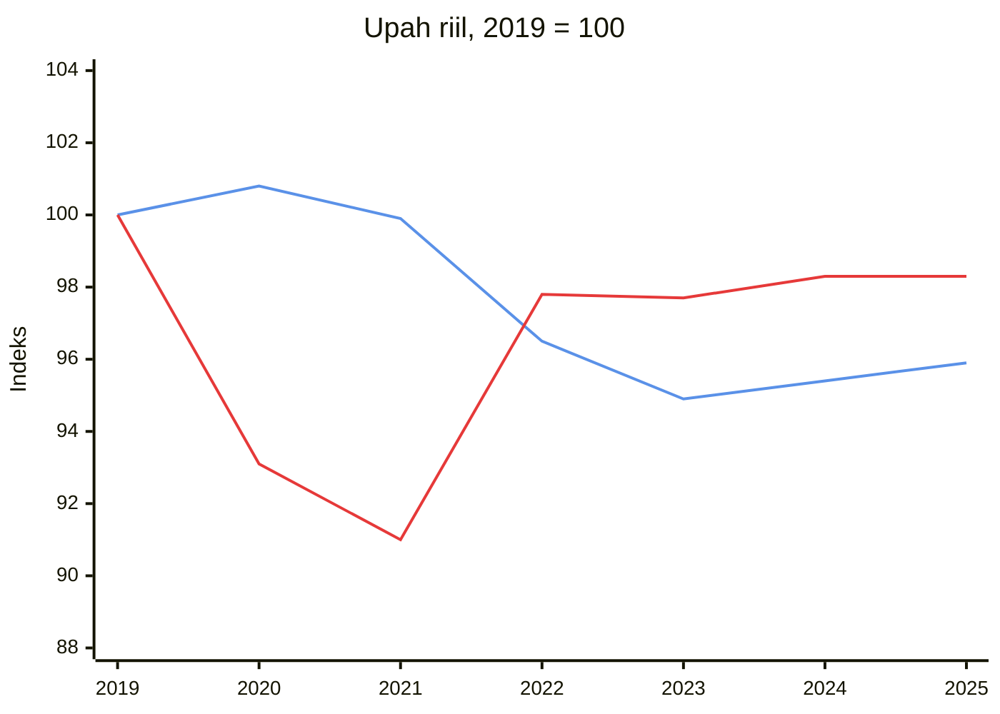
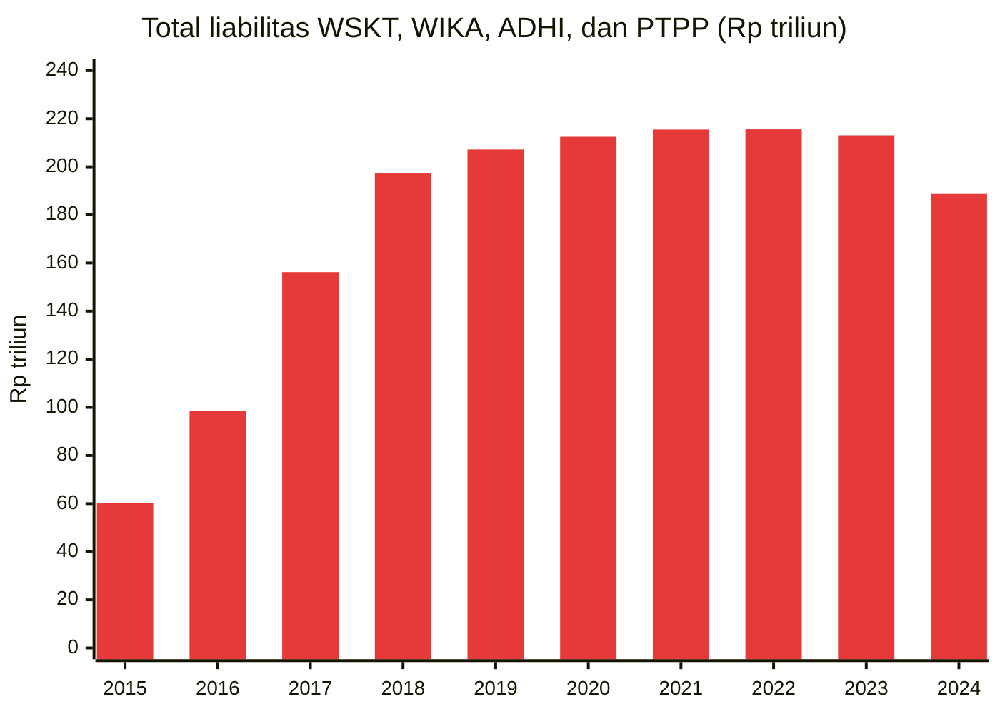

**Singkatnya:** pemerintah jarang perlu memalsukan angka, karena cukup memilih angka mana yang dipamerkan. Pengangguran terbuka memang hanya 4,85%, tetapi 88% pekerja Indonesia tergolong pekerja informal menurut ILO. Angka kemiskinan versi BPS hanya 8,47%, padahal kalau memakai garis Bank Dunia untuk negara berpendapatan menengah atas, angkanya 64,1%. Median pengeluaran orang Indonesia hanya sekitar 16% dari PDB per kapita, terendah di ASEAN. Utang pemerintah memang hanya 41% PDB, tetapi bunganya menelan sekitar 16% sampai 19% pendapatan negara.
{: .tldr}

* TOC
{:toc}

## Kenapa "ekonomi kita meroket" terdengar benar, tetapi tidak terasa di dompet?

Kamu pasti pernah melihat adegan ini, entah di televisi, di potongan video yang lewat di media sosial, atau langsung di lapangan saat musim kampanye: seorang pejabat berkemeja biru muda berdiri di podium, mengepalkan tangan, lalu berseru lantang, "Ekonomi kita meroket!" Tepuk tangan pun pecah, sementara layar di belakangnya menampilkan grafik pertumbuhan yang menanjak, angka pengangguran yang menurun, dan angka kemiskinan yang katanya terus menyusut. Menariknya, bisa jadi tidak ada satu data pun dalam adegan itu yang dikarang. Semua angka itu mungkin benar, dan justru di situlah letak masalahnya: pemerintah jarang perlu memalsukan data karena cukup memilih angka mana yang ditampilkan, bagaimana angka itu didefinisikan, dan apa yang sengaja tidak disebut.

<figure>

<figcaption>Pidatonya berapi-api dan tepuk tangannya meriah, tetapi pertanyaannya tetap sama: angka mana yang dipilih untuk dipamerkan?</figcaption>
</figure>

Dalam tulisan ini, mari kita bedah tujuh angka yang paling sering dibanggakan dalam pidato semacam itu, yaitu pengangguran, produk domestik bruto (PDB) per kapita, pertumbuhan PDB, inflasi, angka kemiskinan, rasio Gini, serta defisit dan utang pemerintah. Untuk setiap angka, kita akan melihat apa yang sebenarnya diukur, bagaimana angka itu bisa dipoles supaya terlihat cantik, dan bagaimana membaca kenyataan di baliknya, termasuk lewat perbandingan posisi Indonesia dengan negara-negara ASEAN dan OECD. Tujuannya bukan untuk mencurigai semua statistik, melainkan supaya lain kali, ketika ada yang berteriak "meroket" dari atas podium, kamu tahu pertanyaan apa yang perlu diajukan.

## Benarkah pengangguran di Indonesia hanya 4,85%?

**Apa yang diukur?** Menurut Survei Angkatan Kerja Nasional (Sakernas) yang dirilis BPS pada 5 November 2025, tingkat pengangguran terbuka (TPT) Indonesia pada Agustus 2025 tercatat sebesar 4,85%, atau sekitar 7,46 juta orang.[^sakernas] Dalam survei ini, seseorang sudah dihitung bekerja kalau dalam seminggu terakhir ia bekerja paling sedikit satu jam untuk mendapatkan upah atau keuntungan. Penganggur adalah orang yang sama sekali tidak bekerja serta sedang mencari pekerjaan atau siap untuk bekerja.

**Bagaimana angka ini dipoles?** Batas satu jam itu membuat pedagang kaki lima yang dagangannya hanya laku sekali dalam seminggu, pengemudi ojek *online* yang hanya kebagian satu penumpang, atau anak muda yang membantu di warung orang tuanya tanpa dibayar sudah tercatat sebagai orang yang bekerja. Dari satu angka pengangguran, kita tidak bisa tahu berapa jam orang bekerja, apalagi pekerjaan macam apa yang mereka jalani.

Supaya adil, perlu saya akui bahwa batas satu jam ini bukan akal-akalan BPS, melainkan definisi baku Organisasi Perburuhan Internasional (ILO) yang juga dipakai Australia. Angka pengangguran Australia pun menyembunyikan pekerja paruh waktu yang sebenarnya ingin menambah jam kerja, dan menurut estimasi model ILO, porsi pekerja yang jam kerjanya kurang dari yang mereka inginkan justru lebih tinggi di Australia (6,6%) daripada di Indonesia (5,3%).[^ilomodel] Masalahnya bukan pada definisi, melainkan pada kebiasaan pemerintah yang hanya memamerkan angka ini, seolah-olah satu angka sudah cukup untuk menggambarkan seluruh pasar kerja.

Kalau hanya melihat angka pengangguran, posisi Indonesia memang terlihat bagus. Grafik di bawah memakai estimasi model ILO supaya cara hitungnya seragam antarnegara, sehingga angkanya berbeda dari TPT versi BPS. Di grafik itu, pengangguran di Indonesia hanya 3,2%, lebih rendah daripada di Australia (4,1%) dan rata-rata OECD (5,7%).[^wbunemp]



**Bagaimana melihat kenyataannya?** Petunjuk pertama justru ada di rilis BPS sendiri. Pada Agustus 2025, hanya 67,32% orang yang bekerja tergolong pekerja penuh waktu, sementara 24,77% bekerja paruh waktu dan 7,91% (sekitar 11,6 juta orang) tergolong setengah penganggur, yaitu bekerja kurang dari 35 jam seminggu dan masih mencari atau bersedia menerima pekerjaan tambahan.[^sakernas] Jumlah setengah penganggur itu lebih besar daripada jumlah penganggur terbuka. Rata-rata upah buruh pun hanya Rp3,33 juta sebulan, angka yang juga saya pakai ketika membandingkan [gaji pejabat dengan upah rakyatnya](/id/gaji-pejabat-indonesia/).[^sakernas]

Petunjuk yang lebih penting lagi adalah pekerjaan informal. Menurut BPS sendiri, 57,80% pekerja Indonesia (84,58 juta orang) bekerja di sektor informal pada Agustus 2025.[^bpsinformal] Angka versi ILO lebih tinggi lagi, karena definisi ILO yang diselaraskan antarnegara (*harmonised definition*) juga menghitung pekerja tanpa kontrak tertulis dan jaminan sosial sebagai pekerja informal, termasuk buruh yang bekerja di perusahaan formal sekalipun. Kalau memakai ukuran itu, 88,3% pekerja Indonesia tergolong pekerja informal pada 2024, tertinggi kedua setelah Laos (90,5%), jauh di atas Vietnam (67,0%) dan Thailand (63,2%), apalagi rata-rata OECD yang hanya 10,9%.[^iloinformal] Australia tidak melaporkan indikator ini ke ILO, sehingga grafik di bawah tidak menampilkan angkanya.



Jam kerja juga perlu dilihat. Rata-rata orang yang bekerja di Indonesia hanya bekerja 37,6 jam seminggu pada 2025, paling rendah di ASEAN, sementara tetangga kita berada di kisaran 39,8 jam (Filipina) sampai 46,2 jam (Kamboja), seperti terlihat pada grafik di bawah.[^ilohours] Jam kerja di Australia memang lebih pendek lagi, yaitu 31,3 jam, dan rata-rata OECD 33,6 jam, tetapi jam kerja yang pendek di negara kaya sering kali merupakan pilihan dan tetap bergaji layak, sedangkan di Indonesia jam kerja yang pendek sering kali bukan pilihan. Perlu dicatat juga bahwa jam kerja hanya menunjukkan seberapa penuh tenaga orang terpakai, bukan seberapa baik mutu pekerjaannya.



Ada pula soal ketidaksesuaian antara pendidikan dan pekerjaan. Menurut Sakernas 2024, sekitar 35% pekerja muda bekerja di bidang yang tidak sesuai dengan pendidikannya, dan 22,36% bekerja di posisi yang menuntut pendidikan lebih rendah daripada yang mereka miliki.[^mismatch] Ukuran ini memang cenderung menguntungkan negara yang lulusannya masih sedikit, karena makin sedikit lulusan, makin mudah mereka mendapat pekerjaan yang sesuai, tetapi angkanya tetap menunjukkan bahwa banyak anak muda kita bekerja di bawah kemampuannya.

**Kesimpulannya:** di negara yang sebagian besar pekerjaannya informal, angka pengangguran yang rendah justru menandakan bahwa orang tidak sanggup menganggur, bukan bahwa pekerjaannya layak.

## Apakah Indonesia sekaya yang ditunjukkan PDB per kapitanya?

**Apa yang diukur?** PDB adalah nilai semua barang dan jasa yang dihasilkan di dalam batas suatu negara, yang dihitung sebagai konsumsi rumah tangga ditambah investasi, belanja pemerintah, dan ekspor bersih (ekspor dikurangi impor). Kalau angka itu dibagi jumlah penduduk, hasilnya adalah PDB per kapita, yang untuk Indonesia mencapai US$17.660 per orang pada 2025. Angka ini diukur dengan paritas daya beli (PPP, *purchasing power parity*), yaitu kurs yang sudah disesuaikan dengan perbedaan harga antarnegara.[^wbgdppc] Yang sering terlupa, PDB mengukur produksi, bukan pendapatan rumah tangga.

**Bagaimana angka ini dipoles?** Setidaknya ada tiga cara.

1. **Rata-rata yang tertarik ke atas.** PDB per kapita adalah rata-rata, sehingga segelintir orang yang sangat kaya bisa mengangkatnya jauh di atas penghasilan orang kebanyakan. Amerika Serikat adalah contoh yang paling sering dikutip, karena rata-rata pendapatan di sana jauh di atas mediannya.
2. **Produksi, bukan pendapatan.** Laba perusahaan milik asing tetap masuk ke PDB, meski uangnya dikirim ke luar negeri. Irlandia dan Luksemburg adalah contoh ekstremnya: pendapatan nasional bruto (PNB) kedua negara itu masing-masing hanya 69% dan 68% dari PDB, akibat laba perusahaan multinasional yang berkantor di Irlandia dan banyaknya pekerja lintas batas di Luksemburg.[^wbgni] Di Singapura, PNB setara 83% dari PDB, sedangkan di Swiss hampir 99%.
3. **Tidak semua sampai ke meja makan.** PDB juga mencakup investasi dan ekspor bersih, yang tidak langsung dinikmati rumah tangga.

**Bagaimana melihat kenyataannya?** Cara paling sederhana adalah melihat PNB, yaitu PDB dikurangi pendapatan yang mengalir ke pemilik modal dan pemberi pinjaman asing, ditambah pendapatan warga dari luar negeri. Pada 2025, PNB Indonesia sekitar 97% dari PDB, artinya sekitar 3% dari nilai yang diproduksi di dalam negeri mengalir ke luar.[^wbgni] Seperti terlihat pada grafik di bawah, selisih ini tergolong kecil dan mirip dengan negara tetangga, sehingga untuk urusan yang satu ini angka PDB Indonesia tidak banyak menggelembung.



Ukuran terbaiknya adalah median pendapatan rumah tangga yang bisa dibelanjakan (*median household disposable income*). Median tidak ikut tertarik oleh segelintir orang superkaya, sedangkan pendapatan yang bisa dibelanjakan sudah dikurangi pajak dan ditambah bantuan sosial. Sayangnya, angka ini tidak tersedia untuk Indonesia, sebab Survei Sosial Ekonomi Nasional (Susenas) yang digelar BPS mengukur pengeluaran, bukan pendapatan.

Pengganti terbaik yang tersedia adalah median pengeluaran (atau pendapatan) per orang dari Poverty and Inequality Platform (PIP) milik Bank Dunia, yang saya bagi dengan PDB per kapita. Hasilnya bisa kamu lihat pada grafik di bawah: pengeluaran setahun orang Indonesia yang berada persis di tengah hanya 16,4% dari PDB per kapita, atau sekitar seperenamnya.[^pipmedian] Angka ini paling rendah di ASEAN, lebih rendah daripada Filipina (20,9%), Thailand dan Laos (masing-masing 26,2%), Myanmar (33,8%), serta Vietnam (37,5%). Dari 47 negara yang saya hitung, angka yang lebih rendah hanya ada di Irlandia (15,7%), negara yang PDB-nya terkenal menggelembung akibat laba perusahaan multinasional. Di Australia angkanya 38,1%, sedangkan rata-rata OECD sekitar 32%. Kalau dihitung per hari, median pengeluaran orang Indonesia hanya US$6,77 per orang (PPP 2021).[^pipdaily]



Survei pengeluaran memang selalu menghasilkan angka yang lebih rendah daripada survei pendapatan, dan orang kaya jarang terjaring di dalamnya. Meski begitu, sebagian besar negara ASEAN juga mensurvei pengeluaran, dan Indonesia tetap berada di urutan paling bawah. Jarak sejauh inilah, antara rata-rata dan orang kebanyakan, yang menjadi inti masalahnya.

**Kesimpulannya:** rata-rata yang tinggi tetapi median yang rendah berarti pertumbuhan ekonomi belum sampai ke orang-orang yang berada di tengah.

## Apakah pertumbuhan 5% berarti hidup kita membaik?

**Apa yang diukur?** Pertumbuhan ekonomi adalah perubahan PDB riil, yaitu PDB yang sudah dibersihkan dari kenaikan harga. Pertumbuhan sekitar 5% setahun sudah lama menjadi angka andalan pemerintah, termasuk 5,1% pada 2025.[^wbgrowth] Pada triwulan II 2025, BPS mencatat pertumbuhan 5,12% dibandingkan triwulan yang sama tahun sebelumnya, naik dari 4,87% pada triwulan I 2025.[^q2]

**Bagaimana angka ini dipoles?** Setidaknya ada empat cara.

1. **Penduduk yang terus bertambah.** Ekonomi bisa membesar hanya karena jumlah penduduknya bertambah, tanpa ada satu orang pun yang hidupnya membaik. Australia mengalaminya sendiri: PDB-nya terus tumbuh, tetapi PDB per kapitanya turun tujuh triwulan berturut-turut sampai triwulan III 2024.[^abs] Sepanjang 2024, PDB Australia tumbuh 1,4%, sementara PDB per kapitanya turun 0,6%.[^wbgrowth] Penduduk Indonesia tumbuh sekitar 0,78% setahun, sehingga pertumbuhan 5,1% pada 2025 hanya setara sekitar 4,3% per orang.[^wbgrowth]
2. **Belanja yang menambah PDB, tetapi hasilnya sedikit.** Dalam hitungan PDB, jalan yang sepi pengguna atau program yang manfaatnya cepat hilang bernilai sama dengan pabrik yang produktif, setidaknya pada tahun ketika uangnya dibelanjakan. Program Makan Bergizi Gratis (MBG), misalnya, langsung menambah PDB pada tahun anggarannya, berapa pun manfaatnya dalam jangka panjang. Efisiensi investasi bisa diukur dengan *incremental capital-output ratio* (ICOR), yaitu investasi sebagai persentase PDB dibagi pertumbuhan ekonomi: makin rendah angkanya, makin banyak pertumbuhan yang dihasilkan setiap rupiah investasi. ICOR Indonesia 6,2, sementara Filipina 3,8, Malaysia dan Vietnam 4,3, serta Kamboja 4,4, sehingga untuk pertumbuhan yang sama, Indonesia butuh investasi sekitar 1,4 kali lipat investasi negara-negara itu.[^icor] ICOR Australia memang lebih tinggi, yaitu 9,0, tetapi angka setinggi itu wajar bagi negara kaya yang tumbuh pelan dari basis yang sudah tinggi. Belanja konsumsi pemerintah Indonesia sendiri tergolong kecil, hanya 7,5% dari PDB pada 2025, sementara rata-rata OECD 17,3% pada 2024, sehingga masalahnya bukan besarnya belanja, melainkan efisiensi dan pilihan proyeknya.[^govcons]
3. **Penyusutan dan sumber daya yang habis tidak dihitung.** Batu bara dan nikel yang digali dihitung sebagai pendapatan, tetapi berkurangnya cadangan di perut bumi tidak dikurangkan, begitu pula mesin dan jalan yang makin aus. Bank Dunia mengoreksinya lewat pendapatan nasional neto yang disesuaikan (*adjusted net national income*).
4. **Kurs rupiah.** Rupiah yang melemah bisa mendongkrak nilai ekspor dalam PDB, tetapi pada saat yang sama membuat pangan, bahan bakar, dan obat impor makin mahal bagi rumah tangga.

Grafik di bawah membandingkan ICOR Indonesia dengan negara tetangga dan negara OECD.



**Bagaimana melihat kenyataannya?** Mulailah dari pertumbuhan PDB riil per kapita dan pertumbuhan konsumsi rumah tangga riil, lalu cocokkan dengan petunjuk lain yang sulit dipoles: penjualan listrik, angkutan barang, penerimaan pajak, impor, penjualan semen dan mobil, sampai cahaya lampu di malam hari yang terekam satelit. Penjualan listrik memang perlu dibaca hati-hati, karena *smelter* dan pusat data menyedot listrik dalam jumlah besar, tetapi kalau angkanya justru turun, itu tanda bahaya.

Cahaya malam hari bahkan sudah dipakai untuk menguji negara-negara yang dicurigai memoles angkanya. Martinez (2022) membandingkan cahaya malam dari satelit dengan PDB resmi, lalu menemukan bahwa negara otokrasi melebih-lebihkan pertumbuhan PDB tahunannya sekitar 35%, sehingga pertumbuhan yang sebenarnya 2% dilaporkan sekitar 2,7%.[^martinez] Indonesia negara demokrasi, jadi pelajaran dari penelitian ini terletak pada caranya, bukan pada tuduhannya: cahaya lampu di malam hari tidak bisa diatur dari meja kementerian.

Kasus triwulan II 2025 layak kamu nilai sendiri. BPS melaporkan pertumbuhan 5,12%, di atas perkiraan sebagian besar ekonom, padahal triwulan itu tidak lagi terdorong belanja Lebaran seperti triwulan I. Pada 8 Agustus 2025, ekonom Center of Economic and Law Studies (CELIOS) menyurati Divisi Statistik Perserikatan Bangsa-Bangsa (PBB) untuk meminta data itu ditinjau.[^celios] Kementerian Koordinator Bidang Perekonomian dan BPS menjawab bahwa metodologinya terbuka untuk publik dan sudah sesuai standar.[^kemenko] Saya tidak dalam posisi untuk memutuskan siapa yang benar, tetapi kamu bisa mengujinya sendiri: cocokkan angka 5,12% itu dengan penjualan mobil, semen, dan listrik pada triwulan yang sama.

**Kesimpulannya:** pertumbuhan per orang dan per rumah tangga yang sejalan dengan tanda-tanda yang bisa kita lihat sendiri, seperti listrik, semen, dan cahaya malam, jauh lebih bermakna daripada satu persentase di judul berita.

## Kalau inflasi sudah rendah, kenapa harga terus naik?

**Apa yang diukur?** Inflasi diukur dengan Indeks Harga Konsumen (IHK), yaitu harga sekeranjang barang dan jasa yang dicatat BPS setiap bulan. Bobot setiap kelompok barang dalam keranjang itu berasal dari Survei Biaya Hidup (SBH) 2022, yang dipakai sejak Januari 2024.[^sbh] Yang sering disalahpahami, "inflasi turun" berarti harga naik lebih lambat, bukan harga turun.

**Bagaimana angka ini dipoles?** Ada lima celah yang perlu kamu tahu.

1. **Bobot keranjang.** Dalam SBH 2022, makanan (termasuk makanan jadi dan makan di restoran) mendapat porsi 38,04% dari konsumsi, naik dari 33,68% dalam SBH 2018.[^sbh] Padahal, menurut Susenas Maret 2024, rata-rata rumah tangga Indonesia menghabiskan 50,10% anggaran bulanannya untuk makanan, dari rata-rata pengeluaran Rp1.500.556 per orang per bulan, dan bagi rumah tangga miskin porsinya tentu lebih besar lagi.[^makanan] SBH hanya mencakup rumah tangga perkotaan di 150 kabupaten dan kota, dan bobotnya dihitung dari total pengeluaran, sehingga rumah tangga kaya, yang belanjanya lebih besar dalam rupiah, punya pengaruh lebih besar terhadap isi keranjang. Akibatnya, ketika harga beras dan minyak goreng naik, inflasi yang dirasakan keluarga miskin lebih tinggi daripada angka resmi.
2. **Bobot yang tertinggal.** Bobot keranjang hanya diperbarui sekitar empat sampai lima tahun sekali (tahun dasar 2018, lalu 2022). Ketika daging sapi makin mahal dan sebuah keluarga terpaksa beralih ke telur, pembaruan bobot berikutnya akan mengikuti apa yang kini dibeli orang, sehingga keranjang yang lebih murah itu dianggap sebagai kebiasaan baru, dan keluarga itu seolah hidup dengan standar yang "sama". Keluarga yang turun kelas dari daging ke telur itu tidak pernah tercatat dalam indeks.
3. ***Shrinkflation*.** Isi kemasan makin kecil dengan harga yang sama, dan perubahan seperti ini sulit tertangkap dalam survei harga.
4. **Harga yang diatur pemerintah.** Harga BBM, listrik, dan elpiji yang ditetapkan pemerintah menahan laju indeks, sementara bebannya berpindah ke APBN serta ke Pertamina dan PLN, yang harus menjual di bawah harga keekonomian sampai kompensasinya dibayar.
5. **Pasar Murah dan insentif bagi daerah.** Pemerintah daerah, bahkan partai politik, rutin menggelar Pasar Murah dan operasi pasar, yang terang-terangan disebut sebagai alat untuk mengendalikan inflasi. Pada Oktober 2026, misalnya, Menteri UMKM Maman Abdurrahman menyebut Pasar Murah yang digelar Partai Golkar atas instruksi Presiden sebagai bantuan untuk program pengendalian inflasi pemerintah.[^pasarmurah] Ditambah lagi, lewat Peraturan Menteri Keuangan (PMK) No. 43 Tahun 2024, Kementerian Keuangan memberikan insentif fiskal kepada daerah yang dinilai berhasil mengendalikan inflasi. Peringkat inflasi dari data BPS menyumbang 47% dari skor penilaian untuk provinsi dan 30% dari skor penilaian untuk kabupaten dan kota. Hadiahnya Rp300 miliar per periode untuk tiga periode, bagian dari total insentif fiskal Rp4 triliun dalam PMK itu.[^pmk43]

Masalahnya, menurut metodologi yang diterbitkan BPS (2013), harga dicatat dengan jadwal yang tetap: bahan pokok setiap minggu pada hari Senin dan Selasa, bahan makanan lain dan tembakau setiap bulan pada hari Selasa sampai Kamis yang paling dekat dengan tanggal 15, dan jasa pada tanggal 1 sampai 10.[^bpsjadwal] Jadwal yang tetap itulah yang membuat Pasar Murah bisa diatur waktunya. Pada akhir September 2024, Menteri Dalam Negeri Tito Karnavian sendiri mengungkapkan bahwa ada kepala daerah yang mempelajari pasar mana saja yang menjadi sampel survei harga BPS, lalu buru-buru menggelar Pasar Murah di sana "supaya harganya turun". "Dia tahu *random*-nya di mana, sampelnya yang mana," kata Tito, yang lalu meminta BPS menyiapkan beberapa pasar sampel cadangan. Plt. Kepala BPS Amalia Adininggar Widyasanti menolak anggapan bahwa data BPS dimanipulasi.[^tito] Beberapa hari kemudian, Menteri Keuangan Sri Mulyani menyebut kasus seperti itu "sangat sedikit" dan sudah dikoreksi, sambil menegaskan bahwa insentif fiskal tidak boleh mendistorsi angka inflasi.[^srimulyani] Pasar Murah tentu membantu keluarga yang sempat datang hari itu, tetapi sekaligus bisa menurunkan harga yang tercatat di daerah yang diberi hadiah kalau angka inflasinya rendah, dan selama hadiah itu masih ada, godaannya pun tetap ada. Inilah yang disebut hukum Goodhart: ketika sebuah ukuran dijadikan target, ukuran itu tidak lagi bisa diandalkan.

**Bagaimana melihat kenyataannya?** Lihatlah kenaikan harga kumulatif, bukan laju bulanannya. Menurut data Bank Dunia, harga konsumen di Indonesia sudah naik sekitar 31% dari 2015 sampai 2024.[^cpi] Tentu saja deflasi juga bukan tujuan, karena harga yang turun terus-menerus biasanya menandakan ekonomi yang lesu. Pertanyaan yang lebih penting adalah apakah upah naik lebih cepat daripada harga, alias apakah upah riil ikut naik.

Grafik di bawah menunjukkan upah riil, yaitu upah dibagi IHK, dengan 2019 sebagai titik awal (2019 = 100). Garis biru menunjukkan upah riil di Australia, sedangkan garis merah menunjukkan upah riil di Indonesia.[^upahriil]

Meski inflasi Indonesia dalam beberapa tahun terakhir tergolong rendah, rata-rata upah buruh pada 2025 (Rp3,33 juta sebulan) hanya bisa membeli barang dan jasa 1,7% lebih sedikit daripada upah pada 2019 (Rp2,91 juta).[^upahriil] Supaya adil, perlu dicatat bahwa upah riil di Australia juga turun, bahkan lebih dalam, setelah lonjakan inflasi pada 2022. Artinya, di negara mana pun, inflasi yang rendah belum tentu berarti upah mampu mengejar harga. Cara lain yang membantu adalah membandingkan harga dengan penghasilan, misalnya harga rumah dengan penghasilan setahun, atau uang sekolah dengan median upah.

**Kesimpulannya:** pertanyaan yang tepat bukan "seberapa cepat harga naik", melainkan "apakah upah naik lebih cepat".

## Berapa banyak orang miskin di Indonesia, dan garis mana yang dipakai?

**Apa yang diukur?** BPS menetapkan garis kemiskinan dari kebutuhan minimum makanan dan bukan makanan, dan pada Maret 2025 garis itu sebesar Rp609.160 per orang per bulan, atau sekitar Rp20.305 per hari, uang yang di Jakarta mungkin hanya cukup untuk sebungkus nasi padang. Kalau memakai garis itu, penduduk miskin tercatat 8,47% atau 23,85 juta orang, dan BPS menyebutnya sebagai angka terendah dalam dua dekade.[^bpspov] Pada September 2025, angkanya turun lagi menjadi 8,25% atau 23,36 juta orang.[^bpspov2]

**Bagaimana angka ini dipoles?** Caranya sederhana: pilih garis yang rendah. Dalam pembaruan Juni 2025 yang memakai PPP 2021, Bank Dunia menetapkan tiga garis kemiskinan, yaitu US$3,00 per orang per hari untuk negara berpendapatan rendah, US$4,20 untuk negara berpendapatan menengah bawah, dan US$8,30 untuk negara berpendapatan menengah atas.[^wblines] Sejak 1 Juli 2023, Indonesia sudah tergolong negara berpendapatan menengah atas.[^wbclass] Berdasarkan survei 2025, penduduk Indonesia yang hidup di bawah ketiga garis itu masing-masing 3,7%, 15,5%, dan 64,1%, seperti terlihat pada grafik di bawah.[^pip]



**Bagaimana melihat kenyataannya?** Pakailah beberapa garis sekaligus, timbang garis mana yang paling cocok, lalu bandingkan Indonesia dengan negara lain pada garis untuk kelompok pendapatannya sendiri. Pada garis US$8,30, angka kemiskinan Indonesia mencapai 64,1%, padahal PDB per kapitanya US$17.660, sementara angka kemiskinan Vietnam, yang PDB per kapitanya hampir sama (US$18.088), hanya 21,5%.[^pip][^wbgdppc] Thailand, dengan PDB per kapita US$26.250, hanya 11,7%, Malaysia 2,9%, dan Australia 1,5%. Posisi Indonesia justru dekat dengan Filipina (73,9%), padahal PDB per kapita Filipina jauh lebih rendah, yaitu US$12.577. Grafik di bawah menunjukkan perbandingannya, dan PDB per kapita setiap negara tertulis di bawah namanya.



Dengan PDB per kapita yang setara Vietnam, Indonesia semestinya berada di dekat Vietnam dan Thailand, bukan bersanding dengan Filipina dan Laos. Artinya, pendapatan di Indonesia terbagi sangat tidak merata, dan banyak sekali penduduk yang sudah berada di atas garis BPS, tetapi masih jauh dari hidup layak, yaitu kelompok yang sering disebut calon kelas menengah (*aspiring middle class*). Tahun survei dan metode setiap negara memang berbeda-beda, tetapi selisih sebesar itu terlalu lebar untuk dianggap sekadar akibat perbedaan cara menghitung.

Australia dan negara-negara OECD juga memakai ukuran kemiskinan relatif, yaitu porsi penduduk yang penghasilannya di bawah 50% (atau 60%) dari median. Di sinilah muncul kejutan: kalau memakai ukuran itu, kemiskinan di Indonesia hanya 6,7% (2025), lebih rendah daripada Australia (11,3% pada 2020) dan Amerika Serikat (18,9%).[^relpov] Penyebabnya, median pengeluaran di Indonesia sendiri sudah sangat rendah dan survei yang dipakai mengukur pengeluaran, sehingga garis relatif pun ikut memoles angka Indonesia. Garis relatif hanya menunjukkan bahwa kebanyakan orang hidup tidak jauh dari median, bukan bahwa median itu sudah cukup, dan itulah sebabnya garis relatif perlu dibaca bersama garis absolut.

**Kesimpulannya:** jujur atau tidaknya angka kemiskinan sangat bergantung pada garis yang dipakai untuk menghitungnya.

## Apakah ketimpangan di Indonesia memang serendah rasio Gini-nya?

**Apa yang diukur?** Rasio Gini bergerak dari 0, ketika semua orang setara, sampai 1 (atau 100), ketika satu orang menguasai segalanya. Menurut BPS, rasio Gini Indonesia 0,375 pada Maret 2025 dan 0,363 pada September 2025, dihitung dari data pengeluaran Susenas.[^bpsgini]

**Bagaimana angka ini dipoles?** Ketimpangan diukur dari pengeluaran, bukan dari pendapatan atau kekayaan. Orang kaya menabung dan menginvestasikan sebagian besar penghasilannya, dan mereka juga paling sulit disurvei, entah karena menolak diwawancarai atau tidak terjaring sampel, sehingga Gini yang dihitung dari pengeluaran membuat ketimpangan tampak lebih kecil daripada kenyataannya. Grafik di bawah memakai indeks Gini dari survei rumah tangga versi Bank Dunia dan menunjukkan akibatnya: Gini Indonesia 34,4 (2025), lebih rendah daripada Amerika Serikat (41,8) dan hampir sama dengan Australia (33,8) serta Jerman (33,7).[^pipgini] Masalahnya, sebagian besar Gini negara OECD dihitung dari pendapatan, sedangkan sebagian besar Gini negara ASEAN dihitung dari pengeluaran, sehingga keduanya tidak bisa dibandingkan begitu saja.



**Bagaimana melihat kenyataannya?** Carilah Gini dari pendapatan atau kekayaan, atau lihat porsi yang diterima kelompok teratas. Dalam survei pengeluaran Indonesia sendiri, 10% penduduk teratas menyumbang 28,7% dari total pengeluaran (2025).[^piptop] Lain ceritanya kalau yang dihitung adalah pendapatan. Menurut World Inequality Database, 10% teratas di Indonesia menerima 46,9% dari pendapatan nasional sebelum pajak (2018, data terbaru), kurang lebih sama dengan Amerika Serikat (46,8% pada 2024) dan jauh di atas Australia (35,2%) serta rata-rata OECD (37,8%), seperti terlihat pada grafik di bawah.[^wid]



Data pajak juga bisa membantu, karena dari situ kelihatan siapa saja yang membayar pajak penghasilan dan seberapa besar, meski orang berpenghasilan tinggi punya banyak cara untuk mengurangi pajaknya, baik lewat penghindaran pajak yang legal maupun penggelapan pajak yang ilegal.

**Kesimpulannya:** Gini dari pengeluaran hanya menunjukkan seberapa mirip isi piring kita, bukan seberapa mirip isi rekening kita.

## Amankah utang pemerintah sebesar 41% PDB?

**Apa yang diukur?** UU No. 17 Tahun 2003 tentang Keuangan Negara membatasi defisit anggaran paling tinggi 3% PDB dan utang pemerintah paling tinggi 60% PDB.[^uu17] Menurut Dana Moneter Internasional (IMF), utang bruto pemerintah Indonesia (pusat dan daerah) mencapai 40,9% PDB pada 2025, dengan defisit 2,9% PDB.[^imfdebt]

Harus saya akui, kalau dilihat dari angka resmi yang biasa dikutip ini saja, pemerintah Indonesia memang tergolong hati-hati. Seperti terlihat pada grafik di bawah, utang pemerintah Australia 51,9% PDB, rata-rata OECD 70,6%, dan Jepang bahkan 204,8%.[^imfdebt]



**Bagaimana angka ini dipoles?** Ada empat cara yang lazim.

1. **Utang yang dititipkan ke BUMN.** Banyak jalan tol dan proyek infrastruktur dibangun oleh BUMN Karya, yaitu badan usaha milik negara (BUMN) di bidang konstruksi, dengan uang pinjaman mereka sendiri. Utang itu tidak tercatat sebagai utang pemerintah, padahal negara adalah pemilik perusahaan-perusahaan itu dan ujung-ujungnya turun tangan menyelamatkan mereka ketika kesulitan.
2. **Tagihan yang dibayar belakangan.** Pemerintah wajib membayar kompensasi kepada Pertamina dan PLN karena kedua BUMN itu menjual BBM dan listrik di bawah harga keekonomian. Untuk tagihan triwulan I 2024 saja, kompensasi yang belum dibayar mencapai Rp53,8 triliun.[^kompensasi] Selama tagihan itu belum dibayar, defisit tahun berjalan terlihat lebih kecil, sementara bebannya berpindah ke pembukuan Pertamina dan PLN.
3. **Janji yang tidak disebut utang.** Pensiun PNS dibayar dengan skema *pay-as-you-go*: PNS menyetor 4,75% gajinya ke Taspen, tetapi uang pensiunnya dibayar dari APBN setiap tahun, dan untuk 2022 saja bebannya diproyeksikan sekitar Rp119 triliun.[^pensiun] Janji itu pada dasarnya adalah utang, hanya saja tidak pernah tercatat sebagai utang.
4. **Rekayasa keuangan.** Yunani adalah contoh klasiknya: pada 2001, pemerintah Yunani memakai transaksi *currency swap* (pertukaran mata uang) yang dirancang Goldman Sachs, dan bank itu belakangan mengakui bahwa transaksi tersebut memangkas defisit dan utang Yunani dalam jumlah yang "kecil, tetapi tidak bisa diabaikan", sehingga Yunani lebih mudah memenuhi aturan Uni Eropa.[^yunani] Contoh ini bukan tuduhan terhadap Indonesia, melainkan pengingat bahwa angka utang pun bisa direkayasa.

Seberapa besar utang yang dititipkan ke BUMN Karya terlihat dari empat perusahaan yang sahamnya tercatat di bursa, yaitu Waskita Karya (WSKT), Wijaya Karya (WIKA), Adhi Karya (ADHI), dan PP (PTPP). Grafik di bawah menunjukkan total liabilitas (kewajiban) keempatnya. Hanya dalam tiga tahun, totalnya melonjak lebih dari tiga kali lipat, dari Rp60,4 triliun pada 2015 menjadi Rp197,5 triliun pada 2018, di tengah gencarnya pembangunan jalan tol dan infrastruktur, lalu bertahan di atas Rp200 triliun sampai 2023 sebelum turun menjadi Rp188,7 triliun pada 2024. Liabilitas Waskita Karya sendiri naik dari Rp20,6 triliun menjadi Rp95,5 triliun pada periode yang sama, dan Waskita Karya serta Wijaya Karya akhirnya harus merestrukturisasi utangnya dengan bank pada 2023 sampai 2024.[^karya] Tidak sepeser pun dari liabilitas itu dihitung sebagai utang pemerintah.

**Bagaimana melihat kenyataannya?** Pertama, hitunglah utang sektor publik secara keseluruhan, termasuk utang BUMN. Kedua, lihat ongkosnya, yaitu berapa bagian pendapatan negara yang habis untuk membayar bunga. Menurut hitungan saya dari data IMF, bunga bersih yang dibayar pemerintah Indonesia menelan 16,3% dari pendapatannya pada 2025, tertinggi di ASEAN dan ketiga tertinggi dari 48 negara, setelah Kosta Rika (29,8%) dan Meksiko (24,4%).[^imfint] Di Australia porsinya hanya 2,6%, dan di Jepang, yang utangnya 204,8% PDB, hanya 0,5%, seperti terlihat pada grafik di bawah.



Angka dari APBN sendiri bahkan lebih tinggi. Pada 2025, pemerintah pusat membayar bunga utang Rp514,4 triliun, atau 93,04% dari pagu Rp552,85 triliun, sementara pendapatan negara Rp2.765,1 triliun, sehingga bunga utang menelan 18,6% pendapatan negara.[^bunga] Penyebab utamanya adalah pendapatan yang rendah: pendapatan pemerintah Indonesia hanya 13,3% PDB, terendah di antara negara yang saya bandingkan, sehingga utang yang tampak moderat pun terasa berat untuk dipikul.[^imfrev] Utang tidak selalu buruk, seperti yang pernah saya bahas di tulisan [utang baik atau buruk](/id/utang-baik-atau-buruk/), tetapi utang yang bunganya menelan hampir seperlima pendapatan jelas menyempitkan ruang untuk belanja lain.

Ketiga, lihat komposisi utangnya, karena di sinilah perbedaan Indonesia dan Jepang paling terasa. Utang Jepang yang 204,8% PDB itu sebagian besar berdenominasi yen dan dipegang pihak di dalam negeri: pada Desember 2025, Bank of Japan sendiri memegang 43,1% obligasi pemerintah Jepang, sedangkan investor asing hanya 6,8%.[^jepang] Karena itu, pemerintah Jepang tidak mungkin kehabisan yen untuk membayarnya. Lain halnya dengan Indonesia. Pada akhir 2025, sekitar 29% utang pemerintah pusat berdenominasi mata uang asing, yaitu Surat Berharga Negara (SBN) valas sebesar Rp1.636,9 triliun ditambah pinjaman luar negeri sekitar Rp1.192 triliun, dari total utang Rp9.637,9 triliun. Porsi itu sudah mendekati batas 30% yang ditetapkan pemerintah sendiri dalam strategi pengelolaan utangnya.[^valas] Setiap kali rupiah melemah 10%, nilai rupiah dari hampir sepertiga utang itu ikut naik sekitar 10%, dan kenaikan itu bisa terjadi dalam semalam. Kabar baiknya, porsi investor asing di SBN rupiah yang bisa diperdagangkan tinggal 13,37% menjelang akhir 2025, terendah sejak 2007.[^sbnasing]

**Kesimpulannya:** besar kecilnya utang tidak sepenting berapa ongkosnya dan kepada siapa utang itu harus dibayar.

## Apa saja trik di balik angka andalan pemerintah, dan bagaimana membongkarnya?

Ketujuh angka andalan pemerintah, cara memolesnya, dan angka pembandingnya bisa diringkas dalam tabel berikut, lengkap dengan posisi Indonesia.

| Angka andalan | Cara memolesnya | Yang sebaiknya dilihat | Posisi Indonesia |
| --- | --- | --- | --- |
| Pengangguran terbuka 4,85% | Bekerja satu jam seminggu sudah dihitung bekerja | Pekerja informal, setengah penganggur, jam kerja | 88,3% pekerja informal (ILO), 11,6 juta setengah penganggur |
| PDB per kapita US$17.660 | Rata-rata yang tertarik ke atas, produksi yang dianggap pendapatan | PNB, median pendapatan atau pengeluaran | Median pengeluaran 16,4% dari PDB per kapita, terendah di ASEAN |
| Pertumbuhan sekitar 5% | Penduduk bertambah, belanja yang kurang produktif, penyusutan tidak dihitung | Pertumbuhan per kapita, konsumsi rumah tangga, listrik, semen, cahaya malam | 4,3% per kapita (2025), ICOR 6,2 berbanding 3,8 sampai 4,4 di negara tetangga |
| Inflasi rendah | Bobot keranjang, harga yang diatur pemerintah, Pasar Murah | Kenaikan harga kumulatif, upah riil | Harga naik sekitar 31% dari 2015 sampai 2024, upah riil 2025 masih 1,7% di bawah 2019 |
| Kemiskinan 8,47% | Garis kemiskinan yang rendah | Garis Bank Dunia untuk kelompok pendapatan sendiri | 64,1% pada garis US$8,30, dekat Filipina, jauh dari Vietnam |
| Rasio Gini 0,375 | Diukur dari pengeluaran | Porsi pendapatan 10% teratas | 46,9%, setara Amerika Serikat |
| Utang 40,9% PDB | Utang BUMN, tagihan yang ditunda, pensiun PNS | Bunga dibagi pendapatan, komposisi mata uang | Bunga menelan 16,3% pendapatan (IMF), 18,6% pendapatan negara (APBN), sekitar 29% utang dalam valas |

*Sumber setiap angka ada di bagian [Referensi](#referensi).*

## Jadi, apakah ekonomi kita benar-benar meroket?

Mari kembali ke pejabat berkemeja biru muda yang berseru di atas podium. Sebagian angka yang dia pamerkan memang terlihat bagus, tetapi angka-angka yang menggambarkan kehidupan sehari-hari orang kebanyakan tidak ikut meroket: kebanyakan pekerja masih tergolong pekerja informal, orang yang berada di tengah hanya kebagian sekitar seperenam PDB per kapita, dua dari tiga penduduk masih hidup di bawah garis kemiskinan untuk negara sekelas Indonesia, dan hampir seperlima pendapatan negara habis untuk membayar bunga utang.

Statistik tetap alat terbaik yang kita punya untuk memahami negeri ini, dan BPS pun mengikuti metode internasional, sehingga masalahnya biasanya bukan pada angkanya, melainkan pada angka mana yang dipilih untuk dipamerkan. Itulah sebabnya, setiap kali mendengar satu angka dari podium, biasakanlah mencari angka kedua berbekal tiga pertanyaan sederhana. Pertama, siapa yang diwakili angka ini: rata-rata atau median, total atau per orang? Kedua, bagaimana cara mengukurnya: definisi apa, garis apa, dan survei apa yang dipakai? Ketiga, dibandingkan dengan apa: negara lain, garis lain, atau tahun lalu?

Mulailah dari angka berikutnya yang kamu dengar, entah di pidato, di berita, atau di unggahan media sosial, lalu cari pasangannya: pekerja informal untuk angka pengangguran, median untuk PDB per kapita, garis Bank Dunia untuk angka kemiskinan, dan bunga utang untuk rasio utang. Angka memang tidak pernah berbohong, tetapi orang yang memilih angka mana yang ditampilkan bisa saja berbohong, dan pada akhirnya hanya pembaca yang mau mencari angka kedualah yang tidak ikut terkecoh.

*[BPS]: Badan Pusat Statistik, lembaga statistik resmi pemerintah
*[PDB]: Produk Domestik Bruto, nilai seluruh barang dan jasa yang dihasilkan di dalam suatu negara
*[PNB]: Pendapatan Nasional Bruto, PDB ditambah pendapatan bersih dari luar negeri
*[ASEAN]: Association of Southeast Asian Nations, Perhimpunan Bangsa-Bangsa Asia Tenggara
*[OECD]: Organisation for Economic Co-operation and Development, organisasi kerja sama ekonomi yang sebagian besar anggotanya negara maju
*[ILO]: International Labour Organization, Organisasi Perburuhan Internasional
*[TPT]: Tingkat Pengangguran Terbuka
*[Sakernas]: Survei Angkatan Kerja Nasional, survei ketenagakerjaan BPS
*[Susenas]: Survei Sosial Ekonomi Nasional, survei pengeluaran rumah tangga BPS
*[PPP]: Purchasing Power Parity, paritas daya beli, kurs yang disesuaikan dengan perbedaan harga antarnegara
*[PIP]: Poverty and Inequality Platform, basis data kemiskinan dan ketimpangan Bank Dunia
*[ICOR]: Incremental Capital-Output Ratio, investasi yang dibutuhkan untuk setiap satu persen pertumbuhan
*[MBG]: Makan Bergizi Gratis, program makan bergizi gratis dari pemerintah untuk siswa dan kelompok rentan
*[CELIOS]: Center of Economic and Law Studies, lembaga kajian ekonomi di Jakarta
*[PBB]: Perserikatan Bangsa-Bangsa
*[IHK]: Indeks Harga Konsumen, dasar penghitungan inflasi
*[SBH]: Survei Biaya Hidup, survei BPS yang menentukan bobot keranjang IHK
*[BBM]: Bahan Bakar Minyak
*[APBN]: Anggaran Pendapatan dan Belanja Negara
*[PLN]: Perusahaan Listrik Negara
*[PMK]: Peraturan Menteri Keuangan
*[KMK]: Keputusan Menteri Keuangan
*[UMKM]: Usaha Mikro, Kecil, dan Menengah
*[Plt.]: Pelaksana Tugas
*[UU]: Undang-Undang
*[IMF]: International Monetary Fund, Dana Moneter Internasional
*[BUMN]: Badan Usaha Milik Negara
*[SBN]: Surat Berharga Negara, obligasi dan sukuk yang diterbitkan pemerintah
*[valas]: valuta asing, mata uang asing
*[WSKT]: kode saham PT Waskita Karya (Persero) Tbk, BUMN Karya
*[WIKA]: kode saham PT Wijaya Karya (Persero) Tbk, BUMN Karya
*[ADHI]: kode saham PT Adhi Karya (Persero) Tbk, BUMN Karya
*[PP]: PT PP (Persero) Tbk, dulu bernama Pembangunan Perumahan, BUMN Karya
*[PTPP]: kode saham PT PP (Persero) Tbk, dulu Pembangunan Perumahan, BUMN Karya
*[PNS]: Pegawai Negeri Sipil
*[Taspen]: Tabungan dan Asuransi Pegawai Negeri, BUMN pengelola tabungan hari tua dan pensiun PNS
*[ABS]: Australian Bureau of Statistics, badan statistik Australia
*[BPK]: Badan Pemeriksa Keuangan
*[SDG]: Sustainable Development Goals, Tujuan Pembangunan Berkelanjutan PBB
*[CNBC]: Consumer News and Business Channel, kanal berita bisnis
*[GDP]: Gross Domestic Product, produk domestik bruto (PDB)
*[GNI]: Gross National Income, pendapatan nasional bruto (PNB)
*[RI]: Republik Indonesia
*[FY24]: Fiscal Year 2024, tahun fiskal 2024 Bank Dunia (Juli 2023 sampai Juni 2024)
*[DJPPR]: Direktorat Jenderal Pengelolaan Pembiayaan dan Risiko, Kementerian Keuangan

<!-- abbr-ok: ILOSTAT -->

## Referensi

[^sakernas]: BPS, [Keadaan Ketenagakerjaan Indonesia Agustus 2025](https://www.bps.go.id/en/pressrelease/2025/11/05/2479/), 5 November 2025, juga dikutip dari [Bisnis.com](https://ekonomi.bisnis.com/read/20251105/12/1926326/tingkat-pengangguran-terbuka-tpt-naik-agustus-2025-sentuh-485), 5 November 2025: TPT 4,85% (7,46 juta orang), pekerja paruh waktu 24,77%, setengah penganggur 7,91% (11,60 juta orang), pekerja penuh waktu 67,32%, dan rata-rata upah buruh Rp3,33 juta per bulan.
[^ilomodel]: [ILOSTAT](https://ilostat.ilo.org/), estimasi model ILO 2025, setengah pengangguran karena jam kerja (*time-related underemployment*): Indonesia 5,3%, Australia 6,6%.
[^wbunemp]: Bank Dunia, [Unemployment, total (`SL.UEM.TOTL.ZS`)](https://data.worldbank.org/indicator/SL.UEM.TOTL.ZS), estimasi model ILO, 2025: Indonesia 3,2%, Australia 4,1%, rata-rata OECD 5,7% (rata-rata sederhana dari 38 anggota).
[^bpsinformal]: BPS, dikutip dari [CNBC Indonesia](https://www.cnbcindonesia.com/news/20251105121936-4-682481/pekerja-formal-naik-tapi-pekerja-informal-masih-mendominasi-di-ri), 5 November 2025: pekerja informal 57,80% (84,58 juta orang) pada Agustus 2025.
[^iloinformal]: ILOSTAT, [Informality](https://ilostat.ilo.org/topics/informality/), indikator SDG 8.3.1 dengan definisi ILO yang diselaraskan antarnegara, tahun terbaru: Indonesia 88,3% (2024), Laos 90,5%, Vietnam 67,0%, Thailand 63,2%, rata-rata OECD 10,9%. Australia tidak melaporkan indikator ini.
[^ilohours]: ILOSTAT, [Working time](https://ilostat.ilo.org/topics/working-time/), estimasi model ILO 2025, rata-rata jam kerja aktual per minggu: Indonesia 37,6 jam, negara ASEAN lain 39,8 sampai 46,2 jam, Australia 31,3 jam, rata-rata OECD 33,6 jam.
[^mismatch]: BPS, Sakernas 2024, dikutip dari [CNBC Indonesia](https://www.cnbcindonesia.com/research/20251104154304-128-682220/pendidikan-tinggi-upah-rendah-35-pekerja-muda-salah-jurusan), 4 November 2025: sekitar 35% pekerja muda bekerja di bidang yang tidak sesuai dengan pendidikannya, dan 22,36% berpendidikan lebih tinggi daripada yang dibutuhkan pekerjaannya.
[^wbgdppc]: Bank Dunia, [GDP per capita, PPP (`NY.GDP.PCAP.PP.CD`)](https://data.worldbank.org/indicator/NY.GDP.PCAP.PP.CD), 2025, dolar internasional atas dasar harga berlaku: Indonesia US$17.660, Vietnam US$18.088, Thailand US$26.250, Filipina US$12.577.
[^wbgni]: Bank Dunia, [GNI per capita, PPP (`NY.GNP.PCAP.PP.CD`)](https://data.worldbank.org/indicator/NY.GNP.PCAP.PP.CD) dan PDB per kapita PPP, 2025. Hitungan saya untuk PNB dibagi PDB: Indonesia 97%, Irlandia 69%, Luksemburg 68%, Singapura 83%, Swiss 99%.
[^pipmedian]: Bank Dunia, [Poverty and Inequality Platform](https://pip.worldbank.org) (median pengeluaran atau pendapatan per orang, PPP 2021, survei terbaru) dan PDB per kapita PPP dari World Development Indicators. Hitungan saya: Indonesia 16,4% (2025), Filipina 20,9%, Thailand 26,2%, Laos 26,2%, Myanmar 33,8%, Vietnam 37,5%, Irlandia 15,7%, Australia 38,1% (2020), rata-rata OECD sekitar 32%.
[^pipdaily]: Bank Dunia, [Poverty and Inequality Platform](https://pip.worldbank.org): median pengeluaran Indonesia US$6,77 per orang per hari (PPP 2021), survei 2025.
[^wbgrowth]: Bank Dunia, [GDP growth (`NY.GDP.MKTP.KD.ZG`)](https://data.worldbank.org/indicator/NY.GDP.MKTP.KD.ZG) dan [GDP per capita growth (`NY.GDP.PCAP.KD.ZG`)](https://data.worldbank.org/indicator/NY.GDP.PCAP.KD.ZG): Indonesia 5,1% pada 2025, per kapita 4,3%, dengan pertumbuhan penduduk 0,78%; Australia pada 2024, PDB tumbuh 1,4% dan PDB per kapita turun 0,6%.
[^q2]: BPS, pertumbuhan ekonomi triwulan II 2025 sebesar 5,12% dibandingkan triwulan II 2024, setelah 4,87% pada triwulan I 2025, dikutip dari [Bisnis.com](https://ekonomi.bisnis.com/read/20250814/9/1902278/komisi-statistik-pbb-beri-respons-anomali-data-pertumbuhan-ekonomi-ri-512), 14 Agustus 2025.
[^abs]: ABS, [Australian economy grew 0.3 per cent in the September quarter](https://www.abs.gov.au/media-centre/media-releases/australian-economy-grew-03-cent-september-quarter), Desember 2024: PDB per kapita turun 0,3% pada triwulan III 2024, penurunan tujuh triwulan berturut-turut.
[^icor]: Bank Dunia, investasi sebagai persentase PDB ([`NE.GDI.FTOT.ZS`](https://data.worldbank.org/indicator/NE.GDI.FTOT.ZS)) dibagi pertumbuhan PDB riil ([`NY.GDP.MKTP.KD.ZG`](https://data.worldbank.org/indicator/NY.GDP.MKTP.KD.ZG)), rata-rata 2015 sampai 2024 tanpa 2020 dan 2021. Hitungan saya: Indonesia 6,2, Filipina 3,8, Malaysia 4,3, Vietnam 4,3, Kamboja 4,4, Thailand 7,4, Australia 9,0. Untuk pertumbuhan yang sama, 6,2 ÷ 4,3 ≈ 1,4 kali lipat.
[^govcons]: Bank Dunia, [General government final consumption expenditure (`NE.CON.GOVT.ZS`)](https://data.worldbank.org/indicator/NE.CON.GOVT.ZS): Indonesia 7,5% PDB (2025), rata-rata OECD 17,3% (2024).
[^martinez]: Luis R. Martinez, [How Much Should We Trust the Dictator's GDP Growth Estimates?](https://doi.org/10.1086/720458), Journal of Political Economy 130(10), 2022: negara otokrasi melebih-lebihkan pertumbuhan PDB tahunannya sekitar 35%. Hitungan saya: 2% × 1,35 = 2,7%.
[^celios]: Bisnis.com, [Komisi Statistik PBB beri respons anomali data pertumbuhan ekonomi RI 5,12%](https://ekonomi.bisnis.com/read/20250814/9/1902278/komisi-statistik-pbb-beri-respons-anomali-data-pertumbuhan-ekonomi-ri-512), 14 Agustus 2025: surat CELIOS kepada Divisi Statistik PBB tertanggal 8 Agustus 2025.
[^kemenko]: Investortrust, [CELIOS minta data pertumbuhan ekonomi diaudit PBB, Kemenko Perekonomian: metodologinya ada](https://investortrust.id/macro/75780/celios-minta-data-pertumbuhan-ekonomi-diaudit-pbb-kemenko-perekonomian-metodologinya-ada), Agustus 2025.
[^sbh]: BPS, dikutip dari [DDTCNews](https://news.ddtc.co.id/berita/nasional/1799147/mutakhirkan-penghitungan-inflasi-bps-perbarui-bobot-komoditas-ihk): SBH 2022 menjadi dasar IHK sejak Januari 2024, mencakup 150 kabupaten dan kota, dengan porsi makanan 38,04% dari konsumsi, naik dari 33,68% dalam SBH 2018.
[^makanan]: BPS, Susenas Maret 2024, dikutip dari [CNBC Indonesia](https://www.cnbcindonesia.com/news/20241023155215-4-582442/bukan-jakarta-warga-ri-makan-beras-paling-banyak-ternyata-ada-di-sini), 23 Oktober 2024: rata-rata pengeluaran Rp1.500.556 per orang per bulan, 50,10% di antaranya untuk makanan.
[^pasarmurah]: Antara Banten, [Pasar murah dinilai bantu pengendalian inflasi](https://banten.antaranews.com/berita/394167/pasar-murah-dinilai-bantu-pengendalian-inflasi), 26 Oktober 2026.
[^pmk43]: Kementerian Keuangan, [PMK No. 43 Tahun 2024](https://jdih.kemenkeu.go.id/download/3d48755e-455f-4910-b52f-370cff7ded36/43%20Tahun%202024.pdf) tentang insentif fiskal untuk penghargaan kinerja pemerintah daerah dalam pengendalian inflasi, juga di [pasal.id](https://pasal.id/peraturan/pmk/pmk-43-2024): peringkat inflasi dari data BPS berbobot 47% untuk provinsi dan 30% untuk kabupaten dan kota, Rp300 miliar per periode untuk tiga periode, dan total insentif fiskal Rp4 triliun.
[^bpsjadwal]: BPS, deskripsi metodologi IHK (2013), tersedia di situs [ILO](https://webapps.ilo.org/ilostat-files/SSM/SSM1_NEW/E/IDN_CPI_Descriptions%20-2013.pdf): jadwal pencatatan harga mingguan, bulanan, dan untuk jasa.
[^tito]: Liputan6, [Dituding pemda manipulasi data inflasi, BPS buka suara](https://www.liputan6.com/bisnis/read/5716591/dituding-pemda-manipulasi-data-inflasi-bps-buka-suara), 1 Oktober 2024: pernyataan Menteri Dalam Negeri Tito Karnavian dan tanggapan Plt. Kepala BPS Amalia Adininggar Widyasanti.
[^srimulyani]: CNBC Indonesia, [Data inflasi BPS dimanipulasi pemda? Sri Mulyani temui Mendagri](https://www.cnbcindonesia.com/news/20241004121003-4-576969/data-inflasi-bps-dimanipulasi-pemda-sri-mulyani-temui-mendagri), 4 Oktober 2024.
[^cpi]: Bank Dunia, [Consumer price index (`FP.CPI.TOTL`)](https://data.worldbank.org/indicator/FP.CPI.TOTL): harga konsumen Indonesia naik sekitar 31% dari 2015 sampai 2024, hitungan saya.
[^upahriil]: Indonesia: rata-rata upah buruh bulan Agustus menurut BPS (Sakernas), Rp2,91 juta (2019), Rp2,76 juta (2020), Rp2,74 juta (2021), Rp3,07 juta (2022), Rp3,18 juta (2023), Rp3,27 juta (2024), dan Rp3,33 juta (2025), dikutip dari [Databoks](https://databoks.katadata.co.id/en/education/statistics/ee7ad197c76ab3e/average-indonesian-employee-salary-increases-by-rp12-million-in-9-years) dan rilis BPS 5 November 2025, dibagi IHK dari Bank Dunia ([`FP.CPI.TOTL`](https://data.worldbank.org/indicator/FP.CPI.TOTL)). Australia: Wage Price Index (upah per jam tanpa bonus) dibagi IHK, keduanya dari ABS, rata-rata tahunan, dengan 2025 memakai tiga triwulan pertama. Hitungan saya, 2019 = 100.
[^bpspov]: BPS, [Persentase penduduk miskin terus menurun](https://www.bps.go.id/id/news/2025/07/25/731/poverty-rate-continues-to-decline.html), 25 Juli 2025: garis kemiskinan Rp609.160 per orang per bulan, penduduk miskin 8,47% (23,85 juta orang) pada Maret 2025. Hitungan saya: Rp609.160 ÷ 30 ≈ Rp20.305 per hari.
[^bpspov2]: BPS, dikutip dari [Fortune Indonesia](https://www.fortuneidn.com/news/bps-jumlah-penduduk-miskin-turun-jadi-23-36-juta-per-september-2025-00-6cmtl-m46nms): penduduk miskin 8,25% (23,36 juta orang) pada September 2025.
[^wblines]: Bank Dunia, [June 2025 update to global poverty lines](https://www.worldbank.org/en/news/factsheet/2025/06/05/june-2025-update-to-global-poverty-lines), 5 Juni 2025: US$3,00, US$4,20, dan US$8,30 per orang per hari (PPP 2021).
[^pip]: Bank Dunia, [Poverty and Inequality Platform](https://pip.worldbank.org), PPP 2021. Indonesia, survei 2025: 3,7% di bawah US$3,00, 15,5% di bawah US$4,20, dan 64,1% di bawah US$8,30 per hari. Pada garis US$8,30, survei terbaru: Filipina 73,9% (2023), Laos 70,3%, Myanmar 79,8% (2017), Vietnam 21,5% (2022), Thailand 11,7% (2024), Malaysia 2,9% (2021), Australia 1,5% (2020).
[^wbclass]: Bank Dunia, [New World Bank Group country classifications by income level: FY24](https://blogs.worldbank.org/en/opendata/new-world-bank-group-country-classifications-income-level-fy24), Juli 2023: Indonesia tergolong negara berpendapatan menengah atas mulai 1 Juli 2023.
[^relpov]: Bank Dunia, [Proportion of people living below 50 percent of median income (`SI.DST.50MD`)](https://data.worldbank.org/indicator/SI.DST.50MD): Indonesia 6,7% (2025), Australia 11,3% (2020), Amerika Serikat 18,9%.
[^bpsgini]: BPS, rasio Gini 0,375 pada Maret 2025 dan 0,363 pada September 2025, dihitung dari pengeluaran Susenas, dikutip dari Infobanknews dan Fortune Indonesia.
[^pipgini]: Bank Dunia, [Poverty and Inequality Platform](https://pip.worldbank.org), indeks Gini survei terbaru: Indonesia 34,4 (2025, pengeluaran), Amerika Serikat 41,8, Australia 33,8, Jerman 33,7.
[^piptop]: Bank Dunia, [Poverty and Inequality Platform](https://pip.worldbank.org): porsi pengeluaran 10% penduduk teratas Indonesia 28,7% (2025).
[^wid]: World Inequality Database, dikutip dari [Our World in Data](https://ourworldindata.org/grapher/income-share-top-10-before-tax-wid): porsi pendapatan nasional sebelum pajak yang diterima 10% teratas, Indonesia 46,9% (2018), Amerika Serikat 46,8% (2024), Australia 35,2%, rata-rata OECD 37,8%.
[^uu17]: UU No. 17 Tahun 2003 tentang Keuangan Negara, penjelasan Pasal 12 ayat (3): defisit anggaran paling tinggi 3% PDB dan jumlah utang paling tinggi 60% PDB.
[^imfdebt]: IMF, [World Economic Outlook, general government gross debt](https://www.imf.org/external/datamapper/GGXWDG_NGDP), 2025: Indonesia 40,9% PDB dengan defisit 2,9% PDB, Australia 51,9%, Jepang 204,8%, rata-rata OECD 70,6%.
[^kompensasi]: detikFinance, [Pemerintah belum bayar kompensasi energi ke Pertamina-PLN Rp53,8 triliun](https://finance.detik.com/energi/d-7411777/pemerintah-belum-bayar-kompensasi-energi-ke-pertamina-pln-rp-53-8-triliun), 2024: kompensasi untuk tagihan triwulan I 2024 yang belum dibayar.
[^pensiun]: Bisnis.com, [Blak-blakan anak buah Menkeu Sri Mulyani soal beban pensiun PNS dalam APBN](https://finansial.bisnis.com/read/20220829/215/1571936/blak-blakan-anak-buah-menkeu-sri-mulyani-soal-beban-pensiun-pns-dalam-apbn), 29 Agustus 2022: keterangan Direktur Jenderal Anggaran Isa Rachmatarwata, iuran PNS 4,75% dari gaji ke Taspen dan beban pensiun sekitar Rp119 triliun yang diproyeksikan untuk 2022.
[^yunani]: MercoPress, [Goldman Sachs defends 2001 swap deal to mask debts of Greece](https://en.mercopress.com/2010/02/22/goldman-sachs-defends-2001-swap-deal-to-mask-debts-of-greece), 22 Februari 2010: Gerald Corrigan dari Goldman Sachs mengakui bahwa transaksi itu menghasilkan "*a small, but not insignificant reduction in Greece's deficit and debt*".
[^karya]: Laporan tahunan dan laporan keuangan perusahaan, dihimpun penulis dari Indonesia-Investments (2015 sampai 2016), [detikFinance](https://finance.detik.com/read/2018/05/11/115051/4015513/4/mengintip-utang-bumn-konstruksi-yang-meningkat-sejak-2014) (11 Mei 2018), pemberitaan laporan tahunan Waskita Karya, termasuk [CNBC Indonesia](https://www.cnbcindonesia.com/market/20250430093330-17-629851/top-waskita-karya--wskt--pangkas-utang-rp147-triliun-di-2024) (30 April 2025), dan neraca di stockanalysis.com (WIKA, ADHI, PTPP, 2021 sampai 2024). Angka WIKA 2019 sampai 2020 dan WSKT 2020 dihitung dari aset dikurangi ekuitas. Total liabilitas akhir tahun: Rp60,4 triliun (2015), Rp98,4 triliun (2016), Rp156,2 triliun (2017), Rp197,5 triliun (2018), Rp207,2 triliun (2019), Rp212,5 triliun (2020), Rp215,5 triliun (2021), Rp215,6 triliun (2022), Rp213,1 triliun (2023), dan Rp188,7 triliun (2024).
[^imfint]: IMF, [Fiscal Monitor](https://www.imf.org/en/Publications/FM), 2025. Hitungan saya untuk bunga bersih pemerintah (keseimbangan primer dikurangi surplus atau defisit anggaran secara keseluruhan) dibagi pendapatan: Indonesia 16,3%, Kosta Rika 29,8%, Meksiko 24,4%, Australia 2,6%, Jepang 0,5%, dari 48 negara.
[^bunga]: Bisnis.com, [Pemerintah bayar bunga utang Rp514 triliun pada 2025, nyaris 20% total belanja pusat](https://ekonomi.bisnis.com/read/20260716/10/1988669/pemerintah-bayar-bunga-utang-rp514-triliun-pada-2025-nyaris-20-total-belanja-pusat), 16 Juli 2026, berdasarkan audit BPK: pembayaran bunga utang Rp514,4 triliun (93,04% dari pagu Rp552,85 triliun) dan pendapatan negara Rp2.765,1 triliun. Hitungan saya: Rp514,4 triliun ÷ Rp2.765,1 triliun ≈ 18,6%.
[^imfrev]: IMF, [Fiscal Monitor](https://www.imf.org/en/Publications/FM), 2025: pendapatan pemerintah (pusat dan daerah) Indonesia 13,3% PDB.
[^jepang]: Bank of Japan, Flow of Funds, dikutip dari Kementerian Keuangan Jepang, Desember 2025: Bank of Japan memegang 43,1% dan investor asing 6,8% obligasi pemerintah Jepang (tidak termasuk surat utang jangka pendek).
[^valas]: Hitungan saya dari data Kementerian Keuangan, akhir 2025: SBN valas Rp1.636,9 triliun ditambah pinjaman luar negeri sekitar Rp1.192 triliun, dibagi total utang pemerintah pusat Rp9.637,9 triliun ≈ 29%. Batas utang valas 30% menurut [KMK No. 441 Tahun 2024](https://api-djppr.kemenkeu.go.id/web/api/v1/media/A09585E6-0E5E-4955-A41B-15B4030AB4E8) tentang strategi pengelolaan utang negara.
[^sbnasing]: CNBC Indonesia, [Era asing berakhir, porsi investor global di SBN terendah 18 tahun](https://www.cnbcindonesia.com/research/20251215150332-128-694311/era-asing-berakhir-porsi-investor-global-di-sbn-terendah-18-tahun), 15 Desember 2025, berdasarkan data DJPPR: porsi investor asing 13,37% dari SBN rupiah yang dapat diperdagangkan menjelang akhir 2025, terendah sejak 2007.
