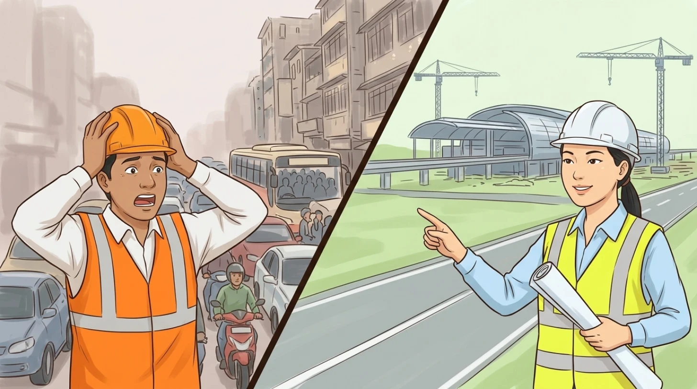
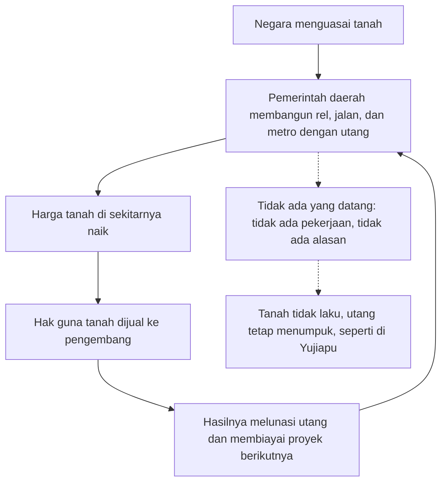
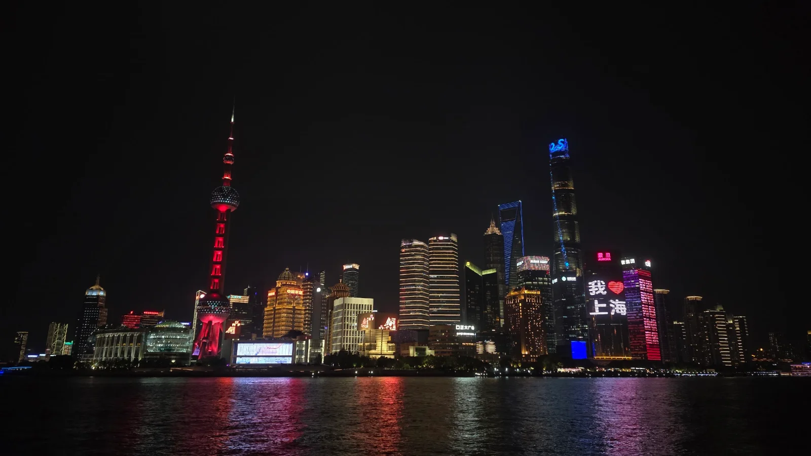
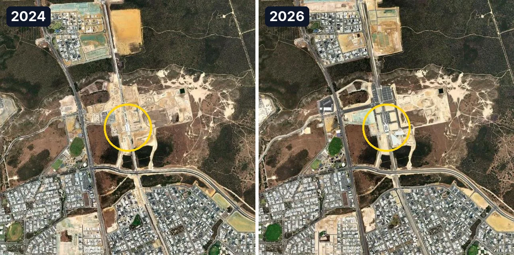
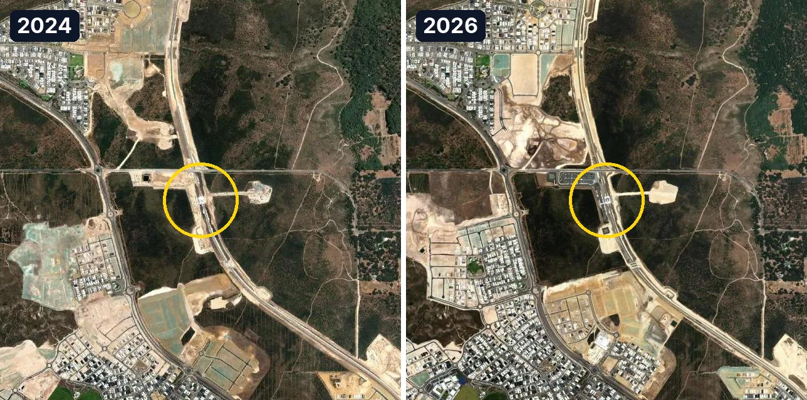
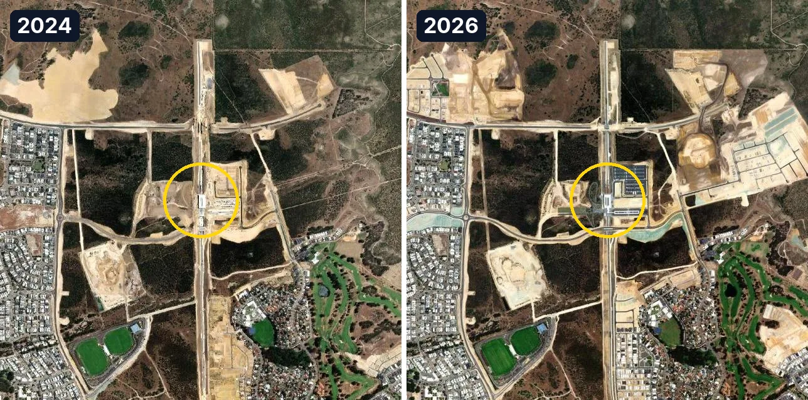
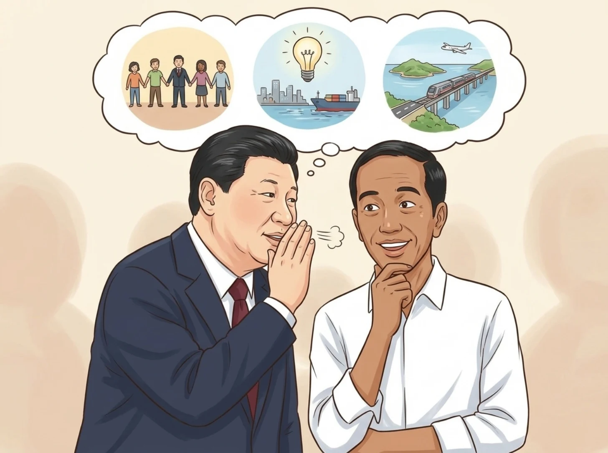

**Singkatnya:** pembangunan infrastruktur China bisa secepat itu karena memakai cara *supply-push*: negara membangun rel, stasiun, jalan, dan metro lebih dulu, membiayainya dari kenaikan harga tanah di sekitarnya, lalu menjaga rencananya selama puluhan tahun, sehingga warga dan pelaku usaha datang belakangan. Hasilnya, jalur kereta cepat China mencapai 50.000 km pada akhir 2025. Cara ini berhasil di Shenzhen dan Pudong, tetapi gagal di Yujiapu, dan secara keseluruhan mewariskan utang perusahaan pembiayaan milik pemerintah daerah sekitar 50,9% PDB China. Sejauh ini, Indonesia baru meniru cara China membangun, sementara cara China menyambungkan proyek dan melanjutkannya lintas pemerintahan belum ikut ditiru.
{: .tldr}

* TOC
{:toc}

## Apa yang membuat saya takjub setiap kali berkunjung ke China?

Saya menghabiskan lebih dari 25 tahun pertama hidup saya di Indonesia, hampir dua tahun terakhir ini saya tinggal di Australia, dan sejak 2023 saya selalu menyempatkan diri berkunjung ke China setidaknya sekali setahun. Sampai tulisan ini dibuat, saya sudah menjejakkan kaki di 14 wilayah. Di antaranya ada dua daerah administratif khusus (SAR, *special administrative region*), yaitu Hong Kong dan Makau, serta keempat kota setingkat provinsi yang langsung berada di bawah pemerintah pusat (*municipality*): Beijing, Tianjin, Shanghai, dan Chongqing. Yang selalu membuat saya takjub adalah skala pembangunannya: jaringan kereta cepat yang menjangkau hampir ke mana-mana, stasiun kereta yang luasnya menyaingi bandara, jaringan metro yang tidak kalah panjang dari jaringan MRT Singapura di hampir setiap kota besar, dan gedung pencakar langit yang menjulang bahkan di kota-kota lapis kedua dan ketiga (sebutan untuk kota menengah dan kecil di China) yang namanya jarang kita dengar.

Sebagai orang yang tumbuh di Indonesia, saya terbiasa dengan urutan yang sebaliknya. Di kota-kota kita, jalan biasanya baru dilebarkan dan rel baru dibangun setelah macetnya tidak tertahankan lagi, sedangkan di China saya berkali-kali melihat stasiun megah dan jalan lebar yang berdiri di lahan yang sekelilingnya masih kosong, seolah-olah penghuninya memang sengaja disuruh datang belakangan.

<figure>

<figcaption>Dua cara membangun kota: menambal setelah macet (<em>demand-pull</em>) atau membangun sebelum penghuninya datang (<em>supply-push</em>).</figcaption>
</figure>

Selain keempat kota setingkat provinsi dan dua daerah administratif khusus tadi, delapan wilayah lain yang sudah saya kunjungi adalah Jiangsu, Heilongjiang, Hunan, Shaanxi, Sichuan, Guangdong, Fujian, dan Taiwan. Peta berikut menandai keempat belas wilayah itu.

<figure>

<figcaption>Keempat belas wilayah yang sudah saya jejaki sejak 2023. Peta: data batas wilayah DataV (Alibaba Cloud).</figcaption>
</figure>

Angka resminya pun tidak kalah mencengangkan dibandingkan pemandangan yang saya saksikan langsung. Menurut Administrasi Perkeretaapian Nasional China, panjang jaringan kereta di China mencapai 165.000 km pada akhir 2025, dan 50.000 km di antaranya adalah jalur kereta cepat, kira-kira 350 kali panjang jalur Whoosh, yang hanya 142,3 km.[^nra][^whoosh] Sepanjang 2025 saja, China membuka 3.109 km jalur baru, dan 2.862 km di antaranya jalur kereta cepat.[^nra]

Untuk transportasi dalam kota, pada akhir 2025 ada 58 kota di China daratan yang memiliki jaringan kereta perkotaan (metro, LRT, trem, dan sejenisnya) dengan total panjang sekitar 13.068 km.[^camet] Kalau hanya jalur metronya yang dihitung, tanpa moda lain, panjangnya menurut CAMET mencapai 836 km di Beijing, 812 km di Shanghai, dan 680 km di Chengdu, ibu kota Provinsi Sichuan, sementara seluruh jaringan MRT dan LRT Singapura, yang sering kita jadikan patokan di Asia Tenggara, panjangnya 271,3 km.[^camet][^lta] Artinya, panjang jaringan metro Chengdu saja sudah sekitar 2,5 kali panjang seluruh jaringan rel perkotaan Singapura.

Pertanyaannya, bagaimana China bisa membangun secepat dan sebanyak itu, dan kenapa Indonesia, yang ambisinya juga besar, sulit menirunya? Menurut saya, jawabannya bukan sekadar soal uang atau tenaga kerja, melainkan soal urutan: mana yang datang lebih dulu, jalannya atau penggunanya.

## Apa bedanya pembangunan *demand-pull* dan *supply-push*?

Dalam pembangunan *demand-pull*, infrastruktur baru dibangun setelah kebutuhannya terbukti, sedangkan dalam pembangunan *supply-push*, infrastruktur dibangun lebih dulu berdasarkan rencana jangka panjang, dan kebutuhannya baru datang belakangan.

**_Demand-pull_** adalah cara yang dipakai sebagian besar negara, termasuk Indonesia. Infrastruktur dibangun secara reaktif dan bertahap, sebagai jawaban atas tanda-tanda kebutuhan yang nyata dan bisa dibuktikan: jalan yang macet setiap hari, kereta yang penuh sesak, atau pelabuhan yang antreannya mengular. Keunggulan cara ini ada pada efisiensi, karena hampir tidak ada modal yang menganggur dan setiap rupiah dibelanjakan untuk kebutuhan yang nilainya sudah terbukti. Risiko komersialnya pun lebih rendah, sebab penggunanya sudah ada sebelum proyeknya dimulai. Kelemahannya, biayanya cenderung lebih tinggi, karena pembangunan baru dimulai ketika kotanya sudah padat: lahan harus dibebaskan di tengah permukiman, jalur harus dibuat di bawah tanah, dan lalu lintas terganggu selama bertahun-tahun.

MRT Jakarta fase 1 adalah contoh klasiknya. Jalur Lebak Bulus sampai Bundaran HI sepanjang 15,7 km, yang punya 13 stasiun (tujuh stasiun layang dan enam stasiun bawah tanah), baru diresmikan pada 24 Maret 2019, ketika macet di koridor Sudirman dan Thamrin sudah lama menjadi santapan sehari-hari warga Jakarta. Proyek ini menelan biaya sekitar Rp16 triliun, atau kira-kira Rp1 triliun per kilometer, dan didanai pinjaman JICA.[^mrtj]

**_Supply-push_** berjalan dengan logika sebaliknya. Perencana, pemerintah, atau pengembang besar membangun secara proaktif berdasarkan proyeksi jangka panjang, rencana induk, atau visi tentang wujud sebuah wilayah puluhan tahun lagi, bukan berdasarkan permintaan hari ini. Keunggulan utamanya ada pada skala, karena proyek-proyek besar yang terkoordinasi bisa menentukan arah pertumbuhan sebuah wilayah, industrinya, dan daya tahannya untuk puluhan tahun ke depan. Selain itu, karena proyek dirancang dan dikerjakan dalam jumlah besar dengan rencana yang mencakup puluhan tahun, biaya per unitnya turun dan kapasitasnya tidak terus-menerus tertinggal dari kebutuhan. Sisi gelapnya muncul kalau perencanaannya buruk: kapasitas itu akan menganggur, sementara biaya operasi dan perawatannya terus berjalan, belum lagi bunganya kalau pembangunannya dibiayai utang.

Perbandingan keduanya bisa diringkas dalam tabel berikut.

| | *Demand-pull* | *Supply-push* |
| --- | --- | --- |
| Pemicu | Kebutuhan yang sudah terbukti: macet, antrean, kapasitas penuh | Rencana induk, proyeksi jangka panjang, visi pemerintah |
| Cara memutuskan | Bertahap, menunggu data permintaan | Dari atas ke bawah, mengikuti rencana puluhan tahun |
| Kelebihan | Modal jarang menganggur, risiko komersial rendah | Skala besar, biaya per unit lebih rendah, kapasitas cukup untuk puluhan tahun |
| Kelemahan | Biaya tinggi dan pengerjaan lambat karena dibangun di tengah kota yang sudah padat | Kapasitas menganggur, biaya perawatan dan bunga utang tetap berjalan |
| Contoh | MRT Jakarta, Sydney Metro | Shenzhen, Pudong, METRONET di Perth |

Tidak ada cara yang selalu benar: *demand-pull* jarang membuang uang tetapi selalu terlambat, sedangkan *supply-push* tidak pernah terlambat tetapi bisa membuang uang dalam jumlah yang sangat besar.

## Bagaimana cara kerja "*build it and they will come*" di China?

Di China, prinsip *build it and they will come* (bangun saja dulu, nanti mereka akan datang) kurang lebih bekerja seperti ini: negara membangun infrastrukturnya lebih dulu, harga tanah di sekitarnya naik, lalu hasil kenaikan harga tanah itulah yang dipakai untuk membayar utang pembangunannya.

Kuncinya ada pada kepemilikan tanah. Di kota-kota China, tanah dimiliki negara, sehingga pemerintah daerah tidak perlu membebaskan lahan dari ribuan pemilik seperti di Indonesia, dan yang dijual kepada pengembang adalah hak guna tanah untuk jangka waktu puluhan tahun. Pembangunannya sendiri biasanya dibiayai dan dikelola oleh perusahaan pembiayaan milik pemerintah daerah (*local government financing vehicle*, LGFV), yang meminjam uang untuk membangun rel, jalan, dan metro. Begitu stasiun berdiri, tanah di sekitarnya menjadi jauh lebih berharga, pemerintah daerah menjual hak guna tanah itu, dan hasilnya dipakai untuk melunasi utang serta membiayai proyek berikutnya. Pada 2021, saat mencapai puncaknya, penjualan hak guna tanah menghasilkan RMB 8,71 triliun bagi pemerintah China.[^landrev]

Putaran itu dijaga oleh perencanaan jangka panjang, mulai dari Rencana Lima Tahun nasional sampai rencana induk kota untuk puluhan tahun ke depan. Para pejabat daerah di China pun selama ini dinilai dari pertumbuhan ekonomi wilayah yang mereka pimpin, sehingga mereka berlomba-lomba membangun. Diagram berikut menggambarkan putaran itu, termasuk jalan buntunya ketika tidak ada yang datang.

### Kapan warga dan pelaku usaha benar-benar datang?

Contoh yang paling terkenal tentu Shenzhen. Pada 1979, ketika Kabupaten Bao'an diubah menjadi Kota Shenzhen, penduduknya hanya sekitar 314.100 orang, dan pada 26 Agustus 1980, Komite Tetap Kongres Rakyat Nasional menyetujui pembentukan kawasan ekonomi khusus di sana. Pada akhir 2025, penduduk Shenzhen sudah mencapai 18,25 juta orang, sekitar 58 kali lipat jumlah penduduk pada 1979, dan PDB-nya mencapai RMB 3,87 triliun.[^shenzhen] Supaya adil, perlu saya akui bahwa Shenzhen tumbuh bukan hanya karena jalan dan pelabuhannya. Kota itu mendapat kebebasan ekonomi yang belum dimiliki kota lain di China saat itu, dan tepat di seberang perbatasannya ada Hong Kong, yang membawa modal, pelabuhan, dan pengalaman berdagang dengan dunia.

Pola serupa terlihat di Pudong, Shanghai. Pada 18 April 1990, Perdana Menteri Li Peng mengumumkan pembukaan Pudong, kawasan di sisi timur Sungai Huangpu yang saat itu sebagian besar masih berupa lahan pertanian dan gudang. Pada 2025, PDB Pudong mencapai RMB 1,88 triliun, atau sekitar sepertiga dari PDB Shanghai yang sebesar RMB 5,67 triliun.[^pudong] Foto di bawah saya ambil dari The Bund, tepi barat Sungai Huangpu, sambil memandangi deretan menara di seberang sungai yang 35 tahun lalu belum ada.

<figure>

<figcaption>Lujiazui, Pudong, dilihat dari The Bund. Pada 1990, deretan menara ini belum ada. Foto: Adjie.</figcaption>
</figure>

Masih di Shanghai, ada contoh yang menurut saya paling menarik bagi kita di Indonesia karena menyatukan bandara, kereta cepat, dan metro, yaitu Hongqiao di tepi barat kota. Stasiun Kereta Hongqiao, yang punya 16 peron dan 30 jalur, dibuka pada 1 Juli 2010 dan menyatu dengan Bandara Hongqiao serta jaringan metro dalam satu kompleks.[^hongqiao] Penumpang yang turun dari pesawat cukup berjalan kaki ke peron kereta cepat atau metro, dan kawasan bisnis Hongqiao kemudian tumbuh di sekitar simpul itu.

Beijing pun punya kisah serupa di kawasan pusat bisnis (*central business district*, CBD) di Distrik Chaoyang. Kawasan ini sudah direncanakan dalam rencana induk Beijing 1993, yang menetapkan area inti seluas 7,04 km² dan kawasan pendukung di sekelilingnya (zona fungsional) seluas 84 km².[^beijingcbd] Pada 2025, Chaoyang memiliki lebih dari 140 gedung yang setoran pajak para penghuninya masing-masing melebihi RMB 100 juta, dan menjadi lokasi 125 kantor pusat regional perusahaan multinasional.[^beijingcbd]

### Kapan warga dan pelaku usaha tidak datang?

Lain ceritanya dengan Yujiapu di Tianjin, yang dulu dijuluki "Manhattan-nya China". Kawasan yang dibangun oleh LGFV ini dipromosikan sebagai kawasan keuangan terbesar di dunia, dan investasi yang ditanamkan di sana setidaknya RMB 200 miliar (US$32 miliar).[^yujiapu] Pada 2014, SCMP sudah menyebut menara-menaranya sebagai "gedung hantu", dan sekitar 2019, menurut The New York Times, kira-kira 80% ruang kantornya masih kosong, sementara pembangunan beberapa menara terhenti di tengah jalan.[^yujiapu] Beberapa instansi pemerintah memang mulai pindah ke sana pada 2019, tetapi sampai tahun itu, perusahaan swasta yang diharapkan berbondong-bondong datang belum juga muncul.

Pelajarannya, perencanaan strategis yang menyeluruh memegang peran kunci, karena orang hanya mau datang ke sebuah tempat kalau mereka punya alasan untuk ke sana. Gedung bisa dibangun dalam hitungan tahun, tetapi alasan orang untuk berkantor di sana tidak bisa dicor bersama betonnya.

Cara membiayai pembangunan dengan utang, lalu melunasinya dari penjualan hak guna tanah, juga meninggalkan tagihan yang besar. Pendapatan pemerintah China dari penjualan hak guna tanah turun dari RMB 8,71 triliun pada 2021 menjadi RMB 4,15 triliun pada 2025, atau anjlok lebih dari separuh setelah empat tahun berturut-turut menurun.[^landrev] Padahal, menurut perkiraan IMF, utang LGFV sudah mencapai RMB 71,4 triliun atau 50,9% PDB China pada 2025, dan kalau semua utang di luar catatan resmi seperti itu dijumlahkan dengan utang resmi, utang pemerintah China dalam arti luas mencapai 126,6% PDB dan diproyeksikan naik menjadi 153,7% PDB pada 2030.[^imf] Utang yang dipakai untuk membangun aset produktif memang bisa dilunasi dari hasil aset itu sendiri, seperti yang pernah saya bahas dalam tulisan [utang baik atau buruk](/id/utang-baik-atau-buruk/), tetapi utang untuk menara kosong hanya meninggalkan cicilan.

## Apakah Australia mulai beralih ke cara China?

Tradisi pembangunan Australia sebenarnya *demand-pull*, dan contohnya mudah ditemukan. Sydney Metro North West, misalnya, baru dibuka pada 26 Mei 2019, ketika jalan-jalan dan kereta di Sydney sudah lama penuh sesak. Jalurnya membentang 36 km dari Tallawong sampai Chatswood dan melewati 13 stasiun.[^sydneymetro] Kereta komuter Sydney bahkan sudah lama memakai gerbong bertingkat supaya muat lebih banyak penumpang, tanda bahwa kapasitasnya selama ini selalu tertinggal dari kebutuhan.

Kasus di Melbourne lebih ekstrem lagi. Pada 2018, biaya jalur kereta ke Bandara Melbourne diperkirakan A$8 sampai 13 miliar, tetapi lewat anggaran 2024, pemerintah negara bagian Victoria menunda proyek itu setidaknya empat tahun, sehingga jalur itu paling cepat baru beroperasi pada 2033.[^melbourne] Tahap pertamanya saja, yang baru dimulai pada 2025-2026, bernilai lebih dari A$4 miliar.[^melbourne] Contoh *demand-pull* yang paling terasa bagi warga Australia adalah perumahan. Pemerintah menargetkan 1,2 juta rumah baru dalam lima tahun sampai Juni 2029, tetapi menurut NHSAC, rumah yang akan terbangun dalam periode itu hanya sekitar 980.000, atau kurang sekitar 220.000 rumah dari target, dan target itu diperkirakan baru tercapai pada triwulan III 2030.[^housing]

Meski begitu, ada tanda-tanda Australia mulai bergeser. Di Perth, program METRONET memperpanjang jalur kereta ke utara sejauh 14,5 km dari Butler sampai Yanchep, lengkap dengan tiga stasiun baru di Alkimos, Eglinton, dan Yanchep, yang dibuka pada 14 Juli 2024.[^yanchep] Biaya akhirnya dilaporkan sekitar A$1 miliar, hampir dua kali lipat perkiraan awal yang hanya sekitar A$531,7 juta.[^yanchep] Yang menarik, ketiga stasiun itu dibangun ketika sekelilingnya sebagian besar masih semak belukar dan pasir yang baru dibersihkan.

Citra satelit berikut membandingkan kawasan di sekitar ketiga stasiun itu pada 2024 dan 2026. Pada 2024, setiap stasiun masih dikelilingi semak dan lahan berpasir, dengan rumah-rumah hanya di salah satu sisinya. Dua tahun kemudian, permukiman baru dengan jaringan jalan dan kaveling rumah sudah tumbuh di sekitar Eglinton dan Yanchep, sementara di sebelah Stasiun Alkimos semak masih tersisa, meski kompleks perumahan baru mulai bermunculan di dekatnya. Warga dan pengembang ternyata benar-benar datang.

<figure>

<figcaption>Stasiun Alkimos, Eglinton, dan Yanchep (dari atas ke bawah), sebelum dan sesudah. Citra satelit: Esri World Imagery, rilis Wayback Agustus 2024 dan Oktober 2026; Esri, Maxar, Earthstar Geographics.</figcaption>
</figure>

Tidak semua janji METRONET sudah terwujud. Pembangunan Stasiun Karnup, misalnya, baru dipastikan pada 2 Agustus 2026, dan pekerjaannya dijadwalkan dimulai pada 2028.[^karnup]

Contoh *supply-push* yang lebih besar ada di Sydney bagian barat. Western Sydney International Airport dibangun bersama kota baru Bradfield di lahan yang masih lapang, dan bandara itu mulai melayani penumpang pada 25 Oktober 2026, diawali penerbangan Jetstar ke Gold Coast.[^wsi] Masalahnya, jalur metro dari St Marys ke Bradfield sepanjang 23 km baru dijadwalkan dibuka pada 2027, sehingga untuk sementara penumpang harus naik bus gratis ke jaringan kereta.[^wsi] Membuka bandara sebelum relnya tersambung adalah risiko yang patut diwaspadai, karena kebiasaan penumpang yang terbentuk di bulan-bulan pertama sulit diubah belakangan.

## Kenapa pembangunan ala China belum berhasil di Indonesia?

Pembangunan ala China belum berhasil di Indonesia karena kita baru meniru cara China membangun, sementara cara China menyambungkan proyek, membiayainya dari kenaikan nilai tanah, dan melanjutkannya lintas pemerintahan belum ikut ditiru.

### Kenapa kota sebesar Surabaya belum punya metro?

Indonesia bukan sekadar menganut *demand-pull*, melainkan *demand-pull* yang ekstrem: bahkan ketika kebutuhannya jelas-jelas sudah ada, infrastruktur yang dibutuhkan tetap belum dibangun. Sampai hari ini, angkutan massal cepat yang memadai hanya ada di Jakarta, yang punya MRT, LRT, dan KRL, serta di Palembang, yang punya LRT. LRT Palembang mulai melayani penumpang pada 1 Agustus 2018, menjelang Asian Games. Jalurnya sekitar 23 km dan melewati 13 stasiun dari bandara sampai Jakabaring, dan pada 2025 kereta ini mengangkut sekitar 4,63 juta penumpang.[^palembang]

Surabaya, Bandung, dan Medan, tiga kota besar yang masing-masing berpenduduk jutaan orang, sama sekali belum punya metro atau LRT, bahkan belum punya BRT yang layak. Surabaya masih mengandalkan bus yang berbagi jalur dengan kendaraan lain, dan rencana BRT-nya baru sampai tahap desain teknis terperinci (DED, *detailed engineering design*). Pembangunan BRT Cekungan Bandung baru dimulai pada Juli 2026, dengan anggaran sekitar Rp1,3 triliun untuk 18 rute, sedangkan BRT Mebidang di Medan ditargetkan beroperasi pada 2027.[^brt] Kedua proyek BRT itu dibiayai lewat program MASTRAN dengan pinjaman Bank Dunia dan AFD.[^brt]

### Apa tiga resep Presiden Xi yang diceritakan Jokowi?

Pergeseran ke arah *supply-push* baru terasa pada era Presiden Joko Widodo. Pada 18 November 2014, di hadapan peserta pendidikan Lemhannas di Istana Negara, Jokowi menceritakan tiga resep yang ia dengar langsung dari Presiden Xi Jinping tentang cara China membangun.[^lemhannas] Yang pertama, kata Jokowi, adalah "partai yang harus bersatu". Yang berikutnya, sebuah negara harus "punya gagasan besar, punya visi besar, punya mimpi besar", yang menurut Jokowi berarti "harus punya rencana jangka panjang", untuk lima puluh sampai seratus tahun ke depan. Resep terakhir ia sampaikan dengan kalimat seperti ini: "Kejar infrastrukturnya. *Connectivity* antar kota, *connectivity* kalau kita antar pulau, itu harus. Jangan ditunda-tunda."[^lemhannas]

<figure>

<figcaption>Tiga resep yang dibisikkan: partai yang bersatu, mimpi besar dengan rencana jangka panjang, dan konektivitas yang tidak ditunda-tunda.</figcaption>
</figure>

Bagi saya, ketiga resep itu bisa dirangkum sebagai pembangunan yang terencana dan strategis. Resep ketigalah yang paling getol dijalankan pemerintahan Jokowi, sementara resep kedua dan terutama resep pertama jauh lebih sulit ditiru oleh negara yang pemerintahannya bisa berganti setiap lima tahun.

### Apakah Tol Trans-Jawa membuktikan bahwa warga dan pelaku usaha bisa datang?

Menurut saya, Tol Trans-Jawa adalah contoh *supply-push* yang paling berhasil di Indonesia, meski keberhasilannya datang lebih lambat dari harapan dan tidak merata. Ruas Merak sampai Surabaya, sekitar 930 km, tersambung pada Desember 2018, disusul ruas Surabaya sampai Probolinggo setahun kemudian, sementara panjang total yang direncanakan sampai Banyuwangi sekitar 1.167 km.[^transjawa]

Hasil kajian tentang dampaknya ternyata beragam: penelitian dari IPB dengan data panel kabupaten dan kota di Jawa Tengah menemukan dampak positif terhadap pertumbuhan ekonomi daerah yang dilewati tol.[^transjawa] Sebaliknya, studi dari UI belum menemukan dampak yang stabil dalam jangka menengah terhadap PDRB per kapita, pengangguran, maupun kemiskinan, dan kajian di Jawa Timur juga tidak menemukan dampak parsial yang signifikan.[^transjawa] Ada pula pihak yang dirugikan: pedagang di kota-kota sepanjang jalur Pantura kehilangan pembeli yang dulu lewat, dan sebuah studi di Pekalongan mencatat pendapatan pedagang batik yang menurun.[^transjawa] Pelaku usaha memang datang, tetapi sebagian besar ke sekitar gerbang tol dan kawasan industri, bukan merata ke seluruh kota yang dilewati.

### Kenapa Kertajati, Whoosh, dan IKN belum berjalan mulus?

Bandara Kertajati, Kereta Cepat Whoosh, dan IKN adalah proyek yang semangatnya *supply-push*, tetapi hasilnya jauh dari harapan. Setidaknya ada lima penyebabnya.

**Pertama, rencana yang putus di tengah jalan.** China bisa merencanakan sesuatu untuk puluhan tahun dan memastikan rencana itu benar-benar dijalankan, dan menurut saya keuntungan itu datang dari sistem satu partainya. Di Indonesia, rencana besar sering berubah arah setiap kali pemerintahan berganti, dan di dalam satu pemerintahan pun kementerian dan lembaga kerap sibuk menjaga wilayahnya masing-masing (ego sektoral), sehingga bandara, jalan akses, dan rel penghubungnya dibangun oleh pihak yang berbeda dengan jadwal yang berbeda pula.

**Kedua, infrastruktur utama dibangun tanpa sambungannya.** Bandara Kertajati diresmikan pada 24 Mei 2018 dan dirancang untuk sekitar 5,6 juta penumpang setahun pada tahap pertama, tetapi pada 2024 bandara itu hanya melayani 413.240 penumpang, atau sekitar 7% dari kapasitasnya.[^kertajati] Jarak Bandung ke Kertajati sekitar 60 km, dan sejak Tol Cisumdawu dibuka pada 2023, jarak itu bisa ditempuh dalam waktu sekitar satu jam, sehingga masalahnya bukan semata jarak.[^kertajati] Yang menjadi soal, tidak ada rel yang menyambungkan bandara itu ke kota. Pemerintah sendiri memindahkan penerbangan jet dari Bandara Husein Sastranegara di tengah Kota Bandung ke Kertajati mulai 29 Oktober 2023, lalu menjadwalkan Husein kembali melayani pesawat jet mulai 14 Agustus 2026.[^kertajati] Keputusan itu sama saja dengan pengakuan tidak langsung bahwa pemindahan penerbangan ke Kertajati tidak berjalan sesuai rencana.

Sebagai perbandingan, Bandara Pudong di Shanghai, yang dibuka pada 1999, berjarak sekitar 30 km dari pusat kota, kira-kira dua kali jarak Bandara Hongqiao yang hanya sekitar 13 km. Meski jauh, sejak 2004 penumpang Bandara Pudong bisa naik Metro Jalur 2 atau kereta Maglev, yang menempuh 30 km dalam waktu sekitar 7 menit.[^shairport] Tabel berikut menunjukkan bahwa yang menentukan bukan jarak, melainkan ada atau tidaknya sambungan rel ke kota.

| Bandara | Jarak ke pusat kota | Sambungan rel | Waktu tempuh tercepat ke kota |
| --- | --- | --- | --- |
| Hongqiao, Shanghai | Sekitar 13 km (garis lurus) | Metro Jalur 2, satu kompleks dengan Stasiun Kereta Hongqiao | Tidak perlu pindah moda: metro dan kereta cepat ada di kompleks yang sama |
| Pudong, Shanghai | Sekitar 30 km | Maglev (sejak 2004) dan Metro Jalur 2 | Sekitar 7 menit dengan Maglev ke Longyang Road |
| Kertajati, Majalengka | Sekitar 60 km dari Bandung | Tidak ada | Sekitar 1 jam lewat Tol Cisumdawu |

Masalah yang sama terjadi pada Whoosh, yang diresmikan pada 2 Oktober 2023. Jalurnya sepanjang 142,3 km, dan saat ini ada empat stasiun di sepanjang jalur itu: Halim, Karawang, Padalarang, dan Tegalluar.[^whoosh] Stasiun Halim berada di Jakarta Timur, bukan di pusat kota, sementara Stasiun Tegalluar berjarak belasan kilometer dari pusat Kota Bandung. Akibatnya, sebagian besar penumpang tujuan Bandung memilih turun di Padalarang, lalu menyambung dengan kereta pengumpan ke Stasiun Bandung selama 15 sampai 22 menit.[^whooshriders] Dari 6,2 juta penumpang Whoosh pada 2025, 3,1 juta naik atau turun di Halim, 2,2 juta di Padalarang, dan hanya 750 ribu di Tegalluar.[^whooshriders] Stasiun yang dibangun khusus untuk Bandung justru jauh lebih sepi daripada Padalarang.

**Ketiga, kenaikan nilai tanah di sekitar proyek tidak ikut dinikmati proyeknya (tidak ada *land value capture*).** Di China, jalur kereta dibiayai dengan menjual tanah yang harganya naik karena jalur itu, sedangkan proyek di Indonesia menanggung utangnya tanpa ikut menikmati kenaikan nilai tanah di sekitar stasiun. Di sekitar stasiun Whoosh belum ada kawasan berorientasi transit (*transit-oriented development*) yang hasil penjualan tanahnya ikut membayar utang proyek, padahal biaya proyeknya mencapai sekitar US$7,2 sampai 7,27 miliar, termasuk pembengkakan biaya sekitar US$1,2 miliar, dan 75% di antaranya dibiayai utang dari China Development Bank (CDB).[^whooshdebt] Utang proyek ini sekitar Rp116 triliun, dan PSBI, konsorsium BUMN yang dipimpin KAI dan memegang porsi saham Indonesia, merugi Rp4,99 triliun pada 2025 dan Rp5,13 triliun pada semester I 2026.[^whooshdebt] Pada Agustus 2026, Danantara menyatakan bahwa skema restrukturisasi utangnya masih disempurnakan, dan syarat akhirnya belum diumumkan.[^whooshdebt]

**Keempat, pembebasan lahan yang lambat dan mahal, serta proyek yang dimulai sebelum semuanya siap.** Karena tanah di Indonesia dimiliki banyak orang, lahan untuk setiap kilometer rel atau jalan harus dibebaskan dari pemiliknya satu per satu, dan proyek sering dimulai sebelum studi kelayakan, jalan akses, dan sambungannya benar-benar beres. Whoosh adalah contohnya: menurut audit BPKP, pembengkakan biayanya mencapai US$1,176 miliar, dan untuk menutupnya, KAI harus meminjam lagi US$542,7 juta (Rp8,41 triliun) dari CDB.[^whooshdebt]

**Kelima, membangun di tempat yang belum punya alasan ekonomi untuk didatangi.** IKN adalah contoh yang paling jelas. Lewat Perpres Nomor 79 Tahun 2025, pemerintah menargetkan IKN menjadi "ibu kota politik" pada 2028, dan anggaran yang disiapkan untuk 2025 sampai 2028 mencapai Rp48,8 triliun.[^ikn] Anggaran OIKN untuk 2026 hanya Rp6,3 triliun dalam RAPBN, dan DPR menolak tambahan Rp14,92 triliun yang diajukan OIKN, sementara pada 2025, belanja yang terealisasi Rp8,51 triliun dari pagu efektif Rp9,04 triliun.[^ikn] Gedung-gedungnya bisa terus dibangun, tetapi pertanyaan terpentingnya belum terjawab: siapa yang akan pindah, kapan, dan pekerjaan apa yang menunggu mereka di sana?

## Apakah harus menjadi negara satu partai untuk membangun seperti China?

Menurut saya tidak harus, meski perlu saya akui bahwa sistem satu partai memberi China dua keuntungan yang nyata: rencana yang berlanjut puluhan tahun tanpa terputus oleh pemilu, dan kemampuan untuk memaksakan rencana itu sampai ke tingkat daerah. Bagi proyek yang baru terasa manfaatnya setelah 20 atau 30 tahun, kedua hal itu sangat berharga.

Meski begitu, keuntungan itu juga ada harganya. Kasus Yujiapu di Tianjin memperlihatkan bahwa keputusan dari atas bisa salah besar tanpa ada yang berani menghentikannya: investasi di kawasan keuangan itu setidaknya RMB 200 miliar, tetapi sekitar 2019 kira-kira 80% ruang kantornya masih kosong.[^yujiapu] Utang LGFV yang mencapai 50,9% PDB China pada 2025 menunjukkan bahwa cara membangun dengan utang, lalu melunasinya dari penjualan hak guna tanah, bisa macet, dan penggusuran warga demi proyek besar jarang bisa digugat ketika pengawasan dari parlemen, pengadilan, dan pers lemah.[^imf] Kecepatan yang mengagumkan itu dibayar mahal: sistemnya nyaris tidak punya rem.

Di sisi lain, negara demokrasi juga bisa punya rencana jangka panjang. METRONET di Perth tetap berjalan dari satu perdana menteri negara bagian ke penerusnya, dan Australia punya Infrastructure Australia, lembaga independen yang menilai proyek-proyek besar sebelum uang negara dibelanjakan. Indonesia sendiri sudah punya UU Nomor 59 Tahun 2024 tentang RPJPN 2025-2045, yang disahkan pada 13 September 2024 dan seharusnya mengikat setiap presiden selama dua puluh tahun.[^rpjpn] Yang perlu ditiru dari China, menurut saya, bukan sistem politiknya, melainkan kesinambungan rencananya, disiplin untuk menyambungkan setiap proyek sejak hari pertama, dan kecerdikan membiayai proyek dari nilai yang diciptakannya sendiri. Demokrasi bisa mendapatkan ketiganya lewat undang-undang dan lembaga yang kuat, sementara negara otoriter pun tetap bisa melahirkan kawasan kosong seperti Yujiapu.

## Jadi, bagaimana China bisa membangun secepat itu?

China membangun secepat itu karena berani membangun lebih dulu, menyambungkan semuanya sejak awal, membiayainya dari kenaikan harga tanah, dan menjaga rencananya selama puluhan tahun, meski cara yang sama juga menyisakan menara kosong di Yujiapu dan utang pemerintah daerah yang menggunung.

Menurut saya, Indonesia tidak perlu memilih antara membangun setelah macet dan membangun dengan membabi buta. Membangun lebih dulu boleh saja, asalkan setiap proyek tersambung sejak awal, punya alasan untuk didatangi, dan terus dilanjutkan setelah pejabat yang meresmikannya tidak lagi menjabat. Jalan tol dan stasiun hanya membuka pintu, sedangkan yang membuat orang mau masuk adalah sambungan, pekerjaan, dan rencana yang tidak berhenti di tengah jalan.

Lain kali, saat kamu membaca berita peresmian proyek besar, lengkap dengan gunting pita dan tepuk tangannya, cobalah ajukan dua pertanyaan sederhana. Pertama, apa saja yang sudah tersambung ke proyek ini pada hari pertama proyek itu dibuka? Kedua, siapa yang akan membayar dan melanjutkan tahap berikutnya setelah pemerintahan ini berganti? Kalau kedua pertanyaan itu tidak punya jawaban, bisa jadi yang sedang diresmikan bukan awal sebuah kota baru, melainkan calon kawasan kosong berikutnya. Menurutmu, proyek mana di Indonesia yang paling layak diuji dengan dua pertanyaan itu?

*[SAR]: Special Administrative Region, daerah administratif khusus di China
*[MRT]: Mass Rapid Transit, angkutan massal berbasis rel
*[LRT]: Light Rail Transit, kereta ringan perkotaan
*[KRL]: Kereta Rel Listrik, kereta komuter Jabodetabek
*[BRT]: Bus Rapid Transit, bus cepat dengan jalur khusus
*[PDB]: Produk Domestik Bruto, nilai seluruh barang dan jasa yang dihasilkan di dalam suatu wilayah
*[PDRB]: Produk Domestik Regional Bruto, PDB untuk tingkat provinsi atau kabupaten dan kota
*[RMB]: renminbi, mata uang China
*[LGFV]: Local Government Financing Vehicle, perusahaan pembiayaan milik pemerintah daerah di China
*[CBD]: Central Business District, kawasan pusat bisnis
*[IMF]: International Monetary Fund, Dana Moneter Internasional
*[JICA]: Japan International Cooperation Agency, badan kerja sama internasional Jepang
*[HI]: Hotel Indonesia
*[SCMP]: South China Morning Post, surat kabar berbahasa Inggris di Hong Kong
*[NHSAC]: National Housing Supply and Affordability Council, dewan penasihat pemerintah Australia untuk pasokan dan keterjangkauan rumah
*[DED]: Detailed Engineering Design, desain teknis terperinci
*[MASTRAN]: Mass Transit Program, program angkutan massal perkotaan yang didanai Bank Dunia dan AFD
*[AFD]: Agence Française de Développement, badan pembangunan Prancis
*[Mebidang]: Medan, Binjai, dan Deli Serdang
*[Lemhannas]: Lembaga Ketahanan Nasional
*[IPB]: Institut Pertanian Bogor
*[UI]: Universitas Indonesia
*[Pantura]: Pantai Utara Jawa
*[IKN]: Ibu Kota Nusantara
*[OIKN]: Otorita Ibu Kota Nusantara, badan pengelola IKN
*[Cisumdawu]: Cileunyi, Sumedang, dan Dawuan
*[CDB]: China Development Bank, bank pembangunan milik pemerintah China
*[PSBI]: PT Pilar Sinergi BUMN Indonesia, konsorsium BUMN yang memegang porsi saham Indonesia di Whoosh
*[BUMN]: Badan Usaha Milik Negara
*[KAI]: PT Kereta Api Indonesia
*[PT]: Perseroan Terbatas
*[RI]: Republik Indonesia
*[RRI]: Radio Republik Indonesia
*[CNBC]: Consumer News and Business Channel, kanal berita bisnis
*[P3DI]: Pusat Penelitian, Pengolahan Data dan Informasi, unit riset Sekretariat Jenderal DPR
*[KCIC]: PT Kereta Cepat Indonesia China, operator Whoosh
*[BPKP]: Badan Pengawasan Keuangan dan Pembangunan
*[Danantara]: Daya Anagata Nusantara, badan pengelola investasi milik negara
*[Perpres]: Peraturan Presiden
*[RAPBN]: Rancangan Anggaran Pendapatan dan Belanja Negara
*[DPR]: Dewan Perwakilan Rakyat
*[UU]: Undang-Undang
*[RPJPN]: Rencana Pembangunan Jangka Panjang Nasional
*[RKP]: Rencana Kerja Pemerintah
*[Maglev]: magnetic levitation, kereta yang melayang dengan gaya magnet
*[CAMET]: China Association of Metros, asosiasi operator kereta perkotaan China
*[LTA]: Land Transport Authority, otoritas transportasi darat Singapura
*[AAP]: Australian Associated Press, kantor berita Australia
*[BPS]: Badan Pusat Statistik
*[Sumsel]: Sumatera Selatan
*[BPK]: Badan Pemeriksa Keuangan
*[Setkab]: Sekretariat Kabinet
*[JKE]: Jurnal Kebijakan Ekonomi, jurnal ilmiah terbitan UI
*[JEKP]: Jurnal Ekonomi dan Kebijakan Pembangunan, jurnal ilmiah terbitan IPB

<!-- abbr-ok: METRONET -->

## Referensi

[^nra]: Administrasi Perkeretaapian Nasional China, [Buletin Statistik Perkeretaapian 2025](https://www.nra.gov.cn/xwzx/zlzx/hytj/202605/P020260529633504739062.pdf), 29 Mei 2026; angka yang sama tercantum dalam [buletin statistik Kementerian Perhubungan China 2025](https://xxgk.mot.gov.cn/jigou/zhghs/202606/t20260618_4207752.html), 18 Juni 2026: jaringan kereta 165.000 km dan jalur kereta cepat 50.000 km pada akhir 2025, dengan 3.109 km jalur baru pada 2025, 2.862 km di antaranya jalur kereta cepat.
[^camet]: CAMET, [laporan statistik dan analisis tahunan 2025](https://infosharingp2-oss.camet.org.cn/resources/manual/2026/03/31/789660015317061.pdf), 31 Maret 2026: 58 kota di China daratan, 382 jalur, 13.067,89 km kereta perkotaan untuk semua moda pada akhir 2025. Panjang metro: Beijing 835,99 km, Shanghai 811,60 km, Chengdu 680,25 km.
[^lta]: LTA, [Rail Length 2025](https://www.lta.gov.sg/content/dam/ltagov/who_we_are/statistics_and_publications/statistics/pdf/Rail_Length_2025.pdf): jaringan rel Singapura 271,3 km (MRT 242,5 km dan LRT 28,8 km) pada akhir 2025.
[^whoosh]: Setkab, [President Jokowi officiates operation of Whoosh high-speed train](https://setkab.go.id/en/president-jokowi-officiates-operation-of-whoosh-high-speed-train/), 2 Oktober 2023: Whoosh diresmikan di Stasiun Halim; Republika, [KCIC: Whoosh angkut 6,2 juta penumpang pada 2025](https://ekonomi.republika.co.id/berita/t8qjcx423/kcic-whoosh-angkut-62-juta-penumpang-pada-2025-naik-200-ribu-dari-2024), mengutip KCIC: jalur 142,3 km, Stasiun Halim, Karawang, Padalarang, dan Tegalluar. Hitungan saya: 50.000 km ÷ 142,3 km ≈ 351 kali.
[^shenzhen]: Biro Statistik Shenzhen, [Buletin Statistik 2025](https://www.sz.gov.cn/cn/xxgk/zfxxgj/tjsj/tjgb/content/post_12805133.html), 25 Mei 2026: penduduk 18.248.500 orang dan PDB RMB 3.873,18 miliar pada 2025. Penduduk 1979 sebesar 314.100 orang dari seri data biro yang sama, dikutip dari [Jiemian](https://www.jiemian.com/article/9372282.html). Persetujuan kawasan ekonomi khusus pada 26 Agustus 1980 dari [China Daily](https://cn.chinadaily.com.cn/a/202008/26/WS5f4617aaa31008497842131b.html), 26 Agustus 2020. Hitungan saya: 18.248.500 ÷ 314.100 ≈ 58 kali.
[^pudong]: Biro Statistik Pudong, [Buletin Statistik 2025](https://www.pudong.gov.cn/zwgk/tjj_gkml_ywl_tjsj_gb/2026/135/355149.html): PDB Pudong RMB 1.876,91 miliar; Biro Statistik Shanghai, [Buletin Statistik 2025](https://tjj.sh.gov.cn/tjgb/20260330/e0772941e8e041eaaad2df850b44ef98.html), 30 Maret 2026: PDB Shanghai RMB 5.670,87 miliar. Hitungan saya: sekitar 33,1%. Pengumuman 18 April 1990 dari [The Paper](https://www.thepaper.cn/newsDetail_forward_7027024).
[^hongqiao]: [Shanghai Hongqiao railway station](https://en.wikipedia.org/wiki/Shanghai_Hongqiao_railway_station), Wikipedia, dan [The Paper](https://m.thepaper.cn/baijiahao_8119589): dibuka 1 Juli 2010, 16 peron dan 30 jalur.
[^beijingcbd]: Pemerintah Kota Beijing, [Beijing CBD](https://english.beijing.gov.cn/investinginbeijing/InvestmentSpecial/INV_BJ_CBD/inv_idbz/202509/t20250922_4207756.html), September 2025: direncanakan dalam rencana induk Beijing 1993, kawasan inti 7,04 km² dan zona fungsional 84 km²; Chaoyang pada 2025 memiliki lebih dari 140 gedung dengan setoran pajak masing-masing di atas RMB 100 juta dan 125 kantor pusat regional perusahaan multinasional.
[^yujiapu]: SCMP, [Ghost buildings haunt Tianjin's Manhattan project](https://www.scmp.com/property/hong-kong-china/article/1544384/ghost-buildings-haunt-tianjins-manhattan-project), 2014, dan [Despite 10.4pc growth, China's 'Manhattan' remains cautionary tale](https://www.scmp.com/news/china/economy/article/1990611/despite-104pc-growth-chinas-manhattan-remains-cautionary-tale), 2016; The New York Times, dikutip dari [The Real Deal](https://therealdeal.com/2019/04/14/empty-buildings-in-chinas-manhattan-could-mean-trouble-for-growth-in-the-country), 14 April 2019: investasi setidaknya RMB 200 miliar (US$32 miliar) dan sekitar 80% ruang kantor kosong.
[^landrev]: Kementerian Keuangan China, [Penerimaan dan belanja fiskal 2021](http://gks.mof.gov.cn/tongjishuju/202201/t20220128_3785692.htm), 28 Januari 2022: penjualan hak guna tanah RMB 8.705,1 miliar; [Penerimaan dan belanja fiskal 2025](https://m.mof.gov.cn/czxw/202601/t20260130_3982923.htm), 30 Januari 2026: RMB 4.151,8 miliar, turun 14,7% dan turun empat tahun berturut-turut. Hitungan saya: turun 52,3% dari 2021.
[^imf]: IMF, [Country Report No. 26/44, People's Republic of China: 2025 Article IV Consultation](https://www.imf.org/-/media/files/publications/cr/2026/english/1chnea2026001-source-pdf.pdf), Februari 2026, Tabel 2, dan [siaran persnya](https://www.imf.org/en/news/articles/2026/02/18/pr-26053-china-imf-executive-board-concludes-2025-article-iv-consultation), 18 Februari 2026: utang LGFV RMB 71,4 triliun atau 50,9% PDB (perkiraan 2025); utang pemerintah dalam arti luas (*augmented*) 126,6% PDB pada 2025 dan 153,7% pada 2030.
[^sydneymetro]: Pemerintah New South Wales, [Sydney Metro to open three weeks early](https://www.nsw.gov.au/media-releases/sydney-metro-to-open-three-weeks), dan Sydney Metro, [North West opening date announced](https://www.sydneymetro.info/article/north-west-opening-date-announced), 2019: dibuka 26 Mei 2019, Tallawong sampai Chatswood, 13 stasiun, 36 km.
[^melbourne]: AAP, [Questions remain over Melbourne Airport Rail link](https://aapnews.aap.com.au/news/questions-remain-over-melbourne-airport-rail-link), 2024: perkiraan biaya 2018 sebesar A$8 sampai 13 miliar, ditunda setidaknya empat tahun menjadi paling cepat 2033; Victoria's Big Build, [First stage of Melbourne Airport Rail gets underway](https://bigbuild.vic.gov.au/library/melbourne-airport-rail/fact-sheets/first-stage-of-melbourne-airport-rail-gets-underway): tahap pertama lebih dari A$4 miliar; [daftar proyek pemerintah federal](https://investment.infrastructure.gov.au/projects/097140-17vic).
[^housing]: NHSAC, [State of the Housing System 2026](https://nhsac.gov.au/sites/nhsac.gov.au/files/2026-04/ar-state-housing-system-2026.pdf), 30 April 2026: target 1,2 juta rumah dari pertengahan 2024 sampai Juni 2029, perkiraan 980.000 rumah dalam periode itu, dan target baru tercapai pada triwulan III 2030. Hitungan saya: kekurangan sekitar 220.000 rumah.
[^yanchep]: Pemerintah Australia Barat, [METRONET Yanchep Rail Extension officially open](https://www.wa.gov.au/government/media-statements/Cook-Labor-Government/Joint-media-statement---METRONET-Yanchep-Rail-Extension-officially-open-20240714), 14 Juli 2024: 14,5 km dari Butler dengan Stasiun Alkimos, Eglinton, dan Yanchep. Biaya dari [International Railway Journal](https://www.railjournal.com/passenger/commuter-rail/perth-opens-commuter-rail-extension/): perkiraan awal sekitar A$531,7 juta, biaya akhir sekitar A$1 miliar.
[^karnup]: Pemerintah Australia Barat, [Cook Government commits to building METRONET Karnup Station](https://www.wa.gov.au/government/media-statements/Cook%20Labor%20Government/Cook-Government-commits-to-building-METRONET-Karnup-Station-20260802), 2 Agustus 2026: pekerjaan dijadwalkan dimulai pada 2028.
[^wsi]: Perdana Menteri Australia, [It's official: Western Sydney open for passengers 25 October](https://www.pm.gov.au/media/its-official-western-sydney-open-passengers-25-october-and-freight-26-july-2026); The Star, [First international flight lands at new Western Sydney Airport](https://www.thestar.com.my/aseanplus/aseanplus-news/2026/10/26/first-international-flight-lands-at-new-western-sydney-airport), 26 Oktober 2026; Pemerintah New South Wales, [Airport will take off with free bus connection to train network](https://www.nsw.gov.au/ministerial-releases/airport-will-take-off-free-bus-connection-to-train-network): metro St Marys sampai Bradfield sepanjang 23 km dijadwalkan dibuka pada 2027, dengan bus gratis untuk sementara.
[^mrtj]: Setkab, [President Jokowi inaugurates Indonesia's first MRT](https://setkab.go.id/en/president-jokowi-inaugurates-indonesias-first-mrt/), 24 Maret 2019: 15,7 km dan 13 stasiun. Biaya sekitar Rp16 triliun dari PT MRT Jakarta, dikutip dari [Eastspring](https://www.eastspring.com/docs/librariesprovider6/Our-Perspectives/spring-of-life/2019/spring-of-life---maret-2019---wajah-baru-ibukota-jakarta.pdf), Maret 2019. Hitungan saya: sekitar Rp1 triliun per km.
[^palembang]: [Republika](https://news.republika.co.id/berita/pbt7ss349/jajal-lrt-palembang-jokowi-lebih-dari-eropa), Juli 2018: beroperasi untuk umum sejak 1 Agustus 2018; [Koran Jakarta](https://koran-jakarta.com/2025-10-09/jumlah-penumpang-lrt-sumsel-tembus-33-juta), 9 Oktober 2025: 3.386.357 penumpang pada Januari sampai September 2025; [BPS Sumsel](https://satudata.sumselprov.go.id/storage/brs/69835a1acf503.pdf): 403.889, 392.086, dan 444.155 penumpang pada Oktober, November, dan Desember 2025. Hitungan saya: sekitar 4,63 juta penumpang pada 2025.
[^brt]: Bisnis.com, [Proyek BRT Cekungan Bandung dimulai, telan anggaran Rp1,3 triliun](https://ekonomi.bisnis.com/read/20260723/98/1990366/proyek-brt-cekungan-bandung-dimulai-telan-anggaran-rp13-triliun), 23 Juli 2026; [RRI](https://rri.co.id/en/archipelago/2606092/indonesia-develops-brt-systems-in-medan-and-bandung-with-french-support); Investortrust, [BRT MASTRAN diperluas ke Semarang dan Surabaya](https://investortrust.id/business/111925/brt-mastran-diperluas-ke-semarang-dan-surabaya-ini-progresnya), 2026: BRT Mebidang ditargetkan beroperasi pada 2027 dan BRT Surabaya masih di tahap DED.
[^lemhannas]: Setkab, [Arahan Presiden RI Joko Widodo pada penerimaan peserta program pendidikan reguler Lemhannas](https://setkab.go.id/arahan-presiden-ri-joko-widodo-pada-penerimaan-peserta-program-pendidikan-reguler-lemhanas-di-istana-negara-jakarta-18-november-2014/), 18 November 2014; detikNews, [Di depan peserta Lemhannas, Jokowi sampaikan 3 resep jitu bikin negara maju](https://news.detik.com/berita/d-2751470/di-depan-peserta-lemhannas-jokowi-sampaikan-3-resep-jitu-bikin-negara-maju), 18 November 2014.
[^transjawa]: Setkab, [Merak-Surabaya to be linked by toll roads in 2018](https://setkab.go.id/en/merak-surabaya-to-be-linked-by-toll-roads-in-2018/); [Trans-Java Toll Road](https://en.wikipedia.org/wiki/Trans-Java_Toll_Road), Wikipedia: Merak sampai Surabaya tersambung pada Desember 2018, total sekitar 1.167 km sampai Banyuwangi. Dampak ekonomi: [JEKP](https://journal.ipb.ac.id/index.php/jekp/article/download/39971/23792) (IPB, data panel Jawa Tengah); [JKE](https://scholarhub.ui.ac.id/jke/vol15/iss2/8) (UI); [Jurnal Litbang Kota Pekalongan](https://jurnal.pekalongankota.go.id/index.php/litbang/article/view/110) (pedagang batik di jalur Pantura).
[^kertajati]: Setkab, [Kertajati International Airport to be operated on 8 June](https://setkab.go.id/en/kerjatati-international-airport-to-be-operated-on-8-june/), 2018: diresmikan 24 Mei 2018; Setkab, [Check Kertajati Airport for next month trial preparedness: President Jokowi](https://setkab.go.id/en/check-kertajati-airport-for-next-month-trial-preparedness-president-jokowi/), 17 April 2018: kapasitas tahap pertama sekitar 5,6 juta penumpang per tahun; Bisnis.com, [Tol Cisumdawu diresmikan, Menhub: Bandung-Bandara Kertajati cuma 1 jam](https://ekonomi.bisnis.com/read/20230712/98/1674038/tol-cisumdawu-diresmikan-menhub-bandung-bandara-kertajati-cuma-1-jam), 12 Juli 2023; [Liputan6](https://www.liputan6.com/bisnis/read/5875034/strategi-menhub-optimalkan-bandara-kertajati-majalengka), 2025: 413.240 penumpang pada 2024; Katadata, [Bandara Husein layani pesawat jet mulai 14 Agustus](https://katadata.co.id/berita/industri/6a78189b18d76/bandara-husein-layani-pesawat-jet-mulai-14-agustus-perdana-bandung-denpasar), 2026: penerbangan jet dipindahkan ke Kertajati sejak 29 Oktober 2023. Hitungan saya: 413.240 ÷ 5,6 juta ≈ 7%.
[^shairport]: [Shanghai Pudong International Airport](https://en.wikipedia.org/wiki/Shanghai_Pudong_International_Airport) dan [Shanghai maglev train](https://en.wikipedia.org/wiki/Shanghai_maglev_train), Wikipedia: Bandara Pudong dibuka pada 1999, sekitar 30 km dari pusat kota; Hongqiao sekitar 13 km; Maglev 30 km dari Longyang Road ke Bandara Pudong dalam sekitar 7 menit 20 detik, beroperasi komersial sejak 2004; Metro Jalur 2 melayani kedua bandara.
[^whooshriders]: Republika, [KCIC: Whoosh angkut 6,2 juta penumpang pada 2025](https://ekonomi.republika.co.id/berita/t8qjcx423/kcic-whoosh-angkut-62-juta-penumpang-pada-2025-naik-200-ribu-dari-2024), Januari 2026: Halim 3,1 juta, Padalarang 2,2 juta, Tegalluar 750 ribu penumpang; Bisnis.com, [Ini akses transportasi ke Kota Bandung dari stasiun kereta cepat](https://ekonomi.bisnis.com/read/20231209/98/1722450/ini-akses-transportasi-ke-kota-bandung-dari-stasiun-kereta-cepat), 9 Desember 2023: kereta pengumpan Padalarang ke Stasiun Bandung 15 sampai 22 menit.
[^whooshdebt]: Fortune Indonesia, [Berapa utang Kereta Cepat Whoosh?](https://www.fortuneidn.com/news/berapa-utang-kereta-cepat-whoosh-d7w03-00-26sy1-441hjc/amp): biaya sekitar US$7,2 sampai 7,27 miliar, pembengkakan US$1,2 miliar (US$1,176 miliar menurut audit BPKP), 75% dari CDB, utang sekitar Rp116 triliun; Bisnis.com, [KAI sepakati utang kereta cepat Rp8,41 triliun dari China](https://ekonomi.bisnis.com/read/20240109/98/1730819/kai-sepakati-utang-kereta-cepat-rp841-triliun-dari-china), 9 Januari 2024; CNBC Indonesia, [Makin bengkak, rugi pemegang saham Whoosh tembus Rp5,13 T](https://www.cnbcindonesia.com/market/20260731101421-17-755343/makin-bengkak-rugi-pemegang-saham-whoosh-tembus-rp-513-t), 31 Juli 2026: PSBI rugi Rp4,99 triliun pada 2025 dan Rp5,13 triliun pada semester I 2026; [Investortrust](https://www.investortrust.id/business/76072/whoosh-sumbang-kerugian-rp-1-triliun-buat-pt-kai-di-semester-i-2025), 2025: KAI memegang 58,53% PSBI; [Antara Yogyakarta](https://jogja.antaranews.com/berita/823324/danantara-sebut-skema-restrukturisasi-whoosh-dalam-tahap-penyempurnaan), Agustus 2026: skema restrukturisasi masih disempurnakan.
[^ikn]: Kontan, [Presiden Prabowo teken Perpres 79/2025, IKN akan jadi ibu kota politik pada 2028](https://nasional.kontan.co.id/news/presiden-prabowo-teken-perpres-792025-ikn-akan-jadi-ibu-kota-politik-pada-2028), 2025 (Perpres tentang pemutakhiran RKP 2025, diundangkan 30 Juni 2025); Antara, [Anggaran pembangunan IKN hingga 2028 disetujui Rp48,8 triliun](https://www.antaranews.com/berita/4964169/otorita-anggaran-pembangunan-ikn-hingga-2028-disetujui-rp488-triliun), 2025; DPR, [Info Singkat P3DI](https://berkas.dpr.go.id/pusaka/files/info_singkat/Info%20Singkat-XVII-22-II-P3DI-November-2025-172.pdf), November 2025: penolakan tambahan Rp14,92 triliun serta realisasi 2025 Rp8,51 triliun dari pagu efektif Rp9,04 triliun; Bisnis.com, [Sri Mulyani ungkap OIKN dapat pagu Rp6,3 triliun di RAPBN 2026](https://ekonomi.bisnis.com/read/20250815/45/1902838/sri-mulyani-ungkap-oikn-dapat-pagu-rp63-triliun-di-rapbn-2026), 15 Agustus 2025.
[^rpjpn]: BPK, [UU No. 59 Tahun 2024 tentang Rencana Pembangunan Jangka Panjang Nasional Tahun 2025-2045](https://peraturan.bpk.go.id/Details/299728/uu-no-59-tahun-2024), disahkan 13 September 2024.
